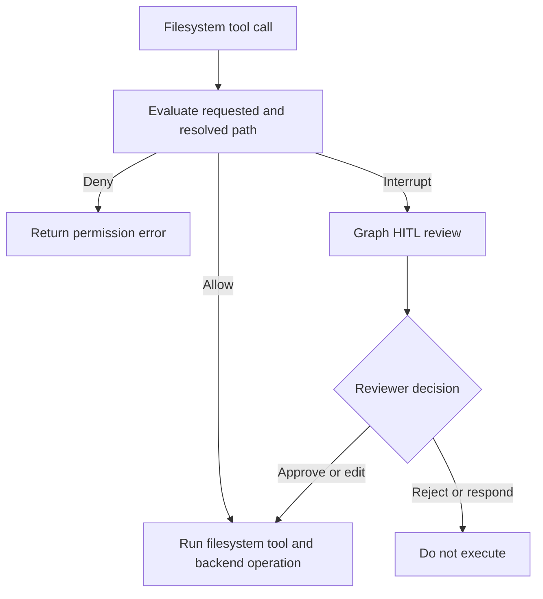
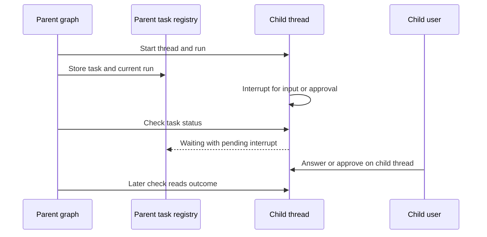

# Permissions and Human Approval

Deep Agents deliberately separates filesystem policy, graph-level human review, and the configuration of each graph that executes tools. A filesystem `interrupt` requests review; it is not a denial. A remote `AsyncSubAgent` is another Agent Protocol graph and thread, rather than a privileged continuation of its parent, so it owns its tools, permissions, and approval exchange.

See [Tool Surface and Filesystem Policy](/openwiki/concepts/tools-filesystem.md), [Subagents and Skills](/openwiki/concepts/subagents-skills.md), [Security](/openwiki/operations/security.md), [GitHub Action](/openwiki/integrations/github-action.md), and [Run a dcode Session](/openwiki/workflows/run-dcode-session.md).

## Filesystem permissions are middleware enforcement

`FilesystemPermission` contains absolute glob `paths`, `read` and/or `write` `operations`, and an `allow`, `deny`, or `interrupt` mode. Rules are evaluated in declaration order: the first matching rule wins, and no match allows the access. Patterns must begin with `/`; traversal (`..`) and home (`~`) components are rejected.

`FilesystemMiddleware` enforces `deny` in its built-in filesystem tools before a backend operation. It is not a general backend ACL: another direct backend caller does not acquire this check. On a `FilesystemBackend`, including one reached through a `CompositeBackend` route, it evaluates both the requested virtual path and its symlink-resolved target; denial of either blocks an operation. Listings and search results remove denied paths.

Recursive or potentially recursive deletion is deliberately stricter than an ordinary first-match lookup. If its target subtree could overlap a write-deny pattern, deletion is refused, so an allowed parent cannot remove a denied descendant. Filesystem permissions do not implement `execute` policy. An execution-capable backend therefore rejects such permissions unless every pattern is scoped to composite routes; this avoids implying that shell execution is protected.

*`deny` is enforced by the filesystem tool; `interrupt` selects review before that tool executes.*

## Interrupt rules generate path-sensitive HITL

`FilesystemMiddleware` does not pause a graph itself. During `create_deep_agent` assembly, interrupt-mode permissions become per-tool `HumanInTheLoopMiddleware` `interrupt_on` entries. They cover `ls`, `read_file`, `write_file`, `edit_file`, `delete`, `glob`, and `grep`, with `approve`, `edit`, `reject`, and `respond` available.

For exact-path tools, the predicate reviews only a matching requested path, plus its resolved target where a backend is available. A deny on either candidate wins over interrupt, returning a permission error rather than an approvable request. Bulk tools—listing, search, glob, and delete—conservatively pause when their reachable subtree can overlap an interrupt-rule anchor. Missing bulk paths and `.` mean the accessible root. `glob` also examines an absolute `pattern`, which can redirect the search independently of `path`; a relative pattern containing `..` is conservatively reviewed. Prefer literal leading anchors such as `/secrets/**`; `/**/secrets` has root anchor `/` and can review every bulk operation.

Caller-provided `interrupt_on` wins over a generated entry of the same name. That is an extension point, not a filesystem-denial bypass: approved and edited calls still enter filesystem middleware for pre-execution enforcement.

## Inheritance stops at graph boundaries

For declarative local `SubAgent` specifications, omitting `permissions` inherits parent rules, while an explicit value—including `[]`—replaces them. The same omitted-versus-explicit rule applies to top-level `interrupt_on`. Assembly installs the effective `FilesystemMiddleware` and merges derived filesystem routing with the effective map; an explicit routing entry wins on a name collision. The auto-added `general-purpose` local subagent also receives parent permissions and top-level routing.

This is construction-time inheritance, not ambient authorization. A `CompiledSubAgent` was already assembled and its owner must configure it. An `AsyncSubAgent` names another graph and must be configured independently. `mode="fork"` can copy conversation state and rebuild prompt middleware, but does not make a remote graph inherit filesystem policy or approval authority. Apply sensitive-tool controls to every executable graph.

## Remote async children retain human-request ownership

`AsyncSubAgentMiddleware` starts an independent remote Agent Protocol thread and run, returns immediately, and records task/thread state under parent `async_tasks`. If the child interrupts, its run can report success while the child thread reports `interrupted` with pending interrupts. `check_async_task` maps that condition to `waiting` and exposes it for observation.

The parent cannot answer, resume, or approve that request; the child user must respond on the child thread. Parent notification is not an approval bridge: `notify_parent` defaults to true for eligible same-deployment children, while `notify_parent=False` removes the parent assistant reference and remote-url children omit it. A paused child does not wake its parent because only the child user can resolve the pause.

*The task registry gives lifecycle visibility; the child thread retains authority to resolve its interrupt.*

`update_async_task` starts a new run on the same child thread. With its default `interrupt` strategy, and with beta `enqueue` once queued work starts, a pending human request can be dropped rather than answered. Cancelling a waiting task marks it cancelled without cancelling a paused run. Treat update and cancellation as lifecycle operations, never approval mechanisms.

## dcode interactive approval routing

The dcode client serializes resolved `ServerConfig` into `DEEPAGENTS_CODE_SERVER_*` variables for its separate graph-server process, whose assembler passes approval settings to `create_cli_agent`. With `auto_approve=False`, dcode installs approve-or-reject routing for shell execution, file write/edit/delete, web search, URL fetch, local and async subagent lifecycle tools, and MCP tools that are not coherently read-only. `auto_approve=True` omits these HITL routes for all tools; it is an unrestricted mode, not a filesystem permission setting.

Interactive approval mode is thread-scoped: `manual`, `auto`, and `yolo`. The live mode is loaded from a Store record using a key validated against the active thread. Unexpected context, malformed or mismatched key, unavailable Store, missing or invalid record, and synchronous access where an async Store is required fail closed to `manual`. `yolo` bypasses stock HITL. `auto` bypasses it only in graphs eligible for classifier-backed Auto; sandboxed or otherwise ineligible graphs treat Auto as Manual.

`AsyncApprovalHITLMiddleware` reads that live mode after model completion, then passes a private process-local routing marker to stock HITL. The marker is neither checkpointed nor trusted after serialization, so graph input cannot forge autonomous approval. Local dcode subagents receive this middleware and explicitly set `interrupt_on={}` to suppress the SDK's inherited synchronous HITL layer. One assembled CLI graph therefore has one approval-routing owner; a separately deployed async child retains its own policy.

`interrupt_shell_only` is valid only with a restrictive shell allow-list. In that case dcode removes ordinary HITL and installs `ShellAllowListMiddleware`; without a restrictive list it falls back to standard HITL. The JavaScript interpreter is a distinct boundary: PTC host-tool calls bypass `interrupt_on`, so its PTC allow-list is the effective control. The `safe` preset permits only `read_file`, `glob`, and `grep`; broader host-tool access requires an explicit list, or `interpreter_ptc="all"` plus unsafe acknowledgement when not auto-approved.

## dcode headless shell control and approval hooks

Non-interactive `dcode` creates a one-shot graph-server session with `interactive=False` and no `ask_user` tool. Its shell policy is determined by `--shell-allow-list`:

- no list disables shell and requests global auto-approval for other tools;
- `all` enables unrestricted shell and also requests global auto-approval;
- `recommended` or an explicit restrictive list enables shell but uses `interrupt_shell_only` with the concrete list. The server installs `ShellAllowListMiddleware`, so commands are validated inline while non-shell tools do not generate routine HITL pauses.

This is an operations trade-off, not a universal approval policy. In the fallback HITL path, the headless client automatically approves non-shell requests and approves `execute` only when `is_shell_command_allowed` accepts it; missing lists, unlisted commands, and dangerous shell constructs are rejected. It resumes each interrupt with collected decisions. A configured permission-request hook changes the arrangement: hooks need to see every gated call, so headless mode disables both the global auto-approve shortcut and `interrupt_shell_only`, lets the hook supply decisions where it can, and applies the client fallback for unresolved requests.

The resume loop counts the initial stream as turn one and each HITL continuation as another turn. `--max-turns` (or a default of 50) stops the loop before an over-budget resume, raising `HITLIterationLimitError`; the command reports this as exit code 124. Use a restrictive list and an explicit turn budget in CI, rather than assuming headless mode supplies a human review boundary.

## Talon has a separate persisted tool policy

Talon's `ToolApprovalStore` is separate from dcode live modes and filesystem path rules. It stores an exact-name boolean mapping in a bounded regular JSON file opened without following symlinks. Enabled names become approve-or-reject HITL entries; unspecified names are not prompted. Its default policy enables review for `update_tool_approvals`, `delete_conversations`, `update_mcp_server`, `start_async_task`, and `send_message`.

A read yields an immutable `ApprovalSnapshot` whose revision hashes policy bytes. Updates validate a complete boolean batch, use a lock and expected-revision compare-and-swap, and report conflict or error instead of overwriting another writer. The runtime binds a loaded snapshot for one invocation and rebuilds its graph only after persisted policy changes, so a saved change applies later rather than loosening the current invocation. The update tool also requires an active snapshot and operator context; cron and background-delivery turns are not operator contexts.

## Operating guidance and focused tests

- Use `deny` for operations that must never run and `interrupt` for a human decision on one graph call. Keep paths absolute and interrupt globs anchored.
- Install filesystem policy and HITL routing in every graph that can execute sensitive tools. Local declarative children inherit only omitted values; compiled and remote children require independent configuration.
- Do not use `update_async_task` or cancellation to answer a waiting child; direct the user to the child thread.
- Treat `--yolo` or `auto_approve=True` as deliberate removal of dcode HITL. In headless runs, no shell list or `all` also permits non-shell tools automatically; prefer a restrictive allow-list, understand that it controls shell commands only, and bound retries with `--max-turns`.
- Keep interpreter PTC on `safe` unless a broader host-tool list is intentionally reviewed.
- `test_permissions.py` covers rule order, validation, recursive-delete protection, generated exact and bulk predicates, symlink enforcement, conflicts, and general-purpose inheritance. dcode agent tests cover async Store reads and fail-closed modes; non-interactive tests cover allow-list decisions, hooks, resume rounds, and turn-budget exit behavior.
