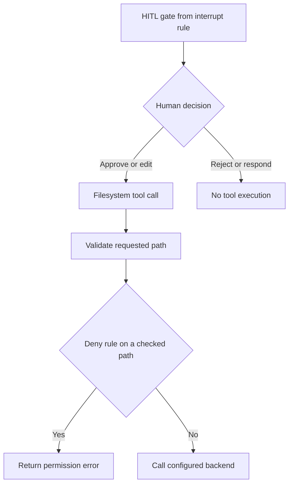
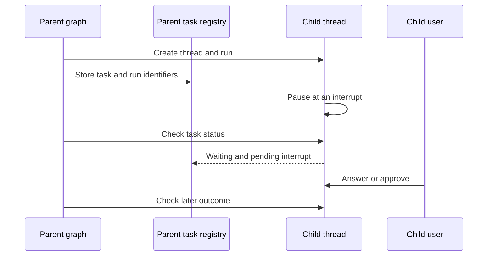

# Filesystem Permissions and Human Approval

Deep Agents separates **denial** from **approval gating**. A filesystem `deny` is enforced by the built-in filesystem tools before they call their backend. An `interrupt` rule does not deny access: at graph construction it becomes a path-sensitive `HumanInTheLoopMiddleware` gate, whose reviewer may approve, edit, reject, or respond without execution. Removing or bypassing a review layer therefore does not remove filesystem denial, and approving a call does not bypass its later deny check.

This page describes behavior of the configured Deep Agents graph, backend, and permission rules. In particular, resolved-path checking is enforcement behavior for `FilesystemBackend` and routed filesystem backends; it is not a security guarantee beyond the configured backend and rules. See [Tool Surface and Filesystem Policy](/openwiki/concepts/tools-filesystem.md), [SDK Construction and Execution](/openwiki/architecture/sdk-construction-execution.md), [Talon Channel Admission](/openwiki/concepts/talon-channel-admission.md), and [Security](/openwiki/operations/security.md).

## Filesystem rule model and enforcement boundary

A `FilesystemPermission` names `read` and/or `write` operations, absolute glob `paths`, and an `allow`, `deny`, or `interrupt` mode. Rules are ordered: the first matching rule decides, while an unmatched operation is allowed. Permission patterns must begin with `/`; patterns containing `..` are rejected, as are patterns containing `~`.

`FilesystemMiddleware` owns this policy for its own tools—`ls`, `read_file`, `write_file`, `edit_file`, `delete`, `glob`, and `grep`. Its tool wrappers validate a path and return a permission error before the backend operation on a deny. It also filters denied entries from result lists. This is tool-level middleware enforcement, not a universal ACL for arbitrary callers of the backend. `interrupt` paths are deliberately not filtered: by the time results are produced, the graph gate has either approved the call or prevented it.

*An `interrupt` gate runs before the filesystem tool; `deny` is rechecked by that tool before its backend operation.*

### Resolved paths and destructive operations

When the backend is a `FilesystemBackend`, directly or through a `CompositeBackend` route, permission evaluation resolves the requested path through symlinks and checks the resolved target as well. A deny on the requested path or target returns an error; failure to resolve returns an error rather than proceeding. The same logic is used when filtering filesystem result paths. A composite route is preserved when the routed filesystem path is resolved.

This prevents a configured deny rule from being bypassed through a symlink in that backend model, including for derived HITL predicates when a backend is supplied. It should be described narrowly as configured enforcement behavior—not as a broader guarantee against all filesystem, backend, deployment, or direct-access paths.

Deletion has an additional all-or-nothing guard. For a directory or target with descendants, `delete` refuses when a write-deny pattern could overlap its subtree, so an allowed ancestor cannot recursively remove denied descendants. This conservative overlap check is distinct from ordinary first-match lookup for an exact file.

Permissions do not implement an `execute` policy. Consequently, `FilesystemMiddleware` rejects nonempty permissions with an execution-capable backend unless all permission patterns are scoped to `CompositeBackend` routes. Route scoping lets rules apply to non-execution routes; it does not make command execution permission-controlled.

## How interrupt rules become review requests

`FilesystemMiddleware` itself enforces denial but does not pause the graph. `create_deep_agent` builds an `interrupt_on` mapping from `interrupt` permissions and adds `HumanInTheLoopMiddleware` when the resulting or caller-supplied map is nonempty. Generated entries cover read tools (`ls`, `read_file`, `glob`, `grep`) and write tools (`write_file`, `edit_file`, `delete`) according to each rule's operation. They offer `approve`, `edit`, `reject`, and `respond`.

The generated `when` predicates distinguish exact and bulk calls:

- Exact tools match the normalized requested path and, if a backend can resolve it, its target. If either candidate is denied, no approval request is created; the tool returns its denial error.
- Bulk tools (`ls`, `glob`, `grep`, and `delete`) review when the reachable subtree could overlap an interrupt rule's literal glob anchor. A missing path and current-directory aliases such as `.` are treated as the accessible root, so they cannot localize away a review.
- `glob` also inspects its `pattern`: an absolute pattern can search independently of `path`, and a relative pattern containing `..` is conservatively reviewed. An unanchored rule such as `/**/secrets` has `/` as its anchor and can therefore review all bulk calls.

Caller-provided `interrupt_on` entries overwrite generated entries with the same tool name. That is a routing extension point, not a way to make a denied operation approvable: an approved or edited call still enters the filesystem tool and its deny enforcement.

## Assembly, exclusion, and child graph boundaries

For declarative local `SubAgent` specifications, omitting `permissions` inherits the parent rules; an explicit value, including `[]`, replaces them. The same omitted-versus-explicit behavior applies to top-level `interrupt_on`, and each local child receives its own generated filesystem review map merged with that effective routing. The auto-added `general-purpose` subagent receives the parent permissions and routing too. A compiled subagent has already been assembled, and an `AsyncSubAgent` runs another graph, so their owners must configure permissions and approval independently.

Harness-profile exclusions are applied after stack assembly. `FilesystemMiddleware` and `SubAgentMiddleware` are required scaffolding and cannot be excluded, but `HumanInTheLoopMiddleware` is removable. Excluding the latter removes generated and caller-configured review for that graph without removing filesystem deny enforcement. Exclusions are validated: required entries, unmatched entries, and ambiguous string-name matches fail graph assembly.

## Async children: status visibility is not approval authority

An `AsyncSubAgent` launches a remote Agent Protocol thread and run, immediately stores task/thread/run state in the parent `async_tasks`, and uses `check_async_task` to observe it. A run paused at an interrupt reports `success`; the child thread carries the pending interrupt, and the task is reported as `waiting` with a note that the user must answer the child directly.

*The parent registry observes lifecycle state; the child thread owns interruption resolution.*

`update_async_task` creates a new run on the same child thread. The default `interrupt` strategy can replace a waiting run; queued (`enqueue`) work also drops a pending human request when it starts. `cancel_async_task` marks a waiting task cancelled without cancelling its paused child run. Neither update nor cancellation answers or approves a child request. Parent notification is likewise not an approval bridge: remote-url children and `notify_parent=False` omit the parent assistant reference used to wake a same-deployment parent.

## Talon persisted tool approval policy

Talon has a separate tool-name policy, not filesystem path rules. `ToolApprovalStore` loads an exact-name boolean mapping from a bounded regular JSON file opened without following symlinks. An immutable `ApprovalSnapshot` produces approve-or-reject HITL entries only for enabled names; tools absent from the mapping are not prompted. The default enabled names are `update_tool_approvals`, `delete_conversations`, `update_mcp_server`, `start_async_task`, and `send_message`.

Policy writes validate entries and use a lock plus an expected byte-revision compare-and-swap. A runtime reads a snapshot for an invocation, rebuilds its graph when the persisted snapshot has changed, and binds that snapshot in a context variable for the turn. Thus a successful update is available on a later invocation, not a way to loosen the graph currently executing. The `update_tool_approvals` tool additionally requires both an active snapshot and an operator context; cron and background-delivery turns are explicitly not operator contexts.

## Operating guidance and focused verification

- Use `deny` for an operation that must not execute through built-in filesystem tools; use `interrupt` where a human decision is desired for one graph call. Do not model an interrupt as a durable denial.
- Keep permission patterns absolute and bulk interrupt patterns literally anchored. Test `glob` with both `path` and absolute `pattern`, plus pathless and `.` cases.
- Configure every executable graph. Omitted values inherit only for declarative local subagents; compiled and remote async children are independent policy boundaries.
- Do not try to resolve a waiting async child through its parent task tools. Direct the user to the child thread.
- Treat removal of `HumanInTheLoopMiddleware`, or disabling a Talon enabled name, as a deliberate loss of approval gating. It does not alter a filesystem `deny` rule.
- `test_permissions.py` covers rule order and validation, recursive-delete overlap, exact and bulk interrupt predicates, execution-capable backend rejection, symlink-resolved enforcement, and resolved-path HITL behavior.
