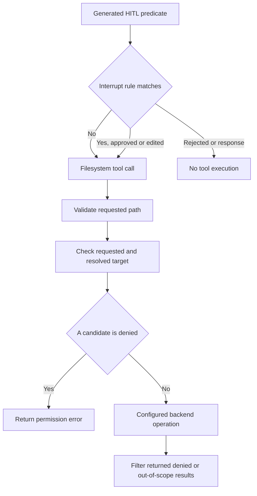

# Permissions and Human Approval

Deep Agents deliberately separates **denial**, **review**, and **backend authority**. `FilesystemMiddleware` applies configured filesystem policy to its built-in tools. A `deny` stops that tool call before the backend operation; an `interrupt` is compiled into a `HumanInTheLoopMiddleware` predicate that pauses the graph for a human decision. The backend remains the component that actually reads, writes, searches, or executes. Consequently, filesystem permissions are not a universal ACL for direct backend callers or unrelated tools, and approving a call does not override a later deny check.

For filesystem-backed routes, both the requested virtual path and its symlink-resolved target matter. This prevents a configured rule from being bypassed via an alias, but it is not a replacement for backend containment, operating-system permissions, or deployment isolation. See [Backends](/openwiki/concepts/backends.md), [Tool Surface and Filesystem Policy](/openwiki/concepts/tools-filesystem.md), [SDK Construction and Execution](/openwiki/architecture/sdk-construction-execution.md), and [Security](/openwiki/operations/security.md).

## Rule model and enforcement boundary

A `FilesystemPermission` specifies `read` and/or `write`, absolute glob `paths`, and an `allow`, `deny`, or `interrupt` `mode`. Rules are evaluated in declaration order: the first matching rule wins, and an unmatched access is allowed. Patterns must start with `/`; `..` is invalid and `~` is unsupported.

The middleware applies the policy to its filesystem tools: `ls`, `read_file`, `write_file`, `edit_file`, `delete`, `glob`, and `grep`. It validates the tool path, performs the denial check, then calls the configured backend only if allowed. It also post-filters backend listings, glob matches, and grep matches so a denied result is not disclosed. `execute` is not an operation covered by this permission model. When an execution-capable backend is used, nonempty permissions are rejected unless every pattern is scoped to a `CompositeBackend` route; that route restriction does not add execute control.

*Review happens before the tool. The tool's denial check runs again before the backend call; review never grants backend authority.*

### Resolved targets and recursive deletion

For a `FilesystemBackend`, including one selected through a `CompositeBackend` route, permission code resolves a requested path through symlinks and evaluates the resulting target as well. A deny on either candidate stops the call. A resolution failure is also an error rather than permission to proceed. Composite routing preserves the route prefix when reconstructing the resolved virtual path. `FilesystemBackend` itself enforces its virtual-root containment when `virtual_mode=True`; with `virtual_mode=False`, absolute paths and traversal can escape its configured root, so use it only for trusted local workflows.

`delete` has an additional conservative guard. If a target may have descendants, it refuses deletion whenever a write-deny glob can overlap the target subtree, including a denied ancestor or descendant. This is intentionally stricter than an ordinary exact-path, first-match decision and avoids recursively removing protected children.

## Interrupt rules and bulk operations

At graph assembly, `create_deep_agent` turns interrupt-mode filesystem rules into per-tool `HumanInTheLoopMiddleware` entries. Read rules register `ls`, `read_file`, `glob`, and `grep`; write rules register `write_file`, `edit_file`, and `delete`. Generated entries allow `approve`, `edit`, `reject`, and `respond`. Caller-provided `interrupt_on` entries can replace a generated entry for the same tool, but cannot make a denied backend operation executable.

Exact-path predicates normalize the supplied path and, when a backend is available, also consider its resolved target. They request review only when an interrupt decision is present and no candidate is denied. Thus a deny wins over an interrupt even where the requested alias and target match different rules.

Bulk tools are necessarily conservative. `ls`, `glob`, `grep`, and `delete` pause if their reachable subtree could overlap an interrupt rule's literal glob anchor. A missing bulk path and current-directory aliases such as `.`, `./`, and `/.` are treated as the accessible root. `glob` also examines its pattern: an absolute pattern has its own search root, while a relative pattern containing `..` cannot be localized and is reviewed. An unanchored rule such as `/**/secrets` anchors at `/`, so it can review every relevant bulk call.

Bulk result filtering preserves the boundary established by that review. Denied results are always removed. Interrupt-mode results reached within the roots covered by the current bulk call remain available after the human approved the call. However, if a backend search returns a path or resolved target that needs interrupt approval **outside** those roots—such as an alias discovered below an otherwise unreviewed search root—the middleware drops it rather than leaking content that was not covered by the interrupt. This filtering is a result-disclosure safeguard; it does not retroactively approve or deny the backend's search operation.

## Graph composition and child boundaries

Declarative local `SubAgent` specifications inherit parent `permissions` and top-level `interrupt_on` only when those fields are omitted. An explicit value, including `[]` or an empty mapping, replaces the inherited value. The automatically added general-purpose subagent gets the parent-effective settings as well. Compiled subagents and remote `AsyncSubAgent` graphs are separately assembled policy boundaries and must be configured independently.

Harness-profile exclusions run after stack assembly. `FilesystemMiddleware` and `SubAgentMiddleware` are protected scaffolding, whereas `HumanInTheLoopMiddleware` can be excluded. Removing HITL removes generated and caller-configured review in that graph, but does not remove filesystem deny checks inside the filesystem tools. Invalid, unmatched, ambiguous, or protected exclusions fail graph assembly.

## CLI and headless approval handling

Deep Agents Code has an additional graph-level approval layer for its gated tools. Its approval mode is resolved from trusted run context and, for typed autonomous modes, a validated per-thread Store key. Missing, malformed, mismatched, or unreadable live-mode data fails closed to manual approval. The async HITL middleware reads that mode after the model response and passes its decision through a transient, process-local marker rather than checkpointed graph state, so serialized state cannot forge autonomous routing.

In headless non-interactive execution, the client records validated HITL requests by interrupt ID, builds decisions, and resumes the graph with `Command(resume=...)`. Malformed approval payloads are rejected. The resume loop is bounded (50 turns by default, or `--max-turns`) to prevent repeated rejected calls from running indefinitely. By default, non-interactive operation auto-approves when shell use is disabled or unrestricted; with a restrictive shell allow-list it gates shell execution, and permission hooks can force calls through the client approval path.

## Async children: visibility is not approval authority

An `AsyncSubAgent` starts an independent remote Agent Protocol thread and run while recording task/thread/run information in the parent task registry. An interrupted child is surfaced as a waiting task, but the pending request belongs to the child thread: the user must answer it there and the parent cannot approve it. Updating creates a new child run under the configured interrupt or enqueue strategy; either can drop a pending child human request rather than answer it. Cancelling a waiting task marks the registry task cancelled without cancelling the paused child run.

## Talon persisted tool approval policy

Talon's tool approval policy is distinct from filesystem paths. It stores an exact-name boolean map in a bounded regular JSON file opened without following symlinks. Enabled names become approve-or-reject HITL entries; omitted names are not prompted. Updates use a locked byte-revision compare-and-swap. A runtime binds an immutable loaded snapshot for one invocation and rebuilds its graph when persisted policy changes, so an update takes effect on a later invocation rather than loosening the current graph.

The `update_tool_approvals` tool may persist changes only when both an active approval snapshot and an operator context are present. Cron and background-delivery turns are not operator contexts.

## Operational guidance and tests

- Use `deny` for actions that must not pass through the built-in filesystem tools. Use `interrupt` for per-call review, not as a durable access-control boundary.
- Treat `FilesystemBackend` configuration as security-critical. Prefer a sandboxed or state/store backend in service deployments; `virtual_mode` is path containment, not process isolation.
- Test aliases as well as their targets. For bulk tools, cover pathless calls, `.` aliases, absolute glob patterns, traversal-bearing relative patterns, and results which escape the initially reviewed search scope.
- Configure each executable graph. Only declarative local subagents inherit omitted policy fields; remote and compiled children do not.
- Do not try to resolve an async child's pending approval from its parent task tools; direct the user to the child thread.
- Focused permission tests cover ordered matching, resolved-target denies and interrupt routing, composite routes, recursive delete overlap, bulk predicate bypass cases, and removal of results that need review outside the covered bulk scope.
