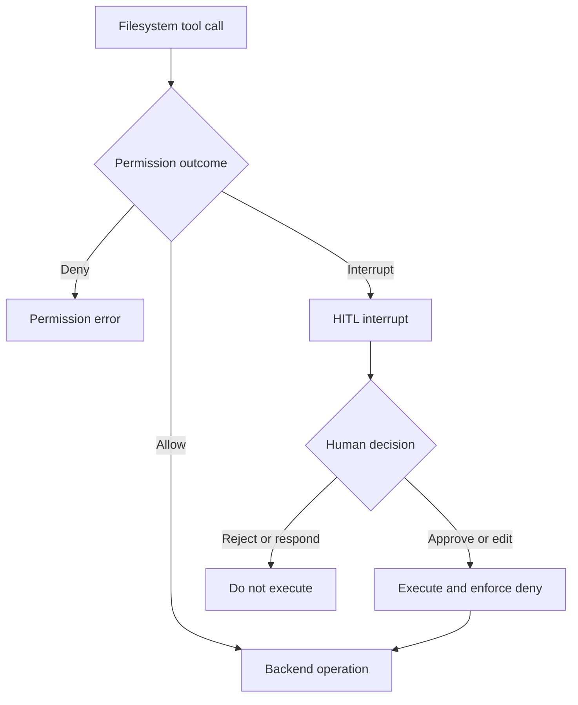
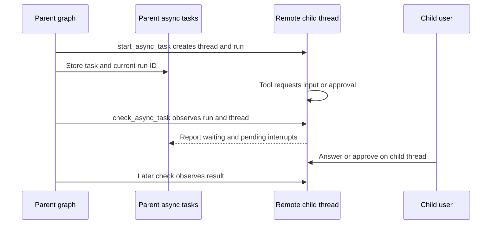

# Permissions and Human-in-the-Loop

Deep Agents separates filesystem enforcement, graph-level human review, and each remote child's configuration. A filesystem rule governs built-in filesystem tools in the graph where it is installed. An `interrupt` rule routes a matching call to `HumanInTheLoopMiddleware`; it is not a denial. An `AsyncSubAgent` runs in another Agent Protocol thread and graph, so its tools, permissions, and approval workflow belong to that child. See [Tool Surface and Filesystem Policy](/openwiki/concepts/tools-filesystem.md), [Subagents, Skills, and Delegation](/openwiki/concepts/subagents-skills.md), and [Security](/openwiki/operations/security.md).

## Filesystem policy is tool-middleware policy

`FilesystemPermission` contains absolute glob `paths`, the `read` and/or `write` `operations` to which it applies, and an `allow`, `deny`, or `interrupt` mode. Rules are considered in declaration order: the first matching rule wins, while an unmatched access is allowed. Permission patterns must begin with `/`, cannot contain `..`, and do not support `~`.

`FilesystemMiddleware` applies `deny` in its built-in filesystem tool implementations before they reach the backend. With a `FilesystemBackend`, directly or behind a `CompositeBackend` route, it evaluates both the requested path and its symlink-resolved target. A denial of either blocks the operation. Listings, searches, and glob results also filter denied paths. This is not a universal backend ACL: direct backend callers do not acquire these middleware checks.

A recursive or potentially recursive `delete` is stricter than a simple first-match result. If its subtree could overlap a deny-write pattern, deletion is refused so an allowed parent cannot remove a denied descendant. Permissions do not presently constrain `execute`; `FilesystemMiddleware` rejects permissions on an execution-capable backend unless every pattern is scoped to composite routes, rather than imply shell execution is protected.

*An interrupt selects a graph review; an approved call still executes through the filesystem middleware.*

## `interrupt` generates path-sensitive HITL routing

`FilesystemMiddleware` enforces denials and filters denied results; it does not itself pause a graph. During `create_deep_agent` assembly, interrupt-mode permissions are converted into `HumanInTheLoopMiddleware` `interrupt_on` entries. Generated entries cover `ls`, `read_file`, `write_file`, `edit_file`, `delete`, `glob`, and `grep`, with `approve`, `edit`, `reject`, and `respond` available to the reviewer.

For exact-path tools, the generated `when` predicate interrupts only when the validated requested path—or, if a backend is available, its resolved target—has an interrupt outcome. Deny wins over interrupt, so a denied call returns its permission error rather than asking a human to approve it. For bulk tools, the predicate deliberately over-approximates: it interrupts when the search or deletion subtree can overlap an interrupt pattern. A missing bulk path can reach any protected location; `.` is treated as the accessible root. `glob` also checks an absolute `pattern`, which can redirect search independently of `path`; a relative pattern containing `..` is unlocalizable and is reviewed. Prefer literal leading anchors such as `/secrets/**`: an unanchored `/**/secrets` collapses to `/` for this overlap test and can review every bulk call.

Caller-supplied `interrupt_on` wins over a generated entry with the same tool name. This is an extension point for application-specific review routing, but it does not bypass filesystem denial enforcement. Approval is neither a sandbox nor a durable authorization grant: it only determines the interrupted graph call.

## Local child inheritance is explicit; remote children are independent

A declarative local `SubAgent` with no `permissions` key inherits the parent list. A supplied list, including `[]`, replaces it. The factory installs a `FilesystemMiddleware` with the resulting list and merges its generated interruption entries with the effective `interrupt_on`; a user entry wins on a tool-name collision. The automatically added `general-purpose` local subagent likewise receives the parent's permissions and top-level interrupt routing.

A `CompiledSubAgent` is already assembled by its caller, and an `AsyncSubAgent` identifies another graph. Neither inherits the parent's filesystem permissions or top-level `interrupt_on`. Put filesystem middleware and HITL configuration in each graph that can execute the sensitive tool. `mode="fork"` copies a snapshot of the parent's conversation at launch, but the child still uses its own system prompt and tools: shared context is not shared authorization.

## Remote async children retain approval ownership

`AsyncSubAgentMiddleware` exposes `start_async_task`, `check_async_task`, `update_async_task`, `cancel_async_task`, and `list_async_tasks`. Starting creates an Agent Protocol thread and run, returns immediately, and stores an `AsyncTask` in parent state under `async_tasks`. The child thread ID is also the task ID; the record tracks its current run ID, status, and observation times.

A run that reaches `interrupt()` normally reports run status `success`; the child thread's `interrupted` state and pending interrupts reveal that it is actually waiting. `check_async_task` maps this to task status `waiting` and returns the pending interrupt IDs and values. This is intentionally observational: the child is waiting for **its user** on its own thread. The parent can inspect the request and continue work, but cannot resume, answer, or approve the child interruption.

*The parent task record provides lifecycle observability, while the child thread retains the authority to resolve its interruption.*

`update_async_task` creates another run on the same child thread. Its default `update_strategy="interrupt"` replaces active work; if the task was waiting, the outstanding human request is dropped, not answered. The beta `update_strategy="enqueue"` queues behind active work, but a queued follow-up still starts if that work pauses for a person, also dropping the request. `cancel_async_task` marks a waiting task cancelled without attempting to cancel a paused run. Use updates and cancellation as lifecycle controls, never as approval responses.

## Parent notification is optional and does not bridge approval domains

`notify_parent` defaults to `True`. For a child on the same deployment, launch metadata can retain the parent assistant and thread, allowing `_ParentNotifierMiddleware` to wake an idle parent with an outcome. A busy parent discovers updates in its pull cycle. A parent thread waiting for human input is deliberately not awakened: starting a run there could cancel the parent's own approval. A child pause similarly does not wake the parent; the parent later observes `waiting`, then can observe a result after the child user resumes it.

Set `notify_parent=False` when application delivery—for example a `webhook`—owns outcomes. The launch still records the parent thread as provenance but removes the parent assistant reference, preventing the launched child and later runs on that child thread from waking the parent. A child with a remote `url` also omits that assistant reference because it cannot wake a parent in another deployment. Notifications are convenience and observability, not delegation of approval authority.

## Talon persists an exact-name approval policy per invocation

The Talon integration adds a separate, tool-name-based review policy. `ToolApprovalStore` reads a bounded regular JSON file without following symlinks and turns enabled exact tool names into `interrupt_on` entries with only `approve` and `reject`. Its default policy enables review for `update_tool_approvals`, `delete_conversations`, `update_mcp_server`, `start_async_task`, and `send_message`; unspecified names are not prompted. This exact-name policy is separate from path-sensitive filesystem rules and can coexist with them.

Each policy read becomes an immutable `ApprovalSnapshot`, identified by a hash of the policy bytes. Updates validate an entire boolean mapping and use a locked compare-and-swap against the expected revision; conflicts, invalid documents, and write failures do not silently replace the policy. A Talon runtime reads the snapshot at invocation start, rebuilds its graph if it changed, and binds it in `ACTIVE_APPROVALS`. Saved changes therefore apply to the next invocation, not midway through the current one. The `update_tool_approvals` tool also requires both an active invocation and an operator context; cron and background-delivery requests are not operators.

## Operations and focused tests

- Apply enforcement to every graph that can execute a sensitive action. An async child remains an independently configured approval domain even when it receives forked history.
- Use `deny` for actions that must never run and `interrupt` only where a reviewer should decide a call. Keep paths absolute and interrupt patterns anchored where possible.
- Do not use `update_async_task` to answer a waiting child; send the user to the child thread. An update can discard the pending request.
- When application delivery owns completion, set `notify_parent=False`; `webhook` alone does not suppress parent wake-up.
- For Talon policy changes, retain and present the revision returned by `get_tool_approvals`; handle compare-and-swap conflicts by reading again. Treat a policy save as next-invocation configuration, not a way to loosen the current invocation.
- `test_permissions.py` covers first-match behavior, recursive deletion protection, symlink-target enforcement, generated predicates, and local subagent inheritance. Async-subagent tests cover task observation, child waiting questions and approvals, updates that drop waiting requests, notification suppression, and paused children not waking parents. Talon's approval tests cover malformed and symlink policy files, atomic revisions, operator gating, and approval before `send_message` delivery.
