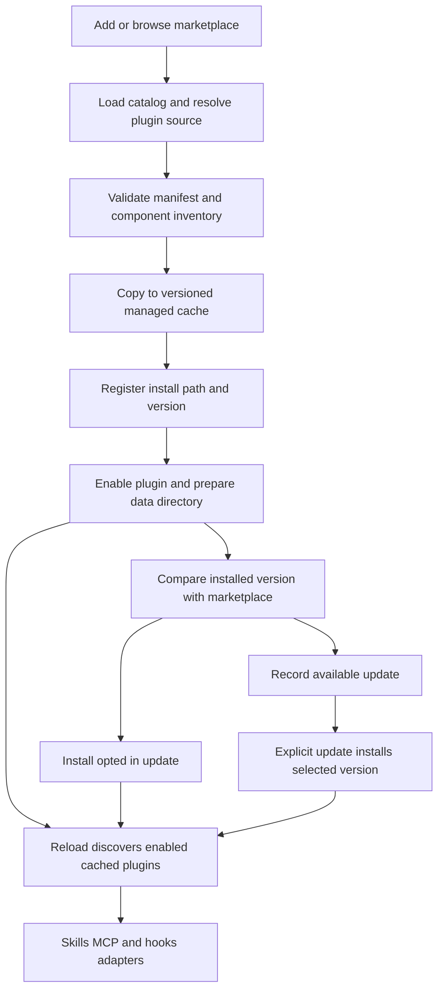

# dcode Plugin Marketplaces and Lifecycle

A dcode plugin is an installed extension whose canonical ID is `{name}@{marketplace}`. A marketplace is a catalog and source resolver, not the runtime location: dcode resolves an entry, validates it, and copies it into a managed cache before enabling and discovering it. Consequently, an installed plugin remains tied to its cached version even when a source directory or repository changes. Plugins contribute **skills**, **MCP configuration**, and **Hooks v2** documents; `agents/` and `commands/` directories are recognized as unsupported rather than loaded. See [Subagents, Skills, and Delegation](/openwiki/concepts/subagents-skills.md) and [MCP Integration](/openwiki/integrations/mcp.md).

## Lifecycle at a glance

*The catalog, cached installation, enablement, update decision, and runtime reload are separate stages.*

## Marketplace discovery and source boundaries

The `dcode plugin` command (also `dcode plugins`) provides marketplace `list`, `add`, and `remove`, plus plugin `list`, `install`, `reinstall`, `update`, `enable`, `disable`, and `uninstall`. Add a source with `dcode plugin marketplace add <source>`.

A default `langchain-plugins` marketplace points at `langchain-ai/langchain-plugins`. It is an implicit record until explicitly removed or overridden: startup and enabled-plugin discovery do not fetch it or create state. Browsing a missing default catalog fetches it on demand; offline browsing reports that it is not cached, and a concurrent mutation causes a retryable busy error rather than waiting. Removing the default persists the opt-out, while saving a record with the same name overrides the default.

A supplied marketplace source can be:

- a local directory or `.json` file;
- GitHub shorthand such as `owner/repo`, optionally with `@ref` or `#ref`;
- an SSH or HTTPS Git repository, optionally with a ref; or
- an HTTPS URL that returns a marketplace JSON document.

Plain HTTP is rejected. Git uses a noninteractive, shallow clone with shallow submodules; managed repository and URL catalog caches use opaque hashes so cache paths do not disclose credentials. URL downloads and redirects must remain HTTPS, and credentials and sensitive URL query or path values are redacted in user-facing source/error text. Remote-cache replacement is staged and validated before it replaces the previous cache.

A directory catalog is searched at `.claude-plugin/marketplace.json`, `.agents/plugins/marketplace.json`, then `.agents/plugins/api_marketplace.json`. Its JSON object needs a whitespace-free `name` without `@` and a `plugins` array. A malformed catalog fails to load; malformed individual entries instead become warnings and are skipped. Entries may name a marketplace-relative local source (with optional `metadata.pluginRoot`) or use `github`, `git-subdir`, or `url` repository source objects with optional ref and subdirectory path.

Every marketplace-relative and plugin-relative path is containment-checked. Absolute paths, `..`, Windows absolute forms, and paths that resolve outside their root—including through symlinks—are rejected. A direct catalog URL caches only that JSON file, so it rejects local relative entries and unsupported remote entry forms that need an unavailable sibling source tree.

## Plugin manifests and inventory

A plugin can use `plugin.json`, `.claude-plugin/plugin.json`, or `.codex-plugin/plugin.json`, in that precedence order. A missing manifest is allowed when the marketplace entry supplies the fallback name, but that plugin is unversioned. If present, the manifest must be a JSON object with a valid nonempty, whitespace-free name.

The manifest supports `version`, `displayName`, `skills`, `mcpServers`, and `hooks`. Path-valued component declarations may be one string or a list, must start with `./`, and resolve inside the plugin root. MCP and hook declarations can instead be inline objects. The inventory additionally considers conventional `skills/`, a root `SKILL.md` when no skills directory/path takes precedence, `.mcp.json`, and `hooks/hooks.json`. Missing, unreadable, or out-of-root component declarations are omitted with warnings.

`extensions.com.langchain.deepagents.code.autoUpdate: true` is a per-plugin automatic-update opt-in. Experimental `pythonExtensions` names existing, in-root `.py` files only when experimental mode is enabled and the plugin declares a nonempty version. The inventory reports, but does not execute, `agents/` and `commands/`.

## State, installation, enablement, and reload

The durable records separate concerns:

| Location | Responsibility |
| --- | --- |
| `plugin_marketplaces.json` | Marketplace source type, source, materialized location, and optional ref. |
| `installed_plugins.json` | Registered cache path and manifest version per plugin ID. |
| `plugin_state.json` | Enabled plugin IDs. |
| `plugin_updates.json` | Available but not installed versions, for notification deduplication. |
| Plugin storage `cache/` | Managed copies at `cache/{marketplace}/{plugin}/{version}`. |
| Plugin storage `data/` | Separate writable directory for each plugin ID. |

Plugin storage defaults beneath the dcode configuration directory and can be relocated using `DEEPAGENTS_CODE_PLUGIN_CACHE_DIR`; state files live under dcode's state directory. Cache and data path segments are sanitized and hash-suffixed. The data directory is created on enablement and also lazily by MCP or hook loading when required.

Installation resolves the marketplace entry, validates its manifest and inventory, copies the source to the versioned cache (removing an included `.git` directory), records that cache path/version, enables the ID, and ensures its data directory. Enabling an unknown installation fails; disabling preserves the cache. Uninstall disables the plugin, removes its install record, and removes its registered cache. Marketplace removal uninstalls associated installed or enabled plugins, deletes managed remote marketplace cache locations, and never deletes a local marketplace source.

Reinstall is a repair operation: it always refreshes the cache, but preserves the enabled state and plugin data directory. Any install, reinstall, update, enablement, or disablement changes subsequent discovery, not an already assembled runtime. The install, reinstall, and successful update CLI responses explicitly instruct the operator to run `/reload` before changed components are applied.

## Runtime integration

Reload-time discovery reads only enabled IDs and their registered cache roots. It parses each manifest and builds an inventory independently, allowing healthy plugins to load when a sibling is invalid or missing. Skills are inserted after built-in sources and before user/project sources. Plugin skill names are lowercased and qualified by the full plugin ID, with nested skill directories adding `:` segments; this prevents collisions between plugins.

Plugin MCP configuration is loaded from inventory files first and inline `mcpServers` second, so inline definitions win name conflicts. Each declared server gets a safe, plugin-scoped name of the form `plugin__...__...`. Values can substitute plugin root, plugin data, and project directory; relative MCP `cwd` is made relative to the plugin root and plugin environment values are supplied. Hooks likewise combine discovered file documents and inline manifest hooks, retaining plugin identity and substitution environment and producing diagnostics through the hook loader.

A missing registered cache directory becomes a `BrokenPluginInstall`, rather than a generic discovery failure. The user-facing repair message does not reveal the path; the path remains in debug diagnostics. Discovery consumers for skills, MCP, hooks, and plugin management can run independently, so broken-install notices are claimed once per process. A successful reinstall releases that claim. MCP and hook adapters also isolate plugin-specific failures so one plugin cannot suppress other plugin configuration.

## Updates and operator control

`plugins.auto_update` defaults to true and can be set through `[plugins].auto_update` or `DEEPAGENTS_CODE_PLUGIN_AUTO_UPDATE`. It enables the automatic check; it does not mean every plugin installs automatically. The check returns without work when offline, globally disabled, or unable to acquire the mutation lock. It refreshes remote marketplaces and considers enabled, installed plugins with a recorded version. Unversioned plugins are skipped so a shared runtime cache is not replaced during a session.

When the marketplace manifest has a different version, only a manifest opting into `autoUpdate` is installed automatically. Other updates are persisted as available. The persisted value suppresses repeat notifications, and a failed refresh/comparison retains a prior availability record so recovery does not re-announce it. `dcode plugin update [plugin_id ...]` targets specified installed IDs or all installed IDs when omitted, includes local marketplaces, and installs updates unless `--check` is used. A successful explicit update clears its availability record and requires `/reload` to take effect.

## Consistency and operational expectations

Mutating lifecycle operations are serialized by a reentrant cross-process file lock. JSON state is written to a same-directory temporary file and atomically replaced. Plugin copies and repository clones are built in temporary directories and swap with backup/rollback handling; the install record is written only after cache replacement succeeds. Strict mutation reads reject unreadable, malformed, wrongly shaped, or unsupported-version state rather than overwriting it. Non-strict discovery reads warn and fall back to empty data.

Focused tests cover the contracts that matter operationally: default-marketplace registration stays offline until browse, default removal persists, and lock contention does not stall browsing; failed cache replacement preserves the old installation, registry, and enablement; update checks distinguish notification-only updates from manifest-opted automatic installs; and missing cached files leave healthy siblings usable while reinstall preserves enablement and plugin data. Tests also exercise containment against external/symlinked component paths and credential redaction.
