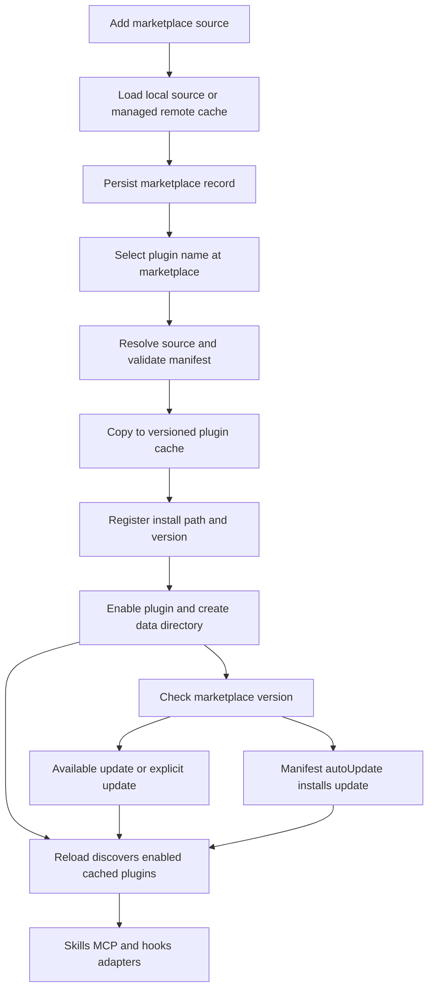

# dcode Plugin Marketplaces and Lifecycle

A dcode plugin is an installed, enabled extension identified as `{plugin-name}@{marketplace-name}`. A marketplace is only a catalog and source resolver; dcode copies each installed plugin to a managed cache and discovers runtime components from that cache. This separation makes an installed version stable even when a local marketplace or remote repository changes. Plugins currently contribute **skills**, **MCP configuration**, and **Hooks v2** documents. `agents/` and `commands/` directories are recognized as unsupported rather than loaded. See [Subagents, Skills, and Delegation](/openwiki/concepts/subagents-skills.md) and [MCP Integration](/openwiki/integrations/mcp.md).

## Lifecycle at a glance

*Marketplace selection, managed cache installation, enablement, and subsequent reload are distinct lifecycle stages.*

## Marketplace sources and catalog format

Use `dcode plugin marketplace add <source>` (or its `plugins` alias) to register a catalog; the CLI also exposes marketplace listing/removal and plugin `list`, `install`, `reinstall`, `update`, `enable`, `disable`, and `uninstall` operations. A source may be a local directory, a local `.json` file, GitHub shorthand (`owner/repo` with optional `@ref`/`#ref`), an SSH or HTTPS Git URL, or an HTTPS URL to a marketplace JSON document. Plain HTTP is rejected. Git source refreshes use shallow clone with submodules and no interactive credential prompt; URL downloads and redirects must remain HTTPS. URLs displayed in CLI output and errors redact embedded credentials and sensitive query or path values.

A directory marketplace searches, in order, `.claude-plugin/marketplace.json`, `.agents/plugins/marketplace.json`, and `.agents/plugins/api_marketplace.json`. Its document must be a JSON object with a whitespace-free marketplace `name` (which cannot contain `@`) and a `plugins` array. Bad individual entries are skipped with warnings, while a missing or structurally invalid catalog fails the marketplace load. Each entry has a validated `name`, optional display metadata, and a source:

- A string or `{ "source": "local", "path": "..." }` is a marketplace-relative local plugin path. `metadata.pluginRoot` can set the base directory.
- `{ "source": "github", "repo": "owner/repo", "ref": "...", "path": "..." }`, `{ "source": "git-subdir", "url": "...", ... }`, and `{ "source": "url", "url": "...", ... }` materialize a Git repository; `path` selects a subdirectory.

Repository materialization uses an opaque hash cache key, so a cache name does not reveal source credentials, and replacement clones are validated before replacing the prior cache. Direct marketplace JSON URLs cache only the catalog: they are rejected if entries require local relative files (or unsupported remote entry forms), because no sibling source tree is available. Local and marketplace-relative paths are containment-checked: absolute paths, `..`, Windows absolute forms, and symlink-resolved escapes are rejected.

## Plugin manifest and compatible components

dcode accepts `plugin.json`, `.claude-plugin/plugin.json`, and `.codex-plugin/plugin.json`, in that order. No manifest is also permitted: the marketplace entry supplies the fallback name, but such an install is unversioned. A present manifest must be a JSON object with a nonempty, whitespace-free name; otherwise it prevents installation or causes that discovered plugin to be skipped.

The manifest may provide `version`, `displayName`, `skills`, `mcpServers`, and `hooks`. Component path fields accept a string or strings and must begin with `./`; they are resolved inside the plugin root. `mcpServers` and `hooks` can instead be inline objects. The component inventory also discovers conventional `skills/` (or root `SKILL.md` when no skills directory/path is selected), `.mcp.json`, and `hooks/hooks.json`. Missing, unreadable, or out-of-root declared components are omitted with warnings rather than escaping the plugin boundary.

The dcode extension namespace is `extensions.com.langchain.deepagents.code`. Its `autoUpdate: true` is a per-plugin opt-in. Experimental `pythonExtensions` can name existing in-root `.py` files, but only when experimental mode is enabled and the plugin declares a nonempty version. The inventory reports `agents/` and `commands/` as unsupported; it does not execute or expose them.

## Installed state, enablement, and reload

The persistent state has complementary responsibilities:

| State | Meaning |
| --- | --- |
| `plugin_marketplaces.json` | Catalog source type, original source, materialized location, and optional Git ref, keyed by marketplace name. |
| `installed_plugins.json` | The current install path and manifest version for each plugin ID. |
| `plugin_state.json` | The set of enabled plugin IDs. |
| `plugin_updates.json` | Non-installed available versions, used to avoid repeating update notifications. |
| Plugin storage `cache/` | Managed copies at `cache/{marketplace}/{plugin}/{version}` using sanitized, hash-suffixed filesystem names. |
| Plugin storage `data/` | A separate writable directory per plugin ID; it is created when enablement or a component needing it requires it. |

Plugin storage defaults beneath dcode's configuration directory and can be relocated with `DEEPAGENTS_CODE_PLUGIN_CACHE_DIR`; persistent records live under dcode's state directory. `install_plugin()` validates and copies the resolved source, strips an included `.git` directory, registers the copy and version, enables it, and creates its data directory. Enablement is deliberately separate from installation: enabling an unknown install fails, disabling preserves the installed copy, and uninstalling disables the plugin, removes its record, and removes its registered cache directory. Removing a marketplace uninstalls all its installed or enabled plugins; it deletes only managed remote marketplace cache locations, never a local source directory.

An install, reinstall, update, enable, or disable changes future discovery. It does not retrofit the already assembled runtime: the install/reinstall and update CLI responses tell the user to run `/reload` to activate the change. A reload discovers only enabled IDs, loads their registered cache roots, parses the manifest, and builds component inventories.

## Runtime integration and namespacing

Enabled plugin skills are inserted after built-in skills and before user and project skill directories. They retain the plugin ID as a namespace, producing lowercase names such as `plugin@marketplace:review` (and intermediate directory segments for nested skills), so identically named skills from different plugins do not collide.

Plugin MCP input comes from discovered `.mcp.json`/declared MCP files and then inline manifest `mcpServers`, with inline entries winning on name conflicts. Every MCP server is renamed to a safe `plugin__...__...` name derived from the full plugin ID and declared server name. Configuration values are substituted with plugin root, plugin data, and optionally project directory; a relative MCP `cwd` is made relative to the plugin root and plugin environment values are added. Hooks similarly accept file and inline documents, associate each with its plugin identity and substitution environment, and report diagnostics through the hook loader.

## Updates and operator control

`plugins.auto_update` defaults to true and is configurable through `[plugins].auto_update` or `DEEPAGENTS_CODE_PLUGIN_AUTO_UPDATE`; it controls the background check, not unconditional installation. After the first prompt, the automatic check skips offline operation and returns immediately if another plugin mutation holds the lock. It refreshes remote marketplaces, considers enabled installed **versioned** plugins, and compares the marketplace manifest version with the recorded version. Unversioned plugins are deliberately not updated because replacing their shared cache during a session is unsafe.

Only a changed plugin manifest with `extensions.com.langchain.deepagents.code.autoUpdate: true` is installed automatically. Other differing versions are recorded as available and surfaced once; a failed comparison retains a previously saved availability record so recovery does not re-notify it. `dcode plugin update [plugin_id ...]` works for installed targets (all installed when omitted), includes local marketplaces, and either installs updates or, with `--check`, only reports them. Successful explicit updates clear their recorded available state and require `/reload` to apply.

## Consistency, security, and failure expectations

All mutating lifecycle operations share a reentrant cross-thread/process `filelock` at the plugin storage root. State writers use a same-directory temporary file followed by replace. Cache copies and Git clones similarly populate and validate a temporary directory, swap it into place with a backup/rollback path, and register the installation only after the replacement succeeds. Strict mutation reads reject unreadable, malformed, or unsupported-version state instead of silently overwriting it; tolerant discovery reads degrade invalid state to empty data with a warning.

Discovery is intentionally isolated per enabled plugin. An invalid ID, absent install record, unreadable cache root, bad manifest, or inventory failure does not abort siblings. A missing registered directory is distinguished as a `BrokenPluginInstall`, with repair guidance to reinstall or disable; the broken-path detail stays in debug diagnostics. Multiple consumers independently discover plugins for skills, MCP, hooks, and management, so broken-install notices are claimed only once per process and a successful reinstall releases the claim. MCP and hook adapters also isolate their own discovery/load failures so plugin trouble does not take down unrelated configuration or other plugins.

Focused tests exercise the observable contracts: missing cache files leave healthy siblings usable and reinstall preserves enablement and plugin data; malformed replacement copies leave the old install, registry, and enablement intact; update checks distinguish notification-only and manifest-opted automatic updates; and tests cover external-path/symlink containment plus credential redaction.
