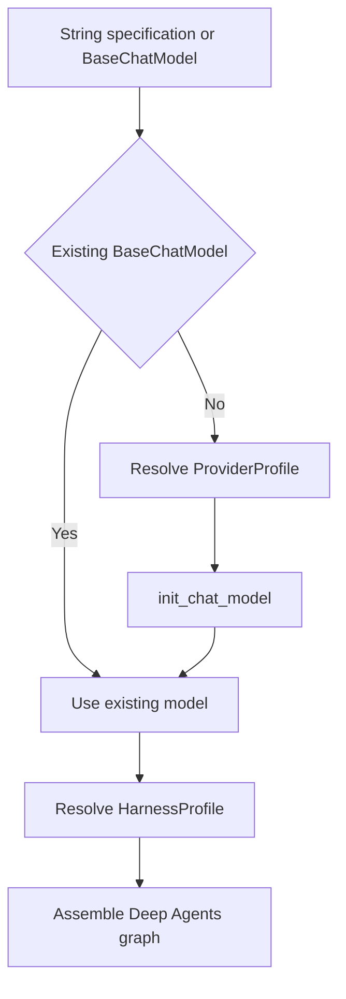
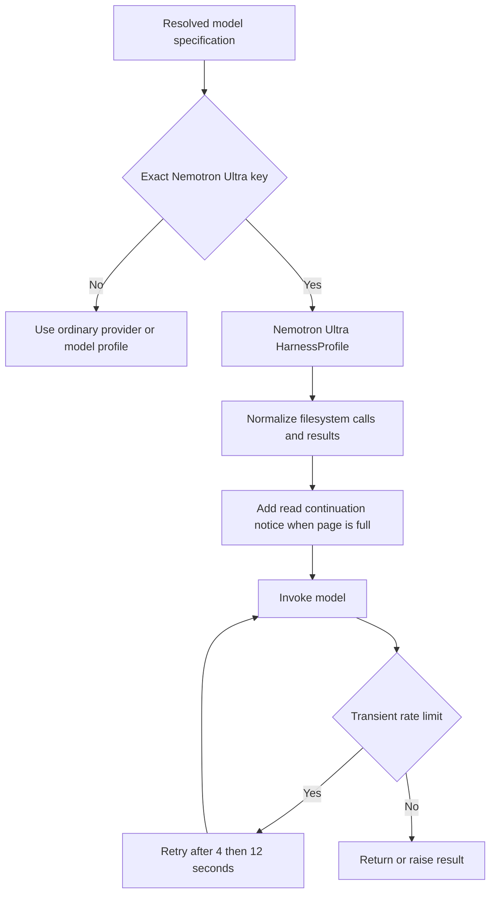
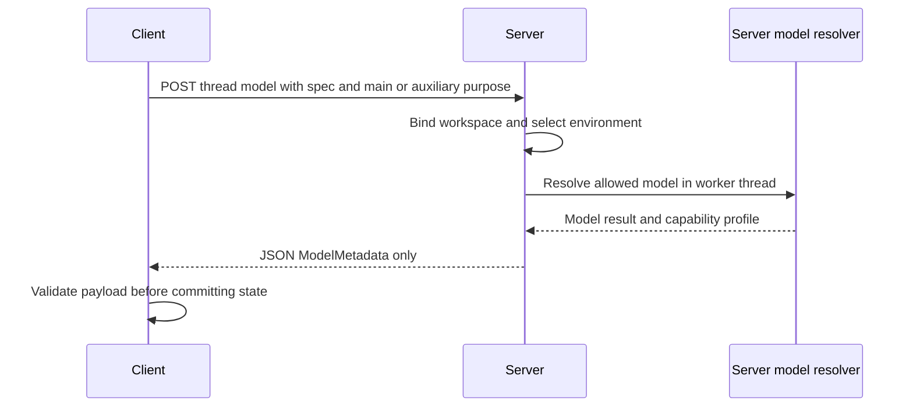

# Profiles and Models

Several mechanisms called a *profile* have intentionally different authority. SDK **ProviderProfile** controls how a string model specification is constructed. SDK **HarnessProfile** changes an agent stack after a model exists. dcode **capability profiles** are descriptive metadata used for discovery, selection, context limits, and reasoning controls. None of these is a substitute for dcode's `models.allowed` admission policy.

## Boundaries and SDK extension points

| Layer | Key | Owns | Does not own |
| --- | --- | --- | --- |
| SDK `ProviderProfile` | `provider` or `provider:model` | `init_chat_model` kwargs, dynamic kwargs, and pre-initialization checks | Prompt, tools, or middleware |
| SDK `HarnessProfile` | `provider` or `provider:model` | Prompt assembly, tool visibility, middleware, and default-subagent behavior | Model-client construction |
| dcode capability profile | `provider:model` | Displayable capabilities, context information, and reasoning-level metadata | Constructor kwargs or authorization |
| dcode `models.allowed` | Canonical `provider:model` | Whether a resolved model may be constructed | Discovery metadata and provider enablement |

The SDK profile registries are beta APIs and additive: a second registration layers on top of the first rather than replacing it. `resolve_model()` applies ProviderProfile behavior only to a string, then calls `init_chat_model`; a supplied `BaseChatModel` is passed through unchanged. An exact model profile overlays the provider profile. Pre-initialization hooks and dynamic factories run base first; factory output overrides static profile kwargs, and caller kwargs have final precedence.

Diagram: construction profiles apply only to string specifications; harness profiles shape the graph after a model is available.

Harness lookup selects an exact specification before a provider fallback; when both are registered, the model-level fields merge over provider-level fields. `create_deep_agent()` resolves it for the main model and each declarative synchronous subagent before it applies prompt, tool-description, and middleware changes. The authored prompt order is caller `USER`, profile `BASE`, then profile `SUFFIX`.

A runtime `HarnessProfile` may supply static or factory `extra_middleware` for the main, general-purpose, and declarative synchronous subagent stacks. It cannot alter a precompiled subagent or a remote asynchronous subagent; `HarnessProfileConfig` intentionally excludes this runtime-only feature so it remains file-friendly. Middleware exclusions cannot remove required filesystem or subagent scaffolding, and an exclusion that matches nothing fails graph assembly. Use tool exclusions—not middleware removal—to hide injected tools from the model.

Profile bootstrap is lazy, thread-coordinated, and one-time. Built-ins load through direct imports; an exception rolls the registry back and fails bootstrap. Provider and harness entry-point plugins load afterward and layer onto built-ins; a broken third-party plugin is warned about and skipped. Register custom profiles before construction so the registry is complete when models and graphs are assembled.

### NVIDIA Nemotron 3 Ultra adaptation

The built-in Nemotron 3 Ultra profile is a **model-specific HarnessProfile**, not an NVIDIA- or reseller-provider-wide behavior change. It is registered only for these client-reported specifications:

- `NVIDIA:nvidia/nemotron-3-ultra-550b-a55b` and `nvidia:nvidia/nemotron-3-ultra-550b-a55b`
- `baseten:nvidia/NVIDIA-Nemotron-3-Ultra-550B-A55B`
- `fireworks:accounts/fireworks/models/nemotron-3-ultra-nvfp4` and `fireworks:accounts/fireworks/models/nemotron-3-ultra-bf16`
- `openrouter:nvidia/nemotron-3-ultra-550b-a55b`
- `nebius:nvidia/Nemotron-3-Ultra-550b-a55b`
- `together:nvidia/nemotron-3-ultra-550b-a55b`

The profile supplies model guidance, a `read_file` description override, and fresh extra middleware for every SDK-assembled applicable stack. Its filesystem shim remaps `path` to `file_path` for `read_file`, `write_file`, `edit_file`, and `delete` when necessary; a `read_file` call with no `limit` receives the 500-line default. It changes an empty `ToolMessage` result to `(empty tool result)` rather than inventing content. A separate pagination middleware appends a continuation instruction only when a non-error `read_file` result contains the full requested number of source lines; the instruction carries the next `offset` and deliberately avoids treating wrapped continuation rows or header-shaped file content as proof of another page.

Diagram: the Nemotron safeguards attach only after an exact model-profile match; they do not change other models on the same providers.

Its model-call retry middleware retries identifiable rate-limit failures, including status `429`, with delays of 4 then 12 seconds; it re-raises other errors and an exhausted rate limit. The focused Nemotron suite pins the identifiers, filesystem argument repair, empty-result handling, default paging and continuation detection, and the transient-429 retry path. These safeguards are distinct from dcode's model-node retry policy.

## dcode configuration, discovery, and catalog

A dcode provider entry can enable or hide a provider, list models, identify API-key or base-URL environment variables, set constructor `params`, add capability `profile` overrides, or name a `class_path`. `class_path` imports and instantiates arbitrary Python from configuration, so it is a trusted-user configuration feature, not safe project input. Provider-wide `params` and `profile` values may have model-keyed tables, whose values shallowly override provider defaults.

For a canonical environment variable, dcode first checks `DEEPAGENTS_CODE_<NAME>`. The prefixed variable wins even when empty, so it can intentionally suppress a canonical shell value. Stored `/auth` credentials are bridged only when that precedence permits the SDK to read the canonical variable.

Capability-profile resolution is separate from construction. `get_model_profiles()` starts with installed integration `_profiles` data, overlays configured fields, then overlays a CLI profile override and records overridden keys. It also represents configured-only models, profile data from a configured class-path package, a curated Codex mirror, and best-effort Ollama metadata. A missing capability profile warns; a configured assignment failure warns and leaves the model usable, while a CLI override assignment failure becomes `ModelConfigError`.

Discovery is presentation, not permission. dcode discovers enabled providers whose capability profiles advertise tool calling and usable text input/output, merges explicitly configured models, and then filters through `models.allowed`. Recommended and current models are retained only when their provider is enabled and policy permits them. Provider readiness is independent of discovered model rows, allowing setup guidance even when no model row exists.

The host sends a `ModelCatalog` to remote pickers. It is a strict presentation snapshot: model specs, provider readiness, policy metadata, override provenance, and a scalar allowlist of capability fields—including `structured_output`—cross the boundary; constructor kwargs and arbitrary profile extensions do not. A remote picker must use its supplied catalog rather than local provider data, and apply catalog policy before installation or authentication prompts.

### Server-resolved metadata and structured-output contract

`ModelCatalog` answers *what can be displayed*. `ModelMetadata` answers *what the server resolved* for the launch model or a proposed selection. Its JSON-safe contract is deliberately small: `model_name`, `provider`, optional positive `context_limit`, a sorted `unsupported_modalities` list, and tri-state `structured_output`. `structured_output=true` or `false` is the resolved model profile's advertised capability; `null` means unknown or unavailable, not a negative capability. No model object, constructor parameter, credential, or arbitrary profile key is serialized.

Diagram: capability discovery and model construction stay on the inference host; the client receives only validated, provider-independent metadata.

The startup `GET /dcode/model` reads the server's cached launch metadata without binding a thread. A thread-scoped `POST /dcode/threads/{thread_id}/model` first binds the workspace, resolves in that workspace's captured model environment, and does not run inference or commit a switch. For a proposed **main** model it passes workspace profile overrides and optional `extra_kwargs`; an **auxiliary** resolution requires a specification, rejects parameters, and intentionally omits main-model profile overrides. The response derives `structured_output` from the resolved model's profile. The cached startup metadata currently has no profile-derived structured-output value, so it serializes that field as `null`.

The client parses every response before it can replace active state: it rejects a non-object payload; an empty/non-string model name; a non-string provider; a non-positive or boolean context limit; a non-list or non-string modality; and a non-boolean, non-null structured-output value. Only then does `apply_to_runtime_state()` replace the model name, provider, context limit, and unsupported modalities. It intentionally does not write structured-output into global runtime state; that value is selection metadata. Resolution and transport failures leave the prior app selection and runtime state intact rather than confirming a model the server did not validate. Workspace conflicts surface as `409`, request/configuration validation as `422`, and unavailable server/environment or unexpected resolution failure as `503`.

Structured-output metadata is advisory where profiles are incomplete. When an auto-classifier selection explicitly advertises `structured_output=false`, dcode warns that structured verdict requests may fail; it does not block the selection. The classifier itself remains fail-closed for review actions and falls back to user approval after repeated failures.

`models.allowed` is the construction admission policy. An omitted policy is unrestricted; `[]` denies every model; nonempty entries are exact `provider:model` values or `provider:*` wildcards. A malformed declaration fails closed as deny-all. Bare Bedrock IDs are rejected in the allowlist because a version colon could be mistaken for the provider separator; use `bedrock:<id>`.

## dcode construction and switching lifecycle

Diagram: admission happens before all provider-facing construction side effects.

`create_model()` canonicalizes an explicit prefix, configured provider prefix, Bedrock bare identifier, or inferred provider. It applies its allowlist after inference but **before** credential bridging, ProviderProfile hooks or factories, and provider imports. A blocked request therefore cannot expose a stored credential as an environment variable or run provider profile code.

After admission, dcode bridges stored credentials and performs its explicit credential check. Providers with ambient authentication are exempt from that early environment-based check; other missing credentials produce a typed actionable error. dcode layers provider and per-model defaults, an applicable stored credential, and SDK ProviderProfile output below `extra_kwargs`; runtime kwargs win. Profile hook or factory exceptions become `ModelConfigError`. Codex follows its OAuth-aware construction path, while a configured `class_path` bypasses normal `init_chat_model()` construction.

`ConfigurableModelMiddleware` reads `model` and `model_params` from LangGraph runtime context for each call, so it can reconstruct and switch a model without recompiling the graph. A `ModelNotAllowedError` always propagates. Other construction failures keep the current model unless strict resolution is configured; in that fallback path model parameters are deliberately marked unknown rather than falsely checkpointed as cleared.

## Reasoning effort and retries

Reasoning effort is exposed only when capability metadata advertises `reasoning_output=True` and valid effort levels. dcode normalizes recognized provider-native effort fields to `reasoning_effort` without discarding unrelated parameters. Anthropic `thinking.type="between_tools"` is available only at `low`, `medium`, and `high` effort.

The model-node middleware owns the visible retry budget: `--max-retries`, provider-specific configuration, global configuration, then the built-in default (`5`); `0` disables retries. dcode disables known provider SDK retry loops after merging user kwargs, then stamps the selected budget on the concrete model. This lets a runtime switch carry the new provider's retry budget rather than multiplying attempts through nested SDK retries.

`CodeModelRetryMiddleware` wraps the model node, not the whole turn, so completed tools are not replayed. It retries only classified transient failures, honors a bounded `Retry-After` hint or jittered exponential backoff within a 60-second interactive delay budget, emits correlated attempt and retry lifecycle events, and re-raises an exhausted failure rather than fabricating an AI answer. Stream consumers use those events to mark partial output from a superseded attempt.

## Compatibility and provider dependency floors

dcode `0.2.5` requires Python `>=3.14,<3.15` and pins `deepagents==0.7.34`. The SDK manifest is `0.7.34`, supports Python `>=3.11,<4.0`, and requires LangChain `>=1.4.9,<2.0.0`, LangChain Core `>=1.7.6,<2.0.0`, Anthropic `>=1.7.10,<2.0.0`, and Google GenAI `>=4.4.3,<5.0.0`. The SDK range does not widen dcode's released Python contract; dcode's editable sibling SDK source is a development override.

The dcode core installs Anthropic `>=1.7.10,<2.0.0`, Google GenAI `>=4.4.3,<5.0.0`, and OpenAI `>=1.7.4,<2.0.0`. Other integrations are extras: Baseten `>=0.2.5,<1.0.0`, Bedrock `>=1.9.2,<2.0.0`, Cohere `>=0.6.0,<1.0.0`, DeepSeek `>=1.1.1,<2.0.0`, Fireworks `>=1.7.2,<2.0.0`, Groq `>=1.1.3,<2.0.0`, Hugging Face `>=1.2.3,<2.0.0`, IBM `>=1.1.2,<2.0.0`, LiteLLM `>=0.11.2,<2.0.0`, Meta `>=0.5.0,<2.0.0`, Mistral `>=1.1.6,<2.0.0`, NVIDIA endpoints `>=1.5.0,<2.0.0` (plus `aiohttp>=3.14.3`), Ollama `>=1.1.0,<2.0.0`, OpenRouter `>=0.2.9,<2.0.0`, Perplexity `>=1.4.2,<2.0.0`, Together `>=0.4.0,<2.0.0`, Vertex AI `>=3.2.5,<4.0.0`, and xAI `>=1.3.0,<2.0.0`. Install the matching dcode extra before selecting its provider.

The `0.2.5` changelog records that compaction input budgeting now follows the selected model. This is release context, not a promise that every runtime switch changes an already compiled graph; model switching remains the responsibility of the runtime middleware described above.

When changing this area, preserve the ordering of canonicalization, admission, credential bridging, profile application, and imports. Test malformed, empty, exact, wildcard, and Bedrock allowlists; prove denied construction has no credential, profile, or import side effects; exercise prefixed environment shadowing and stored credential bridging; and cover profile failure translation, model-switch denial and fallback, and per-switch retry budgets. For the server metadata boundary, test malformed request rejection before construction, workspace-environment isolation, the main-versus-auxiliary override split, response validation, and preservation of active client state on resolution failure. For the Nemotron adaptation, test exact-key registration and its narrow safeguards rather than assuming they apply provider-wide. Relevant focused suites include `libs/code/tests/unit_tests/test_config.py`, `test_model_config.py`, `test_model_switch.py`, `test_model_metadata.py`, `tui/widgets/test_model_selector.py`, `libs/deepagents/tests/unit_tests/test_harness_profiles.py`, and `libs/deepagents/tests/unit_tests/test_nemotron_ultra_profile.py`.

## Related pages

- [Code agent architecture](/openwiki/architecture/code-agent.md)
- [Architecture overview](/openwiki/architecture/overview.md)
- [Configuration layering](/openwiki/concepts/config-layering.md)
- [Testing guide](/openwiki/testing/testing-guide.md)
- [Run a dcode session](/openwiki/workflows/run-dcode-session.md)
