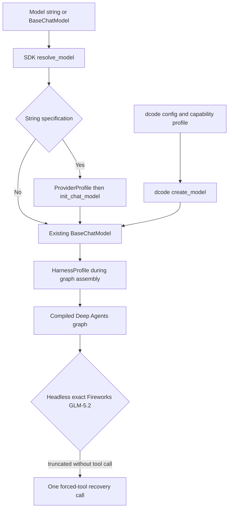
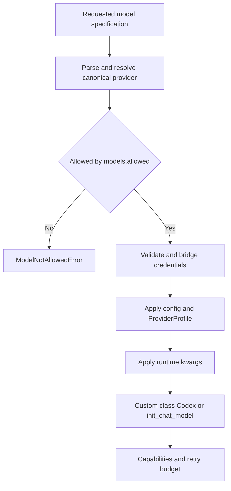

# Profiles and Models

“Profile” has several deliberately separate meanings. The Deep Agents SDK uses **provider profiles** to construct a model from a string and **harness profiles** to adapt the agent graph. dcode uses **capability profiles** to describe a model for selection, prompt metadata, and reasoning controls; it also has a launch-selected user profile that owns configuration and state. Installing an integration or registering an SDK profile does not, by itself, make a model selectable, credentialed, or permitted in dcode.

## Profile boundaries

| Kind | Owner and lookup key | Responsibility |
| --- | --- | --- |
| User profile | dcode launch-time `DEEPAGENTS_HOME` | Trust root containing `config.toml`, credentials/state, and user agent material. |
| SDK `ProviderProfile` | `provider` or `provider:model` | Constructor kwargs, dynamic kwargs, and pre-initialization work for a **string** model spec. |
| SDK `HarnessProfile` | `provider` or `provider:model` | Prompt, tool, middleware, and default-subagent changes while assembling a Deep Agents graph. |
| dcode capability profile | `provider:model` | Model capabilities such as context window, modalities, tool calling, and reasoning levels. |

`DEEPAGENTS_HOME` is selected from the inherited launch environment and captured in the process-wide `PATHS` snapshot; project/global dotenv files cannot change it. This makes the selected user profile a trust boundary rather than a setting that can drift after a directory change or reload. Its `config.toml` is the default source for `ModelConfig`; managed policy is included for default-path reads.

This shows the distinct SDK construction/assembly and dcode construction paths, plus the only profile-adjacent recovery relationship. The recovery branch is not a general provider retry policy.

## SDK provider and harness profiles

The beta SDK registries are additive. Registrations accept a provider or exact `provider:model` key, and a later registration layers fields rather than replacing the old registration. `resolve_model()` leaves an existing `BaseChatModel` unchanged; only a string gets `ProviderProfile` handling and `init_chat_model()`. A supplied instance can still receive a harness profile if its provider and identifier can be determined.

Provider-profile resolution overlays an exact model registration on the provider registration. Static kwargs merge base first, hooks and dynamic factories run base first, factory output overrides static kwargs, and explicit caller kwargs win last. A hook or factory failure stops construction. Bootstrap is lazy, thread-coordinated, and once per process: SDK built-ins must load successfully, whereas faulty third-party entry points are logged and skipped.

Harness lookup similarly prefers an exact spec and falls back to provider-level data. `create_deep_agent()` resolves it separately for the main model and every declarative subagent before applying prompt, tool-description, and middleware changes. Runtime-only extra middleware can affect SDK-assembled main, general-purpose, and synchronous declarative subagent stacks; it cannot alter an already compiled or remote async subagent, so file-friendly `HarnessProfileConfig` excludes that extension.

Harness exclusions are not authorization controls. Required filesystem and subagent scaffolding cannot be removed, unmatched exclusions fail assembly, and tool exclusion runs after tool-injecting and custom middleware. This ordering makes tool exclusion the supported way to hide an injected tool from the model.

Talon is a separate, experimental host that honors the same construction boundary. Its runtime resolves an environment-adjusted model and, when that result is still a string, calls `apply_provider_profile()` before `init_chat_model()`; it leaves a prebuilt model unchanged. For an OpenAI base URL or unified gateway, it starts from profile kwargs and then applies the host connection values, with the unified gateway explicitly disabling `use_responses_api`; an optional context-size setting is applied to the constructed model afterward. Talon therefore consumes provider profiles but does not make them a model-selection or harness-policy mechanism.

## dcode configuration, construction, and capability data

The dcode distribution requires Python `>=3.14,<3.15` and pins `deepagents==0.7.32`; the SDK manifest is itself version `0.7.32` and supports Python `>=3.11,<4.0`. In a workspace, dcode's `tool.uv.sources` can point `deepagents` at the sibling editable checkout, but that development override does not widen the released dcode requirement. Keep the exact pin and the SDK manifest version aligned when changing profile-facing behavior.

Anthropic, Google GenAI, and OpenAI integrations are core dcode dependencies; other supported integrations are optional provider extras, including the `all-providers` convenience extra. The SDK core manifest includes Anthropic and Google GenAI, while its `aws`, `quickjs`, and `video` integrations are optional extras. Packaging only makes an integration importable: enablement, credentials, configured lists, capability requirements, and `models.allowed` separately control usability.

A provider configuration can supply `enabled`, explicit `models`, credential/base-URL names, constructor `params`, capability `profile` overrides, or a trusted `class_path`. The latter imports and instantiates arbitrary Python from user configuration and consequently has the same trust implications as other local executable configuration. Provider-wide `params` and `profile` fields can contain per-model subtables; the per-model mapping shallowly wins.

`get_model_profiles()` reads upstream integration `_profiles` data, overlays configured capability fields, then applies a CLI `--profile-override` when supplied. Entries retain which keys were overridden. It also supports configured-only models, class-path packages exposing `_profiles`, mirrored Codex capabilities, and discovered Ollama metadata. Capability profiles are descriptive data, not SDK `ProviderProfile` constructor behavior.

### Catalog, discovery, and policy

`load_model_catalog()` returns a strict presentation snapshot for the inference host. It carries displayable scalar capabilities, override provenance, readiness, policy metadata, model specifications, and an optional current specification—not arbitrary constructor kwargs or profile extensions. A remote picker uses the supplied catalog rather than inspecting its local provider state and must apply catalog policy before installation or authentication prompts.

Discovery includes enabled providers whose upstream profile advertises tool calling and usable text input/output, then merges explicit configured models. It can derive profile data from a `class_path` package and query installed Ollama models. `models.allowed` filters the final lineup; current and recommended specifications remain eligible only when enablement and policy allow. Readiness remains independent of rows, so a known provider can offer setup guidance even when it has no discovered models.

`models.allowed` is a security boundary: absent means unrestricted, an empty tuple denies every model, and non-empty entries are exact specs or `provider:*` wildcards. A malformed declared allowlist fails closed as deny-all instead of becoming unrestricted.

This flow shows that a policy denial occurs before every provider-facing side effect.

The construction gate is load-bearing. `create_model()` parses an explicit `provider:model` spec, honors a configured provider prefix, treats Bedrock's versioned bare identifiers as Bedrock, or detects a provider for a bare name. It checks `models.allowed` against the resulting canonical `provider:model` spec **before** it bridges stored credentials into environment variables, loads or runs an SDK `ProviderProfile`, or imports a provider implementation. A denied name therefore cannot turn a stored key into an environment value, execute a profile `pre_init`, or cause a provider import.

Only after that gate does dcode diagnose split credential sources, bridge stored credentials in an unscoped environment, and resolve the effective credential. It performs an early actionable credential check for providers with explicit credential mappings; implicit-auth providers are excluded because an environment-variable check cannot establish their authentication state. Configuration kwargs, including a resolved stored key where applicable, are passed beneath `apply_provider_profile()`, and `extra_kwargs` are applied last. Thus provider-profile defaults and factories cannot overwrite configured values, and runtime model parameters cannot be overwritten by profile defaults. A profile hook or factory failure is normalized to `ModelConfigError` with the affected spec and a recovery hint rather than exposing an arbitrary plugin exception. Codex uses its OAuth-aware construction path; configured custom classes bypass ordinary `init_chat_model()`.

After construction, dcode applies configured capability overrides and then CLI capability overrides to the concrete model. This descriptive `model.profile` layer remains separate from constructor `ProviderProfile` behavior: an assignment failure for a configured override warns and keeps the model usable, while a CLI override assignment failure is a `ModelConfigError`. A missing capability profile warns, but an explicit `tool_calling=False` is fatal for an agent.

## Runtime selection, reasoning effort, and retries

`ConfigurableModelMiddleware` reads `model` and `model_params` from LangGraph runtime context on each call. It creates a replacement only when the requested specification differs, shallow-merges call settings, strips Anthropic-only settings when moving to another provider, and patches the Model Identity prompt section. A blocked switch always propagates. Other construction errors propagate in strict mode or log and retain the current model otherwise; the fallback deliberately does not overwrite checkpointed parameters with unknown values. Successful model calls persist the resolved spec and runtime settings needed for resume, while cache identity records effective configured settings separately. Async paths offload blocking construction and configuration reads.

Reasoning effort is driven by dcode capability profiles, not harness profiles. It is available only where `reasoning_output=True` and valid levels are advertised. dcode recognizes canonical and provider-native representations, removes old effort fields while preserving unrelated parameters, and stores the portable `reasoning_effort` value. It persists a selected effort by model in the active configuration; an explicit session/native setting takes precedence over restoring that preference. Anthropic `thinking.type="between_tools"` limits the offered levels to `low`, `medium`, and `high`.

Retry ownership is deliberately separate from constructor kwargs. The budget precedence is `--max-retries`, then `[retries.<provider>].max_retries`, then `[retries].max_retries`, then the built-in default; `0` disables retries. dcode resolves that budget before construction, forces a known provider SDK retry-count kwarg to its disable value after all user kwargs have merged, and stamps the resolved budget on the concrete model. If dcode cannot identify an integration's retry control, it leaves that SDK loop active and warns that attempts may multiply.

`CodeModelRetryMiddleware` reads the stamped budget from `request.model` on every model-node call, falling back to its startup budget only when a custom model cannot carry the metadata. A runtime switch therefore receives the switched provider's configured budget rather than inheriting the original provider's budget, and retries do not replay completed tools. The middleware retries only classified transient failures, honors a valid capped `Retry-After` or jittered exponential backoff within the interactive delay budget, re-raises non-transient or exhausted errors instead of fabricating an AI response, and emits attempt/retry lifecycle events for streamed-output reconciliation.

## Truncation visibility and GLM-5.2 recovery

`output_truncation()` normalizes provider stop metadata into output-token, content-filter, or context-window truncation. For a main-agent reply with neither visible text nor a tool call, `EmptyTruncatedReplyMiddleware` raises `ModelOutputTruncatedError` rather than allowing a silent successful-looking run; the empty reply is not checkpointed and the client receives an error. It does not retry. A partial reply remains visible, and a truncated subagent reply is returned to the parent as a task error when empty or is annotated with a warning when partial.

For three exact GLM-5.2 specs—Fireworks, OpenRouter, and Baseten—dcode registers a prompt-only `HarnessProfile` before creating its CLI graph. Registration is process-idempotent and deliberately does not replace an existing suffix for the same exact spec. This is dcode-specific harness adaptation, separate from both provider construction profiles and capability data.

Only headless dcode main and generated subagent stacks install `_GlmTerminalStallRecovery`. It is narrower than model retry: it considers only the exact Fireworks spec `fireworks:accounts/fireworks/models/glm-5p2` and only a single unstructured-result AI response with no tool calls whose metadata classifies as `max_output_tokens`. It then makes at most one additional model call, appending a trusted recovery suffix, forcing `tool_choice="any"`, and setting Fireworks nested `model_kwargs.reasoning_effort` to `"none"` while preserving other model kwargs. Interactive sessions and the corresponding OpenRouter and Baseten specs do not install or activate it.

A second stalled recovery response is not retried. dcode logs a warning that the headless run may end without a deliverable; the outer empty-truncated-reply guard then makes that failure visible rather than fabricating an answer. Thus this behavior neither widens provider retry eligibility nor masks an exhausted output cap.

Harbor builds eval models directly with `init_chat_model()`, so it bypasses Deep Agents provider-profile construction. Its eval adapter explicitly sets `use_responses_api=True` for `openai:` specs when the caller did not set it. For the shared exact GLM-5.2 set, it defaults nested `model_kwargs.reasoning_effort` to `high` only when neither top-level nor nested native effort field was supplied. The adapter then creates either the dcode headless CLI graph or a bare SDK graph; for the CLI path it mirrors resolved model identity into dcode runtime state so the production Model Identity prompt is accurate.

## Safe changes and focused tests

Changing a provider is a multi-boundary change: choose package/extra, credential and endpoint mapping, discovery, policy, constructor behavior, capability data, reasoning representation, retry ownership, and catalog projection independently. Preserve the allowlist gate's position after canonical inference and before credential mutation, profile hooks, and provider imports. Test capability-profile fallback and override provenance separately from SDK profile precedence.

Focused coverage should pin canonical bare-name policy matching and deny-all/wildcard semantics; the no-side-effect behavior of a denied construction; stored-credential bridging and early missing-credential diagnostics; and normalization of provider-profile hook/factory failures to `ModelConfigError`. Separately test the retry precedence chain, provider-retry suppression, and the per-model budget after a runtime switch. Existing coverage also exercises profile discovery for configured/class-path/Ollama sources, capability-profile merging, native reasoning normalization, runtime-switch fallback and checkpoint state, and catalog redaction. `test_output_truncation.py` covers provider metadata classification, empty-reply visibility, user guidance, invalid tool-call reporting, and subagent propagation. `test_glm_5p2_profile.py` verifies the narrow terminal-stall predicate, forced recovery request, non-mutation of the original request, and one-retry ceiling. Harbor construction should be tested separately because it intentionally bypasses SDK provider profiles.

## Related pages

- [Code agent](/openwiki/architecture/code-agent.md)
- [Configuration layering](/openwiki/concepts/config-layering.md)
- [Subagents and skills](/openwiki/concepts/subagents-skills.md)
- [MCP integration](/openwiki/integrations/mcp.md)
- [Cost and sessions](/openwiki/operations/cost-and-sessions.md)
- [Testing guide](/openwiki/testing/testing-guide.md)
