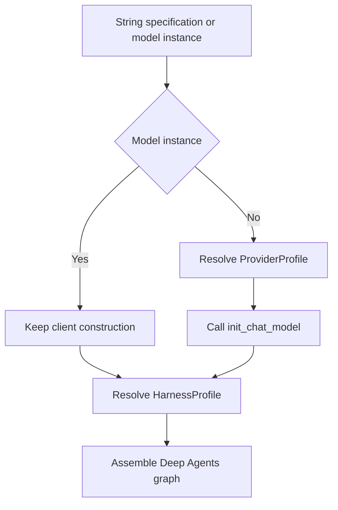
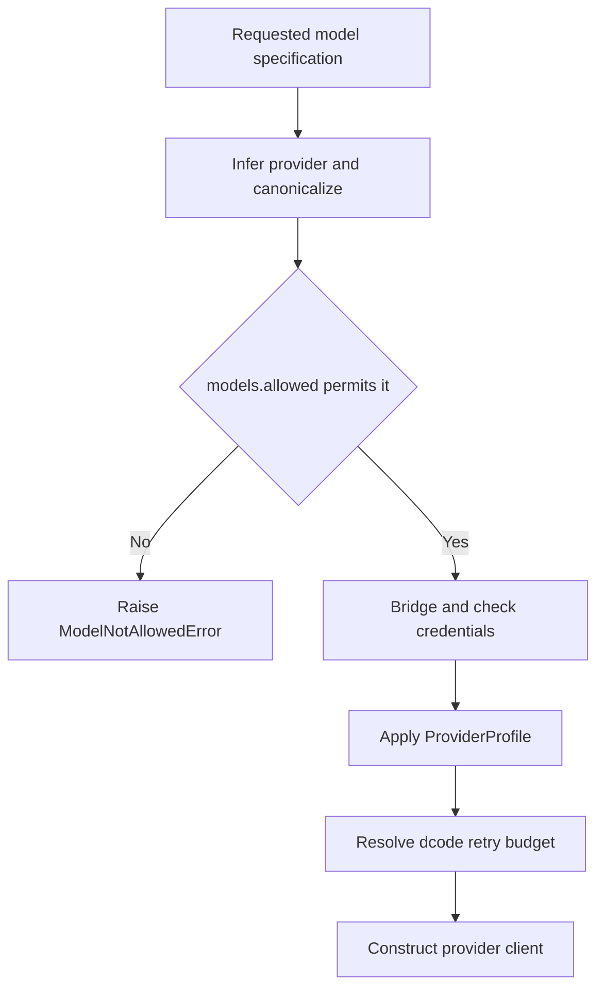
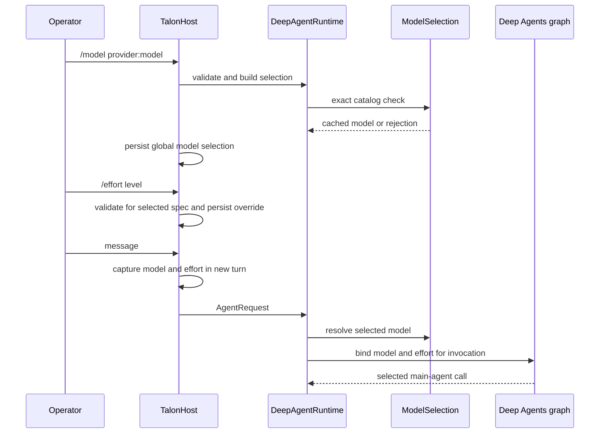

# Profiles and Models

These are independent control planes. SDK profiles construct a model or shape a Deep Agents graph; dcode applies its own policy, credentials, defaults, and retry configuration; Talon selects a catalog-admitted model and, separately, a reasoning control for its channel-hosted graph. In particular, Talon's `/model` and `/effort` are not dcode switches: they do not inherit dcode allowlists, credential store, persisted defaults, or retry policy.

| Control plane | Owner and key | Controls | Does not control |
| --- | --- | --- | --- |
| SDK `ProviderProfile` | Deep Agents; `provider` or `provider:model` | Construction of a string-selected model | Prompts, tools, or graph middleware |
| SDK `HarnessProfile` | Deep Agents; `provider` or `provider:model` | Agent harness around a resolved model | Model-client construction |
| dcode model configuration | dcode; policy, configuration, credentials, and persisted preferences | Admission, construction kwargs, defaults, and retries | Talon's discovered catalog or turn selection |
| Talon model selection | Talon host; discovered catalog plus a persisted global selection | Main-agent model for a Talon turn | dcode policy and dcode state |
| Talon reasoning effort | Talon host; persisted `provider:model` override | Per-turn main-agent invocation settings | Model admission, model selection, and subagent settings |

## SDK profiles: construction and harness

The beta SDK registries are deliberately orthogonal. `ProviderProfile` controls `resolve_model()` when it turns a string into a client through `init_chat_model`; `HarnessProfile` controls what `create_deep_agent()` assembles after the model exists. Both use provider-wide or exact `provider:model` keys, load built-ins and plugins lazily, and merge a later registration over an existing one rather than discarding unspecified fields.



*Provider profiles build string-selected clients; harness profiles shape the agent graph.*

Provider lookup combines an exact profile over its provider profile. Base hooks and dynamic factories run before the exact ones; a factory takes precedence over static profile kwargs; caller kwargs win last. A failed hook stops later profile work and model construction. Profiles are appropriate for client defaults, environment-derived constructor values, headers, and preflight checks—not prompt or tool behavior. Static kwargs are defensively copied and read-only.

Harness lookup selects an exact spec before provider fallback and merges model-level and provider-level fields. `create_deep_agent()` resolves the profile for the main model and each declarative subagent before applying prompt, tool-description, and middleware changes. Tool exclusion changes model visibility, not authorization; protected filesystem and synchronous-subagent middleware cannot be excluded, and an exclusion that matches nothing fails assembly.

## dcode: policy before construction

`ModelConfig` owns dcode's structured providers, `models.allowed` policy, per-model overrides, and stored preferences. The scalar manifest/resolver is a separate configuration system: the manifest declares typed scalar defaults, locations, CLI metadata, redaction, and merge behavior; dedicated loaders own structured configuration. Standard scalar replacement precedence is managed policy, CLI, reload retention, environment, user TOML, then the typed default. Resolution returns a typed result with provenance, tier health, masking, and diagnostics from one locked provider generation.

Invalid scalar values fall through to lower-precedence values and ultimately the typed default. This preserves bounded safeguards such as timeouts and recursion limits. For accumulated structured inputs, valid tiers union or deep-merge with provenance; if accumulation is unsafe, the strongest valid replacement wins. Refresh refuses an unusable managed replacement and keeps the prior usable policy snapshot.



*dcode admits the canonical request before credential bridging, profile hooks, or provider imports.*

`create_model()` accepts an explicit `provider:model` specification or an inferable bare name. Its authoritative allowlist check follows provider inference but precedes credential bridging, SDK provider profiles, and imports, so a blocked request cannot produce those side effects. No allowlist is unrestricted, an empty one denies all, exact and `provider:*` entries admit matching models, and a malformed declared list fails closed. If user model configuration cannot be used, default-path loading preserves managed policy.

Once admitted, dcode layers provider and per-model defaults, stored credentials, and SDK provider-profile results before runtime kwargs. It constructs the Codex OAuth-aware model, a configured `class_path`, or an `init_chat_model` client. `class_path` imports and instantiates a configured `BaseChatModel`, making it a trusted configuration boundary. A profile failure is surfaced as an actionable `ModelConfigError`.

The picker maintains separate persisted defaults for the main model, Auto classifier, and summarizer. It validates policy before saving and rejects a newly persisted model with a missing provider package, but still lets an operator clear a now-unusable stored value.

### Retry and environment ownership

dcode's model-node middleware owns the visible retry budget. Precedence is `--max-retries`, provider-specific retry configuration, global retry configuration, then the built-in default; zero disables retries. `create_model()` disables recognized SDK retry loops and stamps the resolved provider budget on the concrete model, and the middleware reads that model-specific budget for each request. A runtime switch therefore does not multiply retries or accidentally retain the prior provider's budget.

Credentials bootstrap is lazy: first use of the proxy lock-protects one dotenv/project-context/credential initialization attempt, records failures, and continues with available environment. Shell values override nearest project dotenv, which overrides global profile dotenv. Construction can use an immutable context-local environment snapshot; a present `DEEPAGENTS_CODE_` variable shadows the canonical variable even when blank.

## Talon: catalog, model selection, and effort

Talon is an experimental, distinct runtime. It discovers selectable tool-calling models from installed provider catalogs only when the required credential is present in Talon's supplied environment; a credential held only by dcode is insufficient. The startup default is always in the catalog and selecting it means no override. A LangSmith gateway can augment OpenAI entries only when its endpoint is a validated HTTPS LangSmith gateway `/v1` URL with valid authentication. Gateway results must have safe identifiers and, when declared, `/v1/chat/completions` support.

A nondefault request must exactly match the catalog before Talon builds it. `ModelSelection` delays discovery and construction until use, caches each validated built model under a lock, and returns `None` for the startup default. Thus a catalog check is an admission boundary for untrusted chat input, not merely a presentation filter.



*The host validates persistent model and effort selections before a later turn captures them; runtime context is scoped to that invocation.*

### Model selection lifecycle and fallback

`/model` with no spec, or a provider name, is a catalog/listing operation. Changing a model requires a channel operator; the host asks the runtime to validate and construct the requested nondefault model before writing state. It stores at most one `__default__` selection, so the setting applies across conversations and survives a restart. `/model default` (or explicitly selecting the startup default) deletes the persisted override. Failures to discover, build, or write state return generic user-facing messages and log details rather than exposing credentials or provider errors.

The host captures the current global selection into `_Turn` when it starts work. Consequently, a switch after a turn begins applies to its next turn, including turns in new conversations; it cannot alter an in-flight request. A persisted selection that later disappears from the catalog remains visible as unavailable in listing output but does not make chats fail.

For every invocation, `DeepAgentRuntime` resolves the request's selected spec in a worker thread, sets `ACTIVE_MODEL` and effort settings in `ContextVar`s, and resets both in `finally`. Failure to resolve or build a stale selection is caught, logged once per spec at warning level, and represented as `None`; the graph then uses its startup default. This is an availability fallback, not a silent expansion of the catalog.

`ModelSelectionMiddleware` is installed in the graph and swaps `ACTIVE_MODEL` into every main-agent model request without recompiling the graph. It is outermost, so downstream prompt caching sees the selected client. The same middleware merges active effort settings for main-agent calls, including a deep merge for `extra_body.thinking`, without mutating the original request settings; it does not apply the effort override in delegated subagents.

Talon replaces the standard summarizer slot with `SelectedModelSummarization`, because the standard summarizer runs before ordinary custom middleware and would otherwise size context for the startup model. For a selected main-agent model it builds and caches a summarizer keyed to that model, swaps the request model before compaction, and uses 80% of `profile["max_input_tokens"]`; invalid or unavailable profile capacity falls back to 4,000 tokens. With no selection, or inside a delegated subagent, it uses the cached startup summarizer. Subagents therefore retain their startup model and context behavior.

`context_doctor()` accepts the host-selected model and resolves it through the same fallback path before rendering diagnostics. It reports a default-sized diagnostic when the selected model is unavailable rather than letting a stale persisted selection prevent diagnostics.

### `/effort`: model-specific reasoning controls

`/effort` is deliberately separate from `/model`: it never selects, builds, or admits a model. It reads the current global model spec (the selected override, otherwise the startup default), lists the controls known for that spec, and lets only an operator change a nonempty value. An unsupported value is rejected before state is written; `/effort default` removes only that model's override. The host writes a model-to-effort mapping to `effort.json`, so multiple model-specific choices survive restart and switching back restores that model's choice. A failed state write leaves the in-memory selection unchanged. As with model selection, an update affects the next turn because `_Turn` captures its effort.

Supported labels are an allowlist, not a generic provider promise. Talon first normalizes OpenAI gateway paths for native provider recognition, then recognizes DeepSeek, Qwen, and GLM families, uses SDK metadata where available, and supplies documented fallbacks for selected models whose profile metadata is absent. Qwen labels are translated to thinking budgets (`low`, `medium`, `high`, `xhigh`, or provider-limit `max`); DeepSeek and GLM controls use provider-specific thinking payloads; other supported models receive `reasoning_effort`. This translation is performed only after checking that the label is supported, preventing arbitrary chat-command arguments from becoming invocation parameters.

At runtime, the selected model and its captured effort are independently resolved. If a selected nondefault model is stale, no effort is applied to the fallback startup model. Otherwise the runtime validates the captured effort against the effective spec, translates it to settings, stores those settings in `ACTIVE_EFFORT`, and always resets the context variables after the turn. Concurrent turns therefore do not leak a reasoning setting into one another.

## Compatibility and focused verification

`deepagents-code` 0.2.15 requires Python `>=3.14,<3.15` and pins `deepagents==0.7.42`; Deep Agents 0.7.42 supports Python `>=3.11,<4.0`. The SDK manifest requires LangChain `>=1.5.2,<2.0.0`, LangChain Core `>=1.8.5,<2.0.0`, `langchain-anthropic >=1.7.13,<2.0.0`, and `langchain-google-genai >=4.4.3,<5.0.0`. The SDK range does not widen dcode's released Python contract.

Use `libs/talon/tests/unit_tests/test_model_selection.py` for model-selection changes. It covers operator authorization, global persistence/reset, next-turn capture, exact catalog admission, gateway URL and response validation, single construction and caching, stale-selection fallback, selected-model context budgets, subagent summarizer isolation, and selected-provider cache behavior.

Use `libs/talon/tests/unit_tests/test_effort.py` for `/effort` changes. It verifies operator authorization, rejection of unsupported values, per-model secure persistence and reset, preservation on save failure, provider-specific settings and wire payloads, nested settings merge, and concurrent per-turn context isolation. Test through the package route described in the [Testing guide](/openwiki/testing/testing-guide.md):

```bash
cd libs/talon
uv sync --all-groups
make test TEST_FILE=tests/unit_tests/test_effort.py
```

For dcode changes, keep tests proving policy precedes credential/profile side effects, retry ownership survives a switch, malformed policy fails closed, and picker persistence validates both policy and provider availability. The manifest and model-config suites are the focused routes.

## Related pages

- [Architecture overview](/openwiki/architecture/overview.md)
- [Talon channel admission](/openwiki/concepts/talon-channel-admission.md)
- [Talon runtime integration](/openwiki/integrations/talon.md)
- [Cost and sessions](/openwiki/operations/cost-and-sessions.md)
- [Build a Deep Agent](/openwiki/workflows/build-a-deep-agent.md)
- [Testing guide](/openwiki/testing/testing-guide.md)
