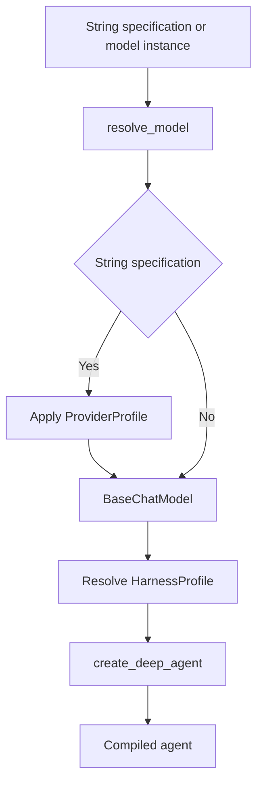
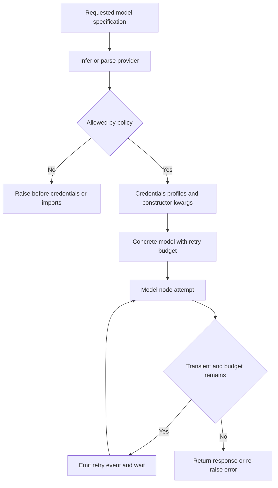
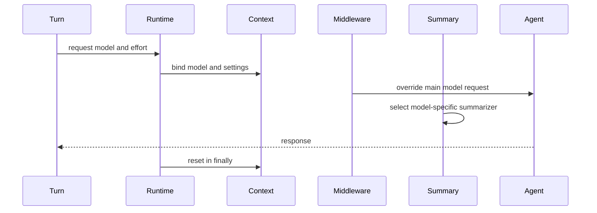

# Profiles, Models, and Reasoning Controls

This repository uses *profile* for separate layers that must not be conflated. A Deep Agents **provider profile** affects construction from a string model specification; a **harness profile** changes the agent graph assembled around a resolved model; and a model object's capability `profile` reports attributes such as `max_input_tokens`. dcode adds provider configuration, policy, credentials, and retries. Talon then selects a model and reasoning control for an individual turn.

## Package and provider boundary

`deepagents-code` 0.1.87 requires Python `>=3.12,<4.0` and pins `deepagents==0.7.29`. The checked-out SDK is 0.7.29 and permits Python `>=3.11,<4.0`; the stricter dcode range and exact pin remain its release contract. The editable `../deepagents` UV mapping is only a monorepo development source. When dcode needs new SDK behavior, change its exact pin in the same PR; release CI rejects a pin older than the workspace SDK unless explicitly bypassed, while an intentionally ahead pin is permitted for prerelease coordination.

The dcode base installation includes Anthropic, Google GenAI, and OpenAI integrations. Other providers are optional extras, and `deepagents-code[all-providers]` aggregates the declared provider extras. A model-name prefix is therefore not evidence that the integration is installed or credentialed.

Talon is an alpha package requiring Python `>=3.12,<4.0`. It declares `deepagents>=0.7.24` and `deepagents-code>=0.1.71,<1.0.0`; its editable sibling mappings do not make Talon an exact SDK-pin consumer.

## SDK profiles: construction versus harness assembly

The beta `deepagents.profiles` API exposes two additive registries. Each key is either a provider such as `openai` or an exact `provider:model` specification; only the first colon separates provider from model, so identifiers may contain more colons.

| Registry | Applies when | Responsibility |
| --- | --- | --- |
| `ProviderProfile` | `resolve_model()` receives a string | Supplies `init_chat_model` kwargs, optional dynamic kwargs, and an optional `pre_init` hook. |
| `HarnessProfile` / `HarnessProfileConfig` | `create_deep_agent()` has a resolved model | Shapes prompts, tool descriptions and visibility, middleware, and default general-purpose-subagent behavior. |

Caption: provider profiles affect string construction, whereas harness profiles affect the graph around either constructed or supplied models.

`resolve_model()` returns an existing `BaseChatModel` unchanged. Only a string calls `apply_provider_profile()` and `init_chat_model()`, so a provider profile cannot retrofit a pre-built instance. A harness profile can still be selected for such an instance from its reported provider and identifier.

Registration layers rather than replaces. Exact provider profiles overlay provider-wide profiles: their `pre_init` hooks and kwargs factories run base first, factory values override static kwargs, and explicit caller kwargs win last. Hook or factory exceptions stop the remaining chained work and propagate. Harness profile merging is field-specific: explicitly set scalar values replace base values, tool-description maps merge by key, exclusions union, same-type middleware replaces in place while novel middleware appends, and general-purpose-subagent fields merge individually.

`create_deep_agent()` resolves the main model and looks up its harness profile; it repeats that resolution for each declarative subagent before applying profile prompt, tool-description, and middleware changes. Required filesystem and subagent scaffolding cannot be excluded. Private, ambiguous, unmatched, or otherwise invalid middleware exclusions fail instead of silently building a different graph.

Bootstrap is lazy, thread-coordinated, and once per interpreter. Built-ins are registered via direct imports; then zero-argument third-party hooks from `deepagents.provider_profiles` and `deepagents.harness_profiles` can layer registrations over them. A built-in failure restores the pre-bootstrap registries and fails bootstrap. Plugin enumeration, load, or registration failure is logged/warned and skipped; plugin order is not a supported precedence mechanism.

## dcode model construction and retry ownership

`create_model()` is dcode's construction entrypoint. It parses or infers a provider and canonical specification, then applies `models.allowed` **before** credential bridging, provider profiles, or provider imports. A blocked model cannot trigger those side effects. After the gate, dcode derives provider and per-model kwargs, applies stored credentials and the SDK provider profile, applies runtime `extra_kwargs`, resolves its retry budget, and constructs either a configured custom class or a standard integration model.

A configured `class_path` imports configured Python and is an explicit custom-provider extension point; treat that configuration as trusted. Missing provider packages, provider initialization failures, missing credentials, and policy denial are surfaced as model-configuration errors. dcode then overlays the model capability `profile` with `config.toml` overrides and finally CLI profile overrides. `ModelResult` extracts the input limit and explicitly unsupported input modalities from the resulting capability metadata.

Dcode, rather than a provider SDK, owns the user-visible model-node retry budget. It disables a recognized provider retry knob after merging kwargs to avoid nested attempts, attaches the resolved budget to the concrete model, and has retry middleware read it from the request model. Thus runtime model switching also changes the applicable retry budget. The middleware wraps individual model calls—not completed tools—emits correlated lifecycle and retry events, retries classified transient failures with backoff or usable `Retry-After`, and re-raises terminal provider failures.

Caption: policy precedes model-construction side effects, and retries surround one model-node attempt.

## dcode reasoning effort

The dcode `/effort` support derives the advertised levels and default from the active model's capability profile only when `reasoning_output` is exactly `True`. Malformed profile fields are ignored with warnings. For Anthropic models configured with `thinking.type == "between_tools"`, the offered profile levels are additionally limited to `low`, `medium`, and `high`.

Per-session model parameters may contain a canonical `reasoning_effort` or provider-native representation. dcode recognizes provider-specific precedence paths—for example `reasoning.effort` before the canonical field for OpenAI/Codex, and native Anthropic or Google fields—and uses their presence to prevent persisted effort restoration. When changing effort, it removes both canonical and native representations without disturbing sibling settings, then stores the canonical `reasoning_effort`; integrations translate that standard constructor parameter into their request format.

## Talon per-turn model and effort controls

Talon discovers selectable native models from dcode's installed-provider catalog only when Talon's own environment contains that provider's credential. It may also add validated models from an authenticated LangSmith unified gateway. A credential stored by dcode alone does not qualify a Talon provider. The graph's default model is always added to the catalog even if discovery does not list it.

`ModelSelection` accepts the default without rebuilding it. Any other selection must exactly match a `provider:model` catalog entry before construction, otherwise it raises `UnknownModelError`. Approved alternatives build on first use and are lock-cached. Because discovery and construction can import providers or block, async runtime callers run them in a thread.

A selected-model construction failure during a turn is deliberately non-fatal: Talon logs it once per model and uses the startup default for that turn. `/model` preparation builds earlier, so an operator normally receives build failure at selection time.

For a turn, the runtime binds the selected model in `ACTIVE_MODEL` and valid effort settings in `ACTIVE_EFFORT`, then resets both context variables in `finally`. Outer `ModelSelectionMiddleware` substitutes the selected model into main-agent model calls without recompiling the graph, and merges effort settings into `model_settings`. It does not apply effort to subagents. `extra_body` and nested `extra_body.thinking` merge rather than overwrite existing sibling settings.

Talon obtains ordinary effort labels from dcode's supported-profile levels, with documented fallbacks for selected models. It provides special controls for OpenAI-compatible Qwen and GLM families: Qwen labels map to token-budget and thinking-body settings, while GLM maps `on`/`off` to its native thinking payload and treats GLM-5.3 as forced-on. Unsupported controls raise `ValueError`; spelling variants such as `extra-high` normalize to `xhigh`.

Selected model context limits must also influence summarization. `SelectedModelSummarization` occupies the Deep Agents summarizer slot and caches a summarizer per selected main model, sizing compaction at 80% of a valid `profile["max_input_tokens"]` or 4,000 tokens when unavailable. It swaps the request model before delegating so the summarizer uses that budget. Subagents retain the startup model and startup summarizer.

Caption: Talon scopes selection and effort to one turn while both main model calls and summarization follow its selected model.

## Verification and safe changes

SDK model tests cover passing through an existing `BaseChatModel` and applying a provider profile for string resolution. Profile and graph tests should preserve lookup, merge, bootstrap-isolation, and harness-application semantics.

For dcode, test ordering-sensitive policy denial before credential/profile side effects, constructor precedence, capability-profile overlays, and provider retry disablement. Reasoning-effort tests should cover malformed capability data, native-parameter precedence, and cleanup that retains unrelated settings. Talon tests cover credential-filtered discovery, exact catalog validation, lazy cache behavior, gateway validation, request-scoped selection and effort, model-specific summarization, and startup behavior for subagents.

When adding a provider, treat package dependency, credentials, catalog discovery, construction, retry behavior, capability profile, and effort translation as independent concerns. When adding a profile, decide whether it belongs to string construction or graph assembly. When changing Talon selection or effort, preserve catalog validation, context-variable reset, subagent isolation, and model-dependent summarization.

## Related pages

- [SDK construction and execution](/openwiki/architecture/sdk-construction-execution.md)
- [Configuration layering](/openwiki/concepts/config-layering.md)
- [Talon](/openwiki/integrations/talon.md)
- [Costs and sessions](/openwiki/operations/cost-and-sessions.md)
