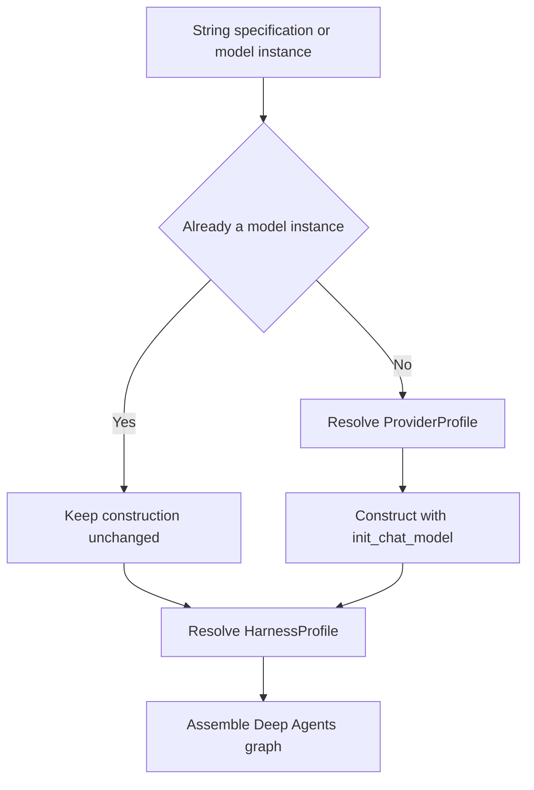
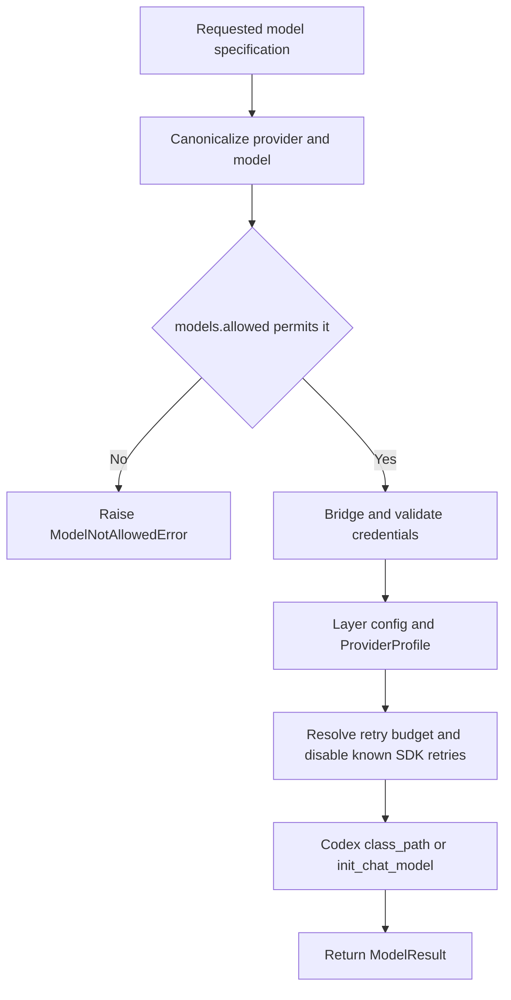
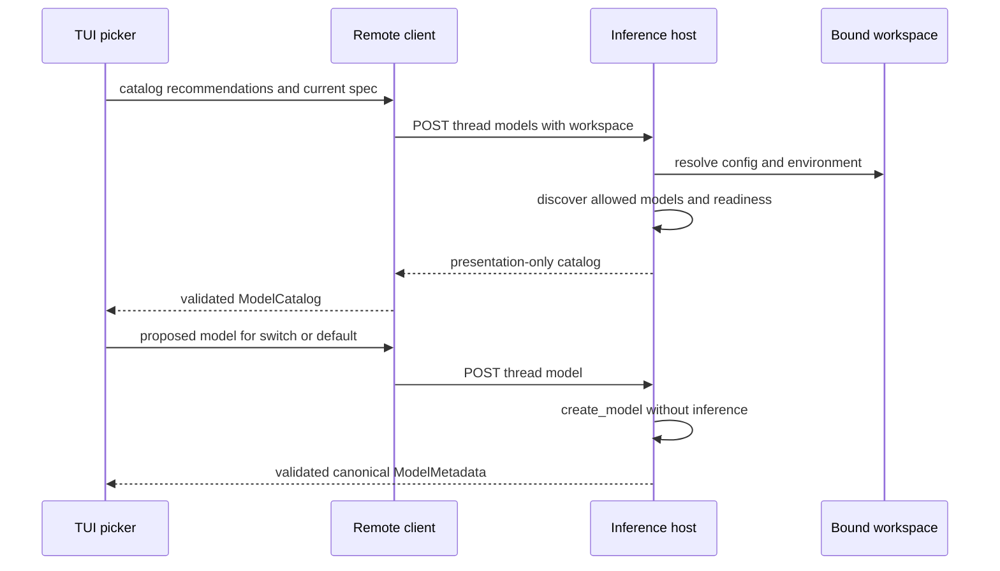

# Profiles and Models

"Profile" denotes several distinct control planes. SDK **ProviderProfile** controls construction of a model from a string; SDK **HarnessProfile** controls the Deep Agents graph after a client exists. dcode capability profiles describe model capabilities, while `models.allowed` is the admission policy. In client/server sessions, the server process that owns the workspace environment is also the authority for discovery, readiness, canonical validation, and the metadata used by the picker.

## Profile planes in the SDK

| Mechanism | Key | Controls | Does not control |
| --- | --- | --- | --- |
| `ProviderProfile` | `provider` or `provider:model` | `init_chat_model` kwargs, dynamic kwargs, and pre-initialization checks | Prompts, tools, or graph middleware |
| `HarnessProfile` | `provider` or `provider:model` | Prompts, tool visibility, middleware, and default subagent behavior | Model-client construction |
| dcode capability profile | `provider:model` | Advertised input, context, tool, and output capabilities | Client kwargs or admission |
| dcode `models.allowed` | canonical `provider:model` | Whether dcode may construct a resolved model | Provider enablement or display metadata |

Both SDK registries are beta APIs. Registration layers rather than replaces settings already registered for the same key, so register before resolving the relevant model or graph.

*Provider profiles participate in string-model construction; harness profiles shape the assembled agent.*

### Provider profiles

`resolve_model()` leaves an existing `BaseChatModel` unchanged. For a string, it resolves and applies a provider profile, then calls `init_chat_model`. A provider-level profile forms the base and an exact `provider:model` profile overlays it. Static kwargs merge with the exact value winning; chained `pre_init` hooks and factories run base first. Factory output overrides static profile kwargs, and explicit caller kwargs have final precedence. A failing `pre_init` prevents its factory and client construction.

Use this extension point for construction defaults, environment-derived kwargs, attribution headers, and preflight checks—not graph behavior. Registered `init_kwargs` are defensively copied and immutable, so mutation of the original caller mapping cannot subsequently change construction behavior.

### Harness profiles and graph boundaries

`create_deep_agent()` resolves the main model's harness profile after model resolution. Exact fields merge over provider fields. It also resolves a profile for each declarative synchronous subagent according to that subagent's model, then applies prompt, tool-description, and middleware changes. Prompt fragments assemble in `USER`, `BASE`, `SUFFIX` order.

A harness profile can override tool descriptions, hide model-visible tools, modify the default general-purpose subagent, and add static or factory `extra_middleware`. This reaches the main graph, generated general-purpose subagent, and SDK-assembled declarative synchronous subagents; it cannot alter an already compiled subagent or a remote asynchronous subagent, whose graphs are owned elsewhere. `HarnessProfileConfig` is the file-friendly YAML/JSON subset and deliberately excludes runtime-only middleware.

Middleware exclusion is stricter than tool exclusion: filesystem and synchronous-subagent middleware are protected scaffolding, and an unmatched exclusion fails graph assembly. Use `excluded_tools` to hide tools from the model. Its filter runs after tool-injecting and custom middleware, so it can hide supplied and middleware-added tools. This is model calibration, not authorization.

Profile bootstrap is lazy, thread-coordinated, and one-time. Built-ins load by direct import, then third-party provider and harness entry-point hooks layer over them. A broken built-in restores the prior registry and fails bootstrap; broken third-party discovery, loading, or invocation is logged and skipped.

`create_deep_agent()` installs prompt-caching middleware for the main graph, generated general-purpose subagent, and declarative synchronous subagents. Anthropic caching activates lazily per Anthropic request. Bedrock and Fireworks integrations are optional: a missing provider module omits them, while unrelated import errors propagate. Lookup caches a middleware class or absence but creates a fresh instance per stack.

## dcode construction: policy before side effects

Configuration resolves manifest options through managed policy, CLI, retained runtime reload, environment, user `config.toml`, and typed defaults, in precedence order. Managed configuration outranks user configuration, and `models.allowed` is an enforced managed-policy key.

`create_model()` accepts `provider:model` or a bare name, infers and canonicalizes its provider, and returns a `ModelResult`. The result deliberately separates construction from global runtime-state mutation; it carries resolved identity, profile-derived metadata, the effective retry budget, and any explicit CLI retry override needed for a later cross-provider switch.

*dcode admits a resolved model before credential work, profile hooks, or provider imports.*

The allowlist runs after provider inference but before credential bridging, provider-profile hooks or factories, and provider imports. A blocked request therefore cannot cause those side effects. After admission, stored `/auth` credentials can be bridged into the environment and dcode checks configured credentials unless the provider supports implicit authentication; missing credentials produce typed actionable errors.

Construction layers provider and per-model configuration, stored credentials, and SDK ProviderProfile output before `extra_kwargs`; runtime kwargs normally win. Provider-profile hook and factory failures become `ModelConfigError`. A configured provider `class_path` imports and instantiates the named `BaseChatModel` rather than using normal `init_chat_model` resolution, making it a trusted configuration/code-execution boundary.

After construction, dcode overlays configured capability fields and then `--profile-override` fields onto `model.profile`; a rejected CLI assignment fails strictly. Missing capability data warns, while explicit `tool_calling=False` fails agent-model validation.

### One retry owner and summary fallback

The model-node middleware owns dcode's visible retry budget so provider SDK retries do not multiply attempts. Precedence is `--max-retries`, provider-specific `[retries.<provider>].max_retries`, global `[retries].max_retries`, then the built-in default of `5`; `0` disables dcode retries. Recognized providers—or providers with retry-parameter metadata—have their SDK retry control forced off after kwargs merge. Unknown SDK retry controls are left intact with a warning and configuration escape hatch.

The concrete model is stamped with the resolved budget. Configurable-model middleware can substitute a request model without recompiling the graph, and retry middleware reads that request model's budget; a cross-provider switch therefore uses the selected provider's policy rather than stale middleware state.

`--summarization-model` wins over `[models].summarization_default`; absent (or blank explicit) selection uses the main model. `_LazySummaryModel` defers dedicated-model resolution until first compaction and serializes setup and invocation. Construction failure warns once and falls back to the main model. A dedicated-model invocation failure restores the main model's token counting, trimming, and retry tuning, retries that summary there, and resets state so a later compaction can retry the override; event-loop blocking errors are re-raised. A successful dedicated model gets dcode retry handling, provider-specific token counting, and a history budget of four fifths of a positive input window, preserving `--max-retries 0` instead of LangChain's generic summary retries.

## Inference-host catalog and metadata

The model picker must not treat its local Python environment as authoritative when inference runs in the server/workspace process. The server exposes private routes for cached launch metadata, a workspace-bound catalog, and workspace-bound proposed-model resolution. The remote client binds requests to the thread's workspace and validates the returned Pydantic/dataclass payloads before the UI uses them. Catalog or resolution input errors return `422`, a workspace conflict returns `409`, and unexpected server failures produce a `503` availability response rather than silently trusting client-side discovery.

*The inference host owns discovery and validation; the client receives only data it can safely render or commit.*

### A serialization-safe boundary

`ModelCatalog` carries model specs, scalar display capabilities, provider readiness and labels, policy presentation, and the retained current spec. It is strict about unexpected fields. The host deliberately filters capability profiles to a fixed scalar allowlist; constructor kwargs and arbitrary config/profile extensions do not cross the process boundary because they can hold credentials or executable data. `ModelMetadata` is likewise a frozen, provider-independent summary—name, provider, context limit, unsupported modalities, and structured-output support—and its payload contains no model instance or credentials. The client validates payload shape before it can replace runtime metadata.

Readiness is computed in the active inference environment. It includes authentication source/state, optional credential variable and detail, display names, and an install extra only when the provider package is absent. This permits a picker to present setup for configured custom providers even when discovery yields no rows, without exposing secrets. The `openai_codex` readiness branch represents ChatGPT's file-backed OAuth state rather than pretending it is an API key.

### Discovery and retention invariants

Discovery starts with `get_available_models()`, which loads installed provider profile data, configured lists, and suitable custom-provider profiles, subject to enabled-provider and `models.allowed` filtering. It separately adds known enabled providers for readiness/setup. Recommended specs and the active spec may be appended when allowed and enabled: recommendations can surface an install-required or profile-less integration, while the active spec is retained even if its integration is unavailable. Failures for one provider are logged and that provider is skipped rather than failing the catalog.

Main-role catalog requests apply main `profile_overrides`; auxiliary requests intentionally omit them. The picker's recommended-only view still unions the active model and recent selections with the curated set, so an in-use or personally recent choice does not disappear merely because it is no longer recommended. Onboarding remains deliberately curated.

For a server-backed picker, catalog readiness, provider labels, install state, and policy are host data; tests guard against consulting local provider discovery or readiness. An explicit `provider:model` with a host-recognized provider is rejected by catalog policy before installation or authentication setup. Inputs whose prefix is ambiguous—such as identifiers containing a colon—or lacks a recognized provider are deferred to the inference host for canonical provider inference, rather than being incorrectly rejected locally.

### Selection, validation, and persistence

The selector loads asynchronously so its frame and filter appear immediately. It retains typed filter input while the catalog request is pending, applies it once data arrives, and abandons late work if the modal was dismissed. Selecting a missing integration offers installation; missing credentials route to the relevant auth flow, with Codex using a confirmation-gated ChatGPT OAuth flow. Cancellation returns to the selector and refreshes readiness instead of committing a selection.

A selected session model is not yet a persisted default. Before saving a new main, classifier, or summarization default, the selector asynchronously resolves it through the same inference-host path (or, while disconnected, canonicalizes and allowlist-checks it locally). It persists the returned canonical `provider:model` only after validation succeeds. This keeps the keyboard responsive, avoids changing the active model merely to validate a default, and prevents a late completion after modal dismissal from writing. A missing provider integration cannot be newly stored because it could fail every future launch, though an already stored unavailable choice can still be cleared. Separate `DefaultModelScope` values ensure a classifier or summarization picker cannot overwrite `[models].default`.

## Talon compatibility

Talon is not a dcode session: it does not use dcode's `models.allowed`, `/auth` credential store, `ModelResult`, or retry policy. It applies `apply_provider_profile` before `init_chat_model` and builds graphs through `create_deep_agent`, so compatible SDK provider profiles, harness profiles, and prompt caching apply to its main model and SDK-assembled synchronous subagents.

Talon only accepts interactive switches from its discovered catalog, builds and caches an accepted model before activation, and stores it in turn-local state. Main-agent calls and summarization then use the selected model without recompiling the graph. Failed selection leaves the current/default model usable; subagents retain their own models.

## Operations and focused tests

`deepagents-code` 0.2.8 requires Python `>=3.14,<3.15` and pins `deepagents==0.7.38`; Deep Agents 0.7.38 supports Python `>=3.11,<4.0`. The dcode core includes Anthropic, Google GenAI, and OpenAI integration floors, with other providers as separately installable extras. `deepagents-talon` likewise requires Python `>=3.14,<3.15` and depends on `deepagents>=0.7.38` and `deepagents-code>=0.2.8,<1.0.0`.

Focused catalog and picker tests cover the host-authority boundary, strict readiness coherence, scalar catalog serialization, custom-provider setup with no discovered models, policy-before-setup behavior, ambiguous identifier deferral, recommendation/current retention, and asynchronous default validation and persistence races. When changing this area, preserve admission before construction side effects, host-owned readiness, presentation-only serialization, current/recent retention, and validation before activation or persistence.

## Related pages

- [Code agent architecture](/openwiki/architecture/code-agent.md)
- [Architecture overview](/openwiki/architecture/overview.md)
- [Configuration layering](/openwiki/concepts/config-layering.md)
- [Testing guide](/openwiki/testing/testing-guide.md)
- [Run a dcode session](/openwiki/workflows/run-dcode-session.md)
