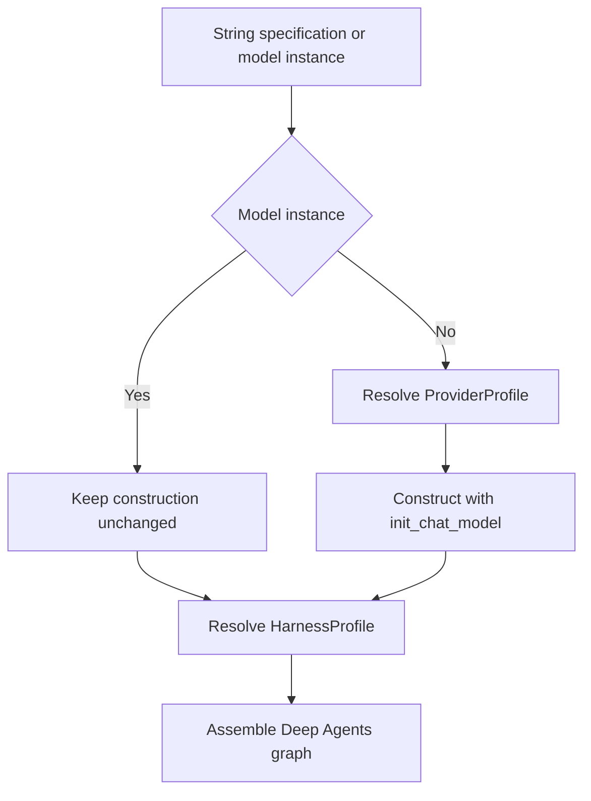
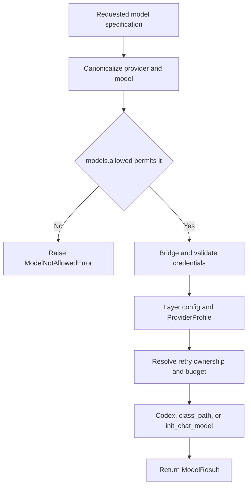

# Profiles and Models

"Profile" names separate mechanisms. An SDK **ProviderProfile** controls how a string model specification becomes a client. An SDK **HarnessProfile** controls the agent graph after a client exists. dcode capability profiles describe a model's capabilities, whereas `models.allowed` is its construction-policy boundary. Talon uses the SDK profile machinery, but has its own model-selection policy and lifecycle.

## Two SDK profile planes

| Mechanism | Key | Controls | Does not control |
| --- | --- | --- | --- |
| `ProviderProfile` | `provider` or `provider:model` | `init_chat_model` kwargs, dynamic kwargs, pre-initialization checks | Prompts, tools, or graph middleware |
| `HarnessProfile` | `provider` or `provider:model` | Prompt assembly, tool visibility, middleware, default subagent behavior | Model-client construction |
| dcode capability profile | `provider:model` | Advertised input/context/tool capabilities | Client kwargs or admission |
| dcode `models.allowed` | canonical `provider:model` | Whether dcode may construct the resolved model | Provider enablement or display metadata |

Both SDK registries are beta APIs. Registration is additive: registering again layers settings over the current entry rather than replacing it. Register before creating the model or graph that needs the behavior.

*Provider profiles participate in string-model construction; harness profiles shape the assembled agent.*

### Provider-profile resolution

`resolve_model()` returns a supplied `BaseChatModel` unchanged. For a string, it applies the resolved profile and calls `init_chat_model`. Provider-level settings are the base and exact `provider:model` settings overlay them. Static kwargs merge with the exact profile winning; chained `pre_init` hooks and factories run base first. Factory output overrides static profile kwargs, while explicit caller kwargs retain final precedence. A failing `pre_init` prevents its factory and client construction.

This is the extension point for constructor defaults, environment-derived kwargs, attribution headers, and preflight checks—not for agent behavior. `init_kwargs` are defensively copied and immutable, preventing later mutation of a caller-owned mapping from changing registered construction behavior.

### Harness-profile resolution and boundaries

`create_deep_agent()` resolves the main model's harness profile after model resolution. Exact profile fields merge over provider fields. It does the same for each declarative synchronous subagent based on that subagent's model. Prompt assembly is `USER`, then `BASE`, then `SUFFIX`.

A harness profile can override tool descriptions, exclude model-visible tools, modify the default general-purpose subagent, and add static or factory `extra_middleware`. The extra middleware reaches the main graph, generated general-purpose subagent, and SDK-assembled declarative synchronous subagents. It cannot alter an already compiled subagent or a remote asynchronous subagent, whose graphs are owned elsewhere. `HarnessProfileConfig` is the file-friendly YAML/JSON subset and deliberately excludes this runtime-only middleware capability.

Middleware exclusion is stricter than tool exclusion. The filesystem and synchronous-subagent middleware are protected scaffolding, and an unmatched middleware exclusion fails assembly. Use `excluded_tools` to hide tools from the model: its filter runs after tool-injecting and custom middleware, so it can remove both supplied and middleware-added tools. Tool visibility is calibration, not an authorization boundary.

### Bootstrap and plugins

Profile bootstrap is lazy and runs once per interpreter. A condition coordinates first access: other threads wait, while same-thread registration re-entry is permitted. Built-in provider and harness profiles register by direct import first; a failure restores the prior registries and propagates. Third-party, zero-argument hooks in `deepagents.provider_profiles` and `deepagents.harness_profiles` run afterward, so their registrations layer over built-ins. Entry-point enumeration, load, or invocation failures are logged/warned and skipped, preserving usable built-ins.

## dcode: policy, construction, and retries

`create_model()` accepts either `provider:model` or a bare model name, infers/canonicalizes the provider, and returns a `ModelResult`. The result separates construction from runtime-state mutation and carries identity, capability-derived metadata, the resolved retry budget, and the explicit CLI retry override needed if another provider is later selected.

*dcode admits a resolved model before work that can change credentials, run hooks, or import providers.*

### Admission, credentials, and kwargs

The allowlist runs after provider inference but before credential bridging, provider-profile hooks/factories, and provider imports. A blocked request therefore cannot cause those side effects. After admission, stored `/auth` credentials can be bridged into the environment and dcode checks configured credentials unless the provider supports implicit authentication; a missing credential produces a typed, actionable error.

dcode layers provider/per-model configuration and stored credentials, then SDK provider-profile output, then `extra_kwargs`; runtime kwargs normally win. Arbitrary profile hook/factory failures become `ModelConfigError`, keeping model-construction failures on dcode's actionable error path. A configured provider `class_path` instead imports and instantiates the named `BaseChatModel` class, so this configuration is a trusted code-execution boundary.

After construction, dcode overlays configured capability fields and then `--profile-override` fields onto `model.profile`; a CLI override fails strictly if it cannot be assigned. Missing capability data only warns, but an explicit `tool_calling=False` fails agent-model validation.

### One retry owner

The model-node middleware owns dcode's visible retry budget to avoid multiplication by provider SDK retry loops. The effective budget is chosen in order:

1. `--max-retries`
2. `[retries.<provider>].max_retries`
3. `[retries].max_retries`
4. Built-in default `5`

`0` disables dcode retries. For known providers—or a provider with configured retry parameter metadata—dcode forces the provider retry parameter to its disable value after merging user kwargs. If it cannot identify an unknown provider's retry control, it leaves that SDK behavior intact and warns with the configuration escape hatch.

The concrete model is stamped with the resolved budget. The configurable-model middleware can substitute a request model at runtime without recompiling the graph, and retry middleware reads the budget from that request model. Thus a cross-provider switch uses its provider's retry configuration rather than multiplying attempts or inheriting stale middleware state. Policy denials propagate; callers can otherwise preserve the current model unless strict resolution is requested.

## Dedicated dcode summarization model

`--summarization-model` takes precedence over `[models].summarization_default`; if neither selects a model, compaction uses the main model. A blank explicit CLI value also means main-model fallback. Resolution is deferred to first compaction, avoiding startup provider imports and allowing a broken optimization to degrade rather than wedge a session.

`_LazySummaryModel` serializes setup and invocation with locks and constructs the selected model under its captured environment. On construction failure, it warns once and summarizes with the main model. If the dedicated model builds but cannot generate a summary, it restores main-model token counting, trimming, and retry behavior, retries that summary on the main model, and resets its configured state so a later compaction can retry the override. Event-loop blocking errors are programming failures and are re-raised.

A successful dedicated model gets dcode retry handling, provider-appropriate token counting, and a history limit of four fifths of a positive input window (or a conservative fallback). Replacing LangChain's generic summary retry wrapper preserves `--max-retries 0` for summaries.

## Talon compatibility and model switching

Talon is not a dcode session: it constructs models from its own environment and does not use dcode's `models.allowed`, `/auth` credential store, `ModelResult`, or retry policy. Its runtime applies `apply_provider_profile` before `init_chat_model` when it builds a model, so provider-profile construction behavior is shared. Its graph is assembled through `create_deep_agent`, so compatible harness profiles remain applicable to the main model and SDK-assembled synchronous subagents.

Talon restricts interactive `/model` switching to an exactly matched catalog discovered from installed, credentialed providers (and configured gateway models). It validates and builds a selected model before activating it, caches it, and places it in a turn-local context so a selected model replaces the main-agent request model without recompiling the graph. Its selection and summarization middleware also build/cache a summarizer for the selected model, sizing compaction to that model's profile; subagents retain their own models. A failed selection leaves the existing/default model usable.

This division matters operationally: installing an SDK profile does not install a LangChain provider package, and dcode's provider extras do not automatically make a provider eligible for Talon. Configure each host's credentials and admission/selection policy independently.

## Package constraints and focused tests

The current dcode package is `0.2.7`, requires Python `>=3.14,<3.15`, and pins `deepagents==0.7.35`. Deep Agents `0.7.35` supports Python `>=3.11,<4.0` and requires LangChain `>=1.4.10,<2.0.0`, LangChain Core `>=1.7.7,<2.0.0`, `langchain-anthropic>=1.7.10,<2.0.0`, and `langchain-google-genai>=4.4.3,<5.0.0`. The SDK's broader Python range does not widen dcode's released contract.

The dcode core includes Anthropic, Google GenAI, and OpenAI integrations; other provider integrations are separately installable extras. Profile registration only changes resolution behavior—it cannot provide an absent integration.

Focused regression coverage includes dcode model construction/retry tests, lazy summary fallback tests, SDK provider/harness profile tests, and Talon's model-selection tests. When changing this area, preserve admission-before-side-effects ordering, one retry owner, construction-versus-harness separation, and the fact that prebuilt or remote subagents retain ownership of their own graph stacks.

## Related pages

- [SDK construction and execution](/openwiki/architecture/sdk-construction-execution.md)
- [Configuration layering](/openwiki/concepts/config-layering.md)
- [Subagents and skills](/openwiki/concepts/subagents-skills.md)
- [Talon runtime integration](/openwiki/integrations/talon.md)
- [Run a dcode session](/openwiki/workflows/run-dcode-session.md)
