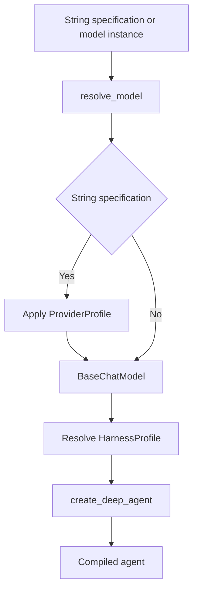
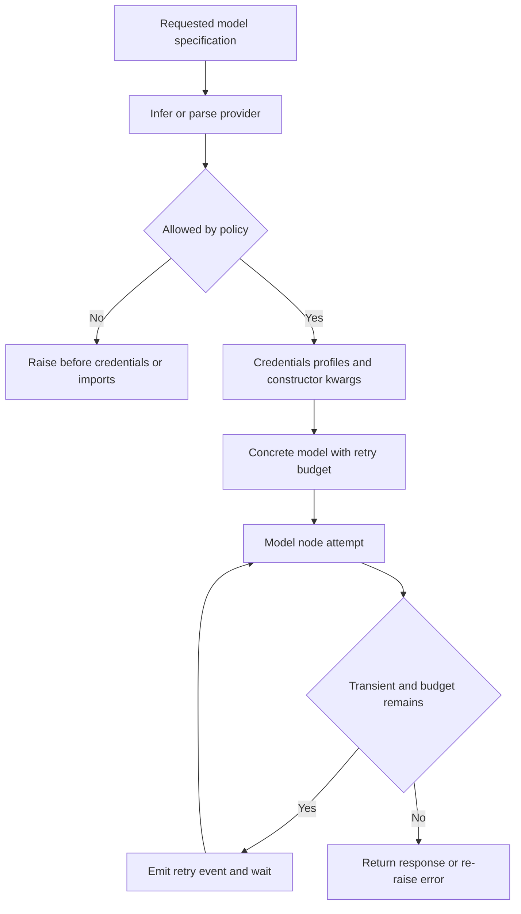
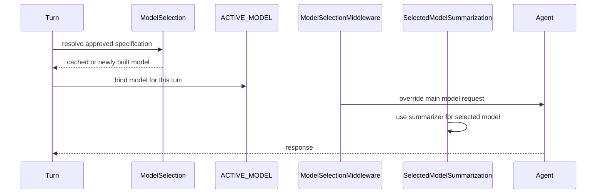

# Profiles and Models

“Profile” names three different concerns in this repository. A Deep Agents **provider profile** configures how a string model is constructed; a Deep Agents **harness profile** configures the agent assembled around a model; and a model object's capability `profile` supplies metadata such as its input-token limit. dcode also has provider configuration, credentials, policy, and retries. Do not treat a familiar model-name prefix as proof that an integration is installed, credentialed, or selectable.

## Compatibility and installation boundary

`deepagents-code` 0.1.86 requires Python `>=3.12,<4.0` and pins its SDK dependency exactly to `deepagents==0.7.28`. The checked-out SDK declares the same 0.7.28 version but supports Python `>=3.11,<4.0`; dcode's stricter Python range and exact pin are the release contract. The editable `../deepagents` UV source mapping is for monorepo development only, not a widening of published compatibility.

When a dcode change needs new SDK behavior, update the exact pin in the same PR. Release checking rejects a pin older than the workspace SDK unless `dangerous-skip-sdk-pin-check` is used; an ahead-of-workspace pin is allowed for deliberate prerelease coordination.

The dcode base install carries the Anthropic, Google GenAI, and OpenAI integrations. Other integrations are optional extras—for example, `deepagents-code[fireworks]` and `deepagents-code[openrouter]`—and `deepagents-code[all-providers]` aggregates the declared model-provider extras. Dependency ranges in the manifest, not a model string's spelling, are the compatibility evidence for an integration.

Talon is separately experimental/alpha: `deepagents-talon` 0.0.9 requires Python `>=3.12`, depends on `deepagents>=0.7.24` and `deepagents-code>=0.1.71,<1.0.0`, and also maps both siblings to editable sources during monorepo work. It therefore does **not** inherit dcode's exact SDK pin as its own declared package contract.

## Deep Agents SDK profiles

The beta `deepagents.profiles` API has two additive registries. Both accept a provider-wide key such as `openai` or an exact `provider:model` key; only the first colon is structural, so model IDs may contain further colons.

| Registry | Applies when | Responsibility |
| --- | --- | --- |
| `ProviderProfile` | `resolve_model()` receives a string | Supplies `init_chat_model` kwargs, an optional runtime kwargs factory, and an optional `pre_init` hook. |
| `HarnessProfile` / `HarnessProfileConfig` | `create_deep_agent()` has a resolved model | Adjusts prompt material, tool descriptions and visibility, middleware, and default general-purpose-subagent behavior. |

Caption: provider profiles affect string construction; harness profiles affect the graph built around either a constructed or caller-supplied model.

`resolve_model()` passes an existing `BaseChatModel` through unchanged. Only string resolution calls `apply_provider_profile()` and then `init_chat_model()`, so register a construction profile before resolving a string; it cannot retrofit a pre-built model. In contrast, a harness profile can still be selected for a pre-built model from its reported provider and identifier.

Registration layers over, rather than replaces, prior settings. Exact model profiles layer on provider profiles. For provider profiles, base hooks and factories run first, factory output overrides static defaults, and caller kwargs have final precedence. Harness profile merging is field-specific: scalar prompt values use an explicitly set exact-model value, description maps merge by key, exclusions union, same-type middleware is replaced in place while new middleware is appended, and the general-purpose-subagent settings merge field by field.

`create_deep_agent()` resolves the main string model, selects its harness profile, and performs the same model/profile resolution for each declarative subagent. It applies profile prompt and tool-description changes while assembling middleware. Required filesystem and subagent scaffolding cannot be excluded; invalid, private, ambiguous, or unmatched middleware exclusions fail rather than silently changing the graph.

Profile bootstrap is lazy and coordinated between threads. Built-ins are registered by direct imports, then third-party zero-argument entry-point hooks in `deepagents.provider_profiles` and `deepagents.harness_profiles` may layer registrations over them. A broken built-in aborts and restores the pre-bootstrap registry state; a broken third-party plugin is warned about and skipped. Plugin ordering is not a supported precedence mechanism.

## dcode construction, policy, and retry ownership

dcode's `create_model()` is the inference-host construction entrypoint. It parses or infers the provider, computes the canonical spec, then enforces `models.allowed` **before** credential bridging, provider profile hooks, or provider imports. A rejected request consequently cannot trigger those side effects. After the gate, dcode obtains provider defaults and per-model configuration, applies stored credentials and an SDK `ProviderProfile`, then applies `extra_kwargs`; runtime parameters normally have highest precedence, except that dcode forces off a known provider-owned retry knob.

A configured `class_path` is an explicit custom-provider extension point and imports configured Python; configuration that uses it must be trusted. Missing provider packages, initialization errors, missing credentials, and policy denial are surfaced as model-configuration failures rather than being inferred by a client.

Capability metadata is separate from constructor kwargs and harness profiles. dcode overlays upstream model metadata with `config.toml` profile overrides and then CLI/workspace overrides, applying the effective fields to the concrete model. `ModelResult` extracts `max_input_tokens` and unsupported input modalities from that object profile; these values guide runtime behavior but do not themselves establish provider support.

Dcode owns model-node retries so a transient model failure does not replay already completed tools. It stamps the selected model's resolved retry budget, disables a known provider SDK retry loop to avoid multiplying attempts, and has the middleware read the budget from the request model—so a runtime switch carries its provider-specific budget. It retries classified transient failures with exponential backoff or usable `Retry-After`, emits correlated attempt and retry events, and re-raises terminal failures rather than returning error text as a model answer.

Caption: the policy gate precedes construction side effects; retries wrap one model-node attempt rather than a whole agent turn.

## Talon: selectable models and model-dependent runtime surface

Talon's `/model` facility is not a static provider allowlist. `discover_models()` starts from dcode's available-model catalog, retains only providers with the required credential present in **Talon's** environment, and can add models returned by a validated LangSmith unified-gateway catalog. A dcode stored credential alone does not qualify a Talon provider. The default graph model remains selectable even if discovery does not list it.

`ModelSelection` requires an exact `provider:model` catalog match before building a non-default model; unknown selections raise `UnknownModelError`. It builds an approved alternative only on first use, caches it under a lock, and returns `None` for the default so no override is needed. Discovery and construction can block, so async callers must run resolution in a thread.

For a turn with a selected model, `ModelSelectionMiddleware` substitutes it into every main-agent model call without recompiling the graph. It is outermost, allowing inner middleware such as prompt caching to see the selected model. `ACTIVE_MODEL` is a context variable, keeping the override scoped to the current turn.

Model selection also changes context management. The SDK summarizer would otherwise size input against the startup model, so `SelectedModelSummarization` occupies the summarizer slot and lazily caches a summarizer per selected model. Its trim limit is 80% of a valid `profile["max_input_tokens"]`, falling back to 4,000 tokens when unavailable. Delegated subagents deliberately retain the startup summarizer and model.

Caption: Talon validates and lazily resolves the selection, then makes both main calls and summarization follow that turn's model.

## Focused verification and change guidance

- SDK `test_models.py` covers pass-through of an existing `BaseChatModel` and provider-profile kwargs for strings. Profile code and graph tests cover lookup/merge behavior, bootstrap isolation, and harness application.
- dcode model-configuration tests should cover the ordering-sensitive policy gate and retry configuration; retry tests cover transient classification, backoff, event correlation, and terminal re-raise behavior.
- Talon `test_model_selection.py` covers credential-filtered discovery, exact-match rejection, lazy build-and-cache behavior, gateway validation, model-specific context budgets, and startup-model behavior for subagents.

When adding a provider, declare its package dependency or extra, credential mapping, discovery behavior, constructor/retry behavior, and tests independently. When adding a profile, decide whether it belongs to construction or graph assembly and test that boundary. When changing Talon selection, preserve the exact catalog validation and ensure any model-dependent middleware—especially summarization—uses the model actually selected for the turn.

## Related pages

- [Code agent](/openwiki/architecture/code-agent.md)
- [Architecture overview](/openwiki/architecture/overview.md)
- [Configuration layering](/openwiki/concepts/config-layering.md)
- [Development](/openwiki/operations/development.md)
- [Run a dcode session](/openwiki/workflows/run-dcode-session.md)
