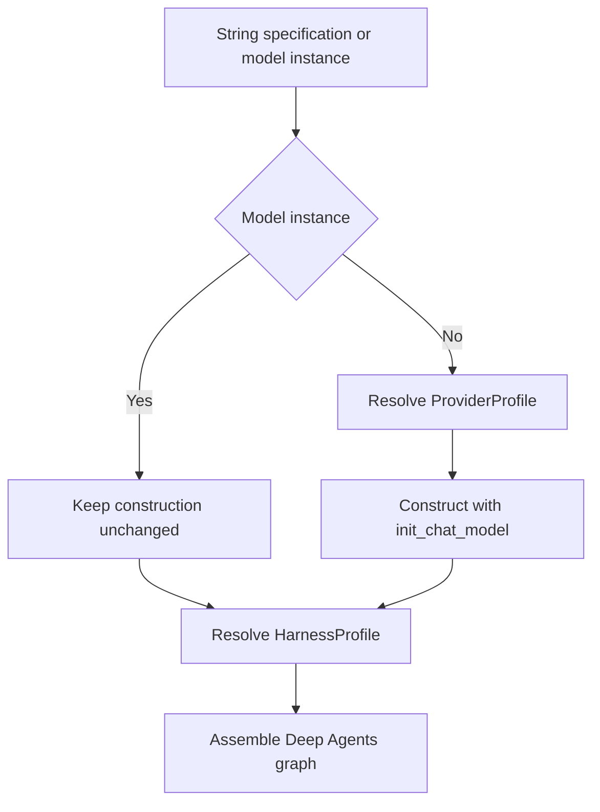
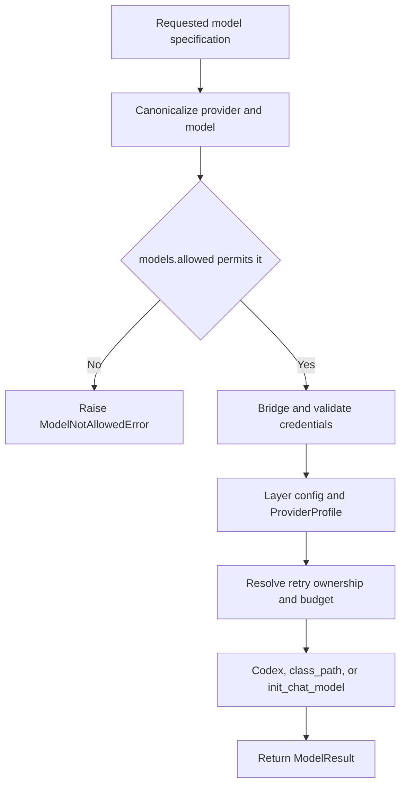

# Profiles and Models

"Profile" has several deliberately separate meanings. SDK **ProviderProfile** controls construction of a chat-model client from a string specification. SDK **HarnessProfile** controls the agent stack after a model has been built. dcode capability profiles describe model capabilities; they inform discovery and runtime features, but do not authorize construction. `models.allowed` is the dcode admission boundary.

## Responsibilities and extension boundary

| Mechanism | Key | Controls | Does not control |
| --- | --- | --- | --- |
| SDK `ProviderProfile` | `provider` or `provider:model` | `init_chat_model` kwargs, dynamic kwargs, and pre-initialization checks | Prompts, tools, and graph middleware |
| SDK `HarnessProfile` | `provider` or `provider:model` | Prompt assembly, tool visibility, middleware, and default-subagent behavior | Model-client construction |
| dcode capability profile | `provider:model` | Advertised capabilities such as context and reasoning support | Constructor kwargs or admission |
| dcode `models.allowed` | canonical `provider:model` | Whether dcode may construct a resolved model | Provider enablement or display metadata |

Both SDK registries are beta APIs and registrations are additive: a later registration layers over the existing entry instead of replacing it. Register an SDK profile before constructing the model or graph that needs it.

Diagram: provider profiles participate only in string-model construction, while harness profiles shape the assembled agent.

### Provider profiles: string construction only

`resolve_model()` returns a supplied `BaseChatModel` unchanged. For a string, it applies the matching provider profile and passes the resulting kwargs to `init_chat_model`. A provider-level profile is the base; an exact `provider:model` profile overlays it. Static kwargs merge with the exact profile winning; chained `pre_init` hooks and factories run base first. Factory output supersedes static profile kwargs, while caller kwargs have final precedence. A failed `pre_init` aborts construction before its factory or `init_chat_model` run.

A `ProviderProfile` is therefore the place for client defaults, environment-derived kwargs, attribution headers, and preflight checks. It is not an agent-behavior customization point. The profile's static `init_kwargs` are defensively copied and read-only, so mutating a caller-owned mapping after registration does not alter future construction.

### Harness profiles: graph assembly

`create_deep_agent()` resolves the matching `HarnessProfile` after resolving the main model. Exact keys merge over provider keys field by field; it similarly resolves a profile for each declarative synchronous subagent according to that subagent's model. The caller prompt is assembled as `USER`, then profile `BASE`, then profile `SUFFIX`.

A harness profile can override tool descriptions, exclude tools, alter the default general-purpose subagent, and add static or factory `extra_middleware`. Extra middleware applies to the main agent, generated general-purpose subagent, and declarative synchronous subagents that the SDK assembles. It cannot be injected into already compiled subagents or remote asynchronous subagents. `HarnessProfileConfig` is the YAML/JSON-friendly subset and intentionally excludes this runtime-only middleware facility.

Middleware exclusion is deliberately stricter than tool exclusion. The filesystem and synchronous-subagent middleware are protected scaffolding; excluding either fails rather than creating a silently broken agent. An exclusion that matches no assembled middleware also fails. Use `excluded_tools` to hide tools from the model: the tool exclusion layer runs after tool-injecting and custom middleware.

### Registry lifecycle and plugins

Profile bootstrap occurs lazily on first registry access. One thread loads it while other threads wait, and same-thread re-entry during plugin registration is allowed. Built-in provider and harness registrations run by direct import first. A built-in failure restores the pre-bootstrap registries and propagates; it is an SDK defect, not an optional integration. Third-party zero-argument entry-point hooks from `deepagents.provider_profiles` and `deepagents.harness_profiles` run afterward, so they layer on the built-ins. Entry-point discovery or plugin failures are warned about and skipped, preserving usable built-ins.

## dcode construction policy and precedence

`create_model()` accepts an explicit `provider:model` specification or a bare model name, resolves the effective provider, and returns a `ModelResult` rather than mutating global runtime state directly. That result includes the resolved provider/model identity, profile-derived context and unsupported-modality metadata, the effective retry budget, and the explicit CLI retry setting needed if a later switch uses another provider.

Diagram: dcode performs policy admission before provider-facing construction work.

The allowlist is applied after provider inference but before credential bridging, profile hooks or factories, and provider imports. Thus a denied model cannot cause those side effects. After admission, stored `/auth` credentials may be bridged to the environment; dcode then checks explicitly configured credentials unless the provider supports implicit authentication. Missing credentials become an actionable typed error.

Construction kwargs layer from provider/per-model dcode configuration and stored credentials through SDK provider-profile output to `extra_kwargs`; runtime kwargs normally win. dcode translates arbitrary provider-profile hook or factory failures into `ModelConfigError` so model-construction failures follow its actionable error path. A configured provider `class_path` bypasses `init_chat_model` and imports/instantiates the named `BaseChatModel` class, making it a trusted configuration boundary.

After construction, dcode overlays configured capability-profile fields and then `--profile-override` fields onto `model.profile`; the CLI override is strict if assignment fails. Capability data is descriptive: a missing profile warns, while an explicit `tool_calling=False` fails capability validation for an agent model.

## Retry ownership and runtime switching

dcode owns the visible model-node retry budget to avoid nested provider SDK loops multiplying requests. The effective budget is selected in descending precedence:

1. `--max-retries`
2. `[retries.<provider>].max_retries`
3. `[retries].max_retries`
4. Built-in default `5`

`0` disables dcode retries. dcode identifies known provider retry kwargs—or a configured `[retries.<provider>].param` override—and forces the provider loop to its disable value after user kwargs have been merged. For an unknown provider whose retry control cannot be identified, it keeps the SDK behavior and emits a warning with the configuration escape hatch.

The resolved budget is attached to the concrete model. `ConfigurableModelMiddleware` can rebuild a request model from runtime context without recompiling the graph; the retry middleware then reads the budget on that request's model, so a switch to another provider uses that provider's configuration. Policy denials always propagate. Other construction errors can retain the current model unless strict resolution is enabled.

## Dedicated summarization model

`--summarization-model` selects a model used only for context-compaction summaries. When the flag is absent, dcode uses `[models].summarization_default`; absent both, summaries use the main agent model. An explicit blank CLI value selects the same main-model fallback. Resolution is intentionally deferred until the first summary so an invalid dedicated model does not delay launch with provider imports.

When compaction first needs a configured dedicated model, `_LazySummaryModel` constructs it under the captured environment and serializes configuration and invocations with locks. On construction failure it logs once and summarizes with the main model; if the dedicated model later fails to generate a summary, it restores main-model token counting, trimming, and retries, then retries that summary with the main model. It resets the dedicated configuration so a later compaction may try the override again. Blocking-event-loop failures are programming errors and are re-raised rather than degraded.

A successful dedicated model receives dcode's retry invoker, its provider-appropriate token counter, and an input history limit of four fifths of its positive `max_input_tokens` (with a conservative fallback otherwise). Replacing LangChain's generic summary retry wrapper is significant: `--max-retries 0` remains effective for summaries too.

## Package constraints and operations

The current dcode package is `0.2.6`, requires Python `>=3.14,<3.15`, and pins `deepagents==0.7.35`. Deep Agents `0.7.35` supports Python `>=3.11,<4.0` and requires LangChain `>=1.4.9,<2.0.0`, LangChain Core `>=1.7.6,<2.0.0`, `langchain-anthropic>=1.7.10,<2.0.0`, and `langchain-google-genai>=4.4.3,<5.0.0`. The SDK's broader Python range does not expand dcode's release contract.

The dcode core includes Anthropic, Google GenAI, and OpenAI integrations. Other providers are optional extras; install the matching extra before selecting that provider. In particular, a profile registration does not install its underlying provider integration.

Focused regression coverage lives in `libs/code/tests/unit_tests/test_config.py` for model creation and retry configuration, `test_main.py` for CLI summarization precedence, `test_compact_tool.py` for lazy summary-model fallback and retry behavior, and the Deep Agents profile tests for construction and graph-profile semantics. When changing this area, preserve the admission-before-side-effects ordering, retry ownership, and the construction-versus-harness boundary.

## Related pages

- [Middleware stack](/openwiki/architecture/middleware-stack.md)
- [Configuration layering](/openwiki/concepts/config-layering.md)
- [Development](/openwiki/operations/development.md)
- [Run a dcode session](/openwiki/workflows/run-dcode-session.md)
