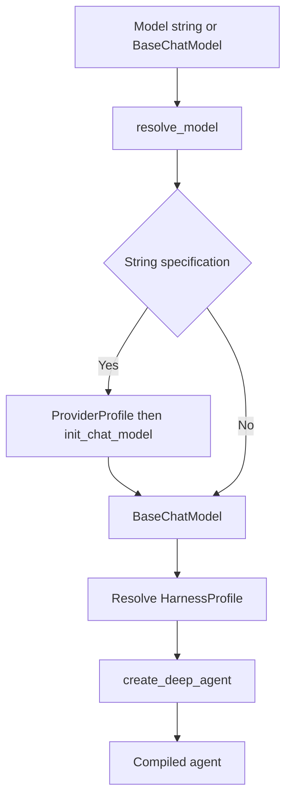
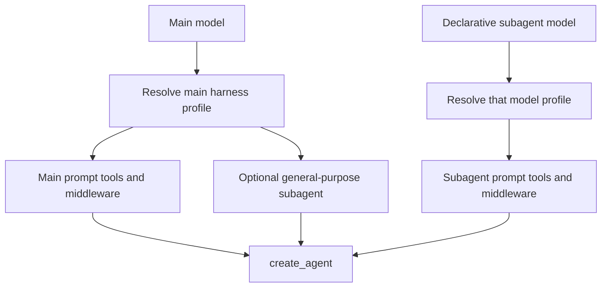
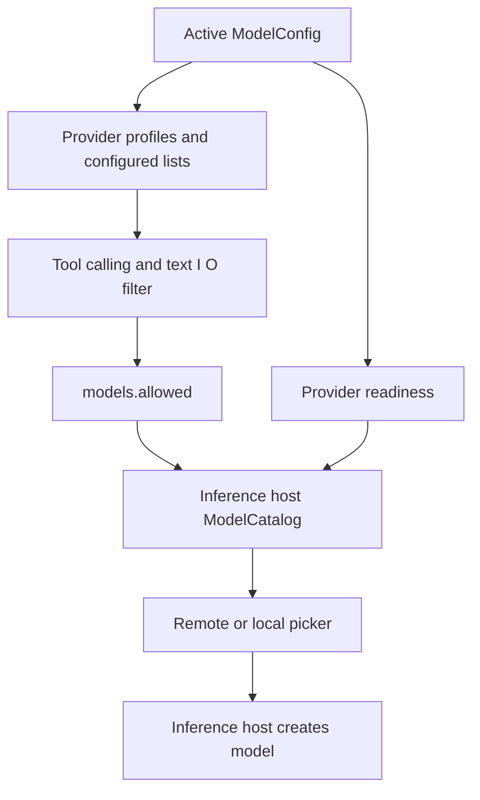
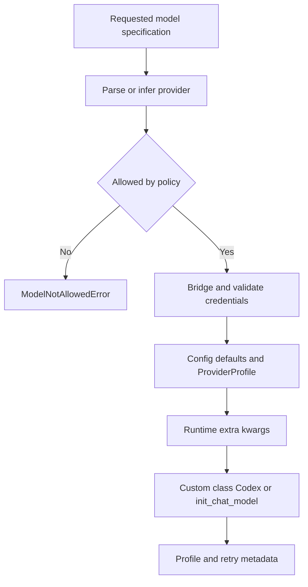

# Profiles and Models

A model specification, an SDK profile, and dcode configuration solve different problems. In the Deep Agents SDK, a **provider profile** supplies model-construction defaults for a string specification and a **harness profile** shapes the agent graph around an already resolved model. dcode separately owns the product-facing model list, credentials, policy, construction parameters, runtime switching, capability display, and retry budget. An installed integration or SDK profile therefore does not itself make a model selectable, credentialed, or allowed by dcode.

## SDK profiles: construction versus harness behavior

`deepagents.profiles` is a beta API with two additive registries. Keys are either a provider such as `openai` or an exact `provider:model` spec; only the first colon is a separator, so a model identifier may contain additional colons. Re-registering a key layers fields onto its existing registration instead of replacing it.

| Registry | Consumer and phase | What it can change |
| --- | --- | --- |
| `ProviderProfile` | `resolve_model()` while resolving a **string** through `init_chat_model()` | static and runtime-derived constructor kwargs; `pre_init` checks or side effects |
| `HarnessProfile` / `HarnessProfileConfig` | `create_deep_agent()` after a model exists | prompt slots, tool descriptions and visibility, middleware, and the auto-added general-purpose subagent |

Caption: provider profiles affect string-model construction, while harness profiles shape the graph around either a constructed or supplied model.

`resolve_model()` returns a supplied `BaseChatModel` unchanged. It invokes `apply_provider_profile()` and `init_chat_model()` only for a string. Thus a provider profile cannot retrofit constructor settings onto an existing instance, but a harness profile can still apply when the instance exposes its provider and identifier. Custom integrations that cannot return a mapping from `_get_ls_params()` lose provider-based matching; SDK logging makes that inspection failure visible.

### Provider-profile precedence and failure behavior

Lookup overlays an exact profile on the provider profile. The resulting static kwargs merge base first; the exact profile wins conflicts. Both `pre_init` hooks run base first, and both dynamic factories run base first. Factory output overrides static profile kwargs, and explicit caller kwargs have final precedence. If a hook or factory raises, later chained work does not run and construction fails.

`ProviderProfile.init_kwargs` is copied and exposed read-only, avoiding a later mutation of the caller's dictionary changing a registration. Use a factory for values that must be read at resolution time, such as an environment variable. Use `pre_init` only for work that must happen before client construction, because it is a side-effect boundary.

Profile registration triggers lazy bootstrap. The SDK imports built-in provider and harness registrations directly, then invokes zero-argument third-party entry points from `deepagents.provider_profiles` and `deepagents.harness_profiles`. Bootstrap runs once and coordinates concurrent callers; other threads do not see a partial registry. A broken built-in restores the prior registry and fails loudly. Broken entry-point enumeration, loading, non-callable targets, or registration are logged or warned and skipped. Plugin ordering is not a precedence contract, so competing plugins should not depend on order.

## Harness profiles and graph assembly

Harness lookup merges an exact registration over a provider-level registration. Scalar prompt slots replace when set; tool-description maps merge by key; tool and middleware exclusions union; same-class extra middleware replaces in the original slot and new middleware appends; and `GeneralPurposeSubagentProfile` fields merge independently. A profile miss is normal and produces an empty profile.

For a model string, the original spec is the lookup key. For a pre-built instance, the SDK tries exact `provider:identifier` candidates before a provider fallback; if the identifier itself is qualified it is also an exact candidate. This distinction avoids treating a bare model identifier as a provider name.

Caption: `create_deep_agent()` resolves harness behavior separately for the main model and each declarative subagent model.

The resolved profile supplies prompt additions, description rewrites, extra middleware, exclusions, and subagent defaults during assembly. `extra_middleware` can be an instance sequence or a factory, and is applied to SDK-assembled main, general-purpose, and declarative synchronous subagent stacks—not already compiled or remote async subagents. The declarative `HarnessProfileConfig` intentionally excludes runtime-only middleware and supports name-based middleware exclusion; converting a runtime profile with unrepresentable middleware back to config fails rather than silently dropping it.

The default `general-purpose` subagent is inserted unless the profile disables it or the caller supplies an explicit subagent of that name. `enabled=False` together with no synchronous subagents removes the `task` tool; async subagents are independent. A GP-specific prompt overrides `base_system_prompt` for that subagent, while a profile suffix still follows it.

Exclusions are calibration, not an authorization mechanism. The SDK refuses to remove filesystem and subagent scaffolding, rejects private or malformed exclusion names, and verifies that every requested exclusion matched an assembled stack. Tool exclusion runs after tool-injecting and custom middleware, so it can remove injected tools and cannot be undone by later custom middleware. A `task` description override should retain `{available_agents}` or the model will not be told which subagents exist.

## dcode model selection is separate product configuration

The `deepagents-code` distribution pins the SDK to `deepagents==0.7.32`, ships core Anthropic, Google GenAI, and OpenAI integrations, and exposes additional providers as optional dependency extras. That packaging compatibility is distinct from profile matching: provider installation enables code availability, while configuration, credentials, policy, and capability checks decide whether dcode can use it.

### Catalog and discovery

`load_model_catalog()` runs in the inference environment and returns a strict presentation snapshot, not constructor configuration. It crosses model specs, scalar display capabilities, override provenance, provider readiness, allowlist metadata, and an optional current spec—but never arbitrary profile extensions or constructor kwargs that could carry credentials or executable data. Remote pickers must use this supplied snapshot instead of inspecting local provider state, and apply its policy before offering setup actions.

Caption: catalog discovery and construction remain on the inference host; the picker receives a constrained presentation and policy view.

Profile-derived discovery includes only enabled providers and models advertising tool calling plus usable text input and output. Explicit configured lists are merged afterward, and configured `class_path` providers can discover their package `_profiles` data. Ollama can contribute installed daemon models. `models.allowed` filters the final lineup; recommended and current specs survive only when their provider is enabled and policy permits, with the active current spec eligible even when its integration has no discovered row.

Readiness is independent from model rows. Known credential-mapped, configured, built-in, and Codex providers can appear with setup metadata even when no models were discovered. An install-extra hint appears only when the provider package is absent.

### Construction order and policy boundary

`create_model()` is dcode's construction entry point, not SDK `resolve_model()`. It parses or infers the canonical provider/model specification and checks `models.allowed` before stored-credential bridging, profile hooks, or provider imports. A denial raises `ModelNotAllowedError` without those side effects.

Caption: policy is intentionally checked after canonical inference but before construction side effects.

After the gate, dcode layers provider and per-model configuration, applicable stored credentials, and SDK `ProviderProfile` defaults. Runtime `extra_kwargs` win last. A configured `class_path` imports and instantiates trusted Python code; Codex follows a separate OAuth-aware construction path rather than ordinary `init_chat_model()`. dcode then layers configured capability-profile overrides and CLI `--profile-override` values on the concrete model. Missing model profiles are a best-effort warning condition, but explicit `tool_calling=False` is fatal for an agent.

## Runtime changes, reasoning, and retries

`ConfigurableModelMiddleware` reads `model` and `model_params` from LangGraph runtime context. It constructs a replacement only if the requested spec differs from the current model, shallow-merges request settings, strips Anthropic-only settings on a cross-provider change, and patches the Model Identity prompt section. A blocked switch always propagates. Other `ModelConfigError` failures propagate in strict mode; otherwise dcode logs the failure and retains the construction-time model without falsely overwriting checkpointed parameters. Successful calls persist the resolved spec and runtime-only settings for resume, while cache identity separately tracks effective configured settings and endpoint identity. Async construction and blocking configuration reads are offloaded from the event loop.

Reasoning effort is driven by dcode model capability profiles, not harness profiles. dcode exposes effort only for profiles with `reasoning_output=True` and valid effort levels, recognizes several provider-native representations, removes previous native/canonical effort fields, and writes the portable `reasoning_effort` setting while preserving unrelated parameters. For Anthropic `thinking.type="between_tools"`, available levels are restricted to `low`, `medium`, and `high`.

The model-node retry middleware owns dcode's user-visible retry budget. Construction resolves the provider or CLI budget, disables recognized provider SDK retry loops to prevent nested multiplication, and stamps the constructed model with its own budget. This makes a runtime switch use the replacement's budget; models that cannot receive metadata fall back to the middleware startup budget.

`CodeModelRetryMiddleware` wraps only model-node calls, rather than a whole agent turn, so completed tool calls are not replayed. It retries classified transient failures with valid capped `Retry-After` or jittered exponential backoff within the interactive delay budget. Non-transient and exhausted failures are re-raised rather than converted to an AI response. Attempt and retry lifecycle events carry a call identifier, allowing stream consumers to mark output from a superseded attempt as incomplete.

## Verification and safe changes

SDK unit coverage exercises string construction with profile kwargs, existing-model pass-through, exact/profile fallback for pre-built models, profile merge behavior, bootstrap isolation, and harness effects for main and declarative subagent stacks. `test_graph.py` is especially important when changing profile application order, exclusion coverage, prompt slots, or default-subagent behavior.

For dcode changes, preserve the ordering-sensitive allowlist gate and test it separately from credential and import behavior. Test catalog changes at the inference-host boundary: capability projection/redaction, configured-list merging, disabled providers, policy filtering, current/recommended models, readiness without rows, and remote picker policy. Treat a new provider as several independent integration decisions: package/extra, configuration and credential mapping, discovery, policy, construction, capability metadata, reasoning support, and retry ownership.

## Related pages

- [Middleware stack](/openwiki/architecture/middleware-stack.md)
- [SDK construction and execution](/openwiki/architecture/sdk-construction-execution.md)
- [Configuration layering](/openwiki/concepts/config-layering.md)
- [Middleware catalog](/openwiki/concepts/middleware-catalog.md)
