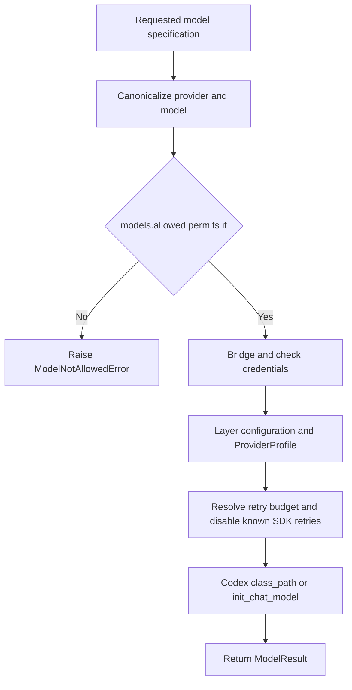
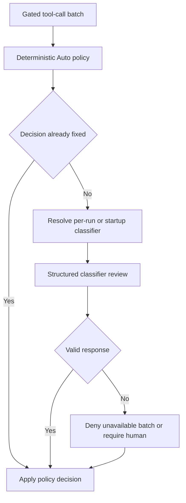
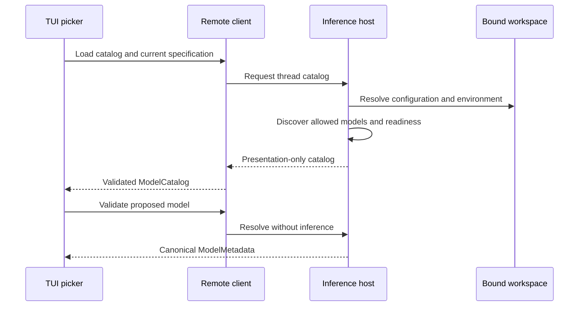

# Profiles and Models

"Profile" has different meanings at three boundaries. In the Deep Agents SDK, a **ProviderProfile** changes how a string model specification becomes a client and a **HarnessProfile** changes the agent graph around that client. In dcode, capability profiles are display and validation metadata, while `models.allowed` is the construction policy. Talon has its own environment-based catalog and turn-local switching; it is not a dcode session.

## Control-plane map

| Plane | Owner and key | Controls | Does not control |
| --- | --- | --- | --- |
| SDK `ProviderProfile` | Deep Agents; `provider` or `provider:model` | `init_chat_model` kwargs, dynamic kwargs, and pre-initialization checks | Prompts, tools, graph middleware |
| SDK `HarnessProfile` | Deep Agents; `provider` or `provider:model` | Prompts, tool visibility, middleware, and default subagent behavior | Model-client construction |
| dcode capability profile | dcode; `provider:model` | Advertised input, context, tool, and output capabilities | Client kwargs or admission |
| dcode `models.allowed` | dcode configuration | Whether dcode may construct a canonical model | Provider enablement or display metadata |
| Talon catalog | Talon host environment | Models an interactive Talon chat may select | dcode policy, auth store, and retries |

## SDK profiles: construction versus harness

Both SDK registries are beta APIs. Registration layers settings onto an existing registration rather than replacing it, so applications should register before resolving models or building graphs.

```mermaid
flowchart TD
    Input["String specification or model instance"] --> Existing{"Already a model instance"}
    Existing -->|Yes| Kept["Keep construction unchanged"]
    Existing -->|No| Provider["Resolve ProviderProfile"]
    Provider --> Client["Construct with init_chat_model"]
    Kept --> Harness["Resolve HarnessProfile"]
    Client --> Harness
    Harness --> Agent["Assemble Deep Agents graph"]
```

*Provider profiles participate in string-model construction, while harness profiles shape the assembled agent.*

### ProviderProfile

`resolve_model()` passes an existing `BaseChatModel` through unchanged. For a string, it applies the resolved provider profile and then calls `init_chat_model`. A provider-wide profile supplies the base; an exact `provider:model` profile overlays it. Static values merge with the exact value winning, `pre_init` hooks and factories run base first, factory results override static values, and explicit caller kwargs have final precedence. A failed pre-initialization hook prevents its factory and client construction.

Use ProviderProfile for constructor defaults, environment-derived settings, attribution headers, and preflight checks—not graph behavior. Its registered `init_kwargs` are defensively copied and immutable, preventing later mutation of the caller's mapping from changing model construction.

### HarnessProfile and assembly limits

`create_deep_agent()` resolves the main model's harness profile and resolves profiles for declarative synchronous subagents from each subagent's model. Exact model fields overlay provider fields before prompt, tool-description, and middleware changes. Prompt fragments assemble in `USER`, `BASE`, `SUFFIX` order.

A harness profile can change tool descriptions, hide model-visible tools, alter the default general-purpose subagent, and add static or factory `extra_middleware`. It reaches the main agent, generated general-purpose subagent, and SDK-assembled declarative synchronous subagents. It cannot modify an already compiled subagent or remote asynchronous subagent, whose graphs are independently owned. The file-friendly `HarnessProfileConfig` deliberately excludes runtime-only middleware.

Middleware exclusions cannot remove required filesystem or synchronous-subagent scaffolding, and an unmatched exclusion fails assembly. Prefer `excluded_tools` when the aim is to hide a tool from the model: this filter runs after tool-injecting and custom middleware. It is a model-visibility control, not authorization.

Profile bootstrap is lazy, coordinated across threads, and runs once. Built-ins load directly before third-party provider and harness entry-point hooks layer on top. A broken built-in fails bootstrap and restores the prior registry; a broken third-party plugin is logged and skipped.

`create_deep_agent()` adds prompt-caching middleware to main, generated general-purpose, and declarative synchronous-subagent stacks. Anthropic caching activates lazily per Anthropic request. Bedrock and Fireworks are optional integrations: an absent module omits the integration, while unrelated import failures propagate. The lookup caches classes or their absence but constructs a fresh middleware instance for every stack.

## dcode: startup configuration and construction

The manifest defines model defaults: `[models].default` is the launch default, `recent` records a switch, `summarization_default` supplies an optional compaction model, and `auto_classifier` supplies an optional Auto reviewer. `auto_classifier_timeout` is a 1–300-second decision-batch limit. `models.providers` may declare custom providers, but its `class_path` is a trusted code boundary: dcode imports and instantiates that `BaseChatModel` class with process privileges.

Manifest resolution ranks managed policy, CLI, retained runtime reload, environment, user `config.toml`, and typed defaults. Managed configuration outranks user configuration; `models.allowed` is an enforced managed-policy key.

*dcode performs policy admission before credential work, provider hooks, or provider imports.*

`create_model()` accepts `provider:model` or a bare name, infers and canonicalizes the provider, and returns a `ModelResult` rather than immediately mutating global runtime state. The result carries resolved identity, profile-derived metadata, the effective retry budget, and the explicit CLI retry override needed for later cross-provider switching.

The allowlist runs after inference but before credential bridging, ProviderProfile hooks or factories, and provider imports. A denied model therefore causes none of those side effects. After admission, dcode may bridge stored `/auth` credentials into the environment and performs an early credential check except for implicit-auth providers; errors are typed and actionable.

Construction layers provider and per-model configuration, stored credentials, and SDK ProviderProfile output before `extra_kwargs`, which normally win. dcode converts arbitrary ProviderProfile hook/factory errors into `ModelConfigError`. It constructs `openai_codex` through its OAuth-aware model class, a configured `class_path` directly, or other providers through `init_chat_model`. Afterwards it overlays configured capability values and then `--profile-override` values; an assignment rejected by the model fails strictly. Missing capability data warns, but explicit `tool_calling=False` fails agent-model validation.

### Retries and compaction

dcode owns the visible retry budget in model-node middleware. Its precedence is `--max-retries`, `[retries.<provider>].max_retries`, `[retries].max_retries`, then the built-in default of `5`; `0` disables retries. Known provider SDK retry loops are forced off after kwargs merge so retries are not multiplied. The concrete model receives the effective budget, allowing request-time model switches to use their own provider policy rather than stale middleware state. Auxiliary callers such as summary generation use the stamped budget too, with a default-and-warning fallback for unstamped models.

`--summarization-model` overrides `[models].summarization_default`; an absent or blank override reuses the main model. Dedicated construction is deferred until compaction, avoiding provider imports on the pre-first-paint path. `_LazySummaryModel` serializes setup and invocation, warns once and falls back to the main model if construction fails, and restores main-model token-counting, trim, and retry tuning if a dedicated invocation fails. A successful dedicated model gets dcode retry handling, provider-specific counting, and a history budget of four fifths of a positive input window; this preserves `--max-retries 0` rather than using LangChain's generic summary retries.

## Classifier-backed Auto mode

Auto is an authorization path, not a general model-selection convenience. `AutoModeHITLMiddleware` first applies deterministic policy and sends the remaining tool-call batch to a structured-output classifier. The classifier defaults to the main agent model when no separate model is selected. A distinct `provider:model` comes from `--auto-classifier-model`, `DEEPAGENTS_CODE_AUTO_CLASSIFIER_MODEL`, or `[models].auto_classifier`; when none is configured, startup may select a lightweight default for the main provider. An explicitly blank CLI flag is preserved as an inherit sentinel, overriding configured/default classifiers and returning review to the main model.

*Auto only authorizes a batch after deterministic policy or a validated classifier result; classifier failures do not silently approve it.*

A runtime `classifier_model` context value wins over startup configuration, enabling `/auto model` without rebuilding the graph. A distinct classifier is built lazily in the workspace environment and cached by specification; construction has a separate timeout, and review has the configured batch deadline. The distinct construction disables preserved-thinking binding because classifier history does not replay thinking blocks. A failure to build or invoke a classifier fails closed: the affected batch is denied as unavailable or escalated to human approval after the configured fallback conditions. A repeated construction fault is latched until a successful review, so later batches ask for human approval instead of silently repeating denials. Counter-state write failures also require human approval.

Startup performs cheap policy, provider-recognition, and credential checks for a configured classifier without importing LangChain. A policy-blocked classifier is downgraded to inheriting the already-approved main model so it cannot abort agent construction; other detected problems are warned and remain fail-closed at review time. The classifier uses the same `create_model()` policy and retry ownership when it is actually built.

## dcode inference-host catalog and picker

In a client/server session, the workspace-bound inference host—not the client's Python environment—owns catalog discovery, provider readiness, canonical model resolution, and display metadata. The host returns strict presentation-only payloads. `ModelCatalog` includes model specifications, scalar capability fields, provider readiness/labels, policy presentation, and the retained current spec; constructor kwargs and arbitrary extensions do not cross the boundary. `ModelMetadata` is a frozen, validated, provider-independent exchange type and never contains a model object or credentials.

*The inference host owns discovery and validation; the client renders and commits only safe metadata.*

Discovery applies enabled-provider and allowlist policy, surfaces allowed recommendations, retains an allowed active spec if discovery omits it, and separately includes known enabled providers so setup/readiness can be presented without model rows. Per-provider discovery failures are logged and skipped. Main-role catalog requests use main `profile_overrides`; auxiliary roles do not. The recommended-only selector also retains the active model and recent selections while catalog loading preserves typed filter input.

Before persisting a main, classifier, or summarization default, the picker resolves the selection asynchronously through the inference host and writes only the returned canonical specification on success. It avoids duplicate work and does not save after dismissal or failure. Explicit catalog models rejected by `models.allowed` are stopped before installation or authentication setup; unavailable but allowed providers can lead to setup flows. Ambiguous model strings are deferred to host resolution rather than guessed locally.

## Talon is a separate runtime

Talon does not use dcode's `models.allowed`, `/auth` credential store, `ModelResult`, or retry policy. It applies SDK `apply_provider_profile` before `init_chat_model`, then calls `create_deep_agent`; compatible SDK provider and harness profiles and prompt caching therefore apply to its main agent and SDK-assembled synchronous subagents.

Talon discovers tool-capable models advertised by installed provider packages and limits them to credentials in Talon's own environment. It accepts an interactive switch only when the exact specification is in that catalog (the graph default is always included), builds and caches the accepted model before activation, and binds it in turn-local state. `ModelSelectionMiddleware` substitutes it for main-agent calls, while Talon replaces the summarizer slot so context sizing follows the selected model, all without graph recompilation. Failed or stale selections leave the default model usable; subagents retain their own models.

## Compatibility and change checklist

`deepagents-code` 0.2.10 requires Python `>=3.14,<3.15` and pins `deepagents==0.7.39`. Deep Agents 0.7.39 supports Python `>=3.11,<4.0` and requires LangChain `>=1.5.0,<2.0.0`, LangChain Core `>=1.8.1,<2.0.0`, `langchain-anthropic >=1.7.10,<2.0.0`, and `langchain-google-genai >=4.4.3,<5.0.0`. dcode includes Anthropic, Google GenAI, and OpenAI integration floors, with further provider integrations as extras. `deepagents-talon` 0.1.0 requires Python `>=3.14,<3.15` and depends on `deepagents>=0.7.39` and `deepagents-code>=0.2.9,<1.0.0`.

Focused changes should preserve these invariants: admission precedes construction side effects; only the host determines remote readiness; catalog payloads remain presentation-safe; model defaults are validated before persistence; dcode has one retry owner; an unavailable Auto classifier never grants approval; and Talon's catalog/environment does not become a back door into dcode policy.

## Related pages

- [Code agent architecture](/openwiki/architecture/code-agent.md)
- [Configuration layering](/openwiki/concepts/config-layering.md)
- [ACP integration](/openwiki/integrations/acp.md)
- [Development](/openwiki/operations/development.md)
- [Run a dcode session](/openwiki/workflows/run-dcode-session.md)
