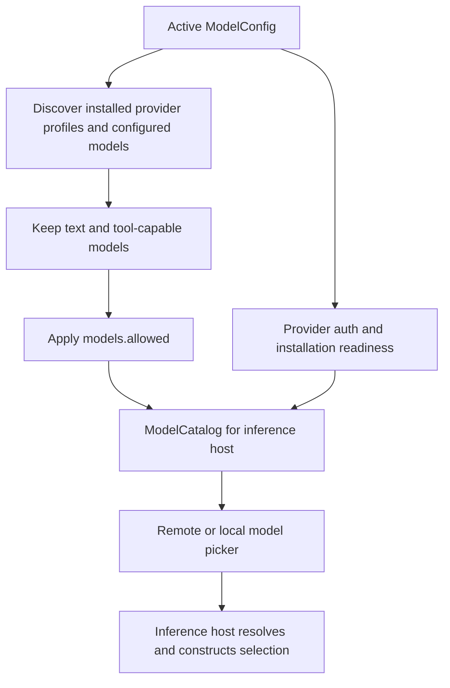
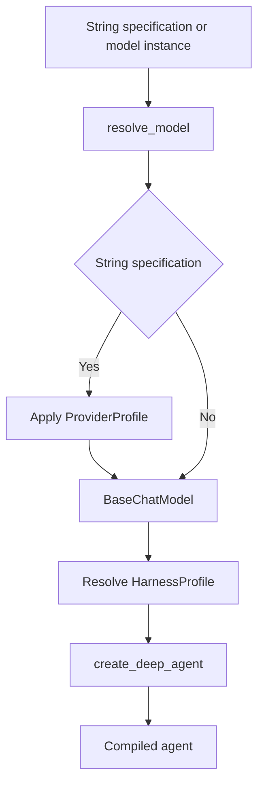
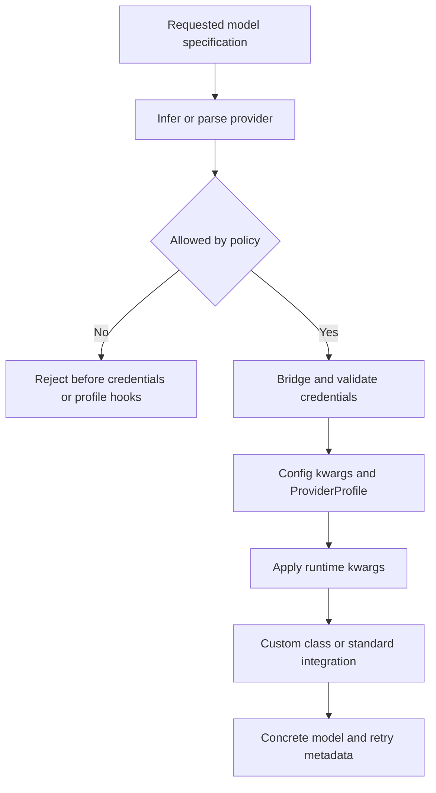

# Profiles and Models

A provider package, a model catalog entry, and a Deep Agents profile answer different questions. A package dependency makes an integration available to import; dcode discovery lists models that the active inference environment can describe and use under its configuration and policy; a **provider profile** changes construction of a string model specification; and a **harness profile** changes the agent assembled around a resolved model. Do not use a provider prefix or an installed extra as evidence that every model from that provider is selectable, credentialed, or appropriate for the agent.

## Package and runtime contract

`deepagents-code` 0.1.88 requires Python `>=3.12,<4.0` and releases against the exact `deepagents==0.7.30` dependency. The checked-out Deep Agents SDK is 0.7.30 and supports Python `>=3.11,<4.0`; dcode's tighter Python floor and exact SDK pin are its release contract. Its `tool.uv.sources` mapping to `../deepagents` is an editable monorepo-development source, not a broader released compatibility promise. When dcode uses new SDK functionality, update the exact pin in the same pull request; the release check rejects a pin older than the workspace SDK unless explicitly bypassed, while a deliberately ahead pin supports prerelease coordination.

The dcode base distribution declares the Anthropic, Google GenAI, and OpenAI LangChain integrations. Other integrations are optional extras, and `deepagents-code[all-providers]` aggregates the declared provider extras. That installation layout is not a provider-support matrix: imports, configuration, enabled state, credentials, the model's advertised capabilities, and `models.allowed` all participate in whether a model appears or can be constructed.

## Catalog: discovery and safe presentation

`load_model_catalog()` creates a validated, presentation-only snapshot from the **inference host's** active configuration. It returns model specifications, displayable capability data, provider readiness, policy metadata, and the active specification. It deliberately excludes constructor kwargs and arbitrary config/profile extensions because those can contain credentials or executable data. The catalog's profile projection allows only scalar display fields such as token limits, input modalities, reasoning output, tool calling, and structured output; it records which displayed values were overridden.

Caption: discovery and policy create a safe display snapshot; construction remains the inference host's responsibility.

Discovery obtains provider model-profile data from installed LangChain provider packages, adds configured model lists, and can discover a configured custom `class_path` provider's `_profiles` module. It retains only entries advertising tool calling and usable text input/output, skips disabled providers, and finally filters the result through `models.allowed`. Ollama is a special runtime discovery path: when enabled and its integration is importable, dcode may append models reported by its daemon. The catalog can additionally surface recommended or current specifications only when the provider is enabled and policy allows them; this prevents a current model disappearing merely because ordinary discovery lacks it.

Provider readiness is reported independently of discovered rows. The catalog includes known configured, built-in, credential-mapped, and Codex providers so a picker can guide setup even for a custom provider with no discovered model. For curated providers it exposes an install-extra hint only when the integration is absent. A picker must treat this snapshot as authoritative for the host that will run inference: focused tests ensure a remote picker neither reloads local provider configuration nor probes local readiness, and enforce `models.allowed` before prompting to install or authenticate a manually entered provider model.

## SDK profiles: construction versus harness assembly

The beta `deepagents.profiles` API has two additive registries. Keys are either a provider such as `openai` or an exact `provider:model` specification; only the first colon is a separator, so the model identifier may contain further colons.

| Registry | Applies when | Responsibility |
| --- | --- | --- |
| `ProviderProfile` | `resolve_model()` receives a string | Supplies `init_chat_model` kwargs, optional dynamic kwargs, and an optional `pre_init` hook. |
| `HarnessProfile` / `HarnessProfileConfig` | `create_deep_agent()` has a resolved model | Shapes prompt assembly, tool descriptions and exclusions, middleware, and default general-purpose-subagent behavior. |

Caption: provider profiles configure string construction; harness profiles configure the graph around either a constructed or supplied model.

`resolve_model()` returns an existing `BaseChatModel` unchanged. Only a string passes through `apply_provider_profile()` and `init_chat_model()`, so a construction profile cannot retrofit a pre-built instance. A harness profile can still apply to that instance: Deep Agents derives its provider and identifier where available and tries exact candidates before provider-level fallback.

Registration layers rather than replaces. An exact provider profile overlays its provider profile. Chained `pre_init` hooks and dynamic factories run base first; factory output overrides static profile kwargs, and explicit caller kwargs win last. Exceptions stop the remaining chained hook or factory work and propagate. Harness profiles also merge model-level settings over provider defaults, but their fields have distinct semantics: scalar values replace when set, tool-description maps merge by key, exclusion sets union, same-type middleware replaces in place while new middleware appends, and general-purpose-subagent fields merge individually.

`create_deep_agent()` resolves a main string model before looking up its harness profile, then repeats resolution and lookup for every declarative subagent. The profile affects prompt, tool-description, middleware, tool exclusion, and default-subagent assembly. Required filesystem and subagent scaffolding cannot be excluded; private, ambiguous, unmatched, or otherwise invalid middleware exclusions raise rather than quietly yielding a different graph.

Profile bootstrap is lazy, thread-coordinated, and one-time per interpreter. Built-ins load by direct imports, then zero-argument third-party hooks in the `deepagents.provider_profiles` and `deepagents.harness_profiles` entry-point groups layer registrations on top. A broken built-in restores the pre-bootstrap registries and fails bootstrap. Broken third-party enumeration, loading, or registration is logged/warned and skipped; plugin ordering is not a precedence contract.

## dcode construction: policy before side effects

`create_model()` is dcode's model-construction entrypoint. It parses or infers the provider and canonical specification, then checks `models.allowed` **before** stored-credential bridging, provider-profile hooks, or provider imports. A policy denial is therefore a `ModelNotAllowedError` without those side effects. After the gate, dcode checks credentials where applicable, layers provider and per-model configuration with stored credentials and SDK provider-profile defaults, applies runtime `extra_kwargs` last, resolves the retry budget, and constructs either a configured custom class or the standard integration model.

Caption: dcode performs authorization before credential and profile side effects, then gives runtime constructor kwargs final precedence.

A configured `class_path` imports configured Python and is consequently a trusted extension boundary. dcode overlays a constructed model's capability `profile` with `config.toml` overrides and then CLI profile overrides, retaining existing profile keys where possible. It extracts context limit and explicitly unsupported input modalities from the resulting metadata. It also stamps the concrete model with the retry budget so model-node retry middleware can follow runtime model switches; if a custom slotted model rejects that metadata, construction continues and middleware falls back to its startup budget.

## Focused verification and change guidance

SDK tests cover pass-through of an existing `BaseChatModel` and provider-profile kwargs for string resolution. Profile and graph tests should preserve exact/provider fallback, merge precedence, bootstrap isolation, and application to both main and declarative subagent stacks.

For dcode catalog changes, test the inference-host boundary, redaction of non-presentation data, capability and policy filtering, disabled providers, current/recommended-model handling, and provider setup behavior when no model row exists. For construction changes, preserve the ordering-sensitive policy gate before credentials, imports, and profile hooks; test constructor precedence and custom-class failure behavior separately from catalog presentation. Treat a new provider as several independent decisions: distribution dependency or extra, manifest mapping, configuration and credentials, discovery/profile availability, allowlist policy, construction, and capability metadata.

## Related pages

- [Code agent](/openwiki/architecture/code-agent.md)
- [Architecture overview](/openwiki/architecture/overview.md)
- [SDK construction and execution](/openwiki/architecture/sdk-construction-execution.md)
- [Sandbox partners](/openwiki/integrations/sandbox-partners.md)
