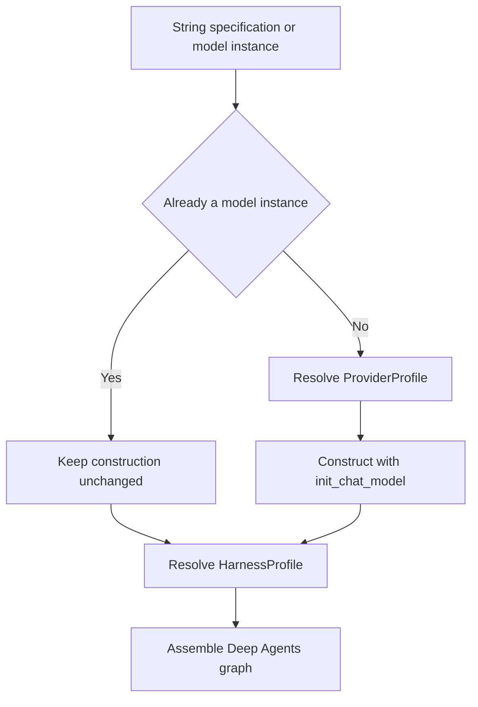
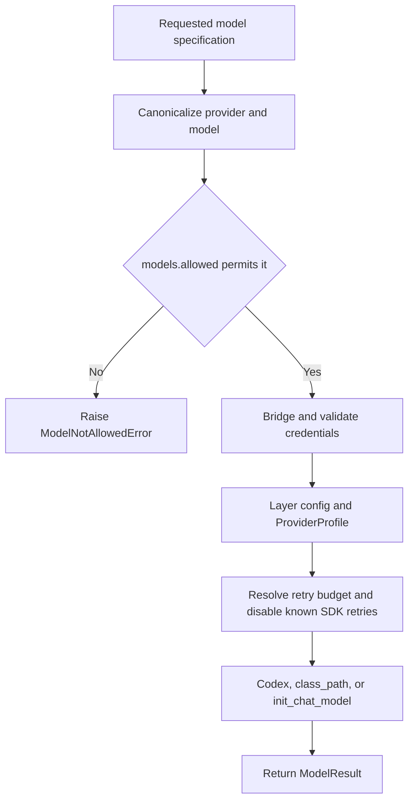

# Profiles and Models

"Profile" names distinct mechanisms. An SDK **ProviderProfile** controls how a string model specification becomes a client. An SDK **HarnessProfile** controls the Deep Agents graph after a client exists. In dcode, capability profile data describes a model's capabilities, while `models.allowed` is the policy boundary that decides whether dcode may construct it. Talon shares the SDK profile machinery but has its own catalog and selection lifecycle.

## SDK profile planes

| Mechanism | Key | Controls | Does not control |
| --- | --- | --- | --- |
| `ProviderProfile` | `provider` or `provider:model` | `init_chat_model` kwargs, dynamic kwargs, and pre-initialization checks | Prompts, tools, or graph middleware |
| `HarnessProfile` | `provider` or `provider:model` | Prompt assembly, tool visibility, middleware, and default subagent behavior | Model-client construction |
| dcode capability profile | `provider:model` | Advertised input, context, and tool capabilities | Client kwargs or admission |
| dcode `models.allowed` | canonical `provider:model` | Whether dcode may construct the resolved model | Provider enablement or display metadata |

Both SDK registries are beta APIs and registration is additive: a later registration layers settings over the entry already registered for the key. Register before constructing the model or graph that needs the behavior.

*Provider profiles participate in string-model construction; harness profiles shape the assembled agent.*

### Provider profiles

`resolve_model()` returns a supplied `BaseChatModel` unchanged. For a string, it resolves the profile, applies it, and calls `init_chat_model`. A provider-level profile is the base and an exact `provider:model` profile overlays it. Static kwargs merge with the exact profile winning; chained `pre_init` hooks and factories run base first. Factory output overrides static profile kwargs, while explicit caller kwargs retain final precedence. A failing `pre_init` prevents its factory and client construction.

This is the extension point for constructor defaults, environment-derived kwargs, attribution headers, and preflight checks—not for agent behavior. `init_kwargs` are defensively copied and immutable, so later mutation of a caller-owned mapping cannot change registered construction behavior.

### Harness profiles and their limits

`create_deep_agent()` resolves the main model's harness profile after model resolution. Exact profile fields merge over provider fields. It also resolves a profile for every declarative synchronous subagent based on that subagent's model, then applies prompt, tool-description, and middleware changes. Prompt assembly is `USER`, then `BASE`, then `SUFFIX`.

A harness profile can override tool descriptions, hide model-visible tools, modify the default general-purpose subagent, and add static or factory `extra_middleware`. Extra middleware reaches the main graph, generated general-purpose subagent, and SDK-assembled declarative synchronous subagents. It cannot alter an already compiled subagent or a remote asynchronous subagent, whose graphs are owned elsewhere. `HarnessProfileConfig` is the file-friendly YAML/JSON subset and deliberately excludes runtime-only middleware.

Middleware exclusion is stricter than tool exclusion. Filesystem and synchronous-subagent middleware are protected scaffolding, and an unmatched middleware exclusion fails graph assembly. Use `excluded_tools` to hide tools from the model: its filter runs after tool-injecting and custom middleware, so it can remove supplied and middleware-added tools. Tool visibility is model calibration, not authorization.

### Lazy bootstrap and optional caching

Profile bootstrap is lazy, thread-coordinated, and one-time. Built-ins load by direct import before third-party provider and harness entry-point hooks; plugin registrations therefore layer over built-ins. A broken built-in restores the prior registry state and fails bootstrap. Broken third-party entry-point enumeration, loading, or invocation is logged/warned and skipped, preserving usable built-ins.

`create_deep_agent()` adds prompt-caching middleware to its main, generated general-purpose, and declarative synchronous subagent stacks. Anthropic caching activates lazily only for an Anthropic request. Bedrock and Fireworks caching are optional integrations: absence of the provider module omits them, while unrelated import errors propagate. Lookup caches classes or absence, but each assembled stack receives a fresh middleware instance.

## dcode: configuration, policy, and construction

The configuration subsystem resolves manifest options from ranked providers: managed policy, CLI, retained runtime reload, environment, user `config.toml`, and typed defaults, in that precedence order. Managed configuration is therefore stronger than user configuration; `models.allowed` is an enforced managed key. This policy is distinct from the provider/model configuration that supplies constructor kwargs.

`create_model()` accepts `provider:model` or a bare model name, infers and canonicalizes the provider, and returns a `ModelResult`. The result keeps construction separate from mutation of global runtime state and carries resolved identity, profile-derived metadata, the effective retry budget, and any explicit CLI retry override needed when a later switch chooses another provider.

*dcode admits a resolved model before credential work, profile hooks, or provider imports.*

### Admission, credentials, and kwargs

The allowlist runs after provider inference but before credential bridging, provider-profile hooks or factories, and provider imports. A blocked request therefore cannot cause those side effects. After admission, stored `/auth` credentials can be bridged into the environment and dcode checks configured credentials unless the provider supports implicit authentication; missing credentials produce typed actionable errors.

Construction layers provider and per-model configuration, stored credentials, and SDK ProviderProfile output before `extra_kwargs`; runtime kwargs normally win. Arbitrary ProviderProfile hook or factory failures become `ModelConfigError`, keeping construction failures on dcode's actionable error path. A configured provider `class_path` imports and instantiates the named `BaseChatModel` class instead of using normal `init_chat_model` resolution, making it a trusted configuration/code-execution boundary.

After construction, dcode overlays configured capability fields and then `--profile-override` fields onto `model.profile`; a CLI override fails strictly if assignment is rejected. Missing capability data warns, while explicit `tool_calling=False` fails agent-model validation.

### One retry owner

The model-node middleware owns dcode's visible retry budget to avoid multiplication by provider SDK retry loops. The effective budget is selected in descending precedence:

1. `--max-retries`
2. `[retries.<provider>].max_retries`
3. `[retries].max_retries`
4. The built-in default of `5`

`0` disables dcode retries. For recognized providers—or a provider with configured retry parameter metadata—dcode forces the provider retry parameter to its disabled value after kwargs merge. If it cannot identify an unknown provider's retry control, it leaves SDK behavior intact and warns with the configuration escape hatch.

The concrete model is stamped with the resolved budget. Configurable-model middleware may substitute a request model at runtime without recompiling the graph; retry middleware reads the budget from that request model. A cross-provider switch therefore uses the selected provider's retry configuration rather than multiplying attempts or inheriting stale middleware state.

## Dedicated dcode summarization model

`--summarization-model` takes precedence over `[models].summarization_default`; if neither selects a model, compaction uses the main model. A blank explicit CLI value also means main-model fallback. Resolution is deferred until first compaction, avoiding startup provider imports and allowing a broken optimization to degrade rather than wedge a session.

`_LazySummaryModel` serializes setup and invocation with locks and constructs the selected model under its captured environment. Construction failure warns once and summarizes with the main model. If a dedicated model builds but cannot generate a summary, it restores main-model token counting, trimming, and retry behavior, retries that summary on the main model, and resets configured state so a later compaction can retry the override. Event-loop blocking errors are re-raised.

A successful dedicated model gets dcode retry handling, provider-appropriate token counting, and a history budget of four fifths of a positive input window. Replacing LangChain's generic summary retry wrapper preserves `--max-retries 0` for summaries.

## Talon compatibility and model switching

Talon is not a dcode session: it does not use dcode's `models.allowed`, `/auth` credential store, `ModelResult`, or retry policy. It applies `apply_provider_profile` before `init_chat_model`, and builds graphs through `create_deep_agent`; compatible SDK provider profiles, harness profiles, and prompt caching consequently apply to Talon's main model and SDK-assembled synchronous subagents.

Talon restricts interactive model switches to its discovered catalog. It validates and builds an accepted selection before activation, caches it, and stores it in turn-local state so main-agent calls and summarization use the selection without graph recompilation. A failed selection leaves the current/default model usable; subagents retain their own models.

## Package constraints and focused tests

The current dcode package is `0.2.8`, requires Python `>=3.14,<3.15`, and pins `deepagents==0.7.38`. Deep Agents `0.7.38` supports Python `>=3.11,<4.0` and requires LangChain `>=1.5.0,<2.0.0`, LangChain Core `>=1.8.0,<2.0.0`, `langchain-anthropic>=1.7.10,<2.0.0`, and `langchain-google-genai>=4.4.3,<5.0.0`. The SDK's broader Python range does not widen dcode's released Python contract.

The dcode core includes Anthropic, Google GenAI, and OpenAI integrations. Other providers are separately installable extras with explicit integration floors; current core floors include `langchain-anthropic>=1.7.10,<2.0.0`, `langchain-google-genai>=4.4.3,<5.0.0`, and `langchain-openai>=1.8.0,<2.0.0`. Registering a profile changes resolution behavior but cannot install a missing integration.

Focused coverage spans command-line parsing (including `--model` alongside other flags), dcode model construction and retry behavior, lazy summary fallback, provider/harness profile resolution, prompt caching, and Talon selection. When changing this area, preserve admission-before-side-effects ordering, one retry owner, construction-versus-harness separation, and ownership of prebuilt or remote subagent stacks.

## Related pages

- [Code agent architecture](/openwiki/architecture/code-agent.md)
- [Configuration layering](/openwiki/concepts/config-layering.md)
- [Install and update dcode](/openwiki/operations/dcode-install-and-update.md)
- [Run a dcode session](/openwiki/workflows/run-dcode-session.md)
