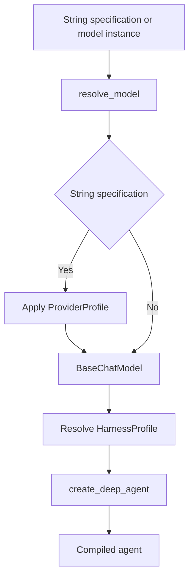
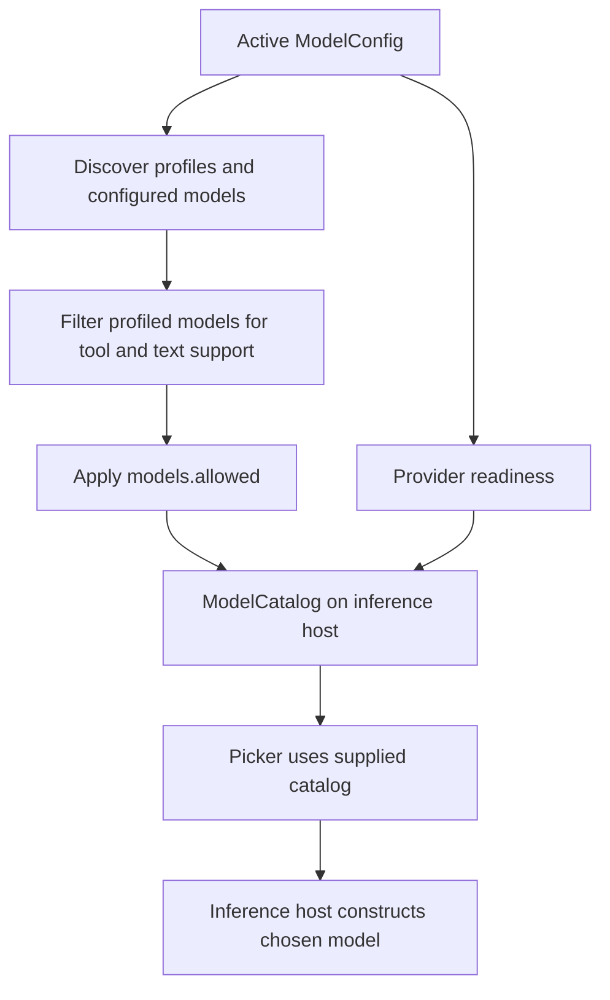
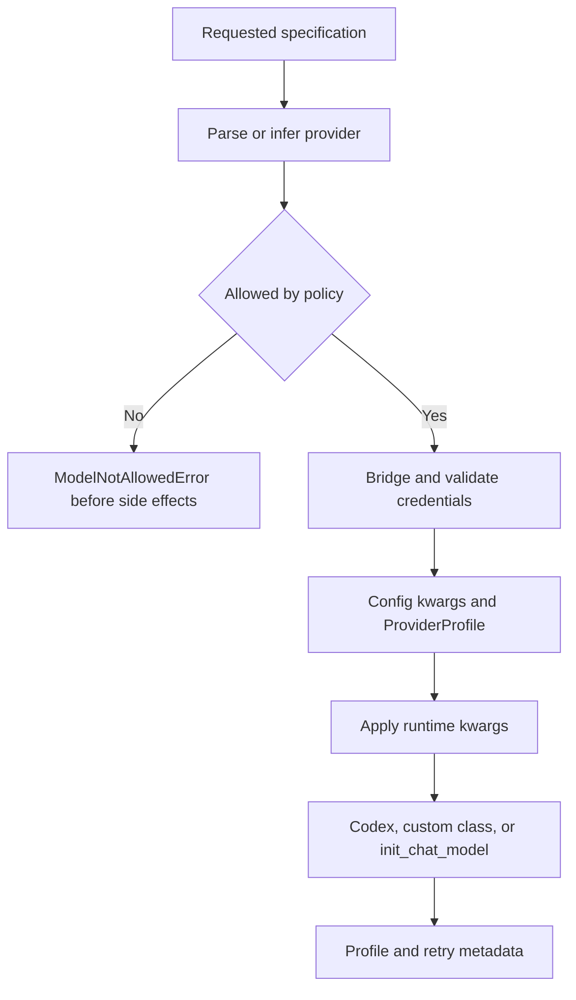

# Models, Profiles, and Provider Behavior

A model string, an SDK profile, and dcode configuration have separate responsibilities. Deep Agents **provider profiles** add defaults while the SDK constructs a string model; **harness profiles** change the agent graph around an already resolved model. dcode owns product policy, credentials, configured constructor parameters, model presentation, runtime switching, and retries. Consequently, an installed provider integration or an SDK profile is not evidence that a model is selectable, credentialed, or permitted by dcode.

## Two SDK profile registries

The beta `deepagents.profiles` API has additive registries keyed by either a provider (`openai`) or an exact `provider:model` specification. Only the first colon separates provider from identifier, so an identifier can itself contain colons.

| Registry | Applied by | Scope |
| --- | --- | --- |
| `ProviderProfile` | `resolve_model()` for a string model | `init_chat_model` kwargs, a dynamic kwargs factory, and a `pre_init` hook |
| `HarnessProfile` / `HarnessProfileConfig` | `create_deep_agent()` after model resolution | Prompt additions, tool descriptions and exclusions, middleware, and general-purpose-subagent defaults |

Caption: provider profiles configure string construction, while harness profiles configure the graph around either a constructed or supplied model.

`resolve_model()` returns a supplied `BaseChatModel` unchanged. It applies `apply_provider_profile()` and calls `init_chat_model()` only for strings. A provider profile therefore cannot retrofit a pre-built instance, although a harness profile can still apply if the instance reports a provider and identifier.

Registration layers rather than replaces. An exact provider profile overlays the provider profile. Base `pre_init` hooks and factories run before exact-model ones; factory output overrides static profile kwargs; explicit caller kwargs win last. An exception stops the remaining hook or factory chain and propagates.

Harness lookup likewise merges an exact profile over provider defaults. Scalar prompt fields replace when set, tool-description maps merge by key, exclusions union, same-class middleware replaces in its original position while new middleware appends, and general-purpose-subagent fields merge separately. For a supplied instance, lookup checks exact provider-and-identifier candidates before provider fallback; a profile miss yields defaults rather than an error.

`create_deep_agent()` resolves and profiles the main model, and repeats that work for each declarative subagent. The resulting profile participates in prompt construction, tool-description changes, extra middleware, exclusions, and subagent assembly. Required filesystem and subagent scaffolding may not be excluded; private, ambiguous, unmatched, or protected middleware exclusions are rejected rather than silently changing the graph.

Profile bootstrap is lazy, thread-coordinated, and one-time per interpreter. Built-ins are direct imports and load first. Then zero-argument plugins from `deepagents.provider_profiles` and `deepagents.harness_profiles` can layer registrations on top. A broken built-in restores prior registry state and fails bootstrap; failed third-party enumeration, loading, or registration is warned/logged and skipped. Entry-point ordering is not a precedence contract.

## dcode catalog is a safe snapshot, not construction

`load_model_catalog()` is run in the environment that will construct the model. It returns a strict presentation snapshot: displayable models and capability fields, provider readiness, `models.allowed` metadata, and an optional current specification. It does **not** pass constructor kwargs or arbitrary profile/config extensions across a process boundary, because those may contain credentials or executable data. The capability projection is a scalar allowlist and records which display values were overridden.

Caption: the catalog is an inference-host presentation and policy boundary; model construction remains on that host.

Discovery reads installed LangChain provider profile data, configured lists, and for configured `class_path` providers, an inferred package `_profiles` module. Profile-derived rows are restricted to tool-calling models with usable text input and output; disabled providers are skipped. Explicit configured lists are then merged, so a configured model is not necessarily capability-validated by upstream profile data. Ollama can append models discovered from its daemon. The result is filtered by `models.allowed`; recommended and current specs are retained only when provider enablement and policy permit them, with a current spec allowed to remain even when its provider integration is unavailable.

Provider readiness is independent of model rows. Known built-in, credential-mapped, configured, and Codex providers can appear so the picker can guide setup even without discovered models; an install-extra hint is shown only when the integration is absent. Remote consumers must use the supplied catalog rather than probing their own local configuration, and must apply catalog policy before provider installation or authentication prompts.

## dcode construction and policy

`create_model()` is the product construction entrypoint. It parses or infers a provider and canonical specification, then enforces `models.allowed` **before** credential bridging, provider-profile hooks, or provider imports. Thus a blocked model raises `ModelNotAllowedError` without those side effects. This is product policy, not SDK profile behavior.

Caption: authorization precedes construction side effects; runtime parameters have the final constructor precedence.

After the gate, dcode resolves credentials, obtains provider and per-model configured kwargs, supplies a stored key when applicable, and applies SDK provider-profile defaults beneath those values. `extra_kwargs` wins over the resulting defaults. A configured `class_path` imports and instantiates configured Python, so it is a trusted extension boundary. Codex is constructed through its OAuth-aware implementation rather than ordinary `init_chat_model`.

dcode layers configured capability-profile overrides and then CLI profile overrides onto the concrete model. It uses the merged profile to report context limit and explicitly unsupported modalities. Capability validation is best effort for missing profiles, but an explicit `tool_calling=False` is fatal for the agent.

## Runtime model changes and request settings

`ConfigurableModelMiddleware` reads `model` and `model_params` from LangGraph runtime context, allowing `agent.invoke()` or `agent.astream()` callers to choose a different model without recompiling the graph. It only constructs a replacement when the requested spec does not match the current model. It shallow-merges runtime parameters into request settings, strips Anthropic-only settings when changing to another provider, and updates the Model Identity prompt section using the replacement's metadata.

A policy denial on a runtime switch always propagates. Other `ModelConfigError` failures either propagate in strict mode or log and continue with the construction-time model; in the latter case the middleware deliberately avoids overwriting checkpointed parameters with unknown state. Successful calls persist the resolved spec and runtime-only parameters for resume, while cache identity separately records effective configured parameters and endpoint identity. Async switching and configuration reads are offloaded from the event loop.

For an active thread, dcode adds prompt-cache routing only where applicable: Fireworks receives session-affinity settings, and OpenAI receives `prompt_cache_key=thread_id` unless `models.openai_prompt_cache_key` disables it or the caller/model already supplied a key. Thread identifiers are not logged.

## Reasoning effort and retry ownership

`/effort` is profile-driven: dcode exposes levels and defaults only when the active model profile advertises `reasoning_output=True` and valid effort levels. It retains unrelated session parameters while replacing canonical and provider-native effort fields with `reasoning_effort`; integrations translate that standard constructor parameter. Native parameter recognition covers OpenAI/Codex, Anthropic, Google GenAI, Fireworks, and xAI. Anthropic `thinking.type="between_tools"` limits the available displayed efforts to `low`, `medium`, and `high`.

The model-node retry middleware owns dcode's retry budget, not provider SDK loops. `create_model()` resolves the provider-specific or CLI budget, disables a recognized provider retry kwarg to prevent nested retries, and stamps the budget on the constructed model. A runtime-selected model consequently carries its own budget; if a slotted custom model cannot accept metadata, retry falls back to the middleware's startup budget.

`CodeModelRetryMiddleware` wraps the model node rather than the whole turn, so completed tool calls are not replayed. It retries classified transient transport, selected provider SDK, retryable `ModelError`, 408/409/429, and 5xx failures, including relevant errors inside exception groups or causal chains. It honors a capped `Retry-After` when valid, otherwise uses jittered exponential backoff, and bounds interactive cumulative delay. Non-transient failures and exhausted budgets are re-raised, never converted into a fabricated model answer. The middleware emits correlated attempt and retry events so clients can mark partial streamed output as incomplete before replay.

## Verification and change guidance

Focused SDK tests cover model-instance pass-through, provider-profile kwargs for strings, profile merge and fallback rules, bootstrap isolation, and applying harness behavior to the main agent and declarative subagents. dcode model-config tests cover allowlist syntax, canonical inference, credential precedence, and authorization errors.

For catalog changes, test the inference-host boundary, redaction, profile-derived capability filtering, configured-list behavior, disabled providers, policy, current/recommended specs, and readiness without a model row. For construction or switch changes, preserve the ordering-sensitive policy gate and distinguish policy denial from non-policy construction fallback. Treat a new provider as independent choices: installation/extra, configuration and credentials, discovery, policy, construction, capability metadata, reasoning support, and retry ownership.

## Related pages

- [Code agent](/openwiki/architecture/code-agent.md)
- [Runtime behavior](/openwiki/architecture/runtime-behavior.md)
- [SDK construction and execution](/openwiki/architecture/sdk-construction-execution.md)
- [Configuration layering](/openwiki/concepts/config-layering.md)
- [Run a dcode session](/openwiki/workflows/run-dcode-session.md)
