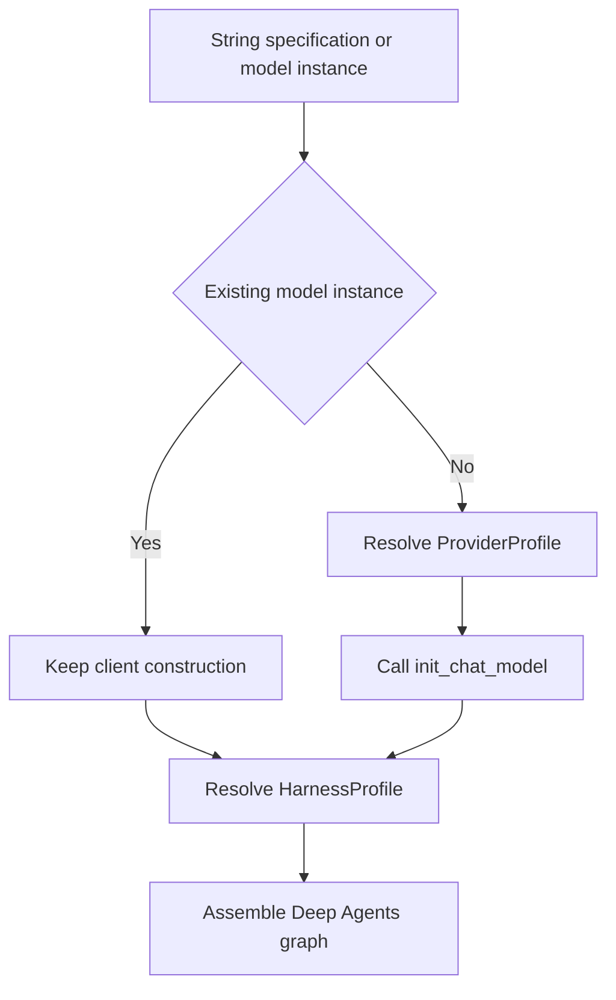
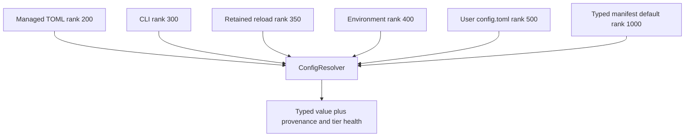
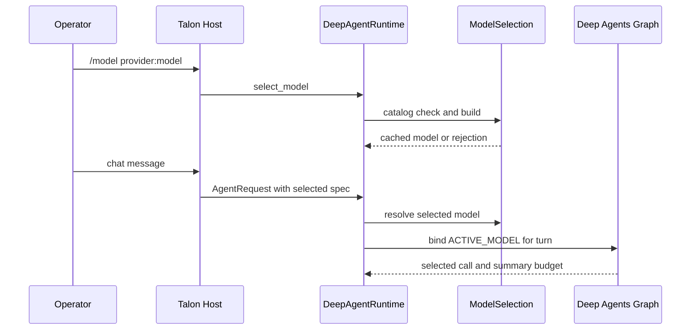

# Profiles and Models

"Profile" has three deliberately separate meanings. They compose at integration boundaries, but none is a substitute for another.

| Control plane | Owner and key | Controls | Does not control |
| --- | --- | --- | --- |
| SDK `ProviderProfile` | Deep Agents; `provider` or `provider:model` | Construction of a string-selected model | Prompts, tools, or graph middleware |
| SDK `HarnessProfile` | Deep Agents; `provider` or `provider:model` | The agent harness around a resolved model | Model-client construction |
| dcode configuration | dcode; managed policy, CLI, environment, user TOML, and runtime state | Scalar settings, model admission, credentials, constructor options, defaults, retries, and picker persistence | Talon's catalog and per-turn selection |
| Talon selection | Talon; discovered catalog and persisted chat setting | The selected model for an interactive Talon turn | dcode allowlists, dcode credential storage, dcode retries, or dcode defaults |

## SDK profiles: construction and harness are orthogonal

The SDK profile APIs are beta. Both registries accept provider-wide and exact-model keys, and re-registration layers fields over an existing registration rather than replacing unspecified settings. Built-in and third-party profiles load lazily when a registry is first used.

*Provider profiles affect string-model construction; harness profiles shape the assembled agent.*

### Provider profiles

`resolve_model()` leaves a supplied `BaseChatModel` alone. For a string, `apply_provider_profile()` resolves an exact profile over the provider profile, invokes `pre_init`, and prepares `init_chat_model` kwargs. Static kwargs merge with exact values winning; base hooks and factories run first; a factory overrides static profile kwargs; and caller kwargs have final precedence. A failing hook stops subsequent factories and construction.

Use `ProviderProfile` for construction defaults, environment-derived values, attribution headers, and construction preflight—not prompt or tool behavior. Its static kwargs are defensively copied and made read-only, so registration cannot be silently changed through a retained dictionary.

### Harness profiles

`create_deep_agent()` resolves a harness profile for the main model and every declarative synchronous subagent. Exact lookup takes priority while inheriting provider-level fields. The profile can assemble the `USER → BASE → SUFFIX` prompt, change tool descriptions, hide tools from the model, add middleware, and configure the generated `general-purpose` subagent.

Tool exclusion controls model visibility rather than authorization. Filesystem and synchronous-subagent middleware are protected; excluding either, or naming middleware that is absent from the final stack, fails graph assembly. `HarnessProfileConfig` is the serializable subset: live middleware and factories remain runtime-only.

## dcode scalar configuration: manifest and resolver

`config_manifest.py` is dcode's canonical contract for **user-tunable scalar options**: stable dotted keys, type/coercion kind, typed defaults, environment names and fallbacks, `config.toml` paths, CLI binding, redaction status, and merge strategy. The manifest deliberately does not flatten user-defined structured configuration. Structured tables use dedicated typed loaders and appear in the manifest only for discovery; credential-bearing tables are marked redacted so configuration inspection reports source and presence without displaying their contents.

A `ConfigOption` validates the manifest itself. It rejects incoherent option metadata—such as mutable or wrong-typed defaults, a negative default for a non-negative integer, a blank required string default, incompatible boolean inversion, or an accumulating strategy on a scalar. This makes a new scalar setting a single contract change rather than a scattered default, parser, environment, and CLI update.

*The resolver evaluates one ordered provider generation; lower rank has stronger precedence.*

The shared process resolver is built from managed and user snapshots, the process environment, and the manifest default, with an installed CLI provider when arguments supply one. Its cached generation gives runtime readers and `dcode config` the same answer. `resolve_options()` resolves a selected set against one lock-held generation; `resolve_all()` does the same for the full manifest. Resolver output carries the effective typed value, source provenance, each tier's health, masked ranks, and diagnostics, which lets inspection describe what actually won rather than merely printing raw files.

For ordinary replacement options, managed policy is strongest, followed by CLI, retained reload values, environment, user TOML, and the typed default. A valid value from a durable higher tier masks lower non-durable contenders; a lower durable user value never displaces a stronger environment value. Structured options may instead union list-like restrictions or deep-merge mappings from weak to strong precedence, retaining leaf provenance. If an accumulating input cannot safely be merged, resolution falls back to the strongest valid replacement rather than allowing a weaker layer to displace policy.

### Invalid input, bounds, and safe fallback

Providers coerce values before ranked resolution. A malformed numeric, list, permission-to-call, duration, or ISO timestamp; an unrecognized boolean token; or a wrong-typed TOML value is marked invalid, logged, and skipped. Resolution then tries the next layer and ultimately the typed default. One damaged entry therefore does not erase valid sibling policy or turn a configuration error into a startup exception.

Bounds belong to the option's resolution contract, not to scattered consumers. Important examples are:

- `mcp.tool_timeout` defaults to 120 seconds and accepts only 1 through 900 seconds.
- The Auto classifier timeout defaults to 20 seconds and accepts only 1 through 300 seconds, preserving a finite decision deadline.
- Managed, environment, and TOML `recursion_limit` values must be 25 through 100,000. The explicit `--recursion-limit` escape hatch accepts values from 1 upward.

An out-of-range value falls through exactly like malformed input. For example, an invalid managed MCP timeout can yield a valid environment or user value, and if every layer is invalid, the finite 120-second default remains. This behavior is essential for timeouts and traversal limits: an accidental or hostile override cannot turn off the guard merely by being present.

The resolver also protects policy during reload. A refresh that cannot produce an enforceable managed snapshot retains the prior usable policy rather than silently exposing lower tiers. A malformed user file similarly retains its prior resolver generation for runtime reload and reports that the edit did not take effect. Reload-specific retained values can temporarily preserve accepted reloadable settings when a refreshed generation cannot reproduce them.

## dcode model construction: policy before side effects

The scalar resolver does not replace dcode's typed model configuration. `ModelConfig` owns structured model providers, allowed-model policy, per-model overrides, and persisted preferences; `create_model()` is the construction boundary that joins this model configuration with credentials and SDK provider profiles.

*dcode checks admission after provider inference but before credential and provider side effects.*

`create_model()` accepts `provider:model` or an inferable bare name. Its allowlist gate runs after inference, so policy sees canonical specifications, but before stored-credential bridging, SDK profile hooks/factories, and provider imports. A blocked request therefore cannot copy a stored credential into the environment or trigger profile side effects.

After admission, dcode checks credentials except for implicit-auth providers, layers provider and per-model configuration with stored credentials and SDK profile output, and gives `extra_kwargs` final precedence. Profile failures become actionable `ModelConfigError`s. Construction uses the OAuth-aware Codex class for `openai_codex`, directly imports and instantiates a configured `class_path`, or calls `init_chat_model`. A `class_path` is consequently a trusted configuration boundary, not ordinary provider selection.

`[models].allowed` is admission policy, not a picker filter or default selector. Its semantics distinguish no policy (unrestricted), an empty value (deny all), and exact or `provider:*` matches. A malformed declared allowlist fails closed. dcode keeps separate persisted defaults for the main model, Auto classifier, and summarizer; picker saves validate admission and reject a newly saved model if its provider package is unavailable, while still allowing an unusable saved value to be cleared.

### Retry ownership and environment lifecycle

The model-node middleware owns dcode's visible retry budget. Precedence is `--max-retries`, provider-specific configuration, global configuration, then the built-in default of 5; zero disables retries. After kwargs merge, dcode disables recognized provider SDK retry loops and stamps the selected budget on the concrete model and `ModelResult`. A runtime model switch thus uses the new provider's budget without multiplying attempts through nested retries.

Importing `deepagents_code.config` does not eagerly load dotenv files or discover project context. First use of the lazy credentials proxy performs one lock-protected bootstrap, records failure, and permits the application to continue with the available environment. Shell values override the nearest project dotenv, which overrides the global profile dotenv. Model construction may instead use an immutable context-local environment snapshot; for a canonical variable, a present `DEEPAGENTS_CODE_` override shadows it even when blank, allowing deliberate suppression.

## Talon: catalog admission and turn-scoped swapping

Talon is an experimental and separate runtime. Its `/model` flow is neither a dcode switch nor a dcode-policy bypass. It discovers installed tool-calling provider models only when credentials exist in **Talon's supplied environment**. A key stored only by dcode is not enough. The graph startup default remains selectable. A LangSmith gateway can augment the OpenAI catalog only after strict HTTPS gateway endpoint validation; Talon accepts safe model identifiers and chat-completions-capable catalog entries.

*A Talon selection is validated and built before use, then bound only for its invocation.*

`ModelSelection` does no discovery or construction at initialization. It requires exact `provider:model` catalog membership before building a nondefault model, caches the result under a lock, and treats selection of the startup default as no override. A stale or unavailable persisted selection falls back to the graph default instead of failing the turn.

For each invocation, the runtime sets `ACTIVE_MODEL` and effort settings in `ContextVar`s and resets them in `finally`. `ModelSelectionMiddleware` swaps the main-agent request model without graph recompilation. `SelectedModelSummarization` replaces the Deep Agents summarizer slot and caches a selected-model-specific summarizer, using 80% of the selected model's input limit or 4,000 tokens if unavailable. Delegated subagents retain startup model and summarizer behavior.

Host-level selection is operator-controlled and persists across new conversations and restart. `/model default` clears it. A selection changed after a turn starts applies on the next turn, and untrusted requested specifications are rejected without echoing them.

## Package compatibility and focused verification

`deepagents-code` 0.2.14 requires Python `>=3.14,<3.15` and pins `deepagents==0.7.41`. Deep Agents 0.7.41 supports Python `>=3.11,<4.0`; that broader SDK range does not widen dcode's release contract. The SDK requires LangChain `>=1.5.2,<2.0.0`, LangChain Core `>=1.8.4,<2.0.0`, `langchain-anthropic >=1.7.12,<2.0.0`, and `langchain-google-genai >=4.4.3,<5.0.0`.

`libs/code/tests/unit_tests/test_config_manifest.py` is the focused regression suite for scalar configuration: manifest/CLI and credential coverage, runtime-versus-introspection agreement, coercion and normalization, source reporting, redaction, bounds, and fallthrough across managed, environment, TOML, and default layers. Preserve tests that prove invalid timeout values retain a finite deadline and that a displayed source is the same source runtime uses.

Keep model-policy tests proving that a blocked model cannot bridge credentials or execute profile side effects. `libs/talon/tests/unit_tests/test_model_selection.py` covers authorization, persistence and reset, exact-catalog rejection, one-time model builds, fallback for stale selection, gateway validation, turn isolation, and selected-model context limits. These are the regressions to preserve when changing catalog discovery, caching, middleware ordering, or request lifecycle.

## Related pages

- [Architecture overview](/openwiki/architecture/overview.md)
- [Configuration layering](/openwiki/concepts/config-layering.md)
- [MCP integration](/openwiki/integrations/mcp.md)
- [dcode install and update](/openwiki/operations/dcode-install-and-update.md)
- [Testing guide](/openwiki/testing/testing-guide.md)
