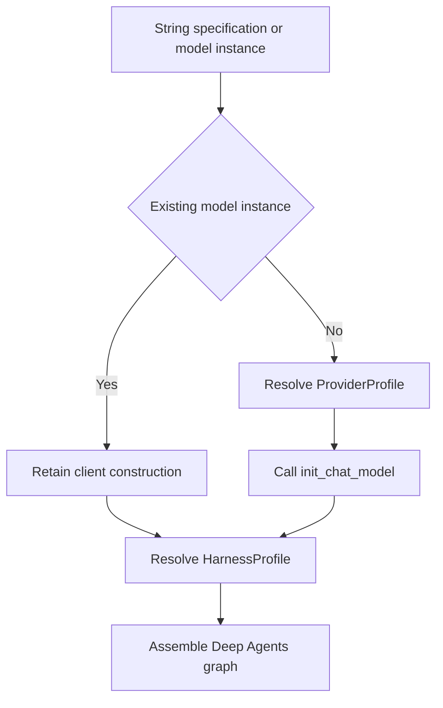

# Profiles and Models

The word *profile* refers to different mechanisms at different boundaries. Do not use one as a substitute for another:

| Control plane | Owner | Key | Controls | Does not control |
| --- | --- | --- | --- | --- |
| SDK `ProviderProfile` | Deep Agents SDK | `provider` or `provider:model` | How a string model becomes a client | Prompts, tools, and graph middleware |
| SDK `HarnessProfile` | Deep Agents SDK | `provider` or `provider:model` | The graph around an already resolved client | Client construction |
| dcode configuration | dcode | manifest, environment, user/managed TOML, CLI, runtime context | Admission, credentials, constructor options, defaults, retries, and persistence | Talon's interactive catalog |
| Talon selection | Talon | its runtime catalog and turn-local selection | An interactive Talon chat's selected model | dcode's `models.allowed`, credential store, or retry ownership |

## SDK profiles: construction and harness are orthogonal

The beta SDK registries are additive: registering a second profile for a key layers it over the first rather than replacing unspecified fields. Both accept provider-wide and exact model keys. Built-in profiles and third-party entry-point registrations are loaded lazily on first registry access, not when `deepagents.profiles` is imported.

*Provider profiles participate only in string-model construction; harness profiles modify the assembled agent.*

### ProviderProfile

`resolve_model()` returns a supplied `BaseChatModel` unchanged. For a string, it calls `apply_provider_profile()` and passes the resulting kwargs to `init_chat_model`. Resolution overlays an exact `provider:model` profile on its provider-level profile. Static kwargs merge with the exact value winning; base hooks and factories run before exact ones; a factory overrides static profile values; and caller kwargs retain final precedence. If a `pre_init` hook fails, subsequent hooks, factories, and construction do not occur.

Use this extension point for constructor defaults, environment-derived values, attribution headers, and construction preflight—not prompt or tool behavior. Profile kwargs are defensively copied and immutable after profile construction.

### HarnessProfile

`create_deep_agent()` resolves a harness profile after resolving its primary model and repeats that process for each declarative synchronous subagent. Exact matches take precedence over a provider fallback and merge with it. The profile can supply the `BASE` and `SUFFIX` portions of the prompt (`USER`, `BASE`, `SUFFIX`), tool-description overrides, model-visible tool exclusions, extra middleware, and settings for the generated `general-purpose` subagent.

`excluded_tools` affects model visibility, not authorization. Required filesystem and synchronous-subagent middleware cannot be excluded; an exclusion that does not match the assembled stack is an assembly error. `HarnessProfileConfig` is the serializable subset: runtime middleware instances and factories remain runtime-only.

Bootstrap is coordinated across threads. Built-ins load before plugin entry points, so a plugin can layer onto an SDK default. A built-in bootstrap failure restores the previous registries and propagates; a broken third-party entry point is logged and skipped.

## dcode environment and bootstrap lifecycle

Importing `deepagents_code.config` does not eagerly traverse project paths or load dotenv files. Accessing the lazy `credentials` proxy triggers a one-time, lock-protected bootstrap, then creates the process-wide `Credentials` instance. Bootstrap captures the launch LangSmith selectors, finds the server project context, loads dotenv values, applies the dcode LangSmith project/tracing setup, and records an exception if it cannot complete. It marks itself done even after failure so a malformed dotenv does not cause retry loops; the application continues with the available environment.

For dotenv injection, shell environment values win over the nearest project `.env`, which wins over the global profile `.env`. A project dotenv is not a general trust boundary: sensitive loader, process-launch, and user-approval controls are denied there. At model-construction time, `use_environment()` can bind an immutable, context-local environment snapshot; environment resolution reads that snapshot instead of process-global `os.environ` for the duration of the block. For a canonical variable such as `OPENAI_API_KEY`, a present `DEEPAGENTS_CODE_OPENAI_API_KEY` wins even when blank; blank intentionally suppresses the canonical value.

## dcode model configuration and policy

`ModelConfig.load()` reads the default profile through the configuration service and caches the immutable result. Managed policy remains effective if the user TOML is missing, unreadable, malformed, or structurally invalid; an explicit path is a file-only read and therefore should not be used by production policy checks.

The model-related stored fields have distinct roles:

- `[models].default` is the preferred launch model; `[models].recent` is the fallback when the default is unavailable or absent.
- `[models].summarization_default` is the persisted preference for compaction, not the main model.
- `[models].auto_classifier` is the persisted model for the Auto authorization classifier, not a general model-routing setting.
- `[models].providers` contributes provider configuration, including optional custom `class_path` construction.
- `[models].allowed` is admission policy, not a catalog filter or default selector.

The allowlist has three meaningful states: absent means unrestricted, `()` means deny all, and a nonempty sequence permits exact `provider:model` entries or `provider:*` provider wildcards. A malformed declared allowlist becomes deny-all rather than silently opening policy. A configured `class_path` is a trusted configuration boundary: dcode imports and instantiates the configured `BaseChatModel` class rather than using ordinary `init_chat_model` resolution.

*dcode admits a model before credential side effects, profile hooks, or provider imports.*

`create_model()` accepts a canonical `provider:model` specification or a bare name whose provider can be inferred. It returns a `ModelResult`, keeping construction separate from the later mutation of runtime state. The allowlist check runs after provider inference and before stored-credential bridging, provider-profile hooks/factories, and imports. Once admitted, dcode checks credentials early except for implicit-auth providers, composes provider and per-model config with stored credentials and SDK profile output, then lets `extra_kwargs` win. Profile hook/factory failures are surfaced as `ModelConfigError`.

Construction uses the OAuth-aware Codex class for `openai_codex`, imports a configured `class_path` directly, and otherwise calls `init_chat_model`. dcode then overlays configured capability metadata and explicit `--profile-override` values; rejection of an explicit profile assignment is an error. Capability metadata informs validation but does not itself grant admission.

### Retry ownership

The model-node middleware owns dcode's visible retry budget. Precedence is `--max-retries`, `[retries.<provider>].max_retries`, `[retries].max_retries`, then the built-in default of `5`; zero disables retries. dcode forces a known provider SDK retry parameter off after merging kwargs to avoid nested retries multiplying attempts. The resolved budget is stored on the constructed model and in `ModelResult`, allowing runtime model switches to pick up the destination provider's budget.

### Persisting a picker default

The TUI model selector separates default scopes for the main model, Auto classifier, and summarization model. Ctrl+S writes only the scope with which that selector was constructed, so `/auto model` cannot overwrite `[models].default`. Persisting a new value checks effective `models.allowed`; a policy refusal is distinct from an I/O failure. The selector also refuses to store a model whose provider integration is missing, while allowing an already-stored unusable choice to be cleared.

## Talon is separate

Talon's interactive selection is a separate control plane. It may use the SDK profile mechanisms when it constructs an SDK model, but it must not be documented or implemented as a dcode model switch: dcode admission policy, `/auth`-backed credentials, persisted defaults, retry middleware, and inference-host catalog behavior remain dcode-owned.

## Package compatibility

`deepagents-code` 0.2.12 requires Python `>=3.14,<3.15` and pins `deepagents==0.7.41`. Deep Agents 0.7.41 itself supports Python `>=3.11,<4.0`; that broader SDK range does not widen dcode's released Python contract. The SDK manifest requires LangChain `>=1.5.2,<2.0.0`, LangChain Core `>=1.8.4,<2.0.0`, `langchain-anthropic >=1.7.12,<2.0.0`, and `langchain-google-genai >=4.4.3,<5.0.0`.

## Focused verification

The focused tests in `libs/code/tests/unit_tests/test_model_config.py` cover the policy distinctions that are easy to regress: malformed entries, explicit deny-all, canonicalization of inferable bare names, rejection of disallowed bare names after inference, and the limited `provider:*` wildcard grammar. `libs/code/tests/unit_tests/test_config.py` exercises dotenv reload and precedence behavior. When changing construction ordering, retain a test that proves blocked models cannot bridge credentials or execute provider-profile side effects.

## Related pages

- [Code agent architecture](/openwiki/architecture/code-agent.md)
- [Configuration layering](/openwiki/concepts/config-layering.md)
- [Cost and sessions](/openwiki/operations/cost-and-sessions.md)
- [Quickstart](/openwiki/quickstart.md)
- [Testing guide](/openwiki/testing/testing-guide.md)
