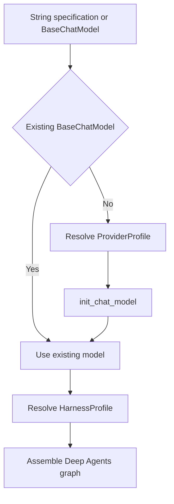
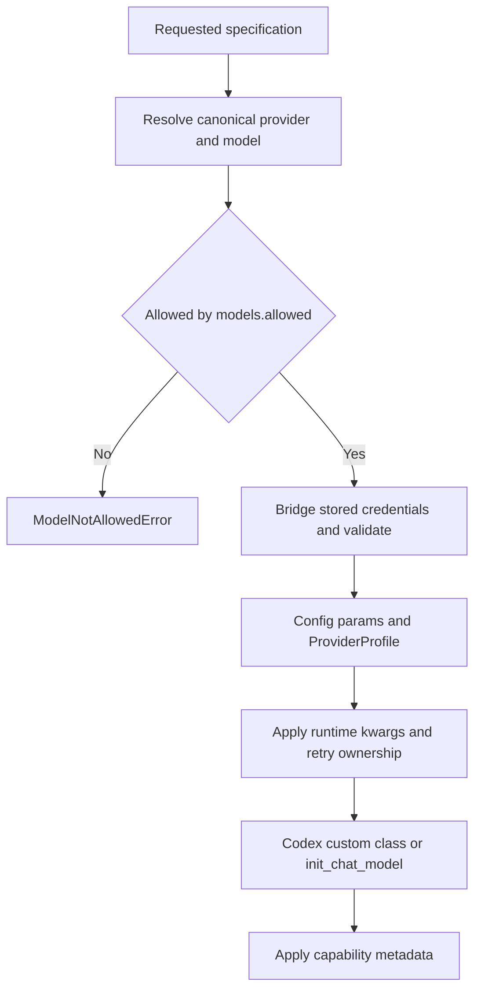

# Profiles and Models

Several mechanisms called a *profile* have intentionally different authority. SDK **ProviderProfile** controls how a string model specification is constructed. SDK **HarnessProfile** changes an agent stack after a model exists. dcode **capability profiles** are descriptive metadata used for discovery, selection, context limits, and reasoning controls. None of these is a substitute for dcode's `models.allowed` admission policy.

## Boundaries and SDK extension points

| Layer | Key | Owns | Does not own |
| --- | --- | --- | --- |
| SDK `ProviderProfile` | `provider` or `provider:model` | `init_chat_model` kwargs, dynamic kwargs, and pre-initialization checks | Prompt, tools, or middleware |
| SDK `HarnessProfile` | `provider` or `provider:model` | Prompt assembly, tool visibility, middleware, and default-subagent behavior | Model-client construction |
| dcode capability profile | `provider:model` | Displayable capabilities, context information, and reasoning-level metadata | Constructor kwargs or authorization |
| dcode `models.allowed` | Canonical `provider:model` | Whether a resolved model may be constructed | Discovery metadata and provider enablement |

The SDK registries are beta APIs and additive: registering again layers settings instead of replacing a prior registration. `resolve_model()` applies ProviderProfile behavior only when given a string, then calls `init_chat_model`; an existing `BaseChatModel` passes through unchanged. For an exact model, provider defaults are merged beneath the exact profile. Hooks and factories run base first; factory values override static profile kwargs, while caller kwargs retain final precedence.

Harness lookup follows the same exact-model-then-provider structure, but is applied during `create_deep_agent()` for the main model and declarative subagents. Runtime-only `extra_middleware` can tune SDK-assembled main, general-purpose, and synchronous declarative subagent stacks, but cannot alter already compiled or remote async subagents; `HarnessProfileConfig` deliberately excludes that non-serializable extension. Required filesystem and subagent scaffolding cannot be excluded, unmatched middleware exclusions fail graph assembly, and tool exclusions are the supported way to hide tools after tool-injecting middleware has run.

Diagram: construction profiles apply only to string specifications; harness profiles shape the graph after a model is available.

Profile bootstrap is lazy and coordinated across threads. Built-in registrations are direct imports and failures abort and roll back bootstrap; third-party provider and harness entry points load afterward, layer on top, and are logged and skipped when broken. Register profiles before agent construction so the intended registrations are present when the model and graph are assembled.

## dcode configuration and environment precedence

A provider entry may enable or hide a provider, list models, identify an API-key or base-URL environment variable, set constructor `params`, provide capability `profile` overrides, or name a `class_path`. A `class_path` imports and instantiates arbitrary Python from user configuration, so it is a trusted-user configuration feature, not safe project input. Provider-wide `params` and `profile` values may have model-keyed tables; model-specific values shallowly override the provider defaults.

For a canonical environment variable, dcode first looks for `DEEPAGENTS_CODE_<NAME>`. Presence of that prefixed variable wins even when it is empty, in which case it suppresses the canonical value. This gives operators an explicit way to override or disable a shell-provided credential in a scoped environment. Stored `/auth` credentials are bridged only when no prefixed override prevents the SDK from reading the canonical variable.

Capability-profile resolution is independent of that constructor path. `get_model_profiles()` starts with installed integration `_profiles` data, overlays configured capability fields, then applies a CLI profile override and records the overridden keys. It also supplies configured-only models, profiles exposed by a configured class-path package, a curated Codex mirror, and best-effort Ollama metadata. A missing capability profile warns; a configured profile assignment failure warns and leaves the model usable, whereas a CLI override assignment failure is a `ModelConfigError`.

## Discovery, catalog, and admission

Discovery is for presentation, not permission. dcode discovers enabled providers whose profile advertises tool calling and usable text input/output, merges explicit configured models, and filters the resulting list through `models.allowed`. Recommended and current specifications are kept only when enabled and permitted. Provider readiness is represented separately, allowing the UI to offer credential or installation guidance even without a discovered model row.

The server supplies a `ModelCatalog` to remote pickers. It is a strict, validated presentation snapshot: model specs, readiness, policy metadata, override provenance, and a small allowlist of scalar capability fields cross the boundary. Constructor kwargs and arbitrary profile extensions do not. A remote picker must use that catalog rather than local provider state and apply catalog policy before prompting for provider installation or authentication.

`models.allowed` is the construction admission policy. An omitted policy is unrestricted; `[]` denies every model; non-empty values are exact `provider:model` entries or `provider:*` wildcards. Invalid declarations fail closed as a deny-all policy. Bare Bedrock IDs are rejected in the allowlist because their version colon would otherwise be parsed as a provider separator; write `bedrock:<id>`.

Diagram: admission is deliberately earlier than every provider-facing construction side effect.

`create_model()` first resolves an explicit prefix, configured provider prefix, Bedrock bare identifier, or inferred provider. It then checks the canonical specification against `models.allowed` **before** credential bridging, ProviderProfile hooks or factories, and provider imports. A blocked request consequently cannot expose a stored credential as an environment variable or execute provider profile code.

After admission, dcode bridges stored credentials and then performs its explicit credential check. Providers supporting ambient authentication are exempt from this early environment-based check; other missing credentials become a typed, actionable error. dcode layers provider and per-model constructor defaults, the resolved credential where applicable, and SDK ProviderProfile output beneath `extra_kwargs`; runtime parameters win. Profile hook/factory exceptions are converted to `ModelConfigError`. Codex takes its OAuth-aware construction path, and a configured `class_path` bypasses normal `init_chat_model()` construction.

## Reasoning effort, retries, and runtime switching

Reasoning effort comes from dcode capability data only when `reasoning_output=True` and a valid level list is advertised. dcode recognizes canonical and provider-native effort spellings, removes obsolete effort fields without discarding unrelated parameters, and writes the portable `reasoning_effort` setting. For Anthropic's `thinking.type="between_tools"`, availability is restricted to `low`, `medium`, and `high`.

dcode owns the visible model-node retry budget. Its order is `--max-retries`, provider-specific retry configuration, global retry configuration, then the built-in default; `0` disables retries. It disables recognized SDK retry loops after merging user kwargs and stores the resolved budget on the concrete model. `CodeModelRetryMiddleware` reads that request model metadata, retries classified transient failures only, honors bounded `Retry-After` values or jittered exponential backoff within an interactive delay budget, emits attempt/retry lifecycle events, and re-raises exhausted failures instead of returning a fake AI response. This prevents retry multiplication and ensures a runtime model switch receives the new provider's budget.

`ConfigurableModelMiddleware` reads `model` and `model_params` from LangGraph runtime context for each call, so it can reconstruct and switch a model without recompiling the graph. A policy denial propagates. Other construction errors can retain the current model unless strict resolution is enabled. A client should treat a successful switch as a new resolved model: the UI updates the canonical provider/model metadata and persists a recent model only after the host resolves it.

## Package compatibility and focused tests

The current dcode package is version `0.2.4`, requires Python `>=3.14,<3.15`, and pins `deepagents==0.7.32`. The SDK manifest is also `0.7.32` but supports Python `>=3.11,<4.0`; that broader SDK range does not widen dcode's released Python contract. dcode's workspace `tool.uv.sources` entry points at the sibling editable SDK checkout for development only. Anthropic, Google GenAI, and OpenAI integrations are core dependencies; the remaining listed providers are optional extras.

When changing this area, preserve the ordering of canonicalization, admission, credential bridging, profile application, and imports. Test malformed, empty, exact, wildcard, and Bedrock allowlists; prove denied construction has no credential/profile/import side effects; test prefixed environment shadowing and stored-credential bridging; and cover provider-profile failures through the actionable error path. The focused dcode suites cover configuration and construction in `tests/unit_tests/test_config.py` and `test_model_config.py`, runtime switching in `test_model_switch.py`, and remote catalog, recommendation, default, policy-empty-state, installation, and authentication routing in `tui/widgets/test_model_selector.py`.

## Related pages

- [Configuration layering](/openwiki/concepts/config-layering.md)
- [State persistence](/openwiki/concepts/state-persistence.md)
- [MCP integration](/openwiki/integrations/mcp.md)
- [Cost and sessions](/openwiki/operations/cost-and-sessions.md)
- [Run a dcode session](/openwiki/workflows/run-dcode-session.md)
- [Testing guide](/openwiki/testing/testing-guide.md)
