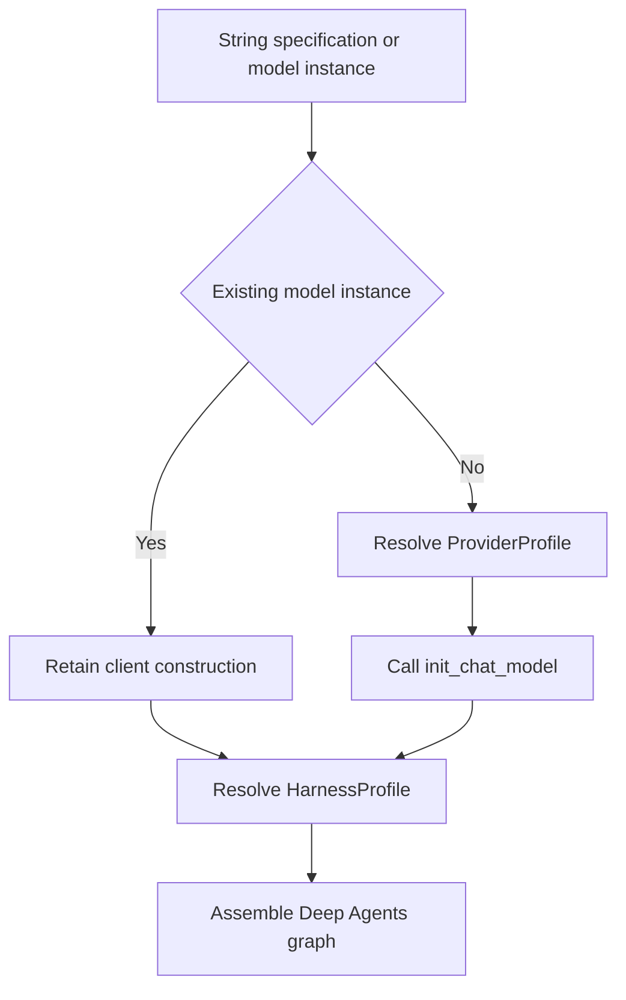
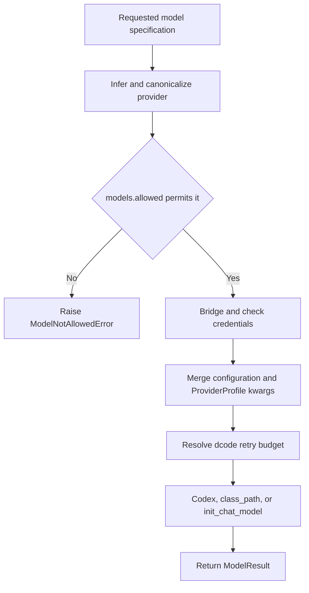
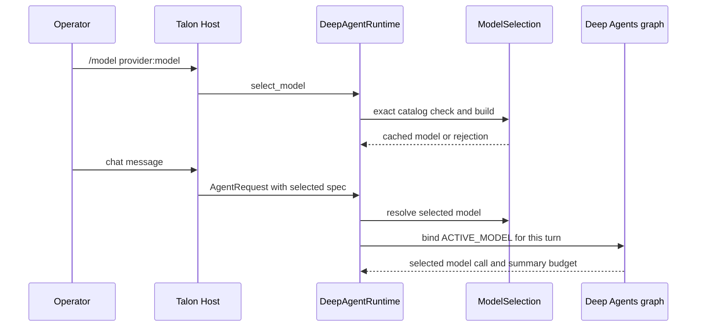

# Profiles and Models

"Profile" has three deliberately separate meanings. Do not use one control plane as a substitute for another.

| Control plane | Owner and key | Controls | Does not control |
| --- | --- | --- | --- |
| SDK `ProviderProfile` | Deep Agents; `provider` or `provider:model` | Construction of a model from a string | Prompts, tools, or graph middleware |
| SDK `HarnessProfile` | Deep Agents; `provider` or `provider:model` | The agent harness around an already resolved model | Client construction |
| dcode configuration | dcode; managed/user configuration, environment, CLI, and runtime context | Admission, credentials, constructor options, defaults, retries, and picker persistence | Talon's catalog and turn selection |
| Talon selection | Talon; discovered catalog plus persisted chat selection | The selected model used by an interactive Talon turn | dcode allowlists, credential store, retry ownership, or defaults |

## SDK profiles: construction and harness are orthogonal

These are beta SDK APIs. The registries are additive: a registration on an existing key layers fields rather than replacing unspecified settings. They accept provider-wide and exact-model keys, and built-ins plus third-party entry points load lazily on first registry access.

*Provider profiles affect string-model construction; harness profiles shape the assembled agent.*

### Provider profiles

`resolve_model()` leaves a supplied `BaseChatModel` alone. For a string, it uses `apply_provider_profile()` before `init_chat_model`. An exact profile overlays the provider profile: static kwargs merge with the exact value winning; base `pre_init` hooks and factories run first; factory output overrides static profile kwargs; and caller kwargs have final precedence. A failed hook stops later hooks, factories, and construction.

Use this extension point for constructor defaults, environment-derived values, attribution headers, and construction preflight—not prompt or tool behavior. `ProviderProfile` defensively copies and freezes its static kwargs, preventing mutation after registration.

### Harness profiles

`create_deep_agent()` resolves a harness profile for the primary model and for each declarative synchronous subagent. Exact matches win over, and merge with, provider fallback. A profile can assemble the `USER → BASE → SUFFIX` prompt, override tool descriptions, hide tools from the model, add middleware, and configure the generated `general-purpose` subagent.

Tool exclusion changes model visibility, not authorization. Filesystem and synchronous-subagent middleware are protected; excluding either, or naming middleware absent from the final stack, fails graph assembly. `HarnessProfileConfig` is the serializable subset: live middleware and factories are runtime-only.

## dcode: provenance, environment, bootstrap, and policy

Configuration resolution is security-sensitive behavior, not simple settings lookup. `ModelConfig.load()` caches the immutable default-path result and reads through the configuration service so managed policy remains in force when user TOML is missing, unreadable, malformed, or structurally invalid. Passing an explicit path deliberately reads only that file and excludes managed policy; production policy checks should use the default path.

Importing `deepagents_code.config` does not eagerly traverse project paths or load dotenv files. First access to lazy `credentials` performs one lock-protected bootstrap and creates the process-wide `Credentials` object. Bootstrap captures launch LangSmith selectors, discovers project context, loads dotenv values, and records failures while allowing the application to continue with the available environment. It completes even after failure, avoiding repeated unsafe or expensive bootstrap attempts.

For dotenv injection, shell values outrank the nearest project `.env`, which outranks the global profile `.env`. A project dotenv is not a general trust boundary: sensitive loader, process-launch, and approval controls are denied there. `use_environment()` instead binds an immutable context-local snapshot for model construction, avoiding an accidental read from mutable process-global environment. For a canonical key such as `OPENAI_API_KEY`, a present `DEEPAGENTS_CODE_OPENAI_API_KEY` shadows it even if blank; blank is an intentional suppression.

The model fields have different responsibilities:

- `[models].default` is the intended launch model and `[models].recent` a fallback.
- `[models].summarization_default` and `[models].auto_classifier` persist specialized preferences, not the main-model default.
- `[models].providers` supplies provider configuration, including optional custom `class_path` construction.
- `[models].allowed` is an admission policy, not a picker filter or default selector.

The allowlist distinguishes absence (unrestricted), `()` (deny all), and a nonempty exact-spec or `provider:*` policy. A malformed declared allowlist fails closed to deny-all. A configured `class_path` is a trusted configuration boundary: dcode imports and instantiates that configured `BaseChatModel` class instead of ordinary `init_chat_model` resolution.

*dcode gates admission before credential side effects, profile hooks, or provider imports.*

`create_model()` accepts `provider:model` or an inferable bare name. The gate runs after inference, so policy sees canonical specs, but before stored-credential bridging, provider-profile hooks/factories, and imports. After admission it checks credentials (except implicit-auth providers), layers provider and per-model configuration with stored credentials and SDK profile output, then lets `extra_kwargs` win. Profile errors are rendered as `ModelConfigError`. It uses the OAuth-aware Codex class for `openai_codex`, direct configured-class construction for `class_path`, or `init_chat_model` otherwise. Capability metadata helps validation but does not grant admission.

### Retry ownership and picker persistence

dcode's model-node middleware owns its visible retry budget. Its precedence is `--max-retries`, provider-specific configuration, global configuration, then built-in `5`; zero disables retries. dcode disables recognized provider SDK retry loops after kwargs merge and stores the chosen budget on the model and `ModelResult`, so runtime switching cannot multiply attempts or retain the previous provider's budget.

The TUI picker persists the main, Auto-classifier, and summarization defaults in separate scopes. Saving checks effective admission policy and refuses a newly persisted model whose provider package is unavailable; clearing an existing unusable value remains possible.

## Talon: catalog admission and turn-scoped swapping

Talon is an experimental, separate runtime. Its `/model` workflow is neither a dcode switch nor a dcode policy bypass. Talon discovers installed tool-calling provider models only for providers with credentials in **Talon's own environment**; a key kept only in dcode's store is not usable. The graph's configured default is always selectable. When a trusted LangSmith gateway is configured, Talon also obtains a catalog from its HTTPS `/v1/models` endpoint, accepts only safe identifiers and chat-completions-capable entries, and rejects malformed, non-HTTPS, credentialed-URL, nonstandard-port, or non-gateway endpoints.

*A Talon selection is validated and built before it is used, then bound only while its request runs.*

`ModelSelection` does no discovery or construction at initialization. It validates exact `provider:model` catalog membership before build, builds a nondefault model once under a lock, and caches it. Runtime selection prepares the model before the next turn so an operator receives a construction failure immediately. A stale or newly unavailable persisted selection does not fail a turn: Talon logs it and uses the graph default.

For each invocation the runtime sets `ACTIVE_MODEL` (and effort settings) in `ContextVar`s and resets both in `finally`. `ModelSelectionMiddleware`, installed so inner middleware observes the selected client, overrides main-agent model calls without recompiling the graph. `SelectedModelSummarization` occupies the Deep Agents summarizer slot and caches a summarizer per selected model, sizing compaction to 80% of that model's input limit (or 4,000 when unknown). Delegated subagents intentionally retain the startup summarizer and model behavior.

Talon host commands and persisted selection scope are distinct from the per-request binding: an operator can change the all-chat model, selections survive `/new` and restart, and `/model default` clears persisted state. Nonoperators cannot change a model; untrusted requested specs are rejected without being echoed. A selection made after a turn has started takes effect on the following turn.

## Package compatibility

`deepagents-code` 0.2.13 requires Python `>=3.14,<3.15` and pins `deepagents==0.7.41`. Deep Agents 0.7.41 supports Python `>=3.11,<4.0`; the SDK range does not widen dcode's released Python contract. The SDK manifest requires LangChain `>=1.5.2,<2.0.0`, LangChain Core `>=1.8.4,<2.0.0`, `langchain-anthropic >=1.7.12,<2.0.0`, and `langchain-google-genai >=4.4.3,<5.0.0`.

## Focused verification

`libs/code/tests/unit_tests/test_model_config.py` covers malformed and deny-all policy, bare-name canonicalization, rejection after inference, and limited wildcard grammar. `libs/code/tests/unit_tests/test_config.py` covers dotenv reload and precedence. Preserve a construction-order test proving that a blocked model cannot bridge credentials or run profile side effects.

`libs/talon/tests/unit_tests/test_model_selection.py` covers operator authorization, persistence and reset, exact-catalog rejection, one-time model builds, fallback for a stale selection, gateway endpoint validation, turn isolation, and selected-model context limits. These are the regressions to preserve when changing Talon's catalog, model cache, middleware ordering, or request lifecycle.

## Related pages

- [SDK construction and execution](/openwiki/architecture/sdk-construction-execution.md)
- [Configuration layering](/openwiki/concepts/config-layering.md)
- [MCP integration](/openwiki/integrations/mcp.md)
- [Talon integration](/openwiki/integrations/talon.md)
- [Testing guide](/openwiki/testing/testing-guide.md)
