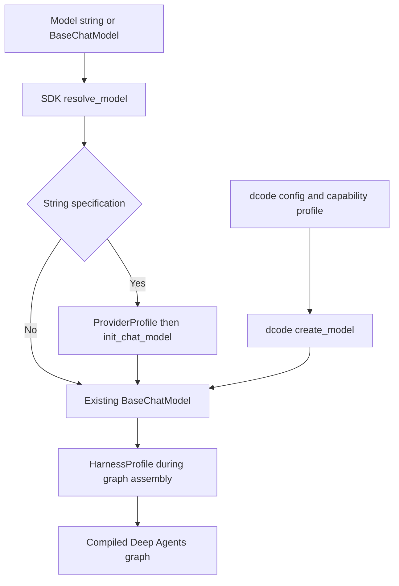
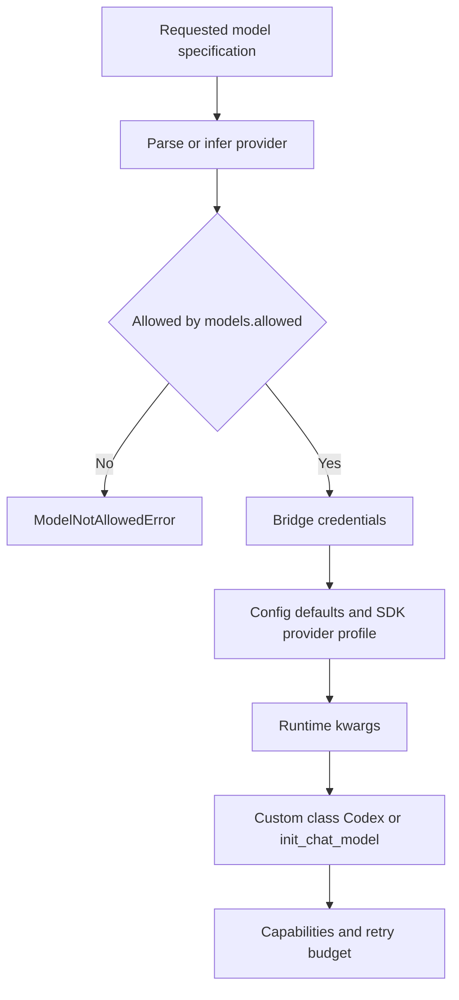

# dcode Models and Profiles

“Profile” has several deliberately separate meanings. The Deep Agents SDK uses **provider profiles** to construct a model from a string and **harness profiles** to adapt the agent graph. dcode uses **capability profiles** to describe a model for selection, prompt metadata, and reasoning controls; it also has a launch-selected user profile that owns configuration and state. Installing an integration or registering an SDK profile does not, by itself, make a model selectable, credentialed, or permitted in dcode.

## The profile boundaries

| Kind | Owner and lookup key | Responsibility |
| --- | --- | --- |
| User profile | dcode launch-time `DEEPAGENTS_HOME` | Trust root containing `config.toml`, credentials/state, and user agent material. |
| SDK `ProviderProfile` | `provider` or `provider:model` | Constructor kwargs, dynamic kwargs, and pre-initialization work for a **string** model spec. |
| SDK `HarnessProfile` | `provider` or `provider:model` | Prompt, tool, middleware, and default-subagent changes while assembling a Deep Agents graph. |
| dcode capability profile | `provider:model` | Model capabilities such as context window, modalities, tool calling, and reasoning levels. |

`DEEPAGENTS_HOME` is selected from the inherited launch environment and captured in the process-wide `PATHS` snapshot; project/global dotenv files cannot change it. This makes the selected user profile a trust boundary, rather than a setting that can drift after a directory change or reload. Its `config.toml` is the default source for `ModelConfig`; managed policy is included for default-path reads.

The SDK construction/assembly path is distinct from dcode's policy-gated construction path; capability data informs dcode behavior around the resulting model.

## SDK provider and harness profiles

The beta SDK registries are additive. Registrations accept a provider or exact `provider:model` key, and a later registration layers fields rather than replacing the old registration. `resolve_model()` leaves an existing `BaseChatModel` unchanged; only a string gets `ProviderProfile` handling and `init_chat_model()`. A supplied instance can still receive a harness profile if its provider and identifier can be determined.

Provider-profile resolution overlays an exact model registration on the provider registration. Static kwargs merge base first, hooks and dynamic factories run base first, factory output overrides static kwargs, and explicit caller kwargs win last. A hook or factory failure stops construction. Bootstrap is lazy, thread-coordinated, and once per process: SDK built-ins must load successfully, whereas faulty third-party entry points are logged and skipped.

Harness lookup similarly prefers an exact spec and falls back to provider-level data. `create_deep_agent()` resolves it separately for the main model and every declarative subagent before applying prompt, tool-description, and middleware changes. Runtime-only extra middleware can affect SDK-assembled main, general-purpose, and synchronous declarative subagent stacks; it cannot alter an already compiled or remote async subagent, so file-friendly `HarnessProfileConfig` excludes that extension.

Harness exclusions are not authorization controls. Required filesystem and subagent scaffolding cannot be removed, unmatched exclusions fail assembly, and tool exclusion runs after tool-injecting and custom middleware. This ordering makes tool exclusion the supported way to hide an injected tool from the model.

## dcode configuration, packages, and capability data

The distribution pins `deepagents==0.7.32`. Anthropic, Google GenAI, and OpenAI integrations are core dependencies; other supported integrations are optional provider extras, including the `all-providers` convenience extra. Packaging only makes an integration importable: enablement, credentials, configured lists, capability requirements, and `models.allowed` separately control usability.

A provider configuration can supply `enabled`, explicit `models`, credential/base-URL names, constructor `params`, capability `profile` overrides, or a trusted `class_path`. The latter imports and instantiates arbitrary Python from user configuration and consequently has the same trust implications as other local executable configuration. Provider-wide `params` and `profile` fields can contain per-model subtables; the per-model mapping shallowly wins.

`get_model_profiles()` reads upstream integration `_profiles` data, overlays configured capability fields, then applies a CLI `--profile-override` when supplied. Entries retain which keys were overridden. It also supports configured-only models, class-path packages exposing `_profiles`, mirrored Codex capabilities, and discovered Ollama metadata. Capability profiles are descriptive data, not SDK `ProviderProfile` constructor behavior.

### Catalog, discovery, and policy

`load_model_catalog()` returns a strict presentation snapshot for the inference host. It carries displayable scalar capabilities, override provenance, readiness, policy metadata, model specifications, and an optional current specification—not arbitrary constructor kwargs or profile extensions. A remote picker uses the supplied catalog rather than inspecting its local provider state and must apply catalog policy before installation or authentication prompts.

Discovery includes enabled providers whose upstream profile advertises tool calling and usable text input/output, then merges explicit configured models. It can derive profile data from a `class_path` package and query installed Ollama models. `models.allowed` filters the final lineup; current and recommended specifications remain eligible only when enablement and policy allow. Readiness remains independent of rows, so a known provider can offer setup guidance even when it has no discovered models.

`models.allowed` is a security boundary: absent means unrestricted, an empty tuple denies every model, and non-empty entries are exact specs or `provider:*` wildcards. A malformed declared allowlist fails closed as deny-all instead of becoming unrestricted.

dcode checks the allowlist after canonical provider inference but before credential bridging, SDK profile work, or provider imports. Afterward it layers provider and per-model configuration, credentials, applicable SDK provider-profile defaults, then runtime `extra_kwargs` last. Codex uses its OAuth-aware path; configured custom classes bypass ordinary `init_chat_model()`. dcode applies configured and CLI capability-profile overrides to the concrete model; a missing profile warns, but an explicit `tool_calling=False` is fatal for an agent.

## Runtime selection, reasoning effort, and retries

`ConfigurableModelMiddleware` reads `model` and `model_params` from LangGraph runtime context on each call. It creates a replacement only when the requested specification differs, shallow-merges call settings, strips Anthropic-only settings when moving to another provider, and patches the Model Identity prompt section. A blocked switch always propagates. Other construction errors propagate in strict mode or log and retain the current model otherwise; the fallback deliberately does not overwrite checkpointed parameters with unknown values. Successful model calls persist the resolved spec and runtime settings needed for resume, while cache identity records effective configured settings separately. Async paths offload blocking construction and configuration reads.

Reasoning effort is driven by dcode capability profiles, not harness profiles. It is available only where `reasoning_output=True` and valid levels are advertised. dcode recognizes canonical and provider-native representations, removes old effort fields while preserving unrelated parameters, and stores the portable `reasoning_effort` value. It persists a selected effort by model in the active configuration; an explicit session/native setting takes precedence over restoring that preference. Anthropic `thinking.type="between_tools"` limits the offered levels to `low`, `medium`, and `high`.

Construction resolves a provider/CLI retry budget, disables recognized provider SDK retries, and stamps that budget on the concrete model. `CodeModelRetryMiddleware` uses the per-request model budget at the model node, so a runtime switch does not multiply retries or replay completed tools. It retries only classified transient failures, honoring valid capped `Retry-After` or jittered exponential backoff within the interactive delay budget; it re-raises non-transient or exhausted errors and emits attempt/retry lifecycle events for streamed-output reconciliation.

## GLM-5.2 dcode harness and Harbor evaluation construction

For three exact GLM-5.2 specs—Fireworks, OpenRouter, and Baseten—dcode registers a prompt-only `HarnessProfile` before creating its CLI graph. Registration is process-idempotent and deliberately does not replace an existing suffix for the same exact spec. This is dcode-specific harness adaptation, separate from both provider construction profiles and capability data.

Headless dcode main and generated subagent stacks also install a Fireworks-only terminal-stall recovery middleware. If exactly `fireworks:accounts/fireworks/models/glm-5p2` returns one tool-free AI result with `finish_reason == "length"`, it makes one recovery call with a trusted suffix, `tool_choice="any"`, and nested Fireworks `reasoning_effort="none"`. It never loops, does not run in interactive sessions, and does not apply to the same model identity on OpenRouter or Baseten.

Harbor builds eval models directly with `init_chat_model()`, so it bypasses Deep Agents provider-profile construction. Its eval adapter explicitly sets `use_responses_api=True` for `openai:` specs when the caller did not set it. For the shared exact GLM-5.2 set, it defaults nested `model_kwargs.reasoning_effort` to `high` only when neither top-level nor nested native effort field was supplied. The adapter then creates either the dcode headless CLI graph or a bare SDK graph; for the CLI path it mirrors resolved model identity into dcode runtime state so the production Model Identity prompt is accurate.

## Safe changes and focused tests

Changing a provider is a multi-boundary change: choose package/extra, credential and endpoint mapping, discovery, policy, constructor behavior, capability data, reasoning representation, retry ownership, and catalog projection independently. Preserve the allowlist gate's position before side effects. Test capability-profile fallback and override provenance separately from SDK profile precedence.

Focused coverage includes profile discovery for configured/class-path/Ollama sources, deny-all and wildcard policy semantics, stored credential precedence, capability profile merging, native reasoning normalization, runtime switch fallback and checkpoint state, catalog redaction, and retry behavior. `test_glm_5p2_profile.py` verifies the narrow terminal-stall predicate, forced recovery request, non-mutation of the original request, and one-retry ceiling. Harbor construction should be tested separately because it intentionally bypasses SDK provider profiles.

## Related pages

- [Code agent](/openwiki/architecture/code-agent.md)
- [Configuration layering](/openwiki/concepts/config-layering.md)
- [Development](/openwiki/operations/development.md)
- [Run evaluations](/openwiki/workflows/run-evals.md)
