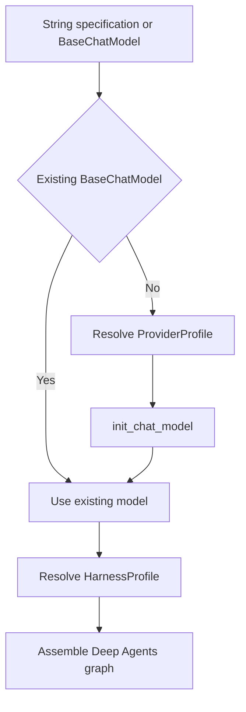
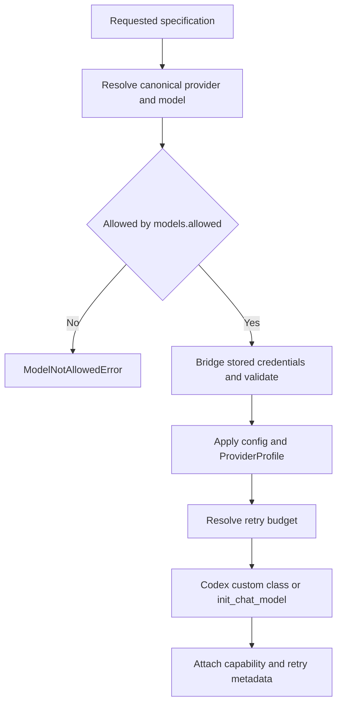

# Profiles and Models

Several mechanisms called a *profile* have intentionally different authority. SDK **ProviderProfile** controls how a string model specification is constructed. SDK **HarnessProfile** changes an agent stack after a model exists. dcode **capability profiles** are descriptive metadata used for discovery, selection, context limits, and reasoning controls. None of these is a substitute for dcode's `models.allowed` admission policy.

## Boundaries and SDK extension points

| Layer | Key | Owns | Does not own |
| --- | --- | --- | --- |
| SDK `ProviderProfile` | `provider` or `provider:model` | `init_chat_model` kwargs, dynamic kwargs, and pre-initialization checks | Prompt, tools, or middleware |
| SDK `HarnessProfile` | `provider` or `provider:model` | Prompt assembly, tool visibility, middleware, and default-subagent behavior | Model-client construction |
| dcode capability profile | `provider:model` | Displayable capabilities, context information, and reasoning-level metadata | Constructor kwargs or authorization |
| dcode `models.allowed` | Canonical `provider:model` | Whether a resolved model may be constructed | Discovery metadata and provider enablement |

The SDK profile registries are beta APIs and additive: a second registration layers on top of the first rather than replacing it. `resolve_model()` applies ProviderProfile behavior only to a string, then calls `init_chat_model`; a supplied `BaseChatModel` is passed through unchanged. An exact model profile overlays the provider profile. Pre-initialization hooks and dynamic factories run base first; factory output overrides static profile kwargs, and caller kwargs have final precedence.

Diagram: construction profiles apply only to string specifications; harness profiles shape the graph after a model is available.

Harness lookup also prefers an exact model and then a provider fallback. `create_deep_agent()` resolves it for the main model and each declarative synchronous subagent before it applies prompt, tool-description, and middleware changes. The authored prompt order is caller `USER`, profile `BASE`, then profile `SUFFIX`.

A runtime `HarnessProfile` may supply static or factory `extra_middleware` for the main, general-purpose, and declarative synchronous subagent stacks. It cannot alter a precompiled subagent or a remote asynchronous subagent; `HarnessProfileConfig` intentionally excludes this runtime-only feature so it remains file-friendly. Middleware exclusions cannot remove required filesystem or subagent scaffolding, and an exclusion that matches nothing fails graph assembly. Use tool exclusions—not middleware removal—to hide injected tools from the model.

Profile bootstrap is lazy, thread-coordinated, and one-time. Built-ins load through direct imports; an exception rolls the registry back and fails bootstrap. Provider and harness entry-point plugins load afterward and layer onto built-ins; a broken third-party plugin is warned about and skipped. Register custom profiles before construction so the registry is complete when models and graphs are assembled.

## dcode configuration, discovery, and catalog

A dcode provider entry can enable or hide a provider, list models, identify API-key or base-URL environment variables, set constructor `params`, add capability `profile` overrides, or name a `class_path`. `class_path` imports and instantiates arbitrary Python from configuration, so it is a trusted-user configuration feature, not safe project input. Provider-wide `params` and `profile` values may have model-keyed tables, whose values shallowly override provider defaults.

For a canonical environment variable, dcode first checks `DEEPAGENTS_CODE_<NAME>`. The prefixed variable wins even when empty, so it can intentionally suppress a canonical shell value. Stored `/auth` credentials are bridged only when that precedence permits the SDK to read the canonical variable.

Capability-profile resolution is separate from construction. `get_model_profiles()` starts with installed integration `_profiles` data, overlays configured fields, then overlays a CLI profile override and records overridden keys. It also represents configured-only models, profile data from a configured class-path package, a curated Codex mirror, and best-effort Ollama metadata. A missing capability profile warns; a configured assignment failure warns and leaves the model usable, while a CLI override assignment failure becomes `ModelConfigError`.

Discovery is presentation, not permission. dcode discovers enabled providers whose capability profiles advertise tool calling and usable text input/output, merges explicitly configured models, and then filters through `models.allowed`. Recommended and current models are retained only when their provider is enabled and policy permits them. Provider readiness is independent of discovered model rows, allowing setup guidance even when no model row exists.

The host sends a `ModelCatalog` to remote pickers. It is a strict presentation snapshot: model specs, provider readiness, policy metadata, override provenance, and a scalar allowlist of capability fields cross the boundary; constructor kwargs and arbitrary profile extensions do not. A remote picker must use its supplied catalog rather than local provider data, and apply catalog policy before installation or authentication prompts.

`models.allowed` is the construction admission policy. An omitted policy is unrestricted; `[]` denies every model; nonempty entries are exact `provider:model` values or `provider:*` wildcards. A malformed declaration fails closed as deny-all. Bare Bedrock IDs are rejected in the allowlist because a version colon could be mistaken for the provider separator; use `bedrock:<id>`.

## dcode construction and switching lifecycle

Diagram: admission happens before all provider-facing construction side effects.

`create_model()` canonicalizes an explicit prefix, configured provider prefix, Bedrock bare identifier, or inferred provider. It applies its allowlist after inference but **before** credential bridging, ProviderProfile hooks or factories, and provider imports. A blocked request therefore cannot expose a stored credential as an environment variable or run provider profile code.

After admission, dcode bridges stored credentials and performs its explicit credential check. Providers with ambient authentication are exempt from that early environment-based check; other missing credentials produce a typed actionable error. dcode layers provider and per-model defaults, an applicable stored credential, and SDK ProviderProfile output below `extra_kwargs`; runtime kwargs win. Profile hook or factory exceptions become `ModelConfigError`. Codex follows its OAuth-aware construction path, while a configured `class_path` bypasses normal `init_chat_model()` construction.

`ConfigurableModelMiddleware` reads `model` and `model_params` from LangGraph runtime context for each call, so it can reconstruct and switch a model without recompiling the graph. A `ModelNotAllowedError` always propagates. Other construction failures keep the current model unless strict resolution is configured; in that fallback path model parameters are deliberately marked unknown rather than falsely checkpointed as cleared.

## Reasoning effort and retries

Reasoning effort is exposed only when capability metadata advertises `reasoning_output=True` and valid effort levels. dcode normalizes recognized provider-native effort fields to `reasoning_effort` without discarding unrelated parameters. Anthropic `thinking.type="between_tools"` is available only at `low`, `medium`, and `high` effort.

The model-node middleware owns the visible retry budget: `--max-retries`, provider-specific configuration, global configuration, then the built-in default (`5`); `0` disables retries. dcode disables known provider SDK retry loops after merging user kwargs, then stamps the selected budget on the concrete model. This lets a runtime switch carry the new provider's retry budget rather than multiplying attempts through nested SDK retries.

`CodeModelRetryMiddleware` wraps the model node, not the whole turn, so completed tools are not replayed. It retries only classified transient failures, honors a bounded `Retry-After` hint or jittered exponential backoff within a 60-second interactive delay budget, emits correlated attempt and retry lifecycle events, and re-raises an exhausted failure rather than fabricating an AI answer. Stream consumers use those events to mark partial output from a superseded attempt.

## Compatibility and provider dependency floors

dcode `0.2.5` requires Python `>=3.14,<3.15` and pins `deepagents==0.7.34`. The SDK manifest is `0.7.34`, supports Python `>=3.11,<4.0`, and requires LangChain `>=1.4.9,<2.0.0`, LangChain Core `>=1.7.6,<2.0.0`, Anthropic `>=1.7.10,<2.0.0`, and Google GenAI `>=4.4.3,<5.0.0`. The SDK range does not widen dcode's released Python contract; dcode's editable sibling SDK source is a development override.

The dcode core installs Anthropic `>=1.7.10,<2.0.0`, Google GenAI `>=4.4.3,<5.0.0`, and OpenAI `>=1.7.4,<2.0.0`. Other integrations are extras: Baseten `>=0.2.5,<1.0.0`, Bedrock `>=1.9.1,<2.0.0`, Cohere `>=0.6.0,<1.0.0`, DeepSeek `>=1.1.1,<2.0.0`, Fireworks `>=1.7.2,<2.0.0`, Groq `>=1.1.3,<2.0.0`, Hugging Face `>=1.2.3,<2.0.0`, IBM `>=1.1.2,<2.0.0`, LiteLLM `>=0.11.2,<2.0.0`, Meta `>=0.5.0,<2.0.0`, Mistral `>=1.1.6,<2.0.0`, NVIDIA endpoints `>=1.5.0,<2.0.0` (plus `aiohttp>=3.14.3`), Ollama `>=1.1.0,<2.0.0`, OpenRouter `>=0.2.9,<2.0.0`, Perplexity `>=1.4.2,<2.0.0`, Together `>=0.4.0,<2.0.0`, Vertex AI `>=3.2.5,<4.0.0`, and xAI `>=1.3.0,<2.0.0`. Install the matching dcode extra before selecting its provider.

The `0.2.5` changelog records that compaction input budgeting now follows the selected model. This is release context, not a promise that every runtime switch changes an already compiled graph; model switching remains the responsibility of the runtime middleware described above.

When changing this area, preserve the ordering of canonicalization, admission, credential bridging, profile application, and imports. Test malformed, empty, exact, wildcard, and Bedrock allowlists; prove denied construction has no credential, profile, or import side effects; exercise prefixed environment shadowing and stored credential bridging; and cover profile failure translation, model-switch denial and fallback, and per-switch retry budgets. Relevant focused suites include `libs/code/tests/unit_tests/test_config.py`, `test_model_config.py`, `test_model_switch.py`, `tui/widgets/test_model_selector.py`, and `libs/deepagents/tests/unit_tests/test_harness_profiles.py`.

## Related pages

- [Middleware stack](/openwiki/architecture/middleware-stack.md)
- [Architecture overview](/openwiki/architecture/overview.md)
- [Subagents and skills](/openwiki/concepts/subagents-skills.md)
- [Quickstart](/openwiki/quickstart.md)
- [Testing guide](/openwiki/testing/testing-guide.md)
