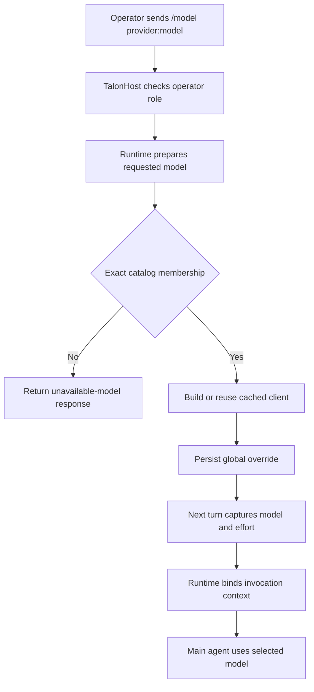
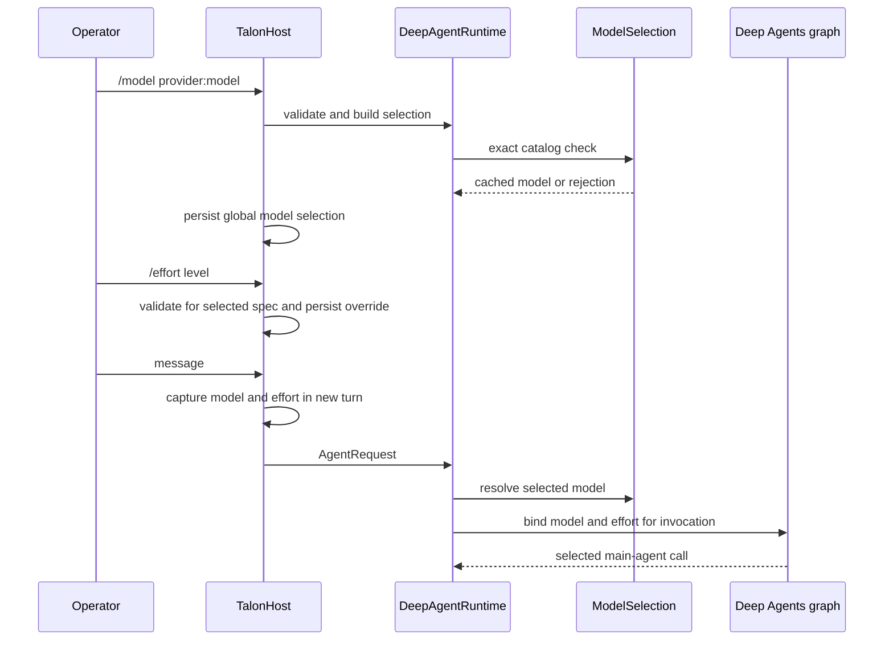

# Profiles and Models

Talon model selection is a Talon host and runtime feature, not dcode policy and not a Deep Agents SDK profile system. `/model` chooses the main-agent client for later Talon turns from Talon's discovered catalog. `/effort` is a separate, model-specific control that contributes invocation settings; it neither admits nor selects a model. Neither command changes dcode allowlists, dcode credentials, dcode preferences, retry policy, or SDK provider and harness profiles.

| Concern | Owner | Scope |
| --- | --- | --- |
| Catalog admission and cached client construction | `ModelSelection` in the runtime | A Talon runtime process |
| Selected-model and effort middleware | `DeepAgentRuntime` | One invocation, through `ContextVar`s |
| `/model` and `/effort` authorization and persistence | `TalonHost` | One assistant, across chats and restart |
| Default model | The graph at runtime startup | Used when there is no override or a saved override is unavailable |

## Catalog admission before construction

`discover_models(env)` starts with the installed provider catalog and includes a provider only when its required credential is nonblank in the environment supplied to Talon. A key stored only in dcode does not qualify. The graph's startup `provider:model` is always added to the displayed catalog—even if it is not otherwise discovered—because choosing it means retaining the graph client rather than rebuilding one.

A configured LangSmith gateway may add models to the `openai` catalog. Talon accepts only an authenticated, HTTPS LangSmith gateway endpoint at exactly `/v1`, with no credentials in the URL, query, fragment, or nonstandard port. It fetches `/models` with a five-second request and no redirect following. The response must be a list; only safe model identifiers are retained, and entries which declare `supported_endpoints` must include `/v1/chat/completions`. Gateway identifiers are deduplicated against native OpenAI catalog entries.

`ModelSelection` is deliberately lazy. Creation does not discover or import providers. Before it calls the model builder, `resolve()` requires exact `provider:model` membership in the current catalog; a bare provider, a malformed spec, or an unlisted model raises `UnknownModelError`. The default spec returns `None`, signaling that middleware must keep the startup model. Every admitted nondefault model is built once under a lock and then cached. This makes the catalog an admission boundary for channel input rather than merely a user-interface list.



*Selection is admitted and built before the host persists it; the resulting choice is captured by a later turn.*

## Host-wide `/model` lifecycle

`/model` without a spec, and `/model <provider>`, list available choices and may be used by any channel user. A change requires a channel operator. For a nondefault spec, the host calls `select_model()` first, which checks catalog membership and builds the client so that a construction failure is reported to the operator before state changes. Discovery and provider errors are logged but not disclosed to chat users.

The host stores at most one override under the global key in `models.json` in the assistant home. Therefore the choice applies to all conversations, including new conversations, and survives restart. `/model default`, or selecting the startup default explicitly, clears that JSON object and restores the graph default. A failed state write does not replace the host's in-memory selection.

At the point a message becomes work, the host copies the current global model override and the effective model's saved effort setting into an immutable `_Turn`. A `/model` or `/effort` change made while transcription or other pre-invocation work is in progress applies only to the next turn. This capture, rather than a lookup during graph execution, prevents a host-wide change from altering an in-flight request.

A previously valid saved selection can become stale—for example, when credentials or installed provider availability change. It remains visible as unavailable in `/model` output. On an invocation, the runtime attempts to resolve it in a worker thread; any failure is logged at warning level once per spec and then at debug level for repeated turns. It binds no override and the graph runs on its startup default. The same resolution path is used for context diagnostics, so a stale selection cannot prevent a context report.



*The host validates and persists operator changes before a later turn captures them; runtime bindings last only for that invocation.*

## Runtime binding and context sizing

`DeepAgentRuntime` enters `_turn_models()` around graph invocation. It resolves the captured spec, derives effort settings only when the model is valid for the effective spec, sets `ACTIVE_MODEL` and `ACTIVE_EFFORT`, and resets both in `finally`. Context variables isolate simultaneous turns. Crucially, effort from a stale nondefault selection is not applied to the fallback startup model.

`ModelSelectionMiddleware` is installed in the main graph. On each main-agent model request it substitutes `ACTIVE_MODEL`, if present, without recompiling the graph. It is positioned so downstream middleware, including prompt caching, observes the selected client. The middleware also merges active effort settings into model settings without mutating the original request. It deep-merges `extra_body.thinking`, retaining unrelated `extra_body` and other settings. Delegated subagents do not receive the effort override.

Changing a model also must change the context budget used for summarization. Deep Agents runs its summarizer before ordinary custom middleware, so Talon replaces that named slot with `SelectedModelSummarization`. For a selected main-agent client it creates and caches a summarizer for that client, substitutes the client in the request before compaction, and uses 80% of `profile["max_input_tokens"]` as the trim limit. Missing, invalid, or nonpositive capacity uses 4,000 tokens instead. With no selected client and within delegated subagents it uses the cached startup summarizer, so subagents retain startup model and context behavior.

## `/effort`: model-specific invocation controls

`/effort` reads the selected global spec, or the startup default when there is no `/model` override. Anyone may inspect the current control and supported labels; only an operator may change a nonempty value. A requested label is normalized (`extra-high` and `x high` become `xhigh`) and must be in that model's supported-level allowlist before the host writes it. `/effort default` removes only the current model's entry.

Overrides are stored by `provider:model` in `effort.json`, independently from `models.json`. Switching models restores the setting saved for that model; switching back to default restores the default model's separate setting. State is changed in memory only after its write succeeds. Like the model selection, the effective setting is captured for the next `_Turn`.

`effort_levels()` recognizes supported controls from provider metadata and documented fallbacks, including normalized OpenAI gateway paths and special DeepSeek, Qwen, and GLM families. `effort_settings()` validates the requested label again before translating it: Qwen labels become a thinking budget and enable flag; DeepSeek and GLM use provider-specific thinking payloads; other supported models use `reasoning_effort`. This second allowlist check prevents arbitrary chat command text becoming provider invocation parameters.

## Operations and focused tests

- Configure credentials in Talon's own environment before expecting a provider's catalog entries to appear. The startup model remains usable as the default even if discovery does not list it.
- Treat `models.json` and `effort.json` as assistant-wide state, not per-channel or per-conversation preferences. Their paths are constrained to the assistant home.
- A stale persisted override is intentionally an availability condition: inspect logs and `/model` listing, but conversations continue on the startup model.
- When adding a provider, gateway behavior, or selection path, preserve exact catalog admission before construction, lock-protected caching, and the fallback path. When modifying middleware ordering, verify selected-model context sizing as well as the final model call.

The focused suites are `libs/talon/tests/unit_tests/test_model_selection.py` and `libs/talon/tests/unit_tests/test_effort.py`. They cover authorization, global persistence and reset, capture timing, credential-gated discovery, gateway validation, exact admission, build caching, stale fallback, selected-model summarization, effort persistence and validation, provider payload translation, deep settings merge, and concurrent turn isolation. Run them through the package workflow in the [Testing guide](/openwiki/testing/testing-guide.md), for example:

```bash
cd libs/talon
uv sync --all-groups
make test TEST_FILE=tests/unit_tests/test_model_selection.py
make test TEST_FILE=tests/unit_tests/test_effort.py
```

## Related pages

- [Source map](/openwiki/architecture/source-map.md)
- [Talon channel admission](/openwiki/concepts/talon-channel-admission.md)
- [Talon runtime integration](/openwiki/integrations/talon.md)
- [Testing guide](/openwiki/testing/testing-guide.md)
