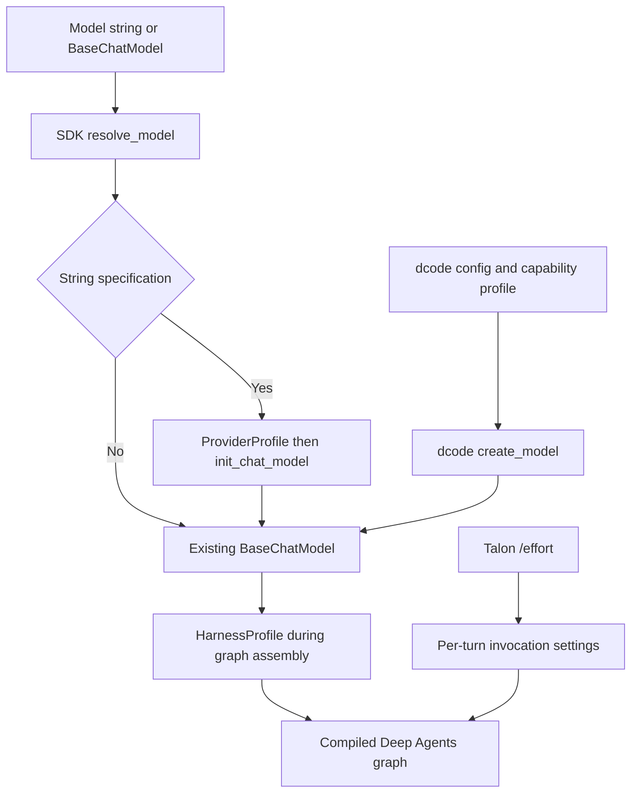
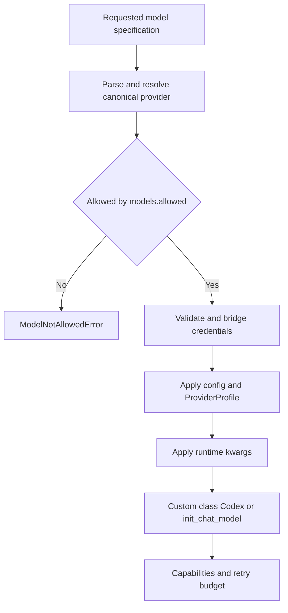
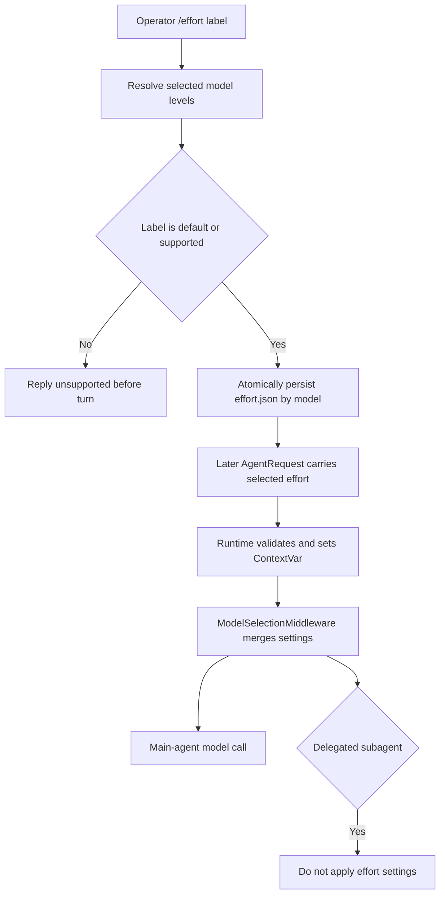

# Profiles and Models

“Profile” and “effort” name several deliberately separate mechanisms. The Deep Agents SDK uses **provider profiles** to construct a model from a string and **harness profiles** to adapt an agent graph. dcode uses **capability profiles** to describe model features for discovery, selection, and its reasoning control. Talon's `/effort` is instead a model-specific command: it selects only documented or discovered reasoning controls and maps them to settings for the next main-agent invocation. Neither capability profiles, Talon effort rules, nor SDK profiles are a general provider authorization policy.

## Profile boundaries

| Kind | Owner and lookup key | Responsibility |
| --- | --- | --- |
| User profile | dcode launch-time `DEEPAGENTS_HOME` | Trust root containing `config.toml`, credentials/state, and user agent material. |
| SDK `ProviderProfile` | `provider` or `provider:model` | Constructor kwargs, dynamic kwargs, and pre-initialization work for a **string** model spec. |
| SDK `HarnessProfile` | `provider` or `provider:model` | Prompt, tool, middleware, and default-subagent changes while assembling a Deep Agents graph. |
| dcode capability profile | `provider:model` | Descriptive capabilities such as context window, modalities, tool calling, reasoning output, and advertised reasoning levels. |
| Talon effort rule | selected `provider:model` | Allowlisted `/effort` labels and their provider-specific invocation payload mapping. |

`DEEPAGENTS_HOME` is selected from the inherited launch environment and captured in the process-wide `PATHS` snapshot; project/global dotenv files cannot change it. This makes the selected user profile a trust boundary rather than a setting that can drift after a directory change or reload.

Diagram: SDK construction and graph assembly are distinct from dcode capability metadata and Talon's request-time effort settings.

## SDK provider and harness profiles

The beta SDK registries are additive. Registrations accept a provider or exact `provider:model` key, and a later registration layers fields rather than replacing the old registration. `resolve_model()` leaves an existing `BaseChatModel` unchanged; only a string gets `ProviderProfile` handling and `init_chat_model()`.

Provider-profile resolution overlays an exact model registration on the provider registration. Static kwargs merge base first, hooks and dynamic factories run base first, factory output overrides static kwargs, and explicit caller kwargs win last. A hook or factory failure stops construction. Bootstrap is lazy, thread-coordinated, and once per process: SDK built-ins must load successfully, whereas faulty third-party entry points are logged and skipped.

Harness lookup similarly prefers an exact spec and falls back to provider-level data. `create_deep_agent()` resolves it separately for the main model and every declarative subagent before applying prompt, tool-description, and middleware changes. Runtime-only extra middleware can affect SDK-assembled main, general-purpose, and synchronous declarative subagent stacks; it cannot alter an already compiled or remote async subagent, so file-friendly `HarnessProfileConfig` excludes that extension.

Harness exclusions are not authorization controls. Required filesystem and subagent scaffolding cannot be removed, unmatched exclusions fail assembly, and tool exclusion runs after tool-injecting and custom middleware. This ordering makes tool exclusion the supported way to hide an injected tool from the model.

Talon consumes the same `ProviderProfile` construction helper but has its own model-selection boundary. Its runtime resolves environment-specific OpenAI base-URL, gateway, and context-size behavior first. If the result remains a string, it applies the provider profile and calls `init_chat_model()`; a prebuilt model bypasses that construction. For gateway/base-URL construction, the host connection values layer over profile-derived kwargs; a unified gateway also disables `use_responses_api`. This is constructor configuration, not Talon `/effort` capability detection or authorization.

## dcode configuration, construction, and capability data

The dcode distribution requires Python `>=3.14,<3.15` and pins `deepagents==0.7.32`; the SDK manifest is itself version `0.7.32` and supports Python `>=3.11,<4.0`. In a workspace, dcode's `tool.uv.sources` can point `deepagents` at the sibling editable checkout, but that development override does not widen the released dcode requirement. Anthropic, Google GenAI, and OpenAI integrations are core dcode dependencies; other supported integrations are optional provider extras.

A provider configuration can supply `enabled`, explicit `models`, credential/base-URL names, constructor `params`, capability `profile` overrides, or a trusted `class_path`. The latter imports and instantiates arbitrary Python from user configuration and consequently has the same trust implications as other local executable configuration. Provider-wide `params` and `profile` fields can contain per-model subtables; the per-model mapping shallowly wins.

`get_model_profiles()` reads upstream integration `_profiles` data, overlays configured capability fields, then applies a CLI `--profile-override` when supplied. Entries retain which keys were overridden. It also supports configured-only models, class-path packages exposing `_profiles`, mirrored Codex capabilities, and discovered Ollama metadata. Capability profiles are descriptive data, not SDK `ProviderProfile` constructor behavior.

### Catalog, discovery, and policy

`load_model_catalog()` returns a strict presentation snapshot for the inference host. It carries displayable scalar capabilities, override provenance, readiness, policy metadata, model specifications, and an optional current specification—not arbitrary constructor kwargs or profile extensions. A remote picker uses the supplied catalog rather than inspecting its local provider state and must apply catalog policy before installation or authentication prompts.

Discovery includes enabled providers whose upstream profile advertises tool calling and usable text input/output, then merges explicit configured models. It can derive profile data from a `class_path` package and query installed Ollama models. `models.allowed` filters the final lineup; current and recommended specifications remain eligible only when enablement and policy allow. Readiness remains independent of rows, so a known provider can offer setup guidance even when it has no discovered models.

`models.allowed` is a dcode model-admission policy: absent means unrestricted, an empty tuple denies every model, and non-empty entries are exact specs or `provider:*` wildcards. A malformed declared allowlist fails closed as deny-all instead of becoming unrestricted.

Diagram: dcode policy admission happens after canonical inference but before provider-facing construction work.

The construction gate is load-bearing. `create_model()` parses an explicit `provider:model` spec, honors a configured provider prefix, treats Bedrock's versioned bare identifiers as Bedrock, or detects a provider for a bare name. It checks `models.allowed` against the resulting canonical `provider:model` spec **before** it bridges stored credentials into environment variables, loads or runs an SDK `ProviderProfile`, or imports a provider implementation. A denied name therefore cannot turn a stored key into an environment value, execute a profile `pre_init`, or cause a provider import.

Only after that gate does dcode bridge stored credentials and resolve the effective credential. It performs an early actionable credential check for providers with explicit credential mappings; implicit-auth providers are excluded because an environment-variable check cannot establish their authentication state. Configuration kwargs, including a resolved stored key where applicable, are passed beneath `apply_provider_profile()`, and `extra_kwargs` are applied last. A profile hook or factory failure is normalized to `ModelConfigError`. Codex uses its OAuth-aware construction path; configured custom classes bypass ordinary `init_chat_model()`.

After construction, dcode applies configured capability overrides and then CLI capability overrides to the concrete model. This descriptive `model.profile` layer remains separate from constructor `ProviderProfile` behavior: an assignment failure for a configured override warns and keeps the model usable, while a CLI override assignment failure is a `ModelConfigError`. A missing capability profile warns, but an explicit `tool_calling=False` is fatal for an agent.

## dcode reasoning effort and retries

dcode reasoning effort is driven by its capability profiles, not harness profiles. It is available only where `reasoning_output=True` and valid levels are advertised. dcode recognizes canonical and provider-native representations, removes old effort fields while preserving unrelated parameters, and stores the portable `reasoning_effort` value. It persists a selected effort by model in the active configuration; an explicit session/native setting takes precedence over restoring that preference. Anthropic `thinking.type="between_tools"` limits the offered levels to `low`, `medium`, and `high`.

Retry ownership is deliberately separate from constructor kwargs. The budget precedence is `--max-retries`, then `[retries.<provider>].max_retries`, then `[retries].max_retries`, then the built-in default; `0` disables retries. dcode resolves that budget before construction, disables recognized provider SDK retry loops after user kwargs merge, and stamps the resolved budget on the concrete model. `CodeModelRetryMiddleware` reads that per-request model budget, retries only classified transient failures with bounded provider `Retry-After` or jittered exponential delay, and re-raises exhausted failures rather than fabricating a response. It emits attempt and retry lifecycle events so streamed output can reconcile retries. A runtime model switch therefore receives the switched provider's budget.

`ConfigurableModelMiddleware` reads `model` and `model_params` from LangGraph runtime context on each call. It can switch model and merge per-call settings without recompiling the graph. A blocked switch propagates; other construction failures can retain the current model unless strict resolution is enabled.

## Talon `/effort`: selection, mapping, and invocation

Talon's `/effort` does **not** reuse dcode capability profiles as its authority. `effort_levels(spec)` first normalizes selected OpenAI-compatible aliases such as `openai:baseten/...` to their native provider spelling, recognizes special DeepSeek, Qwen, and GLM families, then otherwise asks dcode's `supported_efforts_for_model()` and falls back only to Talon's documented per-model allowlist. It intentionally returns no controls for an unrecognized OpenAI namespaced route. The result is a narrow UI and request-mapping compatibility layer—not a provider-access policy.

`/effort` reads the assistant-wide selected model, shows only that model's levels plus `default`, and allows only an operator to change a non-empty value. An unsupported label is rejected before Talon writes selection state or creates a turn, so it cannot reach a model invocation. `default` removes the override. Successful selections are keyed by model in assistant-local `effort.json`; the host writes this JSON atomically with mode `0600`, and only publishes the new in-memory selection after the write succeeds. The selection applies to later turns across chats. If a persisted value is no longer in the current model's levels, the command displays `default`; the runtime likewise omits settings rather than attempting an unsupported invocation.

Diagram: Talon validates a command before a model turn, then scopes the persisted model-specific selection to a later main-agent request.

`effort_settings()` validates again and maps an admitted label to invocation settings. Generic models receive `reasoning_effort`. DeepSeek gets `extra_body.thinking.type` plus `reasoning_effort` except for `none`; Qwen maps presets to `extra_body.thinking_budget` and enables thinking when the checkpoint permits it; GLM maps `on`/`off` to `extra_body.thinking.type`. Qwen's `max` intentionally has no numeric budget, leaving the provider limit in effect. This mapping lets the installed LangChain integration serialize the native wire shape—for example OpenAI Responses nests the setting under `reasoning.effort`, and Anthropic serializes it as `output_config.effort`—rather than Talon hand-crafting provider HTTP payloads.

For each invocation, `DeepAgentRuntime._turn_models()` resolves the selected model and accepts effort only if the request value is still in `effort_levels(spec)`. It sets `ACTIVE_MODEL` and `ACTIVE_EFFORT` context variables and resets both in `finally`, preventing concurrent turns or a later no-effort turn from leaking settings. `ModelSelectionMiddleware` swaps the selected model, shallow-merges effort settings into the request, and merges `extra_body` and nested `thinking` without discarding unrelated settings. It deliberately skips effort injection while `_IN_SUBAGENT` is set: Talon effort modifies main-agent calls, not delegated subagents.

Talon model selection is separate from this control. It discovers tool-calling models from installed provider packages only when Talon's own environment has the provider credential, adds trusted unified-gateway models, requires exact catalog membership before a non-default model is built, and caches built models. That is the runtime's selectable-model boundary; `/effort` neither grants access to a provider nor causes model construction.

## Truncation visibility and GLM-5.2 recovery

`output_truncation()` normalizes provider stop metadata into output-token, content-filter, or context-window truncation. For a main-agent reply with neither visible text nor a tool call, `EmptyTruncatedReplyMiddleware` raises `ModelOutputTruncatedError` rather than allowing a silent successful-looking run; the empty reply is not checkpointed. A truncated subagent reply is returned to the parent as a task error when empty or is annotated with a warning when partial.

For three exact GLM-5.2 specs—Fireworks, OpenRouter, and Baseten—dcode registers a prompt-only `HarnessProfile` before creating its CLI graph, idempotently preserving an existing suffix profile for the exact spec. Only headless dcode stacks install terminal-stall recovery. For the exact Fireworks spec `fireworks:accounts/fireworks/models/glm-5p2`, one tool-free AI result classified as `max_output_tokens` gets at most one additional call: it appends a trusted suffix, forces `tool_choice="any"`, and sets nested `model_kwargs.reasoning_effort` to `"none"` without discarding other kwargs. Interactive and other-provider GLM calls do not recover. This is a dcode-specific harness adaptation and bounded recovery, not a Talon effort rule or general provider retry policy.

Harbor builds eval models directly with `init_chat_model()`, so it bypasses Deep Agents provider-profile construction. For the shared exact GLM-5.2 specs it defaults nested reasoning effort to high only when callers supplied no native effort setting.

## Safe changes and focused tests

Changing a provider crosses independent boundaries: package availability, credentials and endpoints, discovery, dcode admission policy, SDK constructor behavior, dcode capability data, Talon effort mapping, retry ownership, and catalog projection. Preserve dcode's allowlist gate after canonical inference and before credential mutation, profile hooks, and provider imports. Do not turn a Talon mapping fallback into broad provider authorization or infer that a dcode capability override authorizes Talon's model selection.

For dcode, test policy matching and deny-all/wildcard semantics; denied-construction side effects; credential bridging; `ModelConfigError` normalization; capability-profile merge/provenance; native reasoning normalization; and switched-model retry budgets. For Talon, `tests/unit_tests/test_effort.py` covers per-model persistence and restrictive file mode, operator and unsupported-command rejection, rollback after a failed save, alias normalization, family mappings, documented fallback levels, integration payload serialization, per-turn ContextVar isolation, subagent exclusion, and preservation of unrelated model settings. Test a stale persisted effort separately: it must be ignored rather than sent to a model.

## Related pages

- [SDK middleware assembly](/openwiki/architecture/middleware-stack.md)
- [Configuration layering](/openwiki/concepts/config-layering.md)
- [Talon runtime integration](/openwiki/integrations/talon.md)
- [Testing guide](/openwiki/testing/testing-guide.md)
