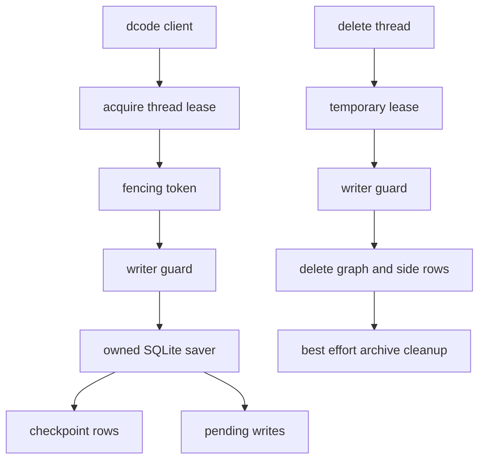
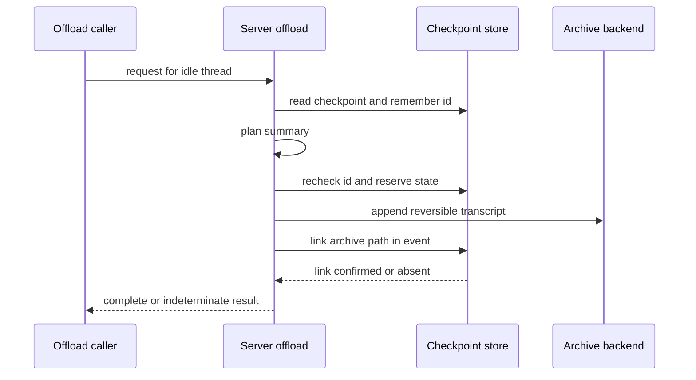

# State and Persistence

A dcode thread is LangGraph state plus dcode-managed metadata. Checkpoints and pending writes are the authority for graph recovery; SQLite names, counters, costs, and prompts are side records; offloaded Markdown history is a separate recoverability artifact. Treating those layers as one transaction or one backup target is unsafe. Talon has its own runtime boundary: its default checkpointer is in memory unless a host supplies a durable saver.

## Persistence boundaries

| Data | Owner and scope | Recovery implication |
| --- | --- | --- |
| Graph channels and pending writes | LangGraph `checkpoints` and `writes` rows for a thread | Resume reads the selected checkpoint, including graph-private channels. |
| dcode discovery and display metadata | Local `DEFAULT_STATE_DIR / "sessions.db"` and dcode side tables | Session listing and labels survive independently of a transcript projection. |
| Goal, rubric, and model resume state | Versioned checkpoint channels and append-only internal notices | A resumed client restores state without replaying or retokenizing history. |
| Compaction archive and handoff snapshot | Per-thread Markdown history on the configured backend | It is a recovery aid with its own retention and deletion lifecycle. |
| Talon conversation state | Supplied checkpointer, or default `InMemorySaver` | Default state lasts only for the running process. |

## Local SQLite sessions

`get_db_path()` hardens `DEFAULT_STATE_DIR` and resolves `sessions.db`. `get_checkpointer()` owns an `aiosqlite` connection and returns an ownership-fenced `AsyncSqliteSaver`. Its connection wrapper retains and explicitly closes the worker-created SQLite handle if opening is cancelled, then drains the worker after close so teardown does not schedule callbacks onto a closed event loop.

Thread discovery derives metadata from checkpoint rows. A covering index supports grouped listing without reading large serialized checkpoint blobs; failure to create it is logged and leaves listing correct but slower. Filters can match agent, Git branch, or the exact stored `cwd`; `cwd` is not normalized or prefix-matched. A DeltaChannel snapshot may omit inline `messages`, so visible message counts are rebuilt from root-namespace message writes in checkpoint/task/index order, including pending writes visible from a head-state read.

Names are deliberately side metadata. dcode prefers `dcode_thread_names`, falls back to the latest root checkpoint's `thread_name` for old stores, and uses an immediate transaction for rename. Conditional automatic naming cannot overwrite a concurrently established name.

## Writer ownership and deletion

Writers reserve a local thread with operating-system locks, hashed private lock paths, and a random fencing token. `writer_guard` serializes in-process and cross-process mutation, validates the live reservation and token, and the owned saver applies it to checkpoint and pending-write mutations. A stale token or released lease is rejected; deletion likewise refuses a thread owned by another client.

*Local writes and deletion must pass the same ownership fence before changing SQLite state.*

Deletion removes checkpoint and write rows together with names, message-count records, prompts, and side-question costs while holding that fence. It then best-effort removes the normal compaction archive and hash-prefixed handoff snapshots. Filesystem cleanup failures are logged but do not change whether checkpoint deletion succeeded.

## Keep state small and model-visible state coherent

Every graph-state channel is stored inline on every checkpoint step; blobs are not deduplicated, except that `messages` is delta encoded. Keep rendered prompts, file contents, caches, and other large or derivable values out of channels—including private channels—and use a per-thread side table when a value must persist separately. Private channels also do not transfer persistent parent state across a subagent `task` boundary.

Goal/rubric channels are checkpointed state, but their model-facing representation is a framework-owned `HumanMessage`, not user conversation. A canonical notice has `lc_source="goal_state"`, schema/version and fingerprint metadata, and is excluded from transcript, title, and derived-conversation projections. It embeds user- or agent-controlled objective, criteria, and status text as escaped, labeled context data. On a size-limit violation it suppresses those fields and tells the model not to act on the saved goal rather than putting an oversized payload into a request.

The client writes accepted goal/rubric state and an optional notice in one `aupdate_state` update. Before a model call it reads the checkpoint and appends a new notice only if the latest valid, visible notice does not match the desired state fingerprint. It defers while tool-call repair is required. Thus a resumed thread repairs missing, stale, invalid, or compacted-away guidance without exposing control messages as conversation.

Summarization is non-destructive: the raw `messages` channel remains checkpointed and `_summarization_event` controls the request-time cutoff. The cutoff is anchored by message ID if earlier entries moved. A malformed, negative, non-integer, or out-of-range cutoff is discarded rather than clamped; the next request sends untrimmed history and logs the condition, avoiding a stale offset that would hide live turns.

## Archives, offload, and handoff consistency

Local offloaded history uses a hardened `conversation_history` directory below the profile where possible. If that location cannot be used, dcode selects a private temporary fallback and marks storage ephemeral. `history.retention_days` controls a non-raising sweep; zero disables it. Expiry considers only direct regular Markdown archives and is serialized against archive refresh. Thread deletion remains independent of retention.

A forced compaction first plans the summary and an archive append. The server reserves the summary state, then writes the archive under a per-session archive lock, then updates the checkpoint event with the archive path. The append retains the exact prior file content: if the follow-up link is confirmed absent, it rolls back; if the server cannot determine whether the link landed, it reports an indeterminate outcome rather than claiming recoverability. An archive write failure can leave a useful in-context summary but no recovery file, and is reported as such.

*The archive becomes advertised recovery state only after the checkpoint link is confirmed; a confirmed failed link restores the prior archive.*

The server-owned `/offload` boundary serializes each thread, allows only idle or error-status registered threads with no pending graph work, and rechecks the checkpoint after summarization. Client transport settings are untrusted: credential-routing parameters are stripped and model selection/parameters are restored from checkpoint state. The permitted write set is derived from `OffloadStateUpdate`, excluding `messages`; this is essential because the operation commits against current state after its read. Cost settlement rolls back only after a confirmed unchanged write; ambiguous or advanced state keeps records claimed to prevent double charging. Commit work completes before request cancellation is re-raised.

A cache handoff has different semantics. It summarizes all source messages, preserves the source context without writing a summary event, stores only settled summarizer cost on the source, and writes an immutable recovery transcript whose session ID is prefixed with a hash of the source thread. The child is seeded with the returned summary and recovery reference. When server and local checkpoint storage differ, the client mirrors a local discovery seed; with shared storage it updates shared metadata instead. The source-derived archive prefix lets source deletion clean snapshots even if child creation did not finish.

## Server construction and compatibility

The development-server scaffold passes the local sessions database path in `DEEPAGENTS_CODE_SERVER_DB_PATH` and generates a factory using the ownership-fenced SQLite saver. It installs delta-history forwarding because langgraph-api's private custom-checkpointer adapter otherwise inherits base delta-history methods and can bypass an inner saver override. The patch is idempotent and best effort: it delegates only when the inner saver overrides the method, otherwise retains the base ancestor walk, and a missing adapter warns rather than blocking startup.

## Talon recovery boundary

`DeepAgentRuntime` uses a supplied LangGraph checkpointer when given; otherwise `_transcript_saver()` returns `InMemorySaver`. A `ConversationSaver` additionally receives the transcript home used to coordinate local hook erasure with archive deletion. Durable Talon recovery is therefore a host/checkpointer deployment concern, not a promise made by the runtime default.

After an interrupted Talon conversation, `recover_interrupted()` reads the latest committed snapshot, asks `PatchToolCallsMiddleware` to repair any dangling tool-call batch, and writes the repaired messages plus a framework interruption marker at that snapshot's configuration. The operation requires a started graph with async state APIs and adds recovery trace metadata. It deliberately appends after committed state rather than attempting to recreate uncheckpointed work.

## Safe changes and focused tests

- Construct writable local savers through `get_checkpointer()` and propagate the ownership token; do not open an unfenced saver against `sessions.db`.
- Preserve database-first, fenced deletion and best-effort file cleanup ordering.
- Preserve the notice fingerprint/schema, internal-message filters, and request-time cutoff validation when changing goal state or transcript projections.
- Preserve the reserve → append → link/verify archive protocol and conservative ambiguous-write cost settlement.
- Do not broaden server offload channels without reconsidering the checkpoint race and credentialed model trust boundary.
- Test persisted goal notices across stale state, compaction cutoffs, malformed events, and incomplete tool batches in `test_goal_state_persistence.py`; test archive/offload failure and concurrency behavior in `test_offload.py` and `test_offload_api.py`; test leases and stale writers in `test_thread_ownership.py`.

See also [SDK construction and execution](/openwiki/architecture/sdk-construction-execution.md), [Context management](/openwiki/concepts/context-management.md), [Talon history storage](/openwiki/concepts/talon-history-storage.md), and [Security](/openwiki/operations/security.md).
