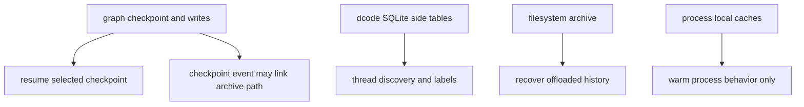
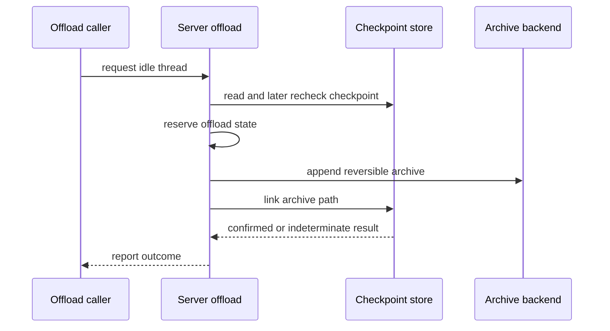

# State and Persistence

A thread is not one atomic persistence unit. The graph checkpointer is authoritative for resumable graph state and pending writes. dcode also maintains SQLite side metadata and filesystem recovery archives; local-context and QuickJS workers keep bounded process-local caches. Each layer has its own writer, consistency protocol, retention, and failure behavior.

## Ownership map

| Layer | Owner | What survives a process restart? | Role |
| --- | --- | --- | --- |
| Graph checkpoint | The configured LangGraph checkpointer | Only if the host supplies durable storage | `messages`, private channels, and pending graph writes needed to resume a particular checkpoint. |
| dcode side metadata | `sessions.db` side tables | Yes, on its local state volume | Names, discovery/count data, prompts, and side-question costs—not graph authority. |
| Offload archives | Per-thread Markdown files | Yes only where the archive backend is durable | Recoverable transcript/history artifact, linked from state after its own protocol succeeds. |
| Process-local cache | Middleware process | No | Warm QuickJS contexts and the bounded parent local-context snapshot cache. |

*The layers may reference one another, but they do not form a single transaction or backup unit.*

## Checkpoint authority and message identity

`DeepAgentState.messages` uses a `DeltaChannel` with `_messages_delta_reducer` and a snapshot frequency of 50, avoiding the quadratic checkpoint growth of full message snapshots. A delta checkpoint can omit the inline `messages` value; consumers must replay writes rather than treating an omitted value as an empty conversation. dcode's session listing does exactly that for message counts, replaying root-namespace writes in checkpoint/task/index order and including pending writes when reading head state.

Message IDs are an end-to-end checkpoint and replay invariant, not display decoration. LangGraph assigns IDs before checkpoint serialization; every message returned by `get_state()` must have a non-`None`, stable ID, including dictionary-style incoming messages. The ID of an earlier human turn must survive later synchronous and asynchronous invocations of the same thread. IDs also anchor state such as summarization cutoffs when positional history moves. Do not regenerate IDs during projection, replay, migration, or a reducer change. The regression suite in `libs/deepagents/tests/unit_tests/test_messages_reducer.py` covers stable IDs across resumed turns and replay from a `None` delta snapshot, as well as `REMOVE_ALL_MESSAGES` reset behavior.

Checkpoint state is intentionally distinct from user-visible transcript. dcode stores all graph state channels inline at every step except delta-encoded `messages`; put large or derivable data in per-thread side storage rather than state. Goal and rubric state is checkpointed through private channels and rendered as a versioned, fingerprinted framework `HumanMessage` that transcript/title projections hide. Before a model call, dcode validates the notice against the active summary cutoff and appends a replacement when needed; it defers while dangling tool calls require repair. Invalid cutoffs are discarded and logged rather than silently hiding messages.

`ResumeStateMiddleware` is the resume boundary for dcode's private per-checkpoint facts. After a successful model response it records context-token usage from the latest AI message; `ConfigurableModelMiddleware` records the effective model and request parameters. Goal/rubric acceptance can be client-written through `aupdate_state`, while proposals and agent-driven status changes are graph-written. On resume, dcode reads those channels as values of the selected checkpoint, not as a thread-level aggregate; malformed persisted model/status values are narrowed before use.

## dcode local sessions and writer fencing

dcode stores local LangGraph sessions in hardened `DEFAULT_STATE_DIR/sessions.db`. `get_checkpointer()` supplies an ownership-fenced `AsyncSqliteSaver`; metadata discovery uses checkpoint rows and a covering index rather than deserializing checkpoint blobs. Thread names live separately in `dcode_thread_names`: that durable value wins over legacy checkpoint metadata, and conditional naming avoids overwriting a concurrent name.

A writer first reserves its thread with operating-system locks and a fencing token. The owned saver validates that live lease for checkpoint and pending-write mutations; deletion acquires the same boundary and refuses a thread held by another client. Its SQLite deletion removes graph rows and dcode side records together, then attempts archive/snapshot cleanup separately. Cancellation-safe connection management explicitly closes a worker-created SQLite handle and drains the worker thread after close.

## Archives, compaction, and handoff

Local offloaded history uses a hardened `conversation_history` directory under the user profile where possible, with a private temporary fallback when that is unavailable. Retention is a non-raising sweep controlled by `history.retention_days`. This archive is not the checkpoint: a failed cleanup does not undo successful checkpoint deletion.

Server offload serializes a registered idle thread without pending graph work, rechecks its checkpoint after summarization, and permits only `OffloadStateUpdate` channels—not `messages`. It treats client transport/model settings as untrusted, restoring model selection and parameters from checkpointed state. To make an archive reference recoverable, it reserves state, appends a reversible archive under the session lock, then links the path in checkpoint state. A confirmed failed link rolls the append back; an unreadable outcome is indeterminate rather than claimed durable.

A cache handoff does not compact its source context. It writes a source-owned recovery transcript, starts a child from the summary, and only mirrors a local discovery seed when server checkpoints are not shared. Source deletion can clean hash-prefixed handoff snapshots even if child creation was incomplete.

*Offload has a cross-store protocol, not an all-or-nothing transaction.*

## Process-local context and QuickJS snapshots

`LocalContextMiddleware` checkpoint-persists its private initial environment snapshot and fingerprint. For forked subagents, it also keeps at most 32 parent snapshots in an in-process ordered cache keyed by thread ID; this cache is only an optimization for byte-identical prompt reuse. If it is absent after restart, the fork runs detection instead. After summarization, a changed environment is appended as a labeled internal message rather than rewriting the cached prompt prefix.

`CodeInterpreterMiddleware` assigns each LangGraph thread an isolated QuickJS slot. In default `thread` mode it snapshots interpreter state after the agent turn into private checkpoint state, using a delta/patch chain; a later evaluation lazily restores it. `turn` keeps state only during one turn and `call` creates a fresh REPL per evaluation. No VM is allocated for a model-only turn. Oversize or failed snapshots are cleared rather than retained. With `snapshot_signing_key`, restoration requires an HMAC over the reconstructed snapshot and slot ID; missing or mismatched signatures are rejected and cleared. Without that key, a checkpoint snapshot is not integrity-checked, so use a signing key whenever the checkpointer is not fully trusted.

## Talon: supplied persistence versus runtime defaults

`DeepAgentRuntime` passes its supplied checkpointer to the constructed Deep Agents graph. If none is supplied, `_transcript_saver()` returns `InMemorySaver`; therefore durable recovery is a host deployment responsibility, not a Talon default. On shutdown Talon first cancels background work and deliberately keeps resources open if workers do not stop, because closing a checkpointer while a worker writes risks partial persistence.

For interrupted conversations, `recover_interrupted()` reads the latest committed graph snapshot, repairs a dangling tool-call batch through `PatchToolCallsMiddleware`, and appends the repair plus an interruption marker using that checkpoint configuration. It never recreates uncheckpointed work.

## Safe changes and focused tests

- Keep stable message IDs through reducers, delta replay, checkpoint serialization, and resume. Run `libs/deepagents/tests/unit_tests/test_messages_reducer.py` for the regression coverage.
- Route dcode mutations through its fenced saver; preserve database deletion before best-effort filesystem cleanup.
- Do not treat archives, SQLite side tables, graph checkpoints, and memory caches as one transactional or backup domain.
- Preserve the reserve → append → link/verify protocol and keep `messages` out of server offload writes.
- Size and sign QuickJS snapshots in deployments with an untrusted or shared checkpointer; test cross-turn restoration with `libs/partners/quickjs/tests/unit_tests/test_snapshot_persistence.py`.
- Test resumed dcode private state and client reconciliation with `libs/code/tests/unit_tests/test_resume_state.py`.

See also [Runtime behavior](/openwiki/architecture/runtime-behavior.md), [Context management](/openwiki/concepts/context-management.md), [ACP](/openwiki/integrations/acp.md), [Sandbox partners](/openwiki/integrations/sandbox-partners.md), and [Cost and sessions](/openwiki/operations/cost-and-sessions.md).
