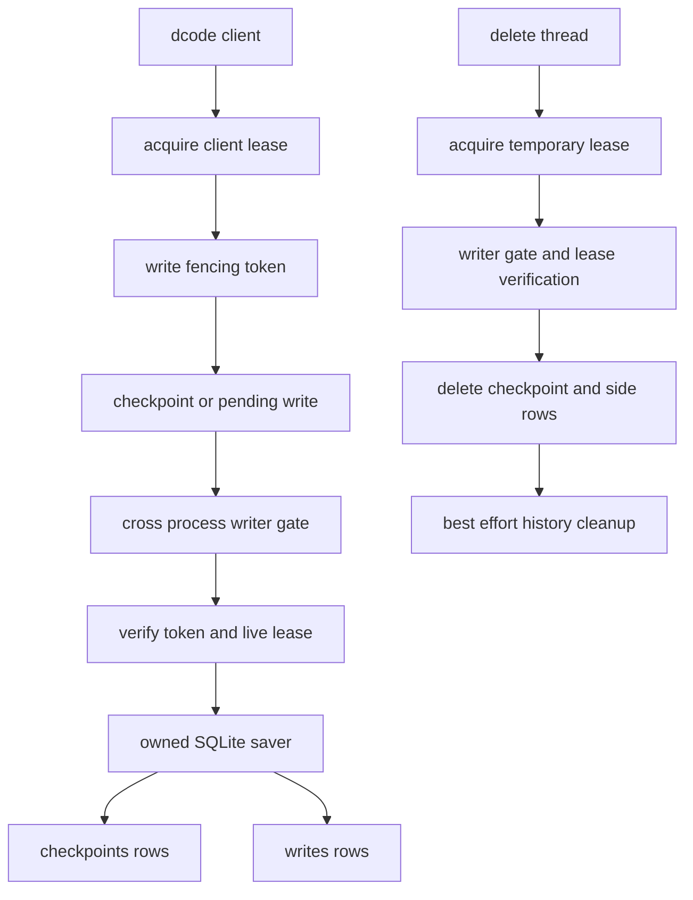

# State, Threads, and Persistence

A dcode thread is a LangGraph thread backed locally by SQLite, with dcode-managed metadata around it. The checkpoint database is authoritative for graph state and pending writes; it is not a general file store, a transcript-only database, or a safe place for large repeated values. dcode adds exclusive-writer ownership, durable display metadata, local offloaded-history files, and—when a server is used—a narrow HTTP boundary for state compaction and cache handoff.

## Persistence boundaries

| Data | Persistence owner and scope | Operational consequence |
| --- | --- | --- |
| Graph channels and pending writes | LangGraph `checkpoints` and `writes` rows for one thread | Resume state comes from the configured checkpointer. |
| dcode session discovery | Local `DEFAULT_STATE_DIR / "sessions.db"` checkpoint metadata and dcode side tables | The local picker can find and label sessions without a bespoke transcript table. |
| Durable name and display caches | `dcode_thread_names` and message-count records in the same SQLite database | These are auxiliary records, not graph channels. |
| Offloaded conversation history | Local `conversation_history` Markdown files in local mode | A compaction archive or handoff recovery snapshot has its own cleanup lifecycle. |
| Remote thread state | The connected LangGraph server | A local handoff seed is only a discovery snapshot when server and local storage differ. |

## Local SQLite sessions and discovery

`get_db_path()` hardens `DEFAULT_STATE_DIR` and resolves the database as `sessions.db`; new local IDs are UUID7 values, which are naturally time-ordered. `get_checkpointer()` is the supported local construction path: it owns the `aiosqlite` connection and yields an ownership-fenced `AsyncSqliteSaver`. The connection wrapper records the worker-created SQLite handle so cancellation during opening cannot strand it, then drains the worker thread after close to prevent late callbacks on a closed event loop.

Thread discovery is derived from checkpoint metadata. dcode creates a covering index for the grouped listing query so normal listing can avoid reading the large serialized checkpoint blobs. Creating that index on an older large database may require a one-time scan; an index-creation failure is logged and listing remains correct, albeit slower. Listing can filter by agent, Git branch, or an exact stored `cwd`; `cwd` is neither normalized nor prefix-matched, and older checkpoints without it do not match.

A DeltaChannel checkpoint may not contain an inline `messages` value. When a display count is requested in that situation, dcode reconstructs it from root-namespace message writes, ordered by checkpoint, task, and write index, and includes pending writes visible to a head-state read. The resulting count cache is an optimization rather than the conversation authority.

### Names are side metadata

Names survive independently of checkpoint revisions. dcode reads `dcode_thread_names` first and falls back to `thread_name` in the latest root checkpoint for older databases. Renaming validates a printable, trimmed single-line name of 1–50 characters, uses an immediate transaction, verifies that the thread exists, writes the durable row, and updates the latest checkpoint metadata for compatibility. The conditional automatic-name mode cannot overwrite a name that another actor has already supplied.

## Ownership, mutation, and deletion

A writable local thread must hold a lease. dcode maps the thread ID to private, hashed lock-file names, takes an operating-system lock rather than accepting `SoftFileLock`, and records a random fencing token in an owner file. `writer_guard` serializes writers in-process and across processes, then validates both that the presented token is current and that the client reservation remains held. The owned saver applies that guard to both checkpoint and pending-write mutations. A released lease or a rotated token therefore rejects a stale writer; cancellation is deferred until a mutation has settled.

*Every mutation enters the writer gate before SQLite changes; deletion holds its own temporary lease and only cleans files after the database work.*

Deletion first reserves the thread and refuses if another client owns it. Under the same writer guard it deletes side-question costs, prompt records, durable names, message-count records, checkpoint rows, and pending-write rows, then commits. It next attempts local offloaded-history cleanup. That cleanup is deliberately best-effort: a filesystem error is logged and does not alter the result, which reports whether checkpoint rows were removed. Cleanup targets both the thread’s normal Markdown archive and every hashed-prefix handoff recovery snapshot owned by that source thread, while leaving other threads’ files intact.

## Keep checkpointed state small

SQLite checkpoint rows store every graph-state channel inline on every step and do not deduplicate blobs. Only `messages` is delta-encoded. Do not place rendered prompts, file contents, caches, or other large or derivable values in state channels—including private channels—and keep `Command(update=...)` payloads small. Repeated large values grow the database and slow resume and state reads.

Instead, place large per-thread data in a dcode side table keyed by thread ID and update it only when it changes. `dcode_thread_names` and per-thread workspace records are the intended pattern. Private channels do not cross a subagent `task` boundary, so they are not a mechanism for transferring persistent parent state to a subagent.

## Local archives and retention

In local mode, offloaded conversation history lives below `~/.deepagents/conversation_history`. dcode hardens that dedicated directory to mode `0o700`, without changing permissions on the shared profile root. If the profile location is unusable, it uses a private temporary fallback and reports that archive storage is ephemeral; it can therefore disappear across restart. Retention is resolved through `history.retention_days`; zero disables the sweep, and cleanup failures are logged rather than raised.

The retention sweep considers only direct regular Markdown archives older than the cutoff and serializes its expiry check with an archive refresh so a concurrent rewrite is not silently discarded. Thread deletion is separate from retention: it always tries cleanup even when retention is disabled.

## Server checkpointer and delta-history fast path

The launched LangGraph development server is scaffolded with a generated `checkpointer.py`. The launcher passes the same local database path through `DEEPAGENTS_CODE_SERVER_DB_PATH`; the generated factory installs the adapter patch and constructs the same ownership-fenced saver class. Consequently, server-originated writes must carry the thread-owner token just like local writes.

The private `langgraph_api` custom-checkpointer adapter inherits BaseCheckpointSaver’s delta-history methods, which prevents its normal unknown-attribute forwarding from reaching an inner SQLite saver override. `install_delta_history_forwarding()` patches only an adapter that still has those base methods. It delegates to an inner saver only when that saver overrides the method; otherwise it retains the base ancestor walk. This is an idempotent, best-effort compatibility patch: a missing adapter logs a warning rather than preventing server startup.

## Server-side offload and handoff

The server exposes `POST /dcode/threads/{thread_id}/offload`, a dedicated `/handoff` route, and an operation-specific cancellation route. An offload is accepted only for an idle or error-status registered thread with no pending graph work. The server serializes operations per thread, reads and hydrates checkpoint state, records the checkpoint ID, runs compaction, rechecks that the checkpoint has not advanced, and only then commits allowed update channels. An empty-message thread returns an unchanged result instead of failing for lack of a checkpoint.

This is a trust boundary. The path supplies the thread ID; client model transport parameters such as endpoints, proxies, HTTP clients, and headers are stripped. Model selection and parameters are restored from the checkpoint when present, so a request cannot redirect credentialed summarization calls. The state-write allowlist is derived from `OffloadStateUpdate`; a server-owned offload must not write `messages`, because it commits against the latest state rather than the state it originally read.

Offload cost settlement is coordinated with the state write. If a failed write is confirmed unchanged, drained cost records are rolled back. If the state advanced or cannot be read back, the records remain claimed to avoid double charging, and the operation reports an indeterminate result when appropriate. Commit work is shielded from request cancellation and cancellation is re-raised after settlement.

A cache handoff is intentionally different from normal compaction: it summarizes the complete source context, saves the summarizer cost and an immutable recovery transcript, but does not write a summary event or compact the source thread. The transcript session ID is prefixed with a hash derived from the source ID so source deletion can find it even if child creation fails. The client then creates a child whose initial message contains the summary and recovery reference, persists the server state, and either mirrors it into the local session index when server storage is separate or updates shared local metadata. Failed child seeding releases any unadopted reservation; if new source activity arrives, dcode keeps the user on the source and leaves the child resumable from the thread list.

## Safe changes and focused tests

- Obtain local savers through `get_checkpointer()` and carry the lease token in configurable state; do not open an unfenced saver against `sessions.db` for a writable thread.
- Preserve the server factory’s ownership-fenced saver and adapter fast-path installation when changing launch scaffolding.
- Treat checkpoint state, dcode side tables, remote server checkpoints, and Markdown archives as separate retention and backup targets.
- When changing deletion, preserve the ordering that removes database records under ownership fencing and keeps filesystem cleanup best effort.
- When changing remote compaction, preserve the read–execute–recheck protocol, the state-channel allowlist, and conservative cost settlement after ambiguous writes.
- Focus tests on `test_sessions.py` and ownership-transition tests for metadata, deletion, leases, and stale writers; `test_checkpointer_adapter.py` for delegation and fallback; `test_offload.py` for archive permissions, retention, and cleanup; and `test_offload_api.py` for request validation, operation serialization, handoff behavior, state writes, cancellation, and failure status mapping.

See also [Code agent architecture](/openwiki/architecture/code-agent.md), [Context management](/openwiki/concepts/context-management.md), [ACP integration](/openwiki/integrations/acp.md), [Cost and sessions](/openwiki/operations/cost-and-sessions.md), and [Run a dcode session](/openwiki/workflows/run-dcode-session.md).
