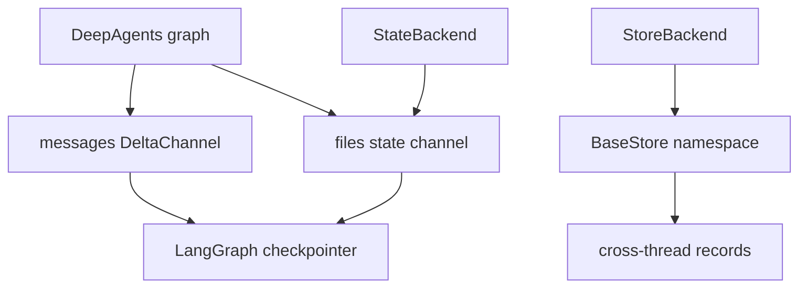
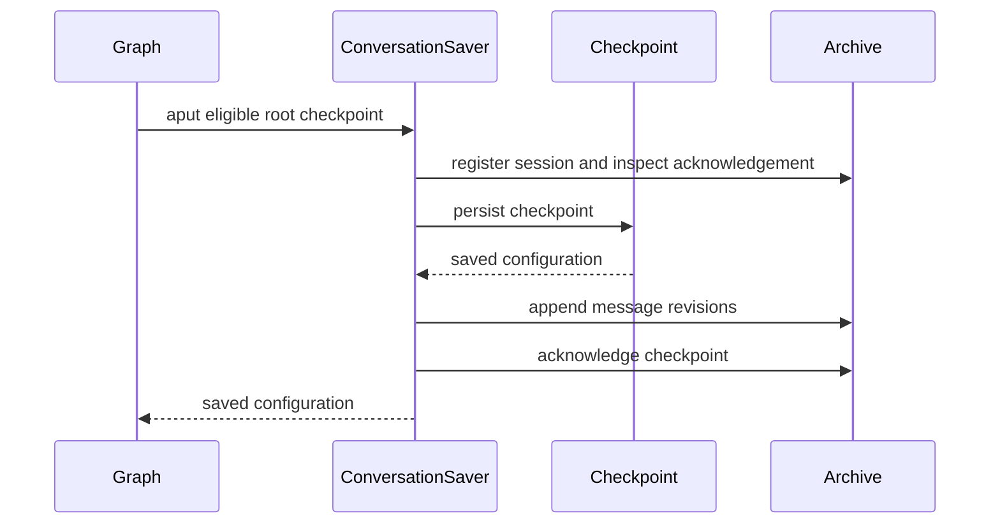

# State, Checkpoints, and Persistence

Persistence has several owners. A LangGraph **checkpointer** records a graph thread and its pending writes; it is not a general-purpose filesystem or a cross-thread memory database. DeepAgents file backends choose whether their files live in that graph state or in a `BaseStore`. dcode layers local session discovery and names over its checkpoint database, while Talon can pair a checkpointer with an independent, chat-scoped archive. These stores have different scope, lifecycle, and failure behavior.

## Storage boundaries

| Mechanism | Owner and scope | What survives |
| --- | --- | --- |
| Graph checkpoint | LangGraph thread selected by `thread_id` | Graph channels, checkpoint metadata, and pending writes, subject to the configured checkpointer. |
| `StateBackend` | The current graph's `files` channel | Files in the current conversation thread when the graph is checkpointed. |
| `StoreBackend` | A caller-selected `BaseStore` namespace | Files across threads that use that namespace, provided the supplied store is durable. |
| dcode session database | Local `sessions.db` | LangGraph checkpoint tables plus dcode discovery metadata, durable names, and best-effort display caches. |
| Talon archive | Trusted channel/chat scope, separate from checkpoints | Searchable historical conversation records, with its own retention and recovery behavior. |

A checkpoint therefore should not be assumed to contain `StoreBackend` files, dcode side records, or Talon history. Backup, retention, and deletion must cover each configured persistence domain.

## Graph state and backend ownership

`create_deep_agent` defines `messages` as a `DeltaChannel` with a snapshot frequency of 50. Rather than storing a complete message list at every update, the channel records deltas and periodically snapshots the value. Its reducer expects LangGraph to assign stable IDs before serialization. During replay, it coerces message-like inputs, applies the last remove-all sentinel, replaces a prior message with the same ID, removes tombstoned IDs, and appends ID-less or new messages deterministically.

`StateBackend` is a virtual filesystem in the graph's `files` state channel. It may only be used inside graph execution: it reads through `CONFIG_KEY_READ` and queues partial channel updates through `CONFIG_KEY_SEND`. Fresh reads apply pending task writes, giving a tool read-your-writes behavior within a superstep; queued updates commit at the node boundary. Consequently, `StateBackend` files are thread-scoped and only become durable when the graph's configured checkpointer is durable.

`StoreBackend` deliberately has the opposite boundary. It reads an explicit `BaseStore`, or the store supplied by the LangGraph execution context, and computes a namespace using the runtime. The namespace is validated as a nonempty tuple of safe, nonempty string components, rejecting wildcard-like characters. This makes cross-thread persistence an explicit application choice—for example, a per-user namespace—not an incidental consequence of sharing a checkpoint database.

*Graph channels flow to the checkpointer; `StoreBackend` uses a separately selected namespace and store.*

## dcode: a checkpoint database is a session index

`deepagents_code.sessions` resolves the local database as `DEFAULT_STATE_DIR / "sessions.db"` after hardening the state directory. New local thread IDs are UUID7 strings, which sort naturally by creation time. The database uses LangGraph checkpoint and write tables rather than a bespoke transcript table.

`get_checkpointer()` is the supported dcode entry point for graph writes. It constructs the ownership-aware `AsyncSqliteSaver` and owns the `aiosqlite` connection lifecycle. The connection wrapper records the worker-created SQLite handle so cancellation while opening cannot strand it, explicitly closes it during shutdown, and joins the worker thread after close. This avoids leaked handles and callbacks reaching a closed event loop.

Thread listing reads checkpoint metadata. dcode creates `idx_dcode_threads_list_v2`, a covering index for the metadata expressions used by the grouped listing query, so ordinary discovery avoids reading large serialized checkpoint blobs. A first build can be costly; failure is logged and listing remains correct with a slower table scan. Listings can filter by agent, branch, or exact stored `cwd`; a `cwd` filter does not normalize paths and excludes older rows without that field.

Because a `DeltaChannel` checkpoint may omit an inline message list, dcode may reconstruct display counts from root-namespace `writes`. It uses checkpoint/task/index ordering and includes pending writes, matching a normal head-state read; subgraph writes are excluded. Counts are cached with a freshness token as an optimization, not as the conversation authority.

Names do not belong solely to checkpoint revisions. dcode persists them in `dcode_thread_names`, prefers that durable row when listing or looking up a thread, and falls back to the latest root-checkpoint `thread_name` for older stores. `rename_thread()` validates a printable, trimmed single-line 1–50-character name, runs an immediate transaction, verifies that the thread exists, and updates the latest checkpoint metadata for compatibility. With `only_if_unnamed=True`, an automatic title cannot win a race against an existing title.

Deletion likewise has a wider scope than deleting checkpoint rows: `delete_thread()` removes checkpoint and write rows, dcode names, message-count cache records, and side-question costs, then attempts offloaded-history cleanup. The offloaded cleanup is best effort, and the return value reports checkpoint deletion; operators should not treat it as a general garbage collector.

## Talon: checkpointer and archive are independent

Talon opens its checkpointer from `DEEPAGENTS_TALON_CHECKPOINT_URI`, falling back to the assistant-local checkpoint path. Built-in URI schemes select SQLite/file, PostgreSQL, or MongoDB implementations; a custom scheme must resolve to exactly one `deepagents_talon.checkpoint_backends` entry point. The selected saver is initialized and owned by an async context manager. Startup errors are converted to a credential-safe `TalonConfigError`, so a URI's credentials are not exposed in the user-facing error.

A configured Talon host can wrap that saver in `ConversationSaver`, which is not a transaction manager. Root checkpoints with trusted `talon_history_channel` and `talon_history_chat` metadata are archive eligible; nested namespaces and unscoped runs are not. For an eligible write it registers/archive-initializes the session, determines changed messages, persists the graph checkpoint, appends idempotent archive revisions, then acknowledges the checkpoint in the archive. If archival fails after the checkpoint succeeds, the failure propagates; retrying the same checkpoint repairs the archive without duplicate revisions.

*For eligible Talon conversations, checkpoint persistence precedes archive append and acknowledgement; the two stores are not transactional.*

`ConversationSaver` holds a shared lock around checkpoint/archive operations. It shields an in-flight `aput()` from cancellation until both writes finish and then re-raises cancellation. The same lock prevents history clearing or thread deletion from interleaving an incomplete append. Deletion performs backend-thread deletion before deleting the archive session registration; a failed batch can therefore be retried, and hosts must stop chat workers before clearing history.

Talon's archive retrieval tools receive their channel/chat scope from the trusted host-side scope provider, not model arguments. Search and reads expose coverage signals such as pagination expiry, scan limits, semantic-search status, and pending indexing; history is data to inspect, not instructions to follow. See [Talon integration](/openwiki/integrations/talon.md) and [Context management](/openwiki/concepts/context-management.md) for their higher-level use.

## Safe operation and tests

- Pick storage by required scope: use graph state for per-thread scratch files and an explicitly namespaced `BaseStore` for shared files or memory.
- Use dcode's `get_checkpointer()` rather than opening an unfenced saver against a shared local session database. Treat the checkpoint tables as LangGraph-managed data.
- Back up or erase dcode checkpoints/writes, dcode auxiliary tables and offloaded history, `BaseStore` data, and Talon checkpoint/archive data according to their independent retention requirements.
- Expect a Talon archive retry after a failure between checkpoint and archive writes; do not assume cross-store atomicity.
- Focus regression coverage on DeepAgents state/store backend context and namespace tests, dcode `test_sessions.py` for listing, naming, counts, and deletion, and Talon `test_checkpoint_backends.py` and `test_archive_saver.py` for URI lifecycle, retry, scoping, cancellation, and deletion ordering.

See also [Backends](/openwiki/concepts/backends.md), [Runtime behavior](/openwiki/architecture/runtime-behavior.md), and [Cost and sessions](/openwiki/operations/cost-and-sessions.md).
