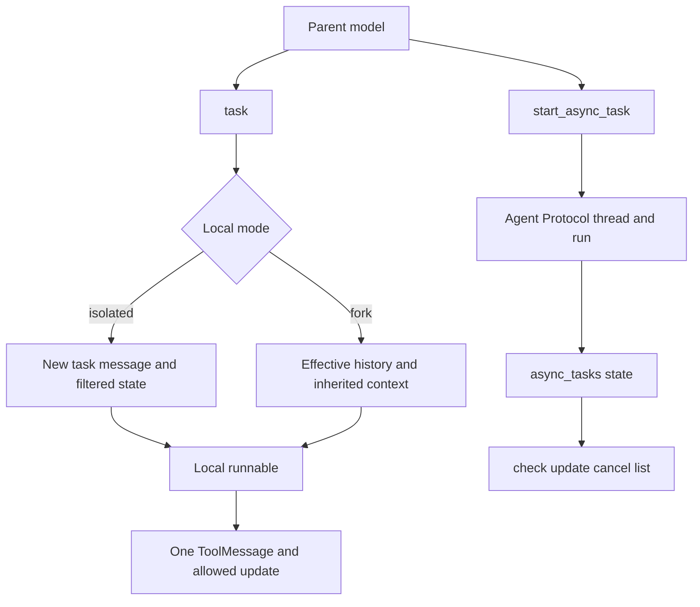
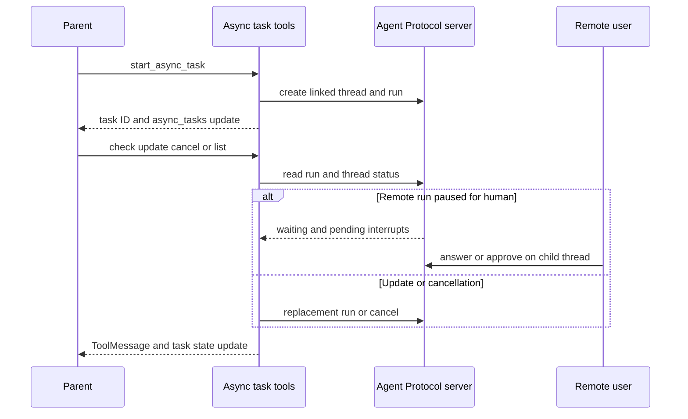
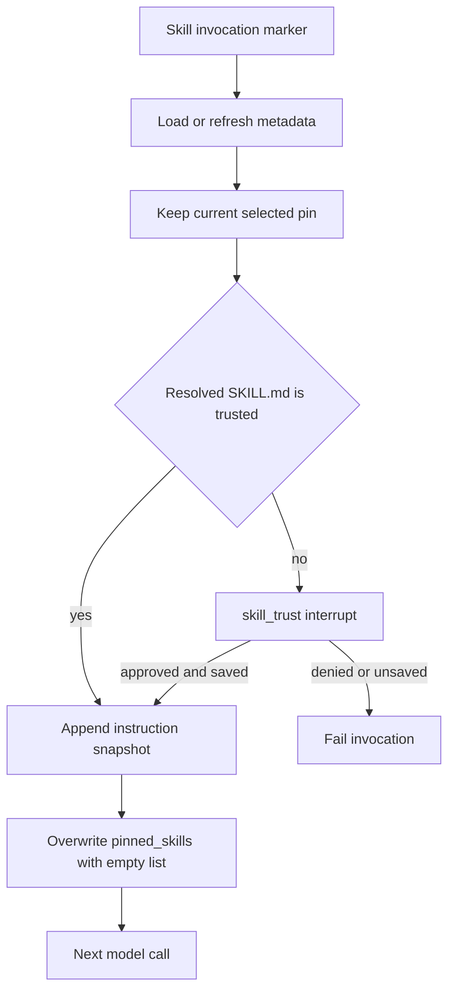
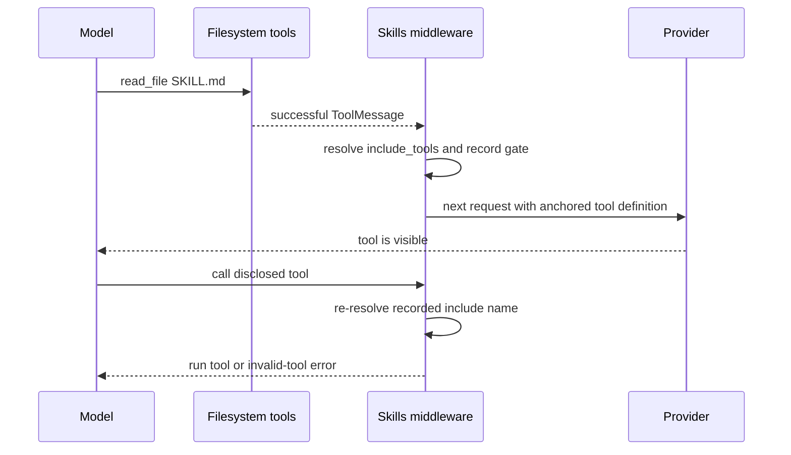

# Subagents and Skills

`create_deep_agent` combines two distinct delegation paths. A local `task` call runs a synchronous child and returns one result to its caller. An `AsyncSubAgent` starts a background run on an Agent Protocol server and records a task that the parent can manage later. Skills are instruction bundles: the SDK middleware indexes and progressively discloses them, while Deep Agents Code adds recursive plugin discovery, explicit `/skill:` invocation semantics, and trusted-root enforcement for instruction reads.

A skill is neither a subagent nor an authorization policy. Its text guides the model; `metadata.include_tools` can participate in a model-visible tool gate, but filesystem permissions and approval/`interrupt_on` remain independent controls. See [Middleware stack](/openwiki/architecture/middleware-stack.md), [Permissions and HITL](/openwiki/concepts/permissions-hitl.md), and [Build a Deep Agent](/openwiki/workflows/build-a-deep-agent.md).

## Assembly and local delegation

The factory classifies every `subagents=` entry before assembling the parent graph: a mapping containing `graph_id` becomes an `AsyncSubAgent`; one containing `runnable` is a caller-owned `CompiledSubAgent`; all others are declarative synchronous `SubAgent` specifications. Declarative specifications are compiled after the factory resolves their model, profile, permissions, tools, prompt, and middleware; compiled runnables remain caller-owned. The synchronous `SubAgentMiddleware` and remote `AsyncSubAgentMiddleware` are installed independently, so async-only configuration does not create `task`.

Unless the active harness profile sets `general_purpose_subagent=GeneralPurposeSubagentProfile(enabled=False)`, the factory prepends a synchronous `general-purpose` worker whenever no inline specification already uses that name. Disabling that default removes `task` only when no other synchronous worker exists; it does not affect async tools. A profile can also customize the generated worker's description and prompt. The generated worker uses the parent model, rewritten user tools, parent permissions, and the resolved parent interrupt policy, including filesystem-derived approval rules.

*The local boundary waits for a result; the remote boundary records a task and lets the parent continue.*

### Task contract, isolation, and results

The `task` schema accepts `description` and `subagent_type` only, apart from injected `runtime`; unknown model-supplied arguments are validation errors rather than silently discarded. Construction rejects duplicate names and unsupported modes; legacy `handoff` means isolated. An unknown selected type produces a tool error, and a tool-call ID is required to return a correlated result.

Isolated mode is the default. The child receives a new `HumanMessage` containing the task and a state copy that excludes the parent transcript, todos, structured response, skill metadata, pending pins, disclosed-skill-tool record, fork marker, rubric, and middleware-private fields. The same output filtering prevents a child from replacing those parent-owned values. Unchanged inherited values are also dropped from the child update, avoiding duplicate additive reductions and conflicts between parallel calls.

For declarative workers, omitted `tools`, `permissions`, and `interrupt_on` inherit parent configuration; explicit values replace the relevant inherited setting (filesystem approval rules are then merged with the resolved permissions). A compiled runnable is an opaque graph: it owns its schema and behavior, but must return a state with `messages` so the boundary can communicate its result.

One successful local invocation becomes one `ToolMessage` tied to the original call. A non-null `structured_response` is JSON serialized; otherwise the boundary walks backward to the last non-empty child `AIMessage` text. Other changed, public state may be returned, but not the transcript or excluded/private fields. The invocation relies on LangGraph's ambient configuration propagation and additionally marks both LangSmith tracing context and child configurable metadata with `ls_agent_type="subagent"`.

### Forked local work

Experimental `mode="fork"` is for context-dependent continuation rather than a narrow handoff. It removes the pending parent tool-call message, applies a pending summarization event to reconstruct effective history, and appends a preamble plus delegated description. A declarative fork retains the internal state needed for its recreated middleware to rebuild inherited prompt behavior; an opaque compiled fork receives only safe public state.

A declarative fork cannot set its `skills` field: by default it starts from the parent skill sources and mirrors the parent middleware so it can rebuild the parent's prompt behavior, with its own system prompt used as an addendum. This is not an immutable lock on the middleware slot: a same-named `SkillsMiddleware` in the fork specification replaces the inherited one in place, and can therefore provide different sources. A differently named subclass is a separate, novel middleware rather than the slot replacement. It does receive a guarded mirror of `task`, but the fork-state marker makes any nested `task` or `atask` call return a refusal. Use isolated mode when explicit input and output isolation matters; use a fork only when the effective conversation is required.

## Remote asynchronous delegation

An `AsyncSubAgent` has a name, description, `graph_id`, optional URL, headers, and an isolated-or-fork mode. `start_async_task` creates a remote thread and run, sending a single user task in isolated mode. In fork mode it snapshots reconstructed parent history, removes nonportable tool artifacts and parent-local eviction metadata, hydrates blob-backed tool content, and serializes the resulting messages for the remote child. The remote graph still owns its own prompt, tools, permissions, and state; a conversation snapshot does not synchronize those settings.

*The parent tracks a remote task, while its child thread owns execution and any human interaction.*

### Parent linkage, ownership, and task lifecycle

`start_async_task` creates a remote thread with `parent_thread_id` metadata when the parent has a thread ID. It also puts the available parent thread and assistant identifiers under `configurable.deepagents_parent` on each launch or replacement run. This is linkage for an Agent Protocol application—not shared execution: the remote graph owns its prompt, tools, credentials, approvals, checkpointer and durable thread state. In particular, parent `permissions` and `interrupt_on` are **not** inherited by an `AsyncSubAgent`; configure approvals and credential access on the remote deployment. For URL-less local ASGI launches and updates, trace headers can nest the child run under the current LangSmith trace without forwarding the parent's run metadata to the child.

`async_tasks` is a merge-reduced parent-state map keyed by remote thread ID. Each record contains the task/thread ID, agent name, current run ID, cached status, and creation/check/update timestamps; preserving parent state with a checkpointer preserves this tracking map, while the Agent Protocol server persists and serves the actual thread. Launch records `running`. `check_async_task` reads the tracked run and, after a successful run, reads the thread to return its final message. If that success has left the thread `interrupted`, the task becomes `waiting`, not terminal: its result includes the pending interrupts and says that the user must answer or approve on the subagent's own thread. The parent cannot satisfy that approval.

A resumed child may have a newer run than the recorded one. When a tracked successful run finds its thread `busy` or `error`, observation lists the newest remote run and updates the stored `run_id`, allowing status recovery after another client resumes the child. `update_async_task` creates an interrupting replacement run on the same thread, retains the task ID, marks it `running`, and—when it was waiting—drops the outstanding human request. `cancel_async_task` cancels an active remote run before recording `cancelled`; a waiting task has no active run, so it is simply marked cancelled and later checks do not regress it to `waiting`. `list_async_tasks` filters by cached status before refreshing nonterminal tasks; `waiting` is refreshable, whereas `cancelled`, `success`, `error`, `timeout`, and `interrupted` are not. A live-status failure leaves the cached status intact.

Unknown types or task IDs and SDK failures return tool errors without a task-state mutation. Clients are cached by URL and resolved headers; `x-auth-scheme: langsmith` is added unless supplied. Managed deployments obtain credentials through the SDK environment variables, while `headers` is the self-hosted authentication extension point. URL-less local ASGI transport is async-only, so it requires an entry point such as `ainvoke`; synchronous use requires a reachable URL.

## Skills: SDK index and Code adapter

The SDK `SkillsMiddleware` indexes metadata from backend-resident `SKILL.md` files, overlays same-named skills in source order, stores the result in `skills_metadata`, and injects a progressive-disclosure prompt directing the model to read full instructions only when relevant. An empty metadata list is cached; setting `skills_metadata` to `None` requests a reload. Source load failures are retained in `skills_load_errors`; the rendered prompt bounds and escapes them as untrusted diagnostics. `system_prompt=None` suppresses the fragment but not metadata loading.

### Assembly: the `SkillsMiddleware` slot

`create_deep_agent` reserves an ordering slot immediately before prompt caching. Profile middleware and novel caller middleware are placed before it, so skills see the compacted messages and the model selected by fallback or routing middleware; the skill fragment is then stable for prompt caching. A caller middleware whose `.name` is exactly `"SkillsMiddleware"` replaces the default in that slot. If `skills=` is omitted, the factory obtains the default sources from the first such main-agent middleware, which also causes the generated `general-purpose` worker to receive that slot. The generated worker otherwise carries over only caller middleware that overrides one of its own default-stack names, not arbitrary main-only middleware.

Top-level `skills=` applies to the main graph and its generated `general-purpose` worker, not to named isolated declarative workers. An isolated declarative worker receives a `SkillsMiddleware` only from its own `skills` field or from an exact-name middleware in its own `middleware` list. For every declarative worker, profile and spec middleware land before the skills slot; when multiple exact-name skill middleware entries are supplied, the last one wins. Forks additionally inherit the parent custom middleware before applying their own replacements, which explains why an exact-name fork middleware can supersede inherited skills even though the fork's `skills` field itself is invalid.

`PluginSkillsMiddleware` subclasses that middleware for Deep Agents Code. Ordinary sources use the SDK's one-level loader. Plugin-namespaced sources are recursively walked: any directory containing `SKILL.md` is a leaf, and intermediate directories qualify the name, for example `plugin:foo:bar:review`. The usual ordered, last-one-wins merge then applies to those qualified names. Metadata records the process that performed the scan: a retained thread is rescanned after a server restart or `/reload`, whereas ordinary turns reuse this process's metadata unless an explicitly selected pin is absent.

### Invocation and pinned instruction snapshots

A Code `/skill:` invocation creates a user-facing request plus an internal `__skill` marker and asks the SDK to pin just that selected name. The adapter only retains the selection from the newest visible user turn; it removes a stale or failed-turn pin on a later normal or goal-continuation turn. This stops a failed invocation from leaking instructions into another request.

Before the next model call, the base mechanism resolves distinct requested names in first-seen order, removes frontmatter from each readable `SKILL.md`, appends attributed `<skill>` `HumanMessage` snapshots, and clears `pinned_skills` with `Overwrite([])`. The snapshot remains in message history, so later source edits do not change it; pinning again reads current content. The Code adapter makes an explicit invocation stricter: an unknown skill, unreadable/oversized/non-UTF-8 file, or file with no body raises an error rather than silently running without the requested instructions.

*Code validates the selected skill's containment before converting it into a one-turn pinned snapshot.*

### Trusted roots and persisted approval

The adapter reads selected skill content only within trusted roots. Its default roots include configured skill sources; invocation discovery also includes built-in, plugin, user, project, Agent, and Claude skill locations. `skills.extra_allowed_dirs` (or `DEEPAGENTS_CODE_EXTRA_SKILLS_DIRS`) and previously verified approvals extend that allowlist. Relative configured roots resolve against the supplied user path base.

If a selected `SKILL.md` resolves outside all allowed roots, the run interrupts with `{type: "skill_trust", skill, directory}`. Approval persists the already resolved directory in `~/.deepagents/.state/skill_trust.json`; denial or a failure to save approval fails the pin. Reads fail closed if no trusted roots exist. At load time saved entries must still resolve to themselves, so a stored directory or parent replaced by a symlink is ignored; if the discovery symlink points to a new target, ordinary containment rejects it and requests approval again. The store uses atomic replacement, treats unreadable/corrupt data as no trust for enforcement, and refuses ordinary trust writes that cannot first read an existing store strictly.

## Skill-selected tools: disclosure is a gate

`metadata.include_tools` names tools that `SkillsMiddleware(tools=...)` can resolve from a static list or a `SkillToolResolver`. These tools are deliberately absent from the ordinary tool node. A successful result for `read_file` on a known skill's `SKILL.md`—including a partial read—or a pinned-skill `HumanMessage` is a trigger. Before the subsequent model call, the middleware resolves the named includes and writes genuinely gated `{tool name: include name}` entries to private `_skill_tools_disclosed`; it writes an empty record when nothing is disclosed, so an old checkpoint cannot authorize a later call.

The resolver is an extension boundary, not a one-time lookup: it is called after eligible reads for every model request and again immediately before a gated tool runs. A resolver can map one include name to several tools and can be asynchronous only on an async agent entry point. It should be stable and cheap (or appropriately context-scoped cached), because unstable output can change the prompt prefix and a tool returned at disclosure but absent at execution is refused.

At execution time, an ordinary registered runtime tool takes precedence. Otherwise the name must be in the latest disclosure record and its recorded include name must still resolve to a same-named tool. Calls before disclosure, in the triggering turn, after compaction removes their only trigger, or with stale resolver output remain invalid-tool calls. If compaction leaves another trigger, disclosure is re-anchored to the earliest remaining one. This is an availability boundary only: a disclosed tool still passes through permissions and HITL middleware.

Provider delivery preserves the conversation prefix rather than moving a newly discovered definition to its beginning. For a model whose profile advertises mid-conversation tools, Anthropic receives inline `tool_addition` blocks and OpenAI Responses receives developer `additional_tools` items. They are inserted after the complete tool-result batch that contains the read, and after queued user messages or empty assistant replies as necessary; repeated calls reproduce the same insertion and bytes while the anchor remains visible. Other models bind the disclosed tools for the next request. The disclosure record follows what the model was actually shown. Anthropic definitions with root `oneOf`, `anyOf`, or `allOf` are withheld because that provider rejects them.

*Successful reads and pins disclose tools for a later request; the recorded disclosure and a fresh resolver result jointly control execution.*

### Scheduled Talon turns

Talon passes `pinned_skills` from request metadata only when `trigger == "cron"`; ordinary channel turns cannot inject pins through metadata. The names are placed in the graph payload before the model call, where `SkillsMiddleware` converts them into the normal pinned snapshots. Talon also fingerprints host-readable `SKILL.md` paths by path, modification time, and size per conversation: a new process or a changed fingerprint writes `skills_metadata=None` to make the SDK reload its cached index. In sandbox mode, only the assistant's `skills` directory is fingerprinted as host-readable.

## Operations and focused tests

Choose an isolated declarative worker for bounded work with deliberately scoped inputs and configuration. Choose a fork only for context-dependent continuation and accept its experimental, nonrecursive contract. Use a compiled worker when another graph owns the child implementation, and an async worker for remote work that needs explicit status management.

Focused graph tests cover classification, default-worker profile controls, and the `SkillsMiddleware` ordering/replacement slot on the main, generated, isolated, and forked stacks. Local tests cover routing, input validation, state filtering, fork reconstruction and refusal, structured-result forwarding, and tracing. Async tests cover the five tools, duplicate/mode validation, headers, task reduction, launch/check/update/cancel/list behavior, cached-status fallback, and async-only ASGI transport. Code skill tests exercise sync and async trust interrupts, denial and persistence failures, pin snapshots, failed-pin cleanup, reload-driven rescans, root-base resolution, duplicate pins, and checking every requested name. SDK payload tests stub real Anthropic and OpenAI transports to assert provider bytes: placement after reads and complete result batches, stable cached prefixes, compaction re-anchoring, fallback-model formatting, schema rejection, and the matching execution gate. Talon tests assert that cron metadata pins an instruction body while the same metadata on a non-scheduled turn does not.

## Related

- [Middleware catalog](/openwiki/concepts/middleware-catalog.md)
- [Talon scheduling](/openwiki/concepts/talon-scheduling.md)
- [Middleware stack](/openwiki/architecture/middleware-stack.md)
- [Permissions and HITL](/openwiki/concepts/permissions-hitl.md)
- [Testing guide](/openwiki/testing/testing-guide.md)
- [Build a Deep Agent](/openwiki/workflows/build-a-deep-agent.md)
