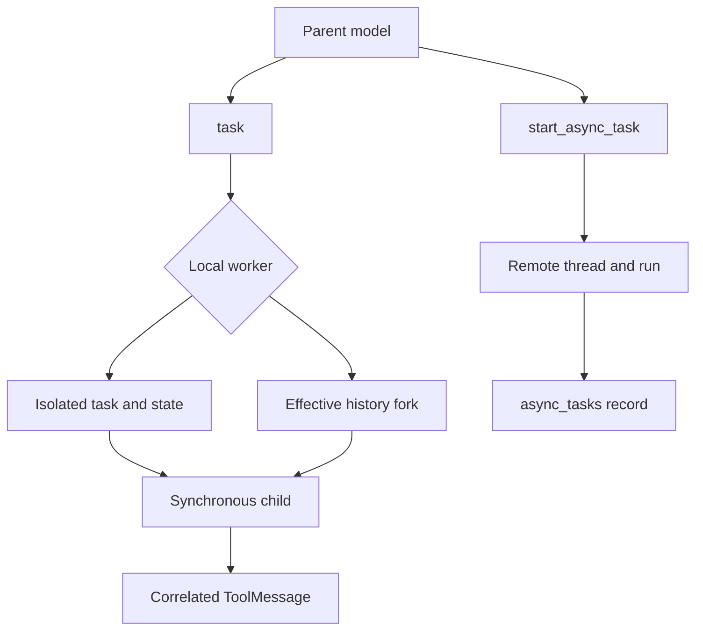
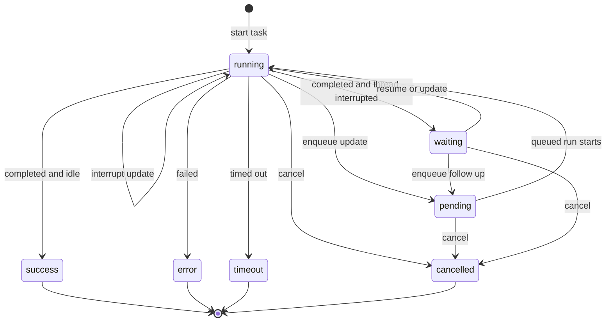
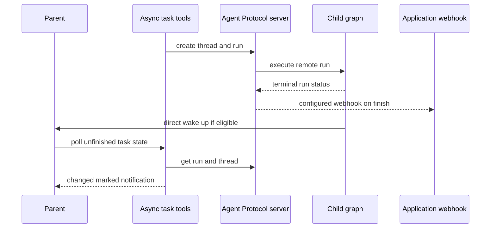
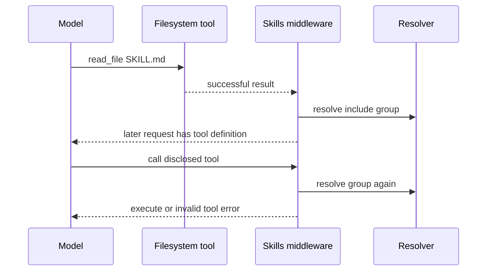

# Subagents, Skills, and Delegation

Deep Agents has three deliberately different mechanisms. The local `task` tool waits for a synchronous child and returns one correlated result. Remote-task tools create durable Agent Protocol work and persist its identity for later observation. Skills are a separate progressive-disclosure mechanism: they show instructions and optionally tool definitions, but do not confer permission. See [Runtime behavior](/openwiki/architecture/runtime-behavior.md), [Context management](/openwiki/concepts/context-management.md), and [Permissions and HITL](/openwiki/concepts/permissions-hitl.md).

## Assembly and the local boundary

`create_deep_agent` partitions `subagents=` into declarative `SubAgent` specifications, caller-owned `CompiledSubAgent` runnables, and remote `AsyncSubAgent` specifications. The synchronous `SubAgentMiddleware` and `AsyncSubAgentMiddleware` are installed independently. Unless a harness profile disables it or a synchronous worker already has that name, the factory adds `general-purpose`; a profile may alter its prompt and description.

*The local boundary waits for one child reply; remote delegation records work to observe later.*

### Isolated tasks and forks

The `task` schema accepts `description` and `subagent_type` (plus injected `runtime`) and rejects model-invented arguments. It requires a tool-call ID so it can emit a correlated `ToolMessage`; unknown worker types are tool errors. A compiled runnable must return `messages` to communicate back.

Isolation is the default. The child receives a new `HumanMessage` containing the description rather than the parent transcript. It excludes messages, todos, structured output, skill metadata and pins, disclosed skill tools, fork and rubric data, and middleware-private fields on both entry and return. Unchanged returned values are dropped, avoiding additive duplication and parallel-update conflicts. Declarative children inherit omitted tools, permissions, and `interrupt_on`; explicit child values replace the relevant inherited configuration, and filesystem-derived approval rules are merged. Compiled and remote children configure approval independently.

A local result is one `ToolMessage`: a non-null `structured_response` is JSON serialized; otherwise the last nonempty child `AIMessage` text is used. Public changed state may return, but excluded and private state cannot. The child retains ambient LangGraph configuration and is traced with `ls_agent_type="subagent"`.

`mode="fork"` is experimental. It reconstructs effective history after summarization, removes the parent message containing the pending tool call, and appends a preamble plus the delegated task. A declarative fork rebuilds inherited prompt-producing behavior; its own prompt is an addendum. It cannot declare an independent `skills` list, and its fork marker refuses nested `task` and `atask` calls. Thus a fork shares context at invocation, not an unrestricted recursive delegation capability.

## Remote asynchronous delegation

An `AsyncSubAgent` defines a name, description, `graph_id`, optional `url`, headers, `webhook`, `notify_parent`, `update_strategy`, and `isolated` or experimental `fork` mode. `start_async_task` creates a remote thread and run, returns the thread ID as the task ID, and records a `running` task. Isolated launch sends one user task. Fork launch snapshots reconstructed parent history, strips local artifacts and eviction metadata, restores blob-backed tool content, and serializes the snapshot. The remote graph still owns its own prompt, tools, credentials, approvals, schema, checkpointer, and thread.

### Task state, observation, and updates

The parent owns a merge-reduced `async_tasks` map keyed by task ID. A record retains task/thread identity, agent and newest-run IDs, cached status, timestamps, and—only for queued follow-ups—`superseded_run_ids`. A checkpointer persists this parent state; the Agent Protocol server separately persists the remote thread and runs.

*`pending` is the newest queued run, while earlier superseded runs can still execute; `waiting` is a child-thread human pause, not success.*

The five tools are `start_async_task`, `check_async_task`, `update_async_task`, `cancel_async_task`, and `list_async_tasks`. `check_async_task` reads the tracked run and returns final output, failure information, or the child thread's pending interrupts. A run that succeeds while its thread is interrupted maps to nonterminal `waiting`; the parent cannot answer that interrupt. If another client resumes the child, observation can adopt the newest run. Server-side `interrupted` runs are reported as `cancelled`, and a parent-cancelled task is not revived by a newer external run.

`update_strategy="interrupt"` (the default) replaces active work on the same thread. `update_strategy="enqueue"` creates a follow-up behind it: the task's newest run may be `pending`, and the previous IDs are retained as superseded so their notifications cannot complete the newer task. Only one queued update per task is allowed in a model turn because parallel calls would otherwise lose tracking. A queued follow-up starts even if the earlier run pauses for a human, dropping that human request. Cancellation targets the newest active run and attempts earlier pending or running superseded runs newest-first; cancelling a waiting task records cancellation without trying to cancel its already-completed run.

`list_async_tasks` filters cached records before refreshing selected nonterminal tasks. Failed SDK refreshes retain cached status. Unknown types and task IDs do not change tracked state. Clients are cached by URL and resolved headers; `x-auth-scheme: langsmith` is added unless the caller supplies it. Managed deployments use SDK environment credentials, while `headers` are the self-hosted authentication extension. URL-less in-process ASGI transport requires an async parent entrypoint such as `ainvoke`; synchronous calls require a reachable URL.

### Delivery channels are not interchangeable

A completion can reach an application or parent in three ways with different authority and guarantees:

*Webhook delivery goes to the configured application endpoint, direct wake-up creates a parent-thread run only when eligible, and polling remains the durable task-observation contract.*

`webhook` is passed to the Agent Protocol server when creating both launch and update runs. It is a server-to-application completion callback, not a command to mutate the parent `async_tasks` state or a substitute for `check_async_task`. Set `notify_parent=False` when the application delivers results itself, for example through that webhook; the parent can still observe its tasks while running.

Every factory-built Deep Agent includes `_ParentNotifierMiddleware`. A child launched on the same deployment may directly wake its parent only when its reference includes the parent's thread and assistant IDs, the parent thread is `idle` or `error`, and a `reject` strategy still accepts the new run. The notifier reports top-level child success or model failure once per run; it re-raises `GraphInterrupt`, skips nested graphs, and logs rather than propagating delivery failure. Cross-deployment children, and children with `notify_parent=False`, retain only a parent-thread reference and cannot wake the parent. Same-deployment launches forward JSON-serializable run context when available; otherwise they pass `configurable.deepagents_parent`. Thread metadata records the parent thread, subagent name, and eligible parent assistant so later child-thread runs can retain linkage.

Polling is separate from direct wake-up. On asynchronous invocation, `AsyncSubAgentMiddleware` records an incoming task notification, then polls unfinished work at agent start, before each model call, and after a final answer. A changed `success`, `error`, `timeout`, `cancelled`, or `waiting` outcome becomes a marked user message framed as system notification; a post-answer change jumps to `model` for another turn. Per-task polling is time-bounded, failures are skipped until a later poll, and an incoming notification from a superseded run is rewritten to say it is not the latest follow-up result. Synchronous hooks do not poll.

## Skills: instructions and optional tool disclosure

`SkillsMiddleware` discovers `SKILL.md` metadata through backend APIs rather than direct filesystem access. Sources are loaded in order and later same-named skills override earlier ones. The resulting `skills_metadata`—including an empty list—is cached until explicitly set to `None`; recoverable load errors are held separately and rendered as bounded escaped diagnostics. The prompt lists metadata and paths and directs the model to read full instructions only when useful.

Pins supply instructions to the next model call. Known distinct names are resolved in first-seen order, readable frontmatter-free bodies become attributed `HumanMessage` snapshots, and `pinned_skills` is cleared. Unknown, unreadable, oversized, or non-UTF-8 files are skipped. The factory places skills after compaction and routing but before prompt caching; a custom middleware named `SkillsMiddleware` replaces that slot.

### Disclosure gates visibility, not authority

A skill can name include groups through `metadata.include_tools`; `SkillsMiddleware(tools=...)` accepts fixed tools or a `SkillToolResolver`. Gated tools are absent from the ordinary tool node. A successful read of a known skill's `SKILL.md`, including a partial read, or a pinned-skill message can disclose the resolved definitions for a later model request. The middleware writes `_skill_tools_disclosed` on every model call, including `{}`, mapping only currently disclosed tool names to their include group.

*The latest disclosure record and a current resolver result must both authorize tool dispatch within the agent, while ordinary permission and HITL still govern the actual action.*

At execution, registered tools take precedence. An otherwise unregistered tool must appear in the latest disclosure record and resolve again to a same-named tool. Calls before disclosure, in the triggering turn, after compaction removes the trigger, or after resolver output changes take ordinary invalid-tool handling. An async resolver requires an async entrypoint and should be stable and inexpensive. For models that support mid-conversation tools, definitions are anchored after the complete read-result batch using Anthropic `tool_addition` or OpenAI Responses `additional_tools`; unsupported Anthropic root combinator schemas are withheld so recorded availability matches model visibility. Disclosure does not bypass filesystem permissions or human approval.

### Code CLI discovery and local trust

The Code CLI adapts the SDK skill loader for local filesystem discovery. It loads built-in, plugin, user, `.agents`, project, and experimental Claude sources in increasing precedence, so a later source replaces an earlier same-named skill; a failed source is logged but does not prevent the remaining sources from being discovered. Plugin sources are recursively discovered and namespace their skill names. This is a CLI/runtime integration layer: agent middleware itself continues to use the configured backend rather than direct paths.

The CLI treats following a skill symlink as a trust decision. `load_skill_content` resolves `SKILL.md` and, when given an allowlist, refuses a result outside all approved roots. The static allowlist can be extended through `DEEPAGENTS_CODE_EXTRA_SKILLS_DIRS` or `[skills].extra_allowed_dirs`. In the plugin skills adapter, a rejected selected skill interrupts with a `skill_trust` request naming its resolved directory; approval persists that canonical directory in `~/.deepagents/.state/skill_trust.json` and the read is retried. Denial, an unwritable trust store, no roots, or a location change between approval and retry prevents the skill from running.

Trust is deliberately fail-closed. The versioned store is atomically replaced on successful writes; normal enforcement treats corrupt, unreadable, or newer-format stores as empty, while strict audit callers surface the error. Before adding a saved directory to the containment allowlist, `load_trusted_skill_dirs` verifies that the stored path still resolves to itself. That means both a discovery symlink retarget and a later replacement of an approved directory by a symlink require fresh approval rather than granting the new target access. Trust permits reading skill instructions; it is neither a model-tool disclosure nor an authorization bypass.

## Operations and focused tests

Use isolated local work for tightly scoped work, a local fork only when effective conversation is needed, and a compiled worker when another graph owns its implementation. Use async work when remote execution must survive beyond a parent turn and be checked, updated, cancelled, or independently resumed. Choose `enqueue` only when preserving current work is more important than immediate follow-up; account for `pending`, superseded results, and dropped child prompts. Use a webhook for application integration, not as the parent-state authority channel, and disable direct wake-up if the application owns delivery.

`test_async_subagents.py` covers launch and validation, isolated and fork payloads, state reduction, headers and linkage, live-status fallback, waiting recovery and cancellation, async-only ASGI, parent notifications and notification escaping, polling extra turns, queued follow-ups, and superseded-run notification handling. The Code skill tests cover source precedence and failure isolation plus trust-store CRUD, strict/error behavior, atomic-write failure, and post-approval symlink-swap rejection. Test integrations should separately exercise interrupt and enqueue behavior, cancellation of both latest and earlier queued runs, webhook receipt, the intended parent observation path, and trust interruption/resume through the actual client UI.

The `examples/async-subagent-server` sample is a minimal FastAPI Agent Protocol peer with in-memory SQLite. It demonstrates thread and run creation, polling, result fetch, cancellation, and health endpoints, but it has no authentication or rate limiting. Its cancel route records cancellation without cancelling the in-flight coroutine. Run it with `uv run uvicorn server:app --port 2024`; production equivalents need authentication, durable storage, rate limits, and actual execution cancellation.

## Related

- [Runtime behavior](/openwiki/architecture/runtime-behavior.md)
- [SDK construction and execution](/openwiki/architecture/sdk-construction-execution.md)
- [Context management](/openwiki/concepts/context-management.md)
- [Permissions and HITL](/openwiki/concepts/permissions-hitl.md)
- [ACP integration](/openwiki/integrations/acp.md)
- [Build a Deep Agent](/openwiki/workflows/build-a-deep-agent.md)
