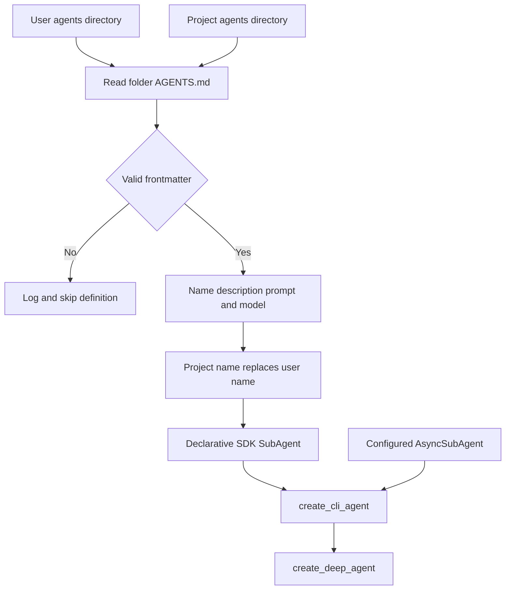
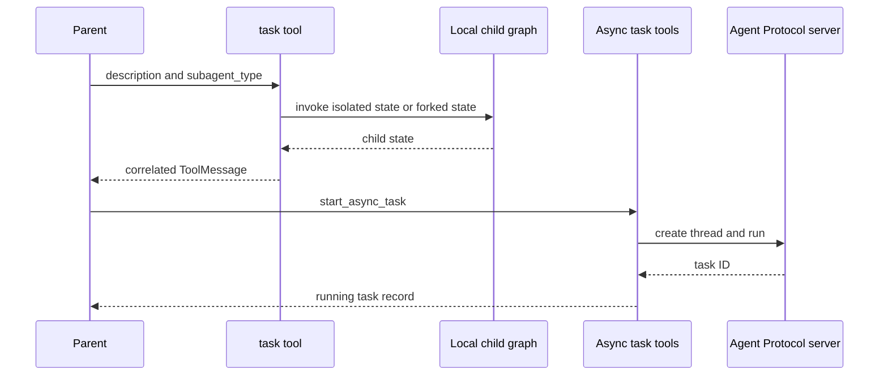
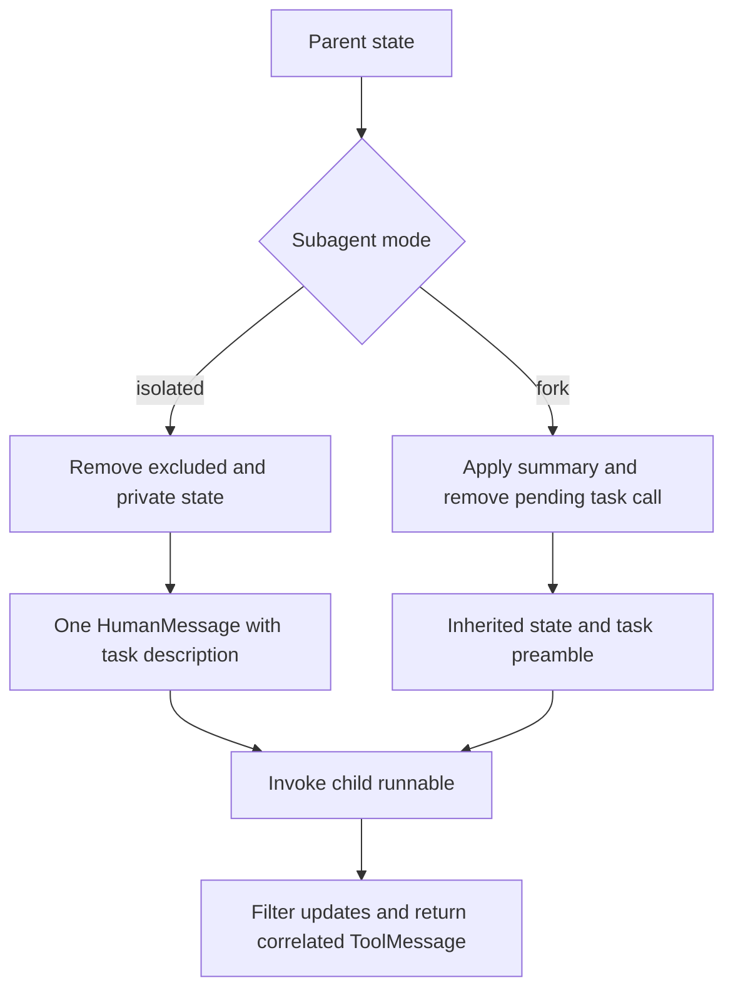

# Subagents and Skills

Deep Agents has two delegation paths and a separate skill mechanism. A synchronous `task` call runs a local child and returns one correlated result to its parent. An `AsyncSubAgent` is instead a remote Agent Protocol task with its own deployment and lifecycle. Skills progressively disclose instructions and, optionally, tool definitions; disclosure does not grant filesystem permission or bypass approval.

Deep Agents Code (dcode) is the product assembly layer around these SDK mechanisms. It discovers local definitions from disk, builds declarative child specifications with dcode policy and middleware, and passes the resulting list to `create_deep_agent`. For base graph construction and execution ordering, see [SDK construction and execution](/openwiki/architecture/sdk-construction-execution.md); for permissions and approval, see [Permissions and HITL](/openwiki/concepts/permissions-hitl.md).

## Dcode discovery and assembly

### Filesystem-defined local workers

Dcode looks for a local worker at `.deepagents/agents/{folder}/AGENTS.md` in user and project agent directories. The file must be UTF-8 Markdown beginning with YAML frontmatter. `description` must be a nonempty string; `model`, if present, must be a string. `name` may be omitted, in which case the folder name becomes the task-visible name. A present but empty, whitespace-only, or non-string `name` is invalid rather than falling back.

The Markdown body becomes `system_prompt`. Invalid or unreadable files are logged and skipped. A Markdown file directly under `agents/`, or a folder containing a differently named Markdown file, is not a definition and produces a diagnostic. Same-name collisions within one source are warned about; project definitions are loaded after user definitions and replace user definitions with the same resolved name.

*Dcode owns filesystem discovery and translates successful local records to declarative SDK children; remote specifications enter the SDK separately.*

`create_cli_agent` supplies a dcode-owned `general-purpose` child unless discovery already produced that name. The fallback is a `fork` by default; set `FORKED_SUBAGENTS=false` to use the SDK default isolated behavior. A discovered `general-purpose` is retained rather than replaced or duplicated.

### Explicit and inherited models

A falsy frontmatter `model` (`null` or `""`) means that the child follows dcode's runtime model selection. Such children receive `ConfigurableModelMiddleware` with nonpersistent model state. A nonempty declared model is checked against the effective allowed-model policy before graph construction and is installed on the child; dcode intentionally omits configurable-model middleware, so a runtime model switch does not replace the explicit selection. The validation context identifies the declaring `AGENTS.md` path, which makes a policy failure actionable among multiple definitions.

Dcode may eagerly resolve a known provider model with its retry-owning factory. Missing provider credentials do not make assembly fail: the original allowed model spec remains on the child, and a credential error surfaces if that child is actually invoked.

### Child middleware is deliberately assembled, not inherited wholesale

For every discovered declarative child and the fallback worker, dcode builds a separate middleware list. It includes Git tracing, nested cost tracking, the subagent truncation guard, retry, server hooks, and conditionally adds the following layers:

- `AsyncApprovalHITLMiddleware` when approval is active;
- `ConfigurableModelMiddleware` only for an inherited/runtime model;
- GLM terminal-stall recovery for headless execution;
- a restrictive `ShellAllowListMiddleware` when shell-only interruption is configured;
- MCP timeout middleware when MCP tools exist;
- the managed-memory guard when memory is enabled;
- `PluginSkillsMiddleware` for skill-only MCP tools when skills are enabled; and
- `MCPProviderToolSearchMiddleware` when provider-native MCP search is enabled.

When dcode installs its asynchronous approval middleware it writes `interrupt_on={}` on the declarative child. This explicit empty value prevents the SDK from inheriting the parent's ordinary synchronous HITL map and wrapping the same child tools a second time. A `CompiledSubAgent` is already a runnable and remote `AsyncSubAgent` specifications execute on their own backend; neither is rewritten by this child-graph assembler.

### Filesystem allowlists cannot be bypassed by delegation

An explicit `--allow-fs-tools` list replaces the main graph's default `FilesystemMiddleware` and supplies matching restricted filesystem middleware to every synchronous declarative child, including dcode's fallback worker. The child uses its explicit model's harness descriptions when it has one, otherwise the main model descriptions. `None`—including `--allow-fs-tools all`—keeps the SDK default unrestricted tool set.

Dcode refuses to assemble a compiled child when this restriction is requested: its middleware cannot safely be injected into an already-built runnable, so accepting it could create an unrestricted `task` escape hatch. Remote async children are unaffected because their filesystem belongs to their remote backend.

## What the SDK does with the assembled specifications

`create_deep_agent` partitions `subagents=` by specification type. Declarative and compiled synchronous children become `SubAgentMiddleware`'s `task` tool. `AsyncSubAgent` records become `AsyncSubAgentMiddleware`, which exposes background-task tools rather than a local child graph. The SDK can add its own general-purpose synchronous child only when no synchronous child with that name exists and the active harness profile permits it; dcode normally prevents that path by providing its own fallback.

*Local delegation blocks until its child returns or interrupts; remote delegation records an independently observable task and returns its ID.*

### Isolation, forks, and result boundaries

The `task` schema accepts `description` and `subagent_type`; `runtime` is injected by the tool node. Invented arguments are rejected, unknown child names return a tool error, and a task call requires a tool-call ID so the returned `ToolMessage` is correlated with its parent call.

An isolated child gets a fresh `HumanMessage` containing only the delegated description. The SDK removes messages, todos, structured output, skills state, pins, disclosed skill tools, rubric data, and declared middleware-private fields from ordinary child input and return updates. On return it also drops values unchanged from the supplied child input: this prevents an inherited additive value from being added a second time and prevents reducer conflicts when sibling `task` calls run in parallel. A compiled runnable must return `messages`; otherwise it cannot produce a parent result.

A fork is experimental. The SDK reconstructs effective history after summarization, removes the pending parent tool-call message, and appends a task preamble and description. Declarative forks retain enough state and middleware to rebuild the parent prompt; their own system prompt is an addendum. They cannot declare independent `skills`, and the fork marker rejects nested `task` and `atask` calls. A fork therefore shares the parent conversation at invocation time without enabling recursive delegation.

*Isolated delegation creates a task-only message, whereas a fork reconstructs the effective parent conversation before it invokes the child.*

A completed local child produces exactly one parent-facing result correlated to the tool-call ID. A non-null `structured_response` is JSON serialized. Otherwise, if the child's final message has a refusal content block, the result is a safe refusal notice; if not, the boundary selects the last nonempty `AIMessage` text. State updates may accompany that result, but excluded, private, and unchanged state cannot cross the boundary. The `task` implementation does not manually copy the parent runnable configuration: LangGraph inherits ambient callbacks, tags, configurable values, and user metadata, merging them with the child's bound configuration so child values such as `lc_agent_name` and `recursion_limit` win collisions. It adds the tool-call ID as checkpoint metadata. Separately, a LangSmith tracing context tags the child `ls_agent_type="subagent"`; that tag reaches LangSmith without leaking into streamed callback metadata.

### Model refusals are task results, not parent failures

Deep Agents installs `ModelRefusalMiddleware` in its assembled declarative child stacks. At the local boundary, both `task` and `atask` catch a `ModelRefusalError`, as well as a `StructuredOutputValidationError` only when its AI message contains a refusal. They return a parent-readable task result stating that the subagent stopped because the model refused. The notice preserves a supplied refusal category and explanation when available and advises against retrying the same request; unrelated structured-output validation errors still propagate.

The result shaper also recognizes a refusal block on the returned final `AIMessage`. This covers compiled children or child configurations where the refusal was returned rather than raised. Ordinary dict-shaped messages are not mistaken for a refusal. The parent agent's own refusal behavior is deliberately separate: its default middleware raises `ModelRefusalError`, so a caller can instead install fallback middleware or exclude the refusal middleware when that is the desired policy. Remote task result extraction applies the same refusal-notice conversion before emitting a completion result.

## Failure, interruption, and cost behavior

Dcode replaces the generic empty-output guard in child stacks with `SubagentTruncatedReplyMiddleware`. It normalizes provider metadata from OpenAI Responses and Chat Completions, Anthropic, Google GenAI, and Bedrock into output-limit, content-filter, or context-window truncations. If a provider truncates a child response before it produces visible text or a parsed tool call—including a reasoning-only reply or an incomplete tool call—the guard raises `ModelOutputTruncatedError`; the parent `task` boundary turns that into an error-status `ToolMessage`. This is distinct from a model refusal, which is reported as the task result described above. If text was produced before truncation, dcode retains that partial answer and appends a warning; a truncated reply with a valid tool call is left for the normal tool loop. This distinguishes a usable incomplete report from a silent empty success.

Nested `CostTrackingMiddleware` checkpoints child spend before approval can pause its graph and transfers the completed owner-scoped delta for the parent to add to its durable session total. The dcode JavaScript interpreter applies the same ownership boundary to `task` calls proxied from `js_eval`: it gives each dispatch occurrence a distinct checkpoint namespace, waits for active dispatched children when the interpreter call settles, and returns a single `_session_cost_transfers` receipt only to the outer owner. Receipt namespaces are de-duplicated during aggregation, preventing replay or parallel fan-out from charging a receipt twice.

## Remote SDK delegation

An `AsyncSubAgent` identifies a remote graph through `name`, `description`, and `graph_id`, with optional `url`, authentication `headers`, `webhook`, `notify_parent`, `update_strategy`, and experimental `mode="fork"`. `start_async_task` creates a remote thread and run, records a `running` task keyed by its thread ID, and returns that ID immediately. The remote graph owns its own prompt, model, tools, credentials, approval, persistence, and filesystem.

Use the async task tools—not the synchronous `task` tool—to check, update, cancel, or list remote work. `mode="isolated"` sends the description only. Experimental `fork` sends a snapshot of reconstructed parent history followed by the task, but it does not synchronize parent configuration; matching child configuration may help prompt caching but does not guarantee a cache hit. An URL-less in-process ASGI remote target requires an async parent entrypoint such as `ainvoke`; synchronous invocation requires a reachable URL.

A remote task that has completed its run while its remote thread waits for a human is `waiting`, not successful. The parent can observe the child-thread interrupts but cannot answer them. For an `enqueue` update, the newest run can be `pending` while the prior run still executes; prior IDs are retained as superseded so their notifications cannot complete the newer task. `interrupt` is the default update strategy.

## Talon background delegation

Talon changes the local `task` and remote `start_async_task` interaction at the middleware boundary. For an ordinary conversational turn, `BackgroundSubagents` detaches either call into an in-memory, owner-scoped job and immediately returns a task ID. It gives the worker an independent thread ID, disables nested delegation, approvals, and authorization handlers, and bounds execution to one hour. Jobs are globally capped (128 retained jobs and four concurrent workers by default; the runtime can configure the concurrency limit). A result includes text only, is limited to 64,000 characters, and is offered only to its owner through `list_subagents` or the next main-agent turn; another conversation cannot inspect, cancel, or consume it.

The main turn acknowledges a result only after it has completed. If the host later discards that reply, it can requeue the returned result IDs; repeated failed deliveries are capped at three, after which the result is marked dropped. This separates successful worker completion from successful delivery to a user.

A scheduled Talon turn has no future conversational turn to receive a detached answer. It therefore runs delegation inline, queues rather than rejects excess inline fan-out, and returns the child result in the same tool call. Inline work has a shorter timeout (ten minutes), does not create a job, and reports a sanitized failure or timeout as an error result. Both detached and inline workers prohibit recursive delegation; a scheduled run also hides management tools that could not usefully report a later result.

## Skills and dcode plugin sources

### SDK progressive disclosure and delegation boundary

`SkillsMiddleware` scans configured backend sources before an agent run and retains a checkpointed skill index; a list, including an empty one, avoids a reload until state is reset to `None`. Sources are read in order and later same-named metadata wins. The model sees names, descriptions, optional annotations, and paths in the system prompt, then reads `SKILL.md` to obtain full instructions. Pinning appends the requested skill bodies without frontmatter as one-time human messages before the next model call; unknown or unreadable names are skipped.

Skill-provided tools are not registered as ordinary middleware tools. A tool listed in a read skill's `metadata.include_tools` is resolved and disclosed for that model call, and the recorded disclosure gates later tool execution. Consequently, loading or listing a skill does not grant tools; the model must have read the skill that exposes them, and a stale disclosure is cleared on every model request.

This state is intentionally local at the synchronous delegation boundary. Isolated declarative children can configure their own `skills`; they do not receive the parent's skill metadata, pinned skills, or prior disclosed-tool record, and their corresponding output cannot overwrite the parent. A fork cannot declare an independent skill source: graph construction instead uses the parent's configured sources so the child can rebuild the inherited context without a competing skill policy. Compiled children retain responsibility for their own skill middleware.

Dcode's `get_skill_sources` orders sources from lower to higher precedence: built-in skills, discovered plugin skills, user `.deepagents`, user `.agents`, project `.deepagents`, project `.agents`, then experimental user and project Claude directories. Later same-named skills replace earlier ones. Plugin discovery failure is logged and does not prevent later local sources from being added.

The plugin adapter supplies a `(path, label, namespace)` source for each available plugin skill root. `PluginSkillsMiddleware` adapts that input to the SDK source format while recursively loading namespaced plugin skills. A nested plugin skill is named with colon-separated path components such as `plugin:sub:review`, then participates in last-one-wins resolution. It retains SDK `SkillsMiddleware` behavior rather than changing its public source API.

For selected/pinned local skills, the dcode adapter resolves `SKILL.md` inside the configured roots plus allowed extra roots before placing its body into the SDK-style pinned message. If a resolved skill lies outside trusted roots, it requests trust for the directory; it retries after approved persistence and refuses a path that changes location between approval and retry. Thus a skill read is a filesystem trust decision, while skill tool disclosure is a separate visibility decision.

A skill-only MCP tool is removed from dcode's initial ordinary tool list and MCP server summary. `PluginSkillsMiddleware` can disclose it after the appropriate skill is read or pinned; execution remains subject to the ordinary tool executor, authorization, and approval middleware. If skills are disabled, dcode warns that skill-only MCP tools are unavailable.

Provider-native MCP search is an optimization distinct from skill disclosure. `MCPProviderToolSearchMiddleware` defers only currently exposed designated MCP tools for supported native OpenAI Responses or Anthropic routes; it leaves executor registrations in place, falls back to eager tools for unsupported routes, and removes incompatible native search blocks from history before a later provider request. It cannot reveal a skill-only tool before the skill layer has disclosed it.

## Tests and safe changes

Focused dcode coverage is split by boundary:

- `test_subagents.py` covers definition parsing, required frontmatter, source precedence, collisions, and discovery diagnostics.
- `test_agent.py` verifies fallback fork behavior, preservation of a discovered `general-purpose`, implicit versus explicit child models, approval and shell wiring, memory guarding, and filesystem allowlist injection into main and child middleware.
- `test_output_truncation.py` exercises provider truncation classification, reasoning-only and interrupted-tool-call failures, recovery ordering, and the parent-visible empty versus partial child behavior.
- `libs/deepagents/tests/unit_tests/middleware/test_subagent_middleware_init.py` exercises middleware construction, invalid and duplicate specifications, isolated versus forked state preparation, fork prompt/cache invariants, private-state handling, skills restrictions, and dynamic structured-output limits.
- `test_subagent_refusal.py` verifies sync and async local task calls turn returned and raised provider refusals—including structured-output refusals—into parent task results; it also verifies the main-agent policy remains independently configurable and remote result extraction uses the same notice.
- `test_js_cost_tracking.py` exercises isolated task dispatch namespaces, durable receipts, child failure and cancellation, pauses, replay, and fan-out aggregation.
- `test_provider_tool_search.py` covers provider and endpoint capability gates, request serialization, eager fallback, approval/resume, model switches, and cross-provider history filtering.
- `libs/talon/tests/unit_tests/test_background.py` covers owner isolation and capacity, result acknowledgement and requeue, scheduled inline execution and fan-out, timeouts, and text-only result projection.

When changing this area, preserve the boundary distinctions: filesystem discovery is a dcode concern, declarative child assembly is local, compiled runnables are caller-owned, and async specs belong to their remote deployment. Treat a child middleware omission as a potential policy bypass, especially for approval, filesystem restrictions, and skill-only tool visibility. For Talon, also preserve the ownership and acknowledgement boundary: do not expose a background result to a different conversation or mark it delivered before the host has completed the consuming turn.

## Related

- [Middleware stack](/openwiki/architecture/middleware-stack.md)
- [Runtime behavior](/openwiki/architecture/runtime-behavior.md)
- [Context management](/openwiki/concepts/context-management.md)
- [Middleware catalog](/openwiki/concepts/middleware-catalog.md)
- [Testing guide](/openwiki/testing/testing-guide.md)
- [Permissions and HITL](/openwiki/concepts/permissions-hitl.md)
- [Plugins](/openwiki/concepts/plugins.md)
- [MCP](/openwiki/integrations/mcp.md)
s, request serialization, eager fallback, approval/resume, model switches, and cross-provider history filtering.

When changing this area, preserve the boundary distinctions: filesystem discovery is a dcode concern, declarative child assembly is local, compiled runnables are caller-owned, and async specs belong to their remote deployment. Treat a child middleware omission as a potential policy bypass, especially for approval, filesystem restrictions, and skill-only tool visibility.

## Related

- [Middleware stack](/openwiki/architecture/middleware-stack.md)
- [Runtime behavior](/openwiki/architecture/runtime-behavior.md)
- [Context management](/openwiki/concepts/context-management.md)
- [Middleware catalog](/openwiki/concepts/middleware-catalog.md)
- [Testing guide](/openwiki/testing/testing-guide.md)
- [Permissions and HITL](/openwiki/concepts/permissions-hitl.md)
- [Plugins](/openwiki/concepts/plugins.md)
- [MCP](/openwiki/integrations/mcp.md)
