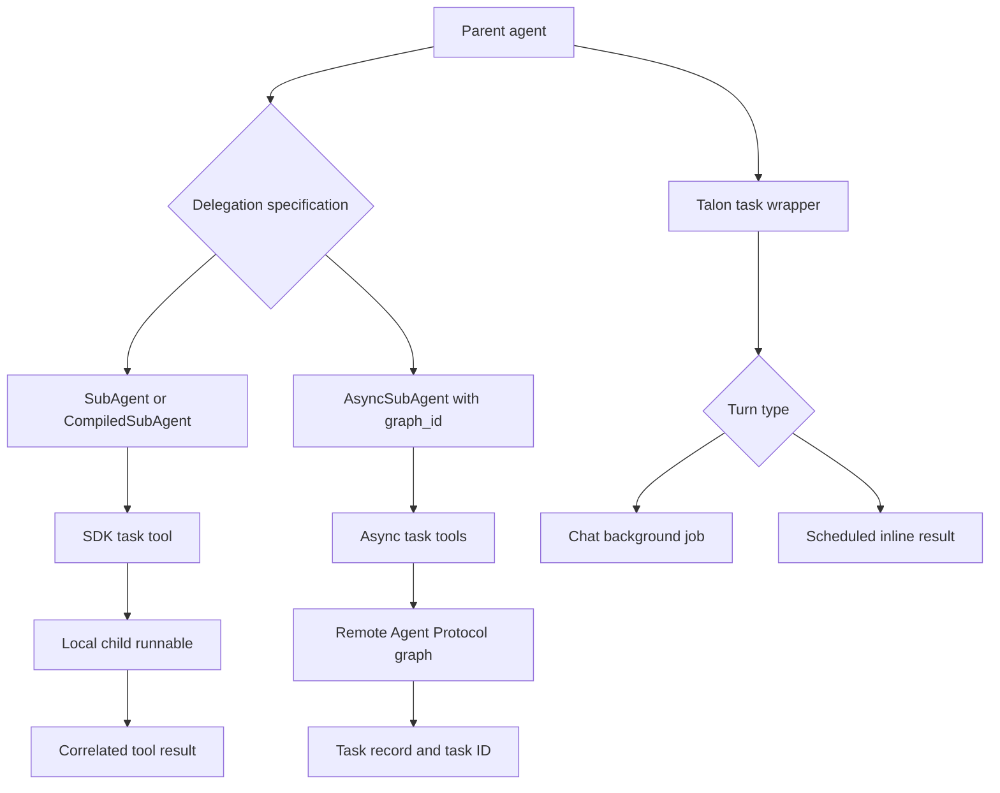
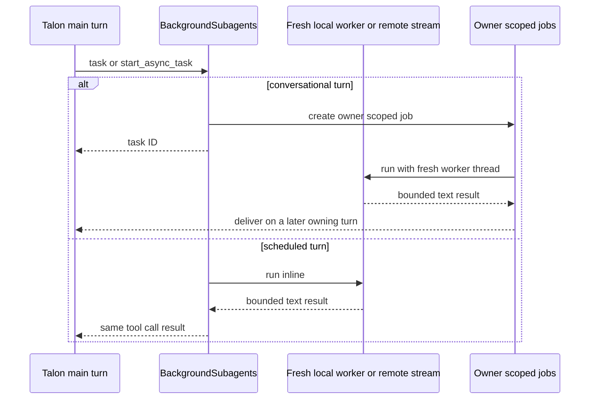

# Subagents and Skills

This page distinguishes four execution models that are easy to conflate:

| Model | Configuration owner | Invocation and result lifecycle | Context and policy boundary |
| --- | --- | --- | --- |
| SDK local `task` | A declarative `SubAgent` or caller-supplied `CompiledSubAgent` | Blocks for a child graph and returns a correlated tool result | SDK builds declarative children; compiled runnable remains caller-owned |
| SDK remote async | `AsyncSubAgent` identifying an Agent Protocol graph | `start_async_task` returns a persistent remote task ID; async tools monitor, update, cancel, and list it | Remote deployment owns its graph, tools, credentials, persistence, and approval |
| Deep Agents Code (dcode) local child | dcode assembles declarative SDK specs and child middleware | Still the SDK's synchronous `task` behavior | dcode must propagate its local safety configuration into children |
| Talon local or remote delegation | Talon prepares fresh local roles or remote specs, then wraps task tools | Chat turns detach work into an in-memory job; scheduled turns wait inline | Talon makes fresh local graphs with explicit attachments and controls delivery to the owning conversation |

A skill is not a subagent. It is a progressive-disclosure source of instructions, and optionally a way to make a deferred tool visible to the model. Skill visibility does **not** itself grant filesystem access, approve an operation, authenticate to a service, or authorize an action.

## Delegation paths and result lifecycles

`create_deep_agent` partitions `subagents=` by shape. A declarative `SubAgent` and a `CompiledSubAgent` are attached to `SubAgentMiddleware` as the synchronous `task` tool. An `AsyncSubAgent` is attached to `AsyncSubAgentMiddleware` instead. The SDK can add a `general-purpose` synchronous child when no child of that name is supplied and the harness profile enables it.

*The SDK local and remote paths have different result ownership; Talon changes when the parent can receive either result.*

### SDK local `task`: a child graph, not a background task

`task` takes a description and a declared subagent type. The middleware requires a tool-call ID to correlate its result; an unknown type is returned as a tool error. Declarative specs are compiled by the SDK, while `CompiledSubAgent` runnables are used as supplied.

By default, a local child receives a fresh `HumanMessage` containing the delegated description rather than the parent transcript. It can receive public custom state, but the boundary excludes messages, todos, structured output, skill metadata and pins, disclosed skill tools, rubric data, and middleware-private fields. On return, it excludes the same boundary-owned fields and unchanged inputs, avoiding duplicate additive updates and reducer conflicts when sibling tasks run in parallel.

The child response is serialized into the parent call's correlated `ToolMessage`: a `structured_response` is JSON-serialized; otherwise the middleware selects the last non-empty AI text. A refusal content block or a `ModelRefusalError`/structured-output refusal becomes a bounded explanatory task result (including available category or explanation and a retry hint), rather than terminating the parent delegation. This behavior applies to synchronous `task`/`atask` invocation; it does not mean the parent model itself suppresses refusals by default.

Experimental `mode="fork"` reconstructs the effective parent history after applying its summarization event, removes the in-flight spawning tool call, and appends a preamble plus the delegated description. A declarative fork retains its parent's system-prompt prefix and prompt-producing middleware (and carries non-excluded parent state, including private channels); its own `system_prompt` is delivered with the task to preserve the prefix cache. A compiled fork is opaque, so it receives only non-private, non-excluded state. Forks cannot define independent `skills`; they inherit the parent skill sources. The fork still has a `task` tool so its tool shape matches the parent, but a private fork marker makes nested `task` or `atask` return a refusal instructing it to complete the work itself. Forking shares context at invocation time; it is not recursive delegation.

When a local child saves checkpoints, the returned `ToolMessage.artifact` carries its actual `checkpoint_ns`, allowing a client to inspect that child history under the parent thread. Compiled graphs are streamed to learn the namespace, including the namespace of a retry that actually completed; nested child namespaces retain their parent segments. There is no artifact when a graph configured with `checkpointer=False` saved nothing. A non-graph runnable uses the task call's fallback namespace. The known exception is a runnable wrapped with `.with_retry()`: it must be invoked for retry behavior, so the recorded fallback can name the failed run while the successful retry saved under a suffixed namespace.

The SDK's policy inheritance is specific to declarative children: their filesystem permissions inherit the parent rules unless they specify replacement rules, and their `interrupt_on` configuration inherits the top-level configuration unless overridden. Compiled runnables and remote async graphs do not inherit those settings; callers configure them at their own boundary.

### SDK remote async: durable remote work

An `AsyncSubAgent` names an Agent Protocol graph with `name`, `description`, and `graph_id`; it can also set a URL, headers, webhook, notification behavior, update strategy, and experimental fork mode. `start_async_task` creates a remote thread and run, returns promptly with a task ID, and records its agent name, thread, run, and status in parent-state `async_tasks`. The middleware supplies five task tools: start, check, update, cancel, and list. This state survives compaction/offloading, so a later parent turn can inspect or control tracked work.

An update normally interrupts the active remote run; `update_strategy="enqueue"` queues the follow-up instead. In either case this is a remote task lifecycle, not a local `task` call. The async middleware polls unfinished records only on the asynchronous path, before model calls and after a final answer; a changed terminal, cancelled, timeout, or human-input outcome becomes a labeled parent message. A remote run waiting for human input is `waiting`, not success.

`mode="fork"` snapshots the effective parent message history at launch, removes local tool artifacts, and appends the task; isolated mode sends only the task description. It copies conversation content, not the parent graph's configuration: remote execution does not inherit the local filesystem, credentials, prompt, approval handlers, or persistence. A URL-less local ASGI target requires an async parent entrypoint such as `ainvoke`; synchronous `invoke` requires a reachable URL.

## Dcode-defined local children

Deep Agents Code is an assembly layer over SDK delegation, not a third SDK transport. `create_cli_agent` supplies dcode's own local policy and passes assembled subagent specifications to `create_deep_agent`; remote `async_subagents` remain remote specifications.

A consequential example is filesystem restriction. With an explicit `--allow-fs-tools` list, dcode installs corresponding `FilesystemMiddleware` on each synchronous declarative child—including its general-purpose child—so `task` cannot bypass the parent allowlist. It rejects compiled children in that configuration because their already-built runnable cannot receive the required middleware. Remote async children are unaffected because they execute against their own backend.

Dcode orders skill sources from built-in and plugin sources through user and project directories, with later sources taking precedence. Plugin discovery errors are logged rather than preventing subsequent local sources from being considered. See [Permissions and HITL](/openwiki/concepts/permissions-hitl.md) for the approval model and [Context management](/openwiki/concepts/context-management.md) for state and compaction context.

## Talon: fresh roles plus background delivery

Talon deliberately does not treat a configured local role as a normal SDK declarative child. `prepare_subagents` rejects fork mode and compiles a local `LocalSubAgent` into a fresh runnable. The fresh graph receives only the task message, its explicit attached tools, a research-oriented system contract, summarization, MCP middleware, and Talon subagent controls. There is no implicit parent history, memory, or skill inheritance.

Talon can attach extra tools for one local task call. The requested names must be unique and present in the current non-delegation tool catalog; the added tools supplement rather than replace the role's configured tools. This is a per-task compilation choice, not a persistent mutation of the role. Talon's `get_agent_tools` inventory reports known tools for fresh roles, but treats compiled and remote roles as opaque.

Talon applies its approval policy while compiling a fresh role: only configured attached tools appear in its `HumanInTheLoopMiddleware`. If policy protection is active, Talon refuses to run a precompiled child because it cannot enforce the policy inside an opaque runnable. A background worker has no operator to resolve a pause, so an interrupt becomes a result saying the protected action did not run; the worker also clears its authorization handler. These are operational safeguards, not evidence that a delegated response has authority to change policy.

*Talon detaches conversational delegation for later owner-scoped delivery, but scheduled work consumes the result within the same turn.*

### Conversational jobs

For ordinary conversational turns, `BackgroundSubagents` intercepts both local `task` and remote `start_async_task`, creates an in-memory job tied to the calling thread ID, and returns a Talon task ID immediately. The worker has a different thread ID, blocks nested delegation, disables approval operation and authorization handlers, and has a one-hour timeout. By default the process retains at most 128 jobs and permits four running workers globally; the runtime can configure the running limit.

Only the owner can list, inspect, message, cancel, or receive its jobs. Results are plain answer text—reasoning and non-text blocks are excluded—and are capped at 64,000 characters. `message_subagent` queues guidance for the next local worker model step rather than interrupting a running model or tool call; it is unavailable for remote or opaque workers.

Completion is separate from delivery. The runtime offers unacknowledged completed results as data to a later main-agent turn and acknowledges them only after that turn completes. If a host discards the completed reply, it can requeue just the result IDs consumed by that reply. Failed delivery attempts are counted; after three failures, the result is marked dropped rather than injected indefinitely.

### Scheduled work stays inline

A scheduled turn has no later conversation turn that can consume a detached result. Talon therefore invokes both local `task` and remote work inline, returns the result through the same tool call, and leaves no job record. Inline calls use a separate semaphore (four slots by default) and queue fan-out over that ceiling rather than refuse it. Their default timeout is ten minutes, shorter than the detached-worker timeout; failure and timeout are converted to sanitized error results so a retryable exception does not escape and replay sibling calls.

## Skills: disclosure is not permission, approval, or authority

`SkillsMiddleware` indexes configured sources before an agent run. The model sees the skill name, description, optional annotations, and path in the system prompt; it must read `SKILL.md` to obtain the full instructions. The index is checkpointed: any list, including an empty list, is reused, while setting `skills_metadata` to `None` requests a reload. Sources are processed in order and later same-named skills replace earlier metadata. Pinning named skills appends their bodies without frontmatter as one-time messages before the next model call; unknown or unreadable names are skipped.

A skill can declare `metadata.include_tools`. Such tools are deliberately kept out of ordinary middleware tool registration. Reading the skill (or pinning it) allows the middleware to resolve and disclose those tools for that model call, and it records the disclosure needed to dispatch a later tool call. A tool is therefore not callable merely because a skill exists or is listed; a new model request recomputes disclosure from the applicable skill reads.

Keep these independent decisions separate when designing or reviewing a system:

1. **Disclosure** — the model has read instructions and, where configured, sees a tool schema. This is what skills control.
2. **Availability and permissions** — a graph has registered the tool and its backend or filesystem rules allow the particular operation. SDK filesystem permission rules are evaluated by `FilesystemMiddleware`; they are not backend-wide authorization.
3. **Approval** — a configured `HumanInTheLoopMiddleware` can pause a tool call for a human decision. Disclosure does not approve it, and dcode/Talon may apply child-specific approval boundaries.
4. **Authority** — credentials, authenticated remote services, and the user or operator's authorization determine what an action may do. Instructions or data returned by a skill or subagent are untrusted input, not permission to alter scope, destinations, policy, or credentials.

For isolated SDK declarative children, skills are local: parent skill metadata, pins, and disclosed-tool state are filtered out. Such a child may configure its own skill sources. A fork instead uses parent skill sources to rebuild inherited context and cannot declare a competing skill configuration. Talon's fresh local workers likewise start without implicit parent skills; a caller may explicitly attach `read_file` and include skill instructions in the task.

## Tests and safe changes

The focused tests make the intended boundaries executable:

- `libs/deepagents/tests/unit_tests/test_subagents.py` covers correlated local results, state isolation and parallel updates, fork context, and checkpoint artifacts. In particular, it verifies nested namespaces, retry-aware namespace reporting, `checkpointer=True` and `False`, and the `.with_retry()` namespace limitation.
- `libs/deepagents/tests/unit_tests/test_subagent_refusal.py` verifies that declarative and compiled local children turn returned or raised model refusals—including structured-output refusals—into a task result, while a main agent still raises by default.
- `libs/deepagents/tests/unit_tests/middleware/test_subagent_middleware_init.py` verifies the fork's inherited prompt prefix, task-local instructions, skill prohibition, state distinctions, and recursion refusal; `middleware/test_fork_payload.py` additionally checks provider payload equivalence, inherited history, cache-control placement, and task-message boundaries.
- `libs/deepagents/tests/unit_tests/test_async_subagents.py` verifies tool construction and validation, task-state reduction, launch records, isolated versus fork launch payloads, and the remote task lifecycle. In particular, the launch-payload test is the boundary test for a fork being a snapshot of messages rather than inheritance of the parent graph.
- `libs/talon/tests/unit_tests/test_background.py` covers owner isolation, capacity, cancellation, independent worker thread IDs, acknowledgement/requeue/drop delivery semantics, timeout and sanitized error behavior, result text projection, remote streaming, and scheduled inline fan-out.
- `libs/talon/tests/unit_tests/test_research_subagents.py` covers fresh-context isolation, explicit attachments and per-task selection, no implicit general-purpose role, recursive-delegation denial, approval behavior for fresh versus compiled children, and rejection of Talon fork mode.

When changing delegation, preserve which component owns execution and policy: SDK declarative children are compiled locally; compiled runnables retain caller-owned internals; remote async work belongs to its deployment; and Talon jobs are in-memory and owner-scoped. Preserve the `ToolMessage` serialization and checkpoint artifact contract for local children, especially when changing retry or streaming behavior. When changing skills, do not turn disclosure into a bypass around tool registration, permissions, approval, or authorization.

## Related

- [SDK construction and execution](/openwiki/architecture/sdk-construction-execution.md)
- [Context management](/openwiki/concepts/context-management.md)
- [Permissions and HITL](/openwiki/concepts/permissions-hitl.md)
- [Talon scheduling](/openwiki/concepts/talon-scheduling.md)
- [Talon integration](/openwiki/integrations/talon.md)
