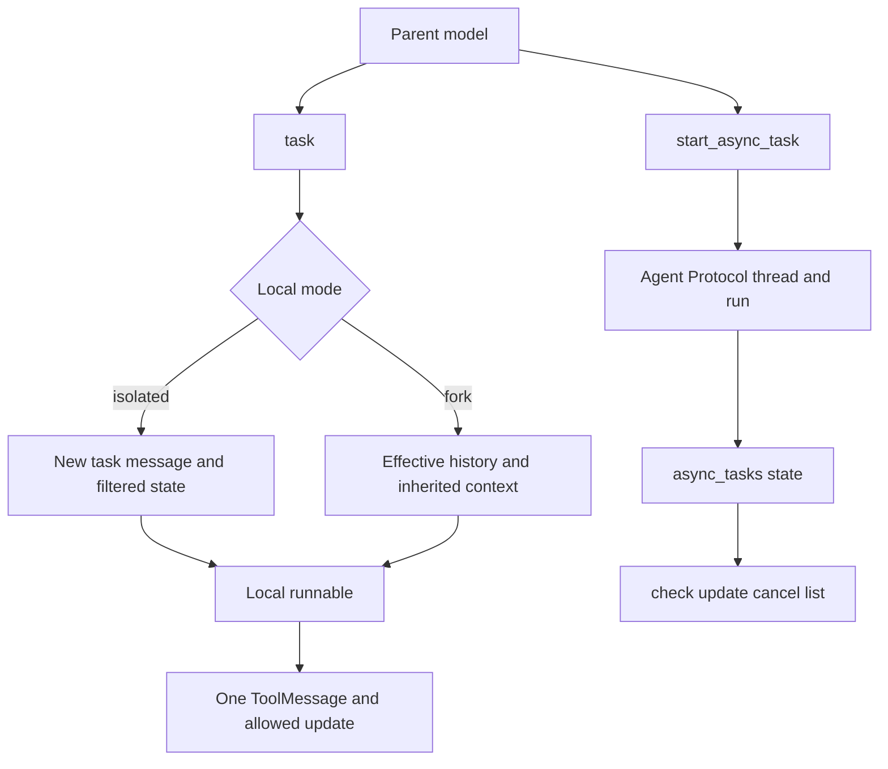
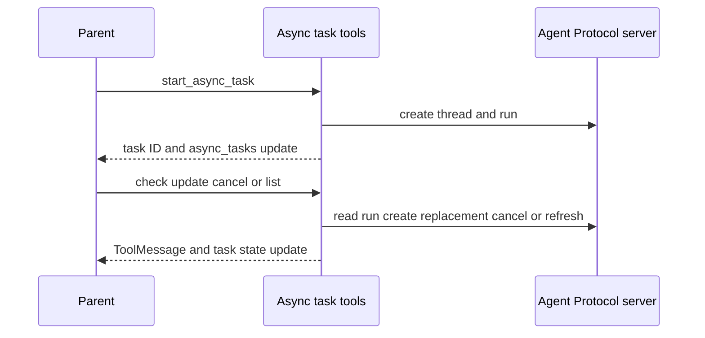
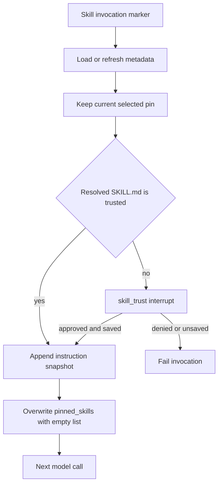

# Subagents and Skills

`create_deep_agent` combines two distinct delegation paths. A local `task` call runs a synchronous child and returns one result to its caller. An `AsyncSubAgent` starts a background run on an Agent Protocol server and records a task that the parent can manage later. Skills are instruction bundles: the SDK middleware indexes and progressively discloses them, while Deep Agents Code adds recursive plugin discovery, explicit `/skill:` invocation semantics, and trusted-root enforcement for instruction reads.

A skill is neither a subagent nor an authorization policy. Its text guides the model; `metadata.include_tools` can participate in a model-visible tool gate, but filesystem permissions and approval/`interrupt_on` remain independent controls. See [Middleware stack](/openwiki/architecture/middleware-stack.md), [Permissions and HITL](/openwiki/concepts/permissions-hitl.md), and [Build a Deep Agent](/openwiki/workflows/build-a-deep-agent.md).

## Assembly and local delegation

The factory separates declarative `SubAgent` specifications and caller-owned `CompiledSubAgent` runnables from `AsyncSubAgent` specifications, which are recognized by `graph_id`. It compiles declarative local workers, uses compiled workers as supplied, installs the local and remote middleware independently, and normally adds `general-purpose` unless the harness profile disables it or a supplied local spec replaces that name.

*The local boundary waits for a result; the remote boundary records a task and lets the parent continue.*

### Task contract, isolation, and results

The `task` schema accepts `description` and `subagent_type` only, apart from injected `runtime`; unknown model-supplied arguments are validation errors rather than silently discarded. Construction rejects duplicate names and unsupported modes; legacy `handoff` means isolated. An unknown selected type produces a tool error, and a tool-call ID is required to return a correlated result.

Isolated mode is the default. The child receives a new `HumanMessage` containing the task and a state copy that excludes the parent transcript, todos, structured response, skill metadata, pending pins, disclosed-skill-tool record, fork marker, rubric, and middleware-private fields. The same output filtering prevents a child from replacing those parent-owned values. Unchanged inherited values are also dropped from the child update, avoiding duplicate additive reductions and conflicts between parallel calls.

For declarative workers, omitted `tools`, `permissions`, and `interrupt_on` inherit parent configuration; explicit values replace the relevant inherited setting (filesystem approval rules are then merged with the resolved permissions). A compiled runnable is an opaque graph: it owns its schema and behavior, but must return a state with `messages` so the boundary can communicate its result.

One successful local invocation becomes one `ToolMessage` tied to the original call. A non-null `structured_response` is JSON serialized; otherwise the boundary walks backward to the last non-empty child `AIMessage` text. Other changed, public state may be returned, but not the transcript or excluded/private fields. The invocation relies on LangGraph's ambient configuration propagation and additionally marks both LangSmith tracing context and child configurable metadata with `ls_agent_type="subagent"`.

### Forked local work

Experimental `mode="fork"` is for context-dependent continuation rather than a narrow handoff. It removes the pending parent tool-call message, applies a pending summarization event to reconstruct effective history, and appends a preamble plus delegated description. A declarative fork retains the internal state needed for its recreated middleware to rebuild inherited prompt behavior; an opaque compiled fork receives only safe public state.

A declarative fork cannot declare `skills`: it replays the parent's skills and prompt-producing middleware, with its own system prompt used as an addendum. It does receive a guarded mirror of `task`, but the fork-state marker makes any nested `task` or `atask` call return a refusal. Use isolated mode when explicit input and output isolation matters; use a fork only when the effective conversation is required.

## Remote asynchronous delegation

An `AsyncSubAgent` has a name, description, `graph_id`, optional URL, headers, and an isolated-or-fork mode. `start_async_task` creates a remote thread and run, sending a single user task in isolated mode. In fork mode it snapshots reconstructed parent history, removes nonportable tool artifacts and parent-local eviction metadata, hydrates blob-backed tool content, and serializes the resulting messages for the remote child. The remote graph still owns its own prompt, tools, permissions, and state; a conversation snapshot does not synchronize those settings.

*Remote work is tracked in parent state while execution and resources remain on the Agent Protocol server.*

`async_tasks` is a merge-reduced map keyed by the thread ID. Each record contains the task/thread ID, agent name, current run ID, cached status, and creation/check/update timestamps. `check_async_task` reads the tracked run and, when it succeeds, fetches the thread values to return its final message. `update_async_task` starts an interrupting replacement run on the same thread, retains the task ID, and replaces the run ID. `cancel_async_task` records cancellation only after remote cancellation succeeds. `list_async_tasks` filters on cached status before refreshing nonterminal entries; a status-fetch failure preserves the cached status.

Unknown types or task IDs and SDK failures return tool errors without a task-state mutation. Clients are cached by URL and resolved headers; `x-auth-scheme: langsmith` is added unless supplied. Environment credentials support managed deployments, and `headers` is the self-hosted extension point. URL-less local ASGI transport is async-only, so it requires an entry point such as `ainvoke`; synchronous use requires a reachable URL.

## Skills: SDK index and Code adapter

The SDK `SkillsMiddleware` indexes metadata from backend-resident `SKILL.md` files, overlays same-named skills in source order, stores the result in `skills_metadata`, and injects a progressive-disclosure prompt directing the model to read full instructions only when relevant. An empty metadata list is cached; setting `skills_metadata` to `None` requests a reload. Source load failures are retained in `skills_load_errors`; the rendered prompt bounds and escapes them as untrusted diagnostics. `system_prompt=None` suppresses the fragment but not metadata loading.

`PluginSkillsMiddleware` subclasses that middleware for Deep Agents Code. Ordinary sources use the SDK's one-level loader. Plugin-namespaced sources are recursively walked: any directory containing `SKILL.md` is a leaf, and intermediate directories qualify the name, for example `plugin:foo:bar:review`. The usual ordered, last-one-wins merge then applies to those qualified names. Metadata records the process that performed the scan: a retained thread is rescanned after a server restart or `/reload`, whereas ordinary turns reuse this process's metadata unless an explicitly selected pin is absent.

### Invocation and pinned instruction snapshots

A Code `/skill:` invocation creates a user-facing request plus an internal `__skill` marker and asks the SDK to pin just that selected name. The adapter only retains the selection from the newest visible user turn; it removes a stale or failed-turn pin on a later normal or goal-continuation turn. This stops a failed invocation from leaking instructions into another request.

Before the next model call, the base mechanism resolves distinct requested names in first-seen order, removes frontmatter from each readable `SKILL.md`, appends attributed `<skill>` `HumanMessage` snapshots, and clears `pinned_skills` with `Overwrite([])`. The snapshot remains in message history, so later source edits do not change it; pinning again reads current content. The Code adapter makes an explicit invocation stricter: an unknown skill, unreadable/oversized/non-UTF-8 file, or file with no body raises an error rather than silently running without the requested instructions.

*Code validates the selected skill's containment before converting it into a one-turn pinned snapshot.*

### Trusted roots and persisted approval

The adapter reads selected skill content only within trusted roots. Its default roots include configured skill sources; invocation discovery also includes built-in, plugin, user, project, Agent, and Claude skill locations. `skills.extra_allowed_dirs` (or `DEEPAGENTS_CODE_EXTRA_SKILLS_DIRS`) and previously verified approvals extend that allowlist. Relative configured roots resolve against the supplied user path base.

If a selected `SKILL.md` resolves outside all allowed roots, the run interrupts with `{type: "skill_trust", skill, directory}`. Approval persists the already resolved directory in `~/.deepagents/.state/skill_trust.json`; denial or a failure to save approval fails the pin. Reads fail closed if no trusted roots exist. At load time saved entries must still resolve to themselves, so a stored directory or parent replaced by a symlink is ignored; if the discovery symlink points to a new target, ordinary containment rejects it and requests approval again. The store uses atomic replacement, treats unreadable/corrupt data as no trust for enforcement, and refuses ordinary trust writes that cannot first read an existing store strictly.

## Skill-selected tools: disclosure is a gate

`metadata.include_tools` names tools that `SkillsMiddleware(tools=...)` can resolve from a static list or a `SkillToolResolver`. These tools are deliberately absent from the ordinary tool node. A successful read of a known `SKILL.md`, or a pinned-skill message, triggers resolution before a later model call; the middleware records genuinely gated tool names and their include names in private `_skill_tools_disclosed`.

At execution time, an ordinary registered runtime tool takes precedence. Otherwise the name must be present in the latest disclosure record and its recorded include name must still resolve to a same-named tool. Calls before disclosure, in the triggering turn, after compaction removes their only trigger, or with stale resolver output remain invalid-tool calls. If compaction leaves another trigger, disclosure is re-anchored to it. This is an availability boundary only: a disclosed tool still passes through permissions and HITL middleware.

Provider delivery is request-format specific. Supported Anthropic models receive inline `tool_addition` blocks and supported OpenAI Responses models receive anchored `additional_tools` developer items; other models receive tools bound on the next request. The disclosure record follows what the model was actually shown. Anthropic definitions with root `oneOf`, `anyOf`, or `allOf` are withheld because that provider rejects them.

## Operations and focused tests

Choose an isolated declarative worker for bounded work with deliberately scoped inputs and configuration. Choose a fork only for context-dependent continuation and accept its experimental, nonrecursive contract. Use a compiled worker when another graph owns the child implementation, and an async worker for remote work that needs explicit status management.

Focused local tests cover routing, input validation, state filtering, fork reconstruction and refusal, structured-result forwarding, and tracing. Async tests cover the five tools, duplicate/mode validation, headers, task reduction, launch/check/update/cancel/list behavior, cached-status fallback, and async-only ASGI transport. Code skill tests exercise sync and async trust interrupts, denial and persistence failures, pin snapshots, failed-pin cleanup, reload-driven rescans, root-base resolution, duplicate pins, and checking every requested name. SDK skill tests cover disclosure timing, resolver behavior, compaction, approval integration, and provider payloads.

## Related

- [Middleware stack](/openwiki/architecture/middleware-stack.md)
- [Runtime behavior](/openwiki/architecture/runtime-behavior.md)
- [Permissions and HITL](/openwiki/concepts/permissions-hitl.md)
- [Testing guide](/openwiki/testing/testing-guide.md)
- [Build a Deep Agent](/openwiki/workflows/build-a-deep-agent.md)
