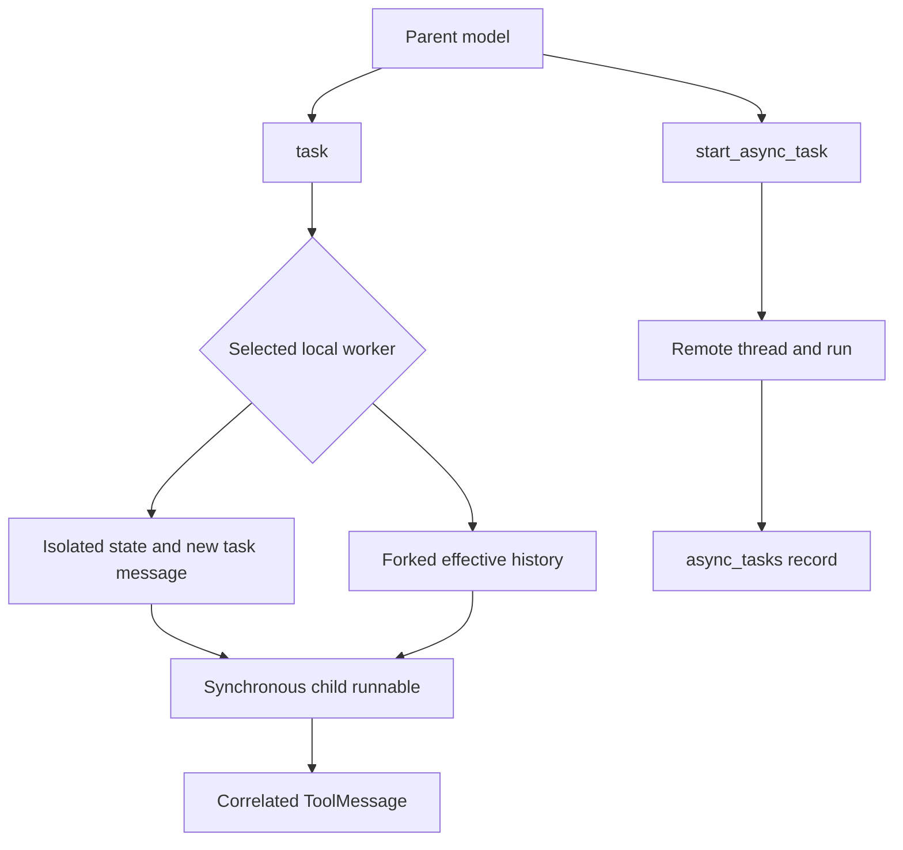
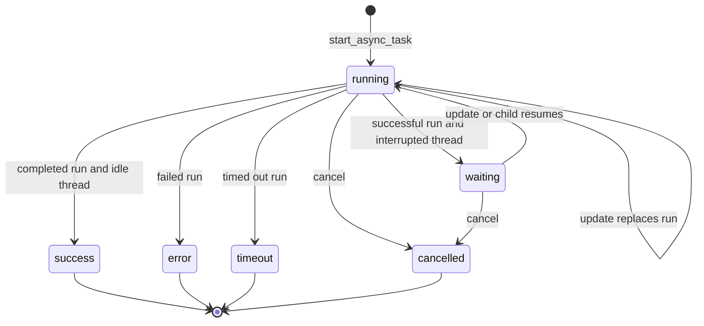
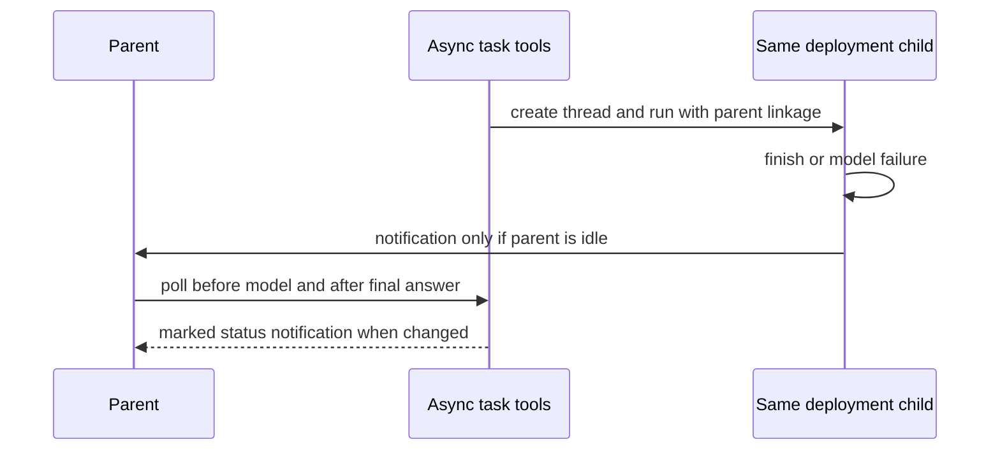

# Subagents and Skills

Deep Agents has two deliberately separate delegation models. The local `task` tool invokes a synchronous child and returns its result within the parent's tool loop. The remote-task tools start an `AsyncSubAgent` on an Agent Protocol server and return a durable task ID so the parent can continue. Neither mechanism is a skills system or an authorization mechanism: skills disclose instructions and, optionally, tool definitions; filesystem permissions and human approval are enforced independently. See [Middleware stack](/openwiki/architecture/middleware-stack.md), [Runtime behavior](/openwiki/architecture/runtime-behavior.md), [State persistence](/openwiki/concepts/state-persistence.md), and [Permissions and HITL](/openwiki/concepts/permissions-hitl.md).

## Assembly and local delegation

`create_deep_agent` classifies `subagents=` entries into declarative `SubAgent` specifications, caller-owned `CompiledSubAgent` runnables, and remote `AsyncSubAgent` specifications. It installs the synchronous and asynchronous middleware independently. Thus an async-only configuration exposes remote-task tools but does not create `task`; a synchronous worker exposes `task` regardless of whether remote workers are configured.

Unless disabled by the active harness profile, the factory supplies a local `general-purpose` worker when no synchronous worker already has that name. A profile may disable it or change its description and prompt. The generated worker uses the parent model, rewritten user tools, resolved filesystem permissions, and resolved approval configuration. A compiled worker remains opaque to the factory and must have a state schema with `messages` to communicate a result.

*Local delegation waits for one child result; remote delegation records work for later observation.*

### Local task boundary

The `task` schema accepts `description` and `subagent_type` (plus injected `runtime`) and rejects model-invented arguments. Duplicate names and invalid modes are rejected during construction; `handoff` is the legacy isolated-mode alias. An unknown type returns a tool error. A tool-call ID is mandatory because the child result is returned as a correlated `ToolMessage`.

Isolated mode is the default. It starts the child with a new `HumanMessage` containing the delegated description, not the parent transcript. Parent-owned values—including messages, todos, structured output, skill metadata and pending pins, skill-tool disclosure state, fork markers, rubric state, and middleware-private fields—are excluded both entering and leaving the child. Values a child returns unchanged are also dropped, avoiding duplicate additive reductions and conflicts from parallel calls.

For declarative workers, omitted `tools`, `permissions`, and `interrupt_on` inherit the parent configuration; an explicitly supplied value replaces its corresponding inherited setting. Filesystem-derived approval rules are merged into the resolved `interrupt_on`. This inheritance applies to local declarative workers, not compiled or remote workers.

A local result is one `ToolMessage`: a non-null `structured_response` is JSON serialized, otherwise the boundary selects the last nonempty child `AIMessage` text. Other changed public state can return, but the transcript, excluded state, and private fields cannot. Invocation uses ambient LangGraph configuration propagation and marks tracing/configurable metadata with `ls_agent_type="subagent"`.

### Experimental forks

`mode="fork"` is context-dependent continuation, not a narrow handoff. Before invoking the child, the boundary removes the parent message containing the pending tool call, applies any summarization event to reconstruct effective history, and appends a preamble plus the delegated description. A declarative fork retains the internal state required to rebuild inherited prompt behavior; an opaque compiled runnable receives only safe public state.

A declarative fork cannot set an independent `skills` list. It inherits parent skill sources and prompt-producing middleware, while its own system prompt is an addendum. A same-named middleware in the fork specification replaces an inherited slot, so an explicit `SkillsMiddleware` can replace the inherited skills slot even though the `skills` field is forbidden. Forks receive a guarded `task` tool, but their fork-state marker makes nested `task` and `atask` calls refuse recursive delegation.

## Remote asynchronous delegation

An `AsyncSubAgent` specifies a name, description, `graph_id`, optional `url` and headers, and `isolated` or experimental `fork` mode. `start_async_task` creates a remote thread and a run, then immediately returns the thread ID as the task ID. Isolated mode sends just one user task. Fork mode serializes a snapshot of reconstructed parent history with local artifacts and eviction metadata removed, and restores blob-backed tool content before serializing it. A fork copies conversation context at launch only: the remote graph still owns its prompt, tools, credentials, approvals, state schema, checkpointer, and durable thread.

*`waiting` is nonterminal: the child thread awaits its own user's answer or approval.*

### Durable state and task tools

The parent owns an `async_tasks` map reduced by task ID. Each record retains the remote thread/task ID, agent name, current run ID, cached status, and creation, check, and update timestamps. Persisting parent state through a checkpointer preserves that map; the Agent Protocol server separately owns the actual remote thread and run.

The middleware provides five tools:

- `start_async_task` creates a thread and run, stores `running`, and returns a task ID.
- `check_async_task` reads the tracked run and returns live status, the final message on success, error detail on failure, or pending interrupts when waiting.
- `update_async_task` interrupts the current run and starts a replacement on the same thread, retaining the task ID and changing the stored run ID.
- `cancel_async_task` cancels an active run and records `cancelled`; a waiting task has no active run and is recorded cancelled directly.
- `list_async_tasks` filters the cached map first, then refreshes nonterminal matching tasks. If an SDK status lookup fails, it retains the cached status.

A successful remote run with an interrupted thread is `waiting`, not `success`. The parent cannot answer that interrupt: the user must resume or approve on the child thread. If another client resumes the child, an observation of a completed recorded run plus a busy or error thread adopts the newest remote run ID. Updating a waiting task replaces its outstanding human request; cancellation prevents later observation of the old interruption from changing it back to waiting.

Unknown types and unknown task IDs return tool errors without mutating tracking state. Clients are cached by URL and resolved headers; `x-auth-scheme: langsmith` is supplied unless configured otherwise. Managed deployments use SDK environment credentials, while `headers` is the self-hosted authentication extension point. URL-less ASGI transport is available only from an async parent entrypoint such as `ainvoke`; synchronous invocation needs a reachable URL.

### Parent linkage and notifications

A launch records a parent thread reference in child-thread metadata. For a URL-less child in the same deployment, it can forward JSON-serializable run context; otherwise it passes `configurable.deepagents_parent`. Same-deployment metadata/reference may include the parent assistant ID, which permits a notification run to wake the parent. A cross-deployment launch omits that assistant ID and retains only the parent thread reference, so it cannot wake a parent in another deployment. Remote workers never inherit the parent's permissions or `interrupt_on`; configure authorization and approvals on their own deployment.

*Wake-up delivery is an optimization for an idle same-deployment parent; durable task polling remains the general contract.*

Every Deep Agent includes `_ParentNotifierMiddleware`. On the asynchronous path, the top-level child reports success with its final content or reports model-call failure once per run. `GraphInterrupt` is re-raised rather than reported. The notifier wakes a parent only when a parent reference includes both thread and assistant IDs and the parent thread is idle or error; it uses a rejecting multitask strategy to avoid replacing a parent that became busy. Delivery failures are logged and swallowed. Its notification is a marked user message whose text is escaped and clipped, whose safe media blocks are retained, and whose failure text omits underlying exception details.

Independently, `AsyncSubAgentMiddleware` polls unfinished tasks at async agent start, before each model call, and after a final answer. A new success, error, timeout, or waiting outcome is added as a marked system notification; an outcome found after a final answer jumps back to the model for another turn. Sync hooks do not poll, so the automatic notification path requires async execution. Recording an arriving notification updates the task record and avoids reporting the same outcome again.

## Skills: instructions and tool disclosure

`SkillsMiddleware` uses backend APIs, not direct filesystem access, to scan configured source directories for child `SKILL.md` files. It parses metadata, loads sources in order, and lets a later same-named skill override an earlier one. The resulting `skills_metadata` list is cached in agent state—including an empty list—until callers set it to `None`. Loading errors are kept separately and rendered as bounded, escaped, untrusted diagnostics. The prompt fragment lists names, descriptions, locations, and full-instruction paths; `system_prompt=None` suppresses that fragment but not loading.

`pinned_skills` is a one-model-call input mechanism. Before the next model call, the middleware resolves distinct requested names in first-seen order, reads each available `SKILL.md`, removes its frontmatter, appends an attributed `HumanMessage` snapshot, and clears the pin list with `Overwrite([])`. Unknown, unreadable, oversized, or non-UTF-8 skills are skipped. A snapshot stays in conversation history, so later source edits do not alter it.

The factory places skills after the compacting/routing portion of the stack and before prompt caching. A custom middleware named exactly `SkillsMiddleware` replaces the default slot. Top-level `skills=` configures the main graph and generated general-purpose worker; isolated declarative workers need their own `skills` or exact-name middleware.

### Tool disclosure is not authorization

A skill can name include groups in `metadata.include_tools`, and `SkillsMiddleware(tools=...)` accepts either fixed tools or a `SkillToolResolver`. Those skill-selected tools are deliberately not placed in the ordinary tool node. A successful `read_file` result for a known skill's `SKILL.md`—including a partial read—or a pinned-skill message can disclose the named tools for a later model request. The middleware records only gated tool names and their producing include name in private `_skill_tools_disclosed`, and writes an empty record when none are disclosed so old checkpoint data cannot authorize a later call.

*The model must first see a tool definition; the recorded disclosure and current resolver result jointly gate execution.*

A resolver is invoked after eligible reads for each model request and again immediately before execution. It may return several tools for one include name. An asynchronous resolver requires an async entrypoint. It should be stable and inexpensive because unstable output can change model input and a tool that has disappeared since disclosure is rejected at execution time.

At tool time, ordinary registered tools take precedence. Otherwise the called name must occur in the latest disclosure record and its include name must still resolve to a tool with that same name. Calls before disclosure, in the triggering turn, after compaction removed their only trigger, or after stale resolver output follow normal invalid-tool handling. When a remaining trigger survives compaction, disclosure is re-anchored to it. This gate controls visibility and availability only: it does **not** confer filesystem access, bypass permission rules, or bypass human-in-the-loop approval.

Models supporting mid-conversation tools receive anchored provider-native definitions after the complete result batch containing the skill read: Anthropic uses `tool_addition` blocks and OpenAI Responses uses developer `additional_tools` items. Other models bind the disclosed tools for the following request. Definitions are withheld when Anthropic would reject a root `oneOf`, `anyOf`, or `allOf` schema, keeping the disclosure record aligned with what the model actually saw.

## Operations and focused tests

Choose an isolated local worker for bounded work with intentionally scoped input. Choose a local fork only when the effective conversation is necessary and its experimental, nonrecursive behavior is acceptable. Choose a compiled worker when another graph owns the implementation. Choose an async worker when remote work should continue while the parent proceeds and can be checked, updated, cancelled, or resumed independently.

Focused async tests cover tool creation and validation, durable map reduction, isolated and fork launch payloads, headers and trace propagation, lifecycle changes, cached-status fallback, waiting-task recovery, cancellation, async-only ASGI constraints, notification escaping and wake-up rules, and polling that returns the model for a new turn. Skills tests should cover source precedence and reload, pins, successful read detection, resolver stability, provider-specific placement, schema rejection, and the execution-time gate. See the [Testing guide](/openwiki/testing/testing-guide.md).

## Related

- [Middleware stack](/openwiki/architecture/middleware-stack.md)
- [Runtime behavior](/openwiki/architecture/runtime-behavior.md)
- [SDK construction and execution](/openwiki/architecture/sdk-construction-execution.md)
- [Permissions and HITL](/openwiki/concepts/permissions-hitl.md)
- [State persistence](/openwiki/concepts/state-persistence.md)
- [Testing guide](/openwiki/testing/testing-guide.md)
