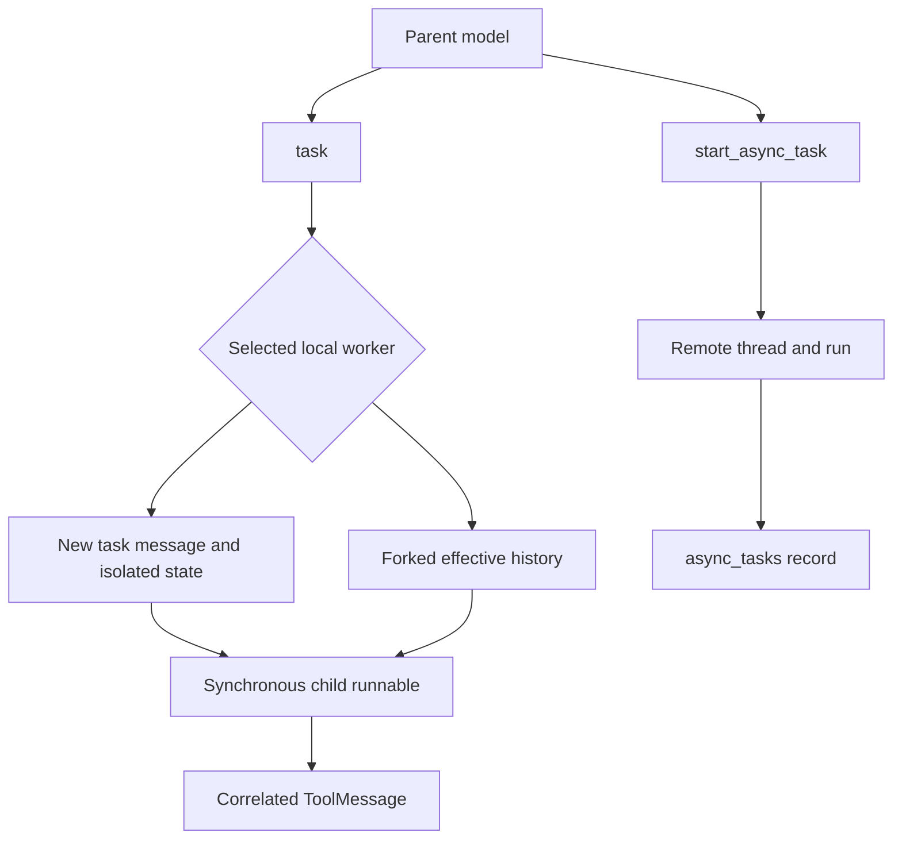
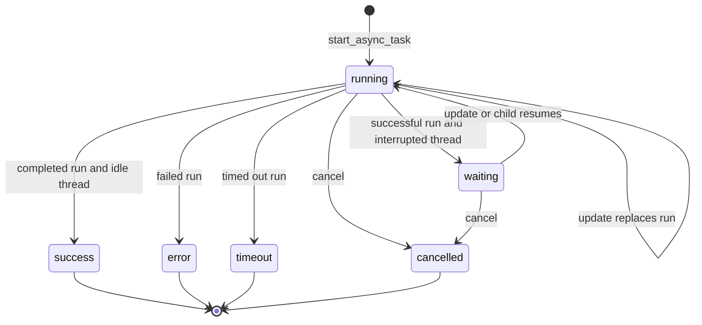
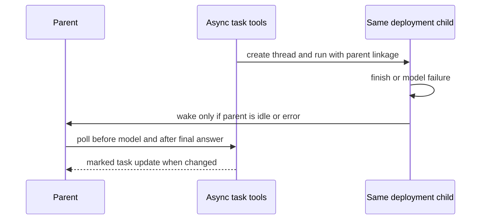
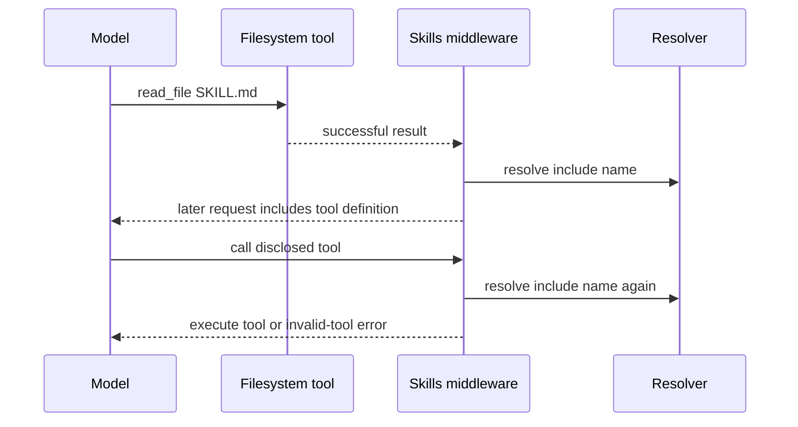

# Subagents and Skills

Deep Agents has two distinct delegation boundaries. The local `task` tool invokes a synchronous child and returns one correlated result in the parent's tool loop. The remote-task tools start an `AsyncSubAgent` on an Agent Protocol server and return a durable task ID so the parent can continue. Skills are a separate progressive-disclosure facility: they reveal instructions and, optionally, tool definitions; they do not grant filesystem access or bypass approval. See [Middleware stack](/openwiki/architecture/middleware-stack.md), [State persistence](/openwiki/concepts/state-persistence.md), and [Permissions and HITL](/openwiki/concepts/permissions-hitl.md).

## Assembly and local delegation

`create_deep_agent` partitions `subagents=` into declarative `SubAgent` specifications, caller-owned `CompiledSubAgent` runnables, and remote `AsyncSubAgent` specifications. It installs the synchronous `SubAgentMiddleware` and `AsyncSubAgentMiddleware` independently. Therefore an async-only configuration exposes remote-task tools but not `task`; synchronous workers expose `task` whether or not remote workers are configured.

Unless the active harness profile disables it or a synchronous worker already uses the name, the factory supplies `general-purpose`. A profile can change that worker's description and prompt. Declarative children are built with resolved model, tools, filesystem permissions, approval configuration, and middleware; a compiled child remains caller-owned and must return state containing `messages` to communicate back.

*Local delegation waits for one child result; remote delegation records work for later observation.*

### Local task boundary

The `task` schema accepts `description` and `subagent_type` (plus injected `runtime`) and rejects model-invented arguments. Construction rejects duplicate names and invalid modes; `handoff` remains the legacy isolated-mode alias. Unknown types produce a tool error. A tool-call ID is mandatory because the result is emitted as a correlated `ToolMessage`.

Isolated mode is the default. The child receives a new `HumanMessage` containing the description, not the parent transcript. Parent-owned state—including messages, todos, structured output, skill metadata and pins, disclosed skill tools, fork markers, rubric state, and middleware-private fields—is excluded on entry and return. Unchanged returned values are also dropped, avoiding duplicate additive reductions and conflicts between parallel calls.

For declarative workers, omitted `tools`, `permissions`, and `interrupt_on` inherit the parent configuration; an explicitly supplied value replaces the respective inherited value. Filesystem-derived approval rules are merged into the resolved `interrupt_on`. Compiled and remote workers do not inherit the parent's `interrupt_on`; configure them independently.

A local result is one `ToolMessage`: a non-null `structured_response` is JSON serialized; otherwise the boundary finds the last nonempty child `AIMessage` text. Changed public state may return, but excluded and private state cannot. Ambient LangGraph configuration propagates to the child, while tracing metadata marks it with `ls_agent_type="subagent"`.

### Experimental forks

`mode="fork"` is a context-dependent continuation rather than a narrow handoff. The boundary removes the parent message containing the pending tool call, applies any summarization event to reconstruct effective history, then appends a preamble and the delegated description. A declarative fork retains internal state required to rebuild inherited prompt behavior; an opaque compiled runnable receives only safe public state.

A declarative fork cannot define an independent `skills` list: it inherits parent skill sources and prompt-producing middleware, with its own system prompt appended as an addendum. A same-named middleware in the fork specification replaces the inherited slot, so an explicit `SkillsMiddleware` may replace the inherited skills slot. Forks receive a guarded `task`, but their fork-state marker rejects nested `task` and `atask` calls to prevent recursive delegation.

## Remote asynchronous delegation

An `AsyncSubAgent` has a name, description, `graph_id`, optional `url` and headers, plus `isolated` or experimental `fork` mode. `start_async_task` creates a remote thread and run, returns the thread ID as the task ID, and stores a `running` record. Isolated mode sends one user task. Fork mode snapshots reconstructed parent history, removes local artifacts and eviction metadata, restores blob-backed tool content, then serializes the snapshot. It copies context only at launch: the remote graph owns its prompt, tools, credentials, approvals, schema, checkpointer, and durable thread.

*`waiting` is nonterminal: the child thread awaits its own user's answer or approval.*

### Durable state and task tools

The parent owns an `async_tasks` map, merge-reduced by task ID. A record holds the task/thread ID, agent name, current run ID, cached status, and creation, check, and update timestamps. A parent checkpointer preserves that state; the Agent Protocol server separately owns the remote thread and run.

The middleware provides five tools:

- `start_async_task` creates a thread and run, records `running`, and returns the task ID.
- `check_async_task` observes the tracked run and returns current status, final output on success, failure detail on error, or pending interrupts when waiting.
- `update_async_task` starts a replacement run on the same thread with `multitask_strategy="interrupt"`; task ID remains stable and run ID changes.
- `cancel_async_task` cancels an active run and records `cancelled`; a waiting task has no active run and is marked cancelled directly.
- `list_async_tasks` filters cached records first, then refreshes the selected nonterminal tasks. A failed SDK lookup retains the cached status.

A successful run whose thread is interrupted is `waiting`, not `success`. The parent cannot answer that interrupt; the child-thread user must resume or approve it. If another client resumes the child, observation can adopt the newest run when the recorded successful run's thread is busy or error. Updating a waiting task replaces the outstanding human request; cancellation prevents the old pause from changing the record back to `waiting`.

Unknown types or task IDs return errors without changing tracked state. Clients are cached by URL and resolved headers; `x-auth-scheme: langsmith` is added unless overridden. Managed deployments use SDK environment credentials, while `headers` is the self-hosted authentication extension. URL-less ASGI transport requires an async parent entrypoint such as `ainvoke`; synchronous invocation requires a reachable URL.

### Parent linkage, wake-ups, and polling

A launch writes the parent thread reference to child-thread metadata. For a same-deployment child, it forwards JSON-serializable run context when available; otherwise it passes `configurable.deepagents_parent`. That reference and metadata can include the parent assistant ID. A cross-deployment launch deliberately removes the assistant ID, retaining only the parent thread reference because it cannot wake a parent on another deployment. Remote workers do not inherit parent permissions or `interrupt_on`.

*Wake-up delivery is an optimization for an idle same-deployment parent; durable task polling is the general contract.*

Every Deep Agent includes `_ParentNotifierMiddleware`. On the asynchronous path, the outermost launched Deep Agent reports success with final content or reports a model-call failure once per run. `GraphInterrupt` is re-raised rather than reported. The notifier wakes a parent only when the reference includes both parent thread and assistant IDs and the parent thread is `idle` or `error`; a rejecting multitask strategy avoids replacing a newly busy parent. Delivery failures are logged and swallowed. Notifications are marked user messages framed as system notifications: text is escaped and clipped, permitted media blocks are retained, and failure text omits underlying exception detail.

Separately, `AsyncSubAgentMiddleware` polls unfinished tasks at asynchronous agent start, before each model call, and after a final answer. A changed success, error, timeout, or waiting result becomes a marked notification message. A notification found after a final answer jumps back to `model` for another turn. The synchronous hooks do not poll, and each poll has a bounded per-task timeout; unavailable tasks are skipped until a later check. Recording a notification that began a run updates the task record so it is not reported again.

## Skills: instructions and tool disclosure

`SkillsMiddleware` uses backend APIs rather than direct filesystem access to find child `SKILL.md` files under configured sources. It loads sources in order, with later same-named skills overriding earlier ones. The resulting `skills_metadata` list, including an empty list, remains cached in state until it is set to `None`. Load errors are retained separately and rendered as bounded, escaped, untrusted diagnostics. The prompt fragment lists metadata and instruction paths and directs the model to read full instructions only when needed; `system_prompt=None` suppresses the fragment but not loading.

`pinned_skills` guarantees input for the next model call. Known distinct skills are resolved in first-seen order; readable `SKILL.md` bodies without frontmatter are appended as attributed `HumanMessage` snapshots, and `pinned_skills` is cleared. Unknown, unreadable, oversized, and non-UTF-8 skills are skipped. Since the snapshot is in history, later source changes do not alter it.

The factory places skills after compaction/routing and before prompt caching. A custom middleware named exactly `SkillsMiddleware` replaces the default slot. Top-level `skills=` configures the main graph and generated general-purpose worker; isolated declarative workers need their own `skills` or exact-name middleware.

### Tool disclosure is not authorization

A skill may list include groups in `metadata.include_tools`; `SkillsMiddleware(tools=...)` accepts fixed tools or a `SkillToolResolver`. Its gated tools are deliberately absent from the ordinary tool node. A successful `read_file` result for a known skill's `SKILL.md`, including a partial read, or a pinned-skill message can disclose the named tools for a later model request. The middleware records only gated tool names and the producing include name in `_skill_tools_disclosed`; it writes an empty record when nothing is disclosed so checkpointed old data cannot authorize a later call.

*The model must first be shown a tool definition; the disclosure record and current resolver result jointly gate execution.*

A resolver runs after eligible reads for each model request and again immediately before execution. It can return several tools for one include name. An asynchronous resolver requires an async entrypoint and should be stable and inexpensive: changed output can alter model input, and a tool no longer returned at execution is rejected.

At tool time, ordinary registered tools take precedence. Otherwise, the requested name must be in the latest disclosure record and the include name must still resolve to a same-named tool. Calls before disclosure, in the triggering turn, after compaction removes the only trigger, or after stale resolver output follow normal invalid-tool handling. A surviving trigger is re-anchored after compaction. This gate controls model visibility and availability only: disclosed tools remain subject to ordinary permission and human-in-the-loop middleware.

For models supporting mid-conversation tools, definitions are anchored after the complete result batch containing the skill read: Anthropic receives `tool_addition` blocks and OpenAI Responses receives developer `additional_tools` blocks. Otherwise, disclosed tools are bound for the following request. Definitions with Anthropic-rejected root `oneOf`, `anyOf`, or `allOf` schemas are withheld so the record matches what the model saw.

## Operations and focused tests

Choose an isolated local worker for bounded work with intentionally scoped input. Use a local fork only when effective conversation is necessary and its experimental, nonrecursive semantics are acceptable. Use a compiled worker when another graph owns implementation. Use an async worker when remote work must continue while the parent proceeds and can later be checked, updated, cancelled, or resumed independently.

`test_async_subagents.py` exercises launch and validation, task-map reduction, isolated and fork payloads, headers and context propagation, lifecycle transitions, cached-status fallback, waiting-task recovery and cancellation, the async-only ASGI constraint, notification wake-up and escaping rules, and polling that gives the model another turn. Skill behavior should be tested for source precedence and reload, pins, successful-read detection, resolver stability, provider placement and schema rejection, plus the execution-time gate. See the [Testing guide](/openwiki/testing/testing-guide.md).

## Related

- [Middleware stack](/openwiki/architecture/middleware-stack.md)
- [SDK construction and execution](/openwiki/architecture/sdk-construction-execution.md)
- [Permissions and HITL](/openwiki/concepts/permissions-hitl.md)
- [State persistence](/openwiki/concepts/state-persistence.md)
- [ACP integration](/openwiki/integrations/acp.md)
- [Testing guide](/openwiki/testing/testing-guide.md)
