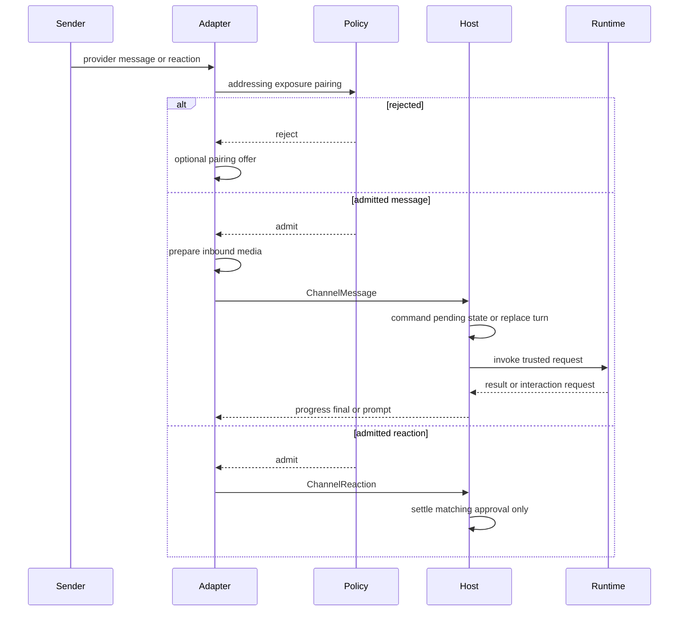

Talon channel adapters are the policy boundary between provider events and an agent turn. An adapter normalizes a provider event into `ChannelMessage` or `ChannelReaction`, applies provider-specific addressing, exposure, and pairing policy, and dispatches only admitted events to the callback installed by `TalonHost`. The host owns conversation identity, commands, pending interaction state, runtime invocation, cancellation, and delivery.

> **Security boundary:** admission controls who may invoke a configured personal agent; it is not tenant isolation or execution containment. `open` lets arbitrary external senders invoke an agent with the host's configured credentials and local access. Pairing grants invocation, not operator authority. Media preparation and voice transcription happen after admission and never authorize a sender.

See [permissions and HITL](/openwiki/concepts/permissions-hitl.md), [Talon scheduling](/openwiki/concepts/talon-scheduling.md), [MCP](/openwiki/integrations/mcp.md), and [the Talon integration](/openwiki/integrations/talon.md).

## Contract and startup lifecycle

`ChannelAdapter` is the transport-neutral lifecycle and delivery contract: `start`, `stop`, host message-handler registration, text/media send and edit, typing, and status. `ChannelMessage` and `ChannelReaction` carry stable, channel-specific conversation and sender identifiers plus adapter metadata. `ReactionChannelAdapter` is optional; only adapters implementing it receive the host's reaction callback.

The host starts the runtime first, binds callbacks before it starts each channel, then starts the scheduler. A failed start unwinds the started scheduler/channels and runtime; shutdown cancels work before stopping channels, scheduler, and runtime.

*Inbound provider policy precedes attachment work and host routing; the host is the only component that creates the runtime request.*

## Admission and provider routing

`ChannelExposure` defaults to `self`: a message must be marked `from_self` or have a configured operator ID. In `allowlist`, configured conversation IDs or text glob patterns are admitted. `open` admits every message, but configuration requires an explicit risk acknowledgement and logs the arbitrary-sender risk. Provider adapters perform these checks before preparing inbound media; Slack and Telegram also independently gate reactions, and Telegram derives `from_self` from the bot identity.

Discord adds an addressing gate for guild traffic: a human message must mention the bot or integration role unless `DEEPAGENTS_TALON_DISCORD_MENTION_OPTIONAL_CHATS` permits that channel. Exposure still applies. Once a top-level guild message is admitted, Discord opens a public thread for the turn and falls back to the parent channel if thread creation fails. Its command registry is shared with the host: hidden commands can still be typed but are neither in help nor registered as Discord application commands. An application interaction is normalized to a `ChannelMessage`, admitted before it is deferred, and routed through a task-local interaction sink.

Pairing is a separate, revocable admission route. It grants a normal sender access but never operator authority: configured operators and allowlisted IDs remain authoritative, `/pair` is handled outside the model, and only an explicitly configured operator may administer it. Pairing records are provider-scoped, codes expire after one hour and are consumed on approval, and corrupt or unreadable persisted state fails closed for paired senders. Revocation removes future paired access and makes a running host cancel the sender's tracked conversations and pause provider-scoped cron jobs.

## Host-owned routing and metadata

For every non-`/help` message, `TalonHost.receive_message` derives a provider-qualified conversation root from the trusted adapter/provider identity and the adapter's channel conversation ID. It locks work by that root and derives the agent conversation ID, including any persisted reset suffix. This prevents equal raw IDs on different providers from sharing a runtime thread.

Adapter metadata is input context, not authority. Before calling the runtime, the host composes metadata from host-owned `channel`, `sender_id`, and `message_id`, then adapter message metadata, then route metadata; the host's fields cannot be overwritten by channel metadata. It also adds host-owned history scope, origin conversation ID, interruption status, model/effort selected by commands, and the computed `tool_approval_operator` flag as appropriate. Channel metadata therefore cannot select the runtime conversation or model, nor grant tool-approval authority.

Within the per-conversation lock, commands have precedence. The host then handles a pending tool-approval response, authorization callback, or interactive question reply before interpreting an ordinary message as a replacement agent turn. This ordering lets a prompt wait for its intended participant without allowing a reply to accidentally start another agent invocation.

## Approval reactions and interactive questions

A reaction being admitted by an adapter is not an approval. The host finds pending approval state only by the provider-qualified conversation/agent thread, then accepts only the configured decision emoji on the prompt message from the sender who initiated the run. Text approvals are bound to that sender too. Mismatches are ignored and audited rather than resolving a pending action.

The `ask_user` tool is a distinct clarification mechanism, explicitly not tool approval. Runtime invocation scopes a request's `question_handler` in a context variable and serializes parallel question batches. The tool is unavailable to subagents or when no handler exists; cancelled or unanswered questions tell the model not to assume an answer.

For an attended channel turn with an identified sender, the host's handler stores a `QuestionSession` for the agent conversation, sends one formatted question at a time, and accepts replies only from that sender. A session supports numbered choices, an `Other` answer, notes, multi-select, `back`, `next`, and `cancel`; answers are limited to 2,000 characters. A failed prompt or follow-up send resolves the handler with no answers so the model is not left waiting. Voice replies to a pending question may be transcribed before parsing, while host checks the same pending session again after transcription to reject a reply whose question closed meanwhile.

Unattended work cannot solicit a person. Background-delivery turns and cron-triggered runtime requests receive no question handler. They also withhold channel approval and authorization handlers; tool-approval authority is false for those turns.

## Replacement, cancellation, and delivery

Each conversation root is serialized. A new ordinary input replaces an active turn: the host increments its generation, cancels the task, and attempts runtime recovery within the same 30-second budget. If cancellation or recovery times out, the agent conversation is blocked rather than allowing potentially inconsistent concurrent turns; a recovery exception permits the replacement but marks its request with `interruption_recovery: failed`.

Result settlement re-enters the conversation lock and compares the turn generation and current agent conversation ID. A stale or cancelled undelivered result is dropped, and its consumed background-subagent result IDs are requeued. Progress sends use the same current-turn checks. Current final text and extracted Markdown media references are sent back to the originating adapter conversation; retryable send failures use exponential backoff.

For ordinary channel turns, the host transcribes eligible downloaded voice, audio, or video before optional runtime inbound-media preparation and model-content construction. It appends a successful transcript to an existing caption (or supplies the empty body), marks `voice_transcribed`, and otherwise keeps the original admitted message. Background-delivery turns skip this preprocessing. Adapters normalize successful local media paths and MIME metadata; failed preparation keeps a deliverable message with `has_media` false and `media_error`. Outbound media validation confines the resolved path to a trusted root and requires a regular file, matching type, and size cap.

## Focused tests and operating guidance

`libs/talon/tests/test_host.py` covers host startup, routing, cancellation/recovery, generation suppression, approval reactions, and metadata boundaries. `libs/talon/tests/test_runtime.py` covers runtime request scoping. `libs/talon/tests/unit_tests/test_questions.py` covers question schema and parsing, serialization, sender binding, failed delivery, voice replies, stale question replies, and the no-question invariant for cron/background work. Provider suites cover their adapter admission and media paths.

1. Prefer `self` or explicit allowlists. Treat `open` as arbitrary invocation, not a sandbox.
2. Treat provider conversation IDs and all adapter metadata as untrusted input. Preserve host ownership of conversation IDs, model selection, and authority flags when adding adapters or route metadata.
3. Do not implement a new reaction type as a generic approval. Bind it to the originating provider, conversation, prompt message, sender, and decision.
4. Keep interactive questions available only on attended, sender-identified turns. A new asynchronous turn type must explicitly decide whether it is attended; cron and background delivery must remain handler-free.
5. On changes to cancellation behavior, retain generation checks and the blocked-on-timeout invariant so a late result cannot leak into a replacement conversation.
