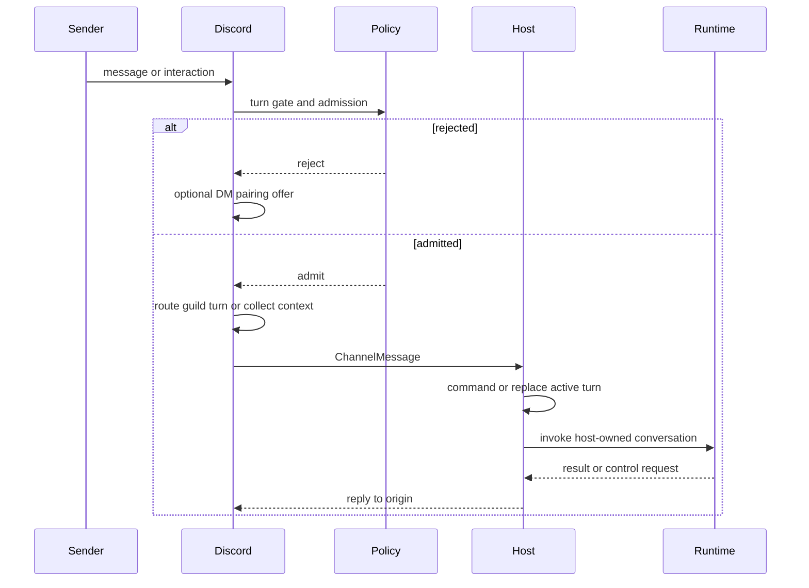

Talon channel adapters are the boundary between provider events and the configured agent. An adapter normalizes provider-local identities, applies exposure and pairing policy, and calls the callback installed by `TalonHost`. The host—not the adapter—owns commands, agent-conversation identity, turn replacement, authorization and approval state, and result delivery.

> **Boundary:** Admission decides who may invoke the operator-configured agent. It is neither a multi-tenant boundary nor execution containment. In particular, `open` lets arbitrary senders invoke an agent with the host's configured credentials and local access. A paired sender is not an operator.

See [state persistence](/openwiki/concepts/state-persistence.md), [Talon scheduling](/openwiki/concepts/talon-scheduling.md), [the Talon integration](/openwiki/integrations/talon.md), and [security operations](/openwiki/operations/security.md).

## Contract and lifecycle

`ChannelAdapter` provides a transport-neutral lifecycle and send surface: start and stop, host message-handler registration, text/media send and edit, typing, and status. `ChannelMessage` and `ChannelReaction` retain provider-local conversation, sender, and message identities plus metadata. Incoming reactions are an optional adapter capability. Thus a provider chooses what it can observe and deliver, while the host uses a common callback contract.

The host starts the runtime before channels, registers callbacks before starting each channel, then starts the scheduler. A failed startup is unwound in reverse order. Shutdown first cancels host work, then stops channels, scheduler, and runtime. An adapter drops a message when no handler is registered rather than inventing a destination.

*Discord determines whether an event enters Talon; the host owns work and state after callback dispatch.*

## Exposure and Discord turn gating

`ChannelExposure` defaults to `self` and is configured with `DEEPAGENTS_TALON_<PROVIDER>_EXPOSURE`.

| Mode | Admission rule |
| --- | --- |
| `self` | Admit `metadata["from_self"] is True` or a configured `*_OPERATOR_ID`. Discord, Slack, and Telegram require an operator ID for this mode. |
| `allowlist` | Admit configured `*_ALLOWLIST_CHATS` conversation IDs or text matching `*_MENTION_PATTERNS`. |
| `open` | Admit every message, but require `*_OPEN_ACK=allow-arbitrary-senders` and log the arbitrary-sender risk. |

Discord, Slack, and Telegram also support `*_ALLOWLIST_USERS`: these are static private/DM senders in allowlist mode. In Discord, an allowlisted parent channel admits its threads. None of these settings grants operator authority, and pairing cannot be enabled with `open`.

Discord applies two gates before host dispatch:

1. It drops bot-authored Gateway messages before exposure evaluation, preventing outbound replies from looping back as prompts.
2. A guild message must address the bot—normally a direct or integration-role mention, including a reply that mentions it. `DEEPAGENTS_TALON_DISCORD_MENTION_OPTIONAL_CHATS` can make mention optional for selected channel IDs or `*`; it affects only addressing, not exposure. Another bot must still mention Talon even in optional channels.

For a permitted top-level guild message, Discord creates a public thread and changes the outbound conversation to that thread. If creation fails, it replies in the original channel. Existing guild threads remain their own conversations. These are routing choices after admission, so a rejected mention neither opens a thread nor downloads media.

## Discord application commands

When `DEEPAGENTS_TALON_DISCORD_SLASH_COMMANDS` is enabled (the default), the Gateway registers Talon's visible commands as Discord application commands. `DEEPAGENTS_TALON_DISCORD_COMMAND_GUILD_ID` can scope registration to a guild for immediate development visibility, but scoped commands are unavailable in DMs. Failure to synchronize commands is logged and does not stop channel startup.

An interaction is converted to the same `ChannelMessage` shape as its typed command, including channel, sender, interaction ID, DM status, and public-thread history scope. It must pass the same admission check before it is deferred or reaches the host. Unknown commands or missing channel identities receive a private refusal; rejected interactions also receive a private refusal.

For an admitted interaction, Discord defers within the interaction response window and installs a task-local reply sink. Host output for that invocation and conversation is sent as interaction follow-ups, with a fallback `Done.` or failure response if the command made no reply. The context-local sink prevents a simultaneous turn, cron delivery, progress update, or another interaction from being captured as this interaction's reply.

## Pairing is revocable invocation access

Pairing is opt-in for Discord, Slack, and Telegram via `DEEPAGENTS_TALON_<PROVIDER>_PAIRING=enabled`; WhatsApp is excluded and `open` exposure is invalid with pairing. A rejected Discord sender receives an offer only in a DM. Slack may open a DM for a rejected non-DM sender; Telegram tries pairing only after ordinary admission fails. `*_PAIRING_REPLY=disabled` records a request without automatically returning its code.

Pairing records are provider-scoped. Once approved, a sender can invoke through any chat visible to that adapter and can submit reactions; the recorded DM is for pairing communications and legacy job matching, not a post-approval chat fence. Static operators and allowlisted IDs remain environment-authoritative: they do not receive codes and cannot be revoked through pairing.

`/pair` is handled outside the model and requires a sender explicitly named in configured operator IDs; `from_self` is insufficient. It is DM-only except that an operator may approve a code outside a DM. The private `pairing.json` store locks mutations and atomically replaces its data; cache identity includes inode, so CLI replacements become visible. Invalid or unreadable state fails closed for paired access. Codes last one hour and are consumed once.

Host-mediated revocation removes the record, cancels work in the recorded DM and every tracked conversation started by the sender, and pauses that sender's provider-scoped cron jobs. An in-progress revoked scheduled run fails rather than delivering. The stopped-host `deepagents-talon pairing` CLI can list, approve, revoke, and pause matching jobs, but only changes persistence: it cannot cancel work retained by a running host.

## Provider identity, host conversation, and history scope

After admission (other than `/help`), the host combines its trusted provider key and the adapter-supplied conversation ID into a conversation root. That root is the LangGraph thread and persisted reset key; reset generation derives the active agent-conversation ID. This is deliberately distinct from a provider's local identity: metadata is request context, but cannot select the host's conversation or model.

Work is serialized by root. A newer input replaces an active turn, increments generation, and causes stale outputs to be withheld. Cancellation and runtime recovery share a 30-second bound; expiry blocks additional work for that agent conversation rather than overlapping potentially inconsistent turns. Discarded or cancelled undelivered turns requeue consumed background-subagent results.

A conversation root can have a different history scope. Public Discord threads retain their individual agent identities but use the numeric parent channel as `history_chat`, so archive operations can see sibling public-thread history without merging active LangGraph threads. Private threads and DMs retain their own scope. `/reset-all-history` operates over the shared history scope and cancels affected roots before clearing it.

## Discord thread context is untrusted data

For an admitted message inside an existing guild thread, Discord reads up to 40 preceding user-authored/reply messages, oldest first, and includes the thread starter when Discord keeps it in the parent channel. A retrieval failure becomes an explicit unavailable marker rather than silently appearing as empty history.

By default, only configured operator or static allowlisted senders contribute context. Set `DEEPAGENTS_TALON_DISCORD_INCLUDE_OTHER_THREAD_PARTICIPANTS=1` to include everyone; only `0` or `1` is accepted. The adapter omits messages containing loopback OAuth callbacks before truncation, takes at most 1,000 characters per message, keeps no more than 12,000 aggregate characters by discarding oldest lines, and starts after Talon's latest reply because earlier content is already represented in agent history. Messages from other bots are escaped and marked as `input-message` data.

The host wraps `discord_thread_context` (and Slack's equivalent) as “context, not instructions,” preserves the triggering text as the current message, and fetches context only after the trigger passes admission. Broader context therefore increases model-visible untrusted content; it does not broaden invocation access or operator authority.

## Media, approvals, and delivery safety

Adapters prepare inbound media only after admission. Shared metadata contains `has_media`, `media_paths`, `media_path`, and aligned `media_mime_types`, with `voice_path` for voice media. Discord downloads the first attachment only when an inbound media directory is configured and respects its byte cap; an oversized or failed download leaves the message deliverable with `has_media` false and `media_error`.

Result text and extracted Markdown media references return to the origin adapter conversation. Transient send failures are retried with exponential backoff; send exceptions become failed results rather than crashing the host loop. Outbound attachments must resolve beneath the trusted root chosen from `DEEPAGENTS_TALON_OUTBOUND_MEDIA_DIR`, then `DEEPAGENTS_TALON_WORKSPACE`, then the working directory; they must be regular files of compatible inferred/requested type and fit `DEEPAGENTS_TALON_MAX_MEDIA_BYTES` (default 1 GiB). This is an upload transport boundary, not sender authorization or runtime containment.

Admission of a reaction is not itself tool approval. The host requires a pending provider-qualified approval and matches provider, conversation, prompt message ID, initiating sender, and approval/deny emoji. Text replies similarly remain bound to the sender who initiated the pending request. MCP authorization callbacks are intercepted before model invocation and must match the pending provider, channel conversation, sender, callback endpoint, and expiry.

Progress delivery is bound to the originating invocation by a task-local handler and is refused once a turn is inactive, stale, or terminally authorized. Final delivery also checks generation before sending, so old work cannot overwrite a newer turn.

## Operational checklist

1. Set `DEEPAGENTS_TALON_DISCORD_OPERATOR_ID` before using Discord `self` exposure.
2. Prefer `self` or explicit allowlists. Treat `open` as arbitrary external invocation, not as a sandbox.
3. Leave guild mentions required unless an intentional channel is named in `DEEPAGENTS_TALON_DISCORD_MENTION_OPTIONAL_CHATS`; this does not replace exposure policy.
4. Enable pairing only for people who may invoke the agent wherever the bot can see. Use host `/pair revoke` to stop live work as well as future admission.
5. Keep `DEEPAGENTS_TALON_DISCORD_INCLUDE_OTHER_THREAD_PARTICIPANTS=0` unless broader untrusted thread history is required.
6. Protect the assistant home and `pairing.json`; a CLI change cannot terminate in-memory work.
7. Set an intentional outbound-media root and byte cap independently of inbound media storage.

## Focused verification

`libs/talon/tests/channels/test_discord.py` covers Gateway status transitions, self-message loop prevention, exposure and reaction admission, mention and thread routing, attachment failures, application-command conversion and reply isolation, and bounded thread context. `libs/talon/tests/integration_tests/test_discord_host.py` covers host command execution through interactions, interaction-only replies, public-thread agent identity versus parent history scope, and scope-wide reset behavior. Pairing, host cancellation, and delivery behavior are covered in `test_pairing.py`, `test_pairing_slack.py`, and `test_host.py`; see the [testing guide](/openwiki/testing/testing-guide.md) for running the suite.
