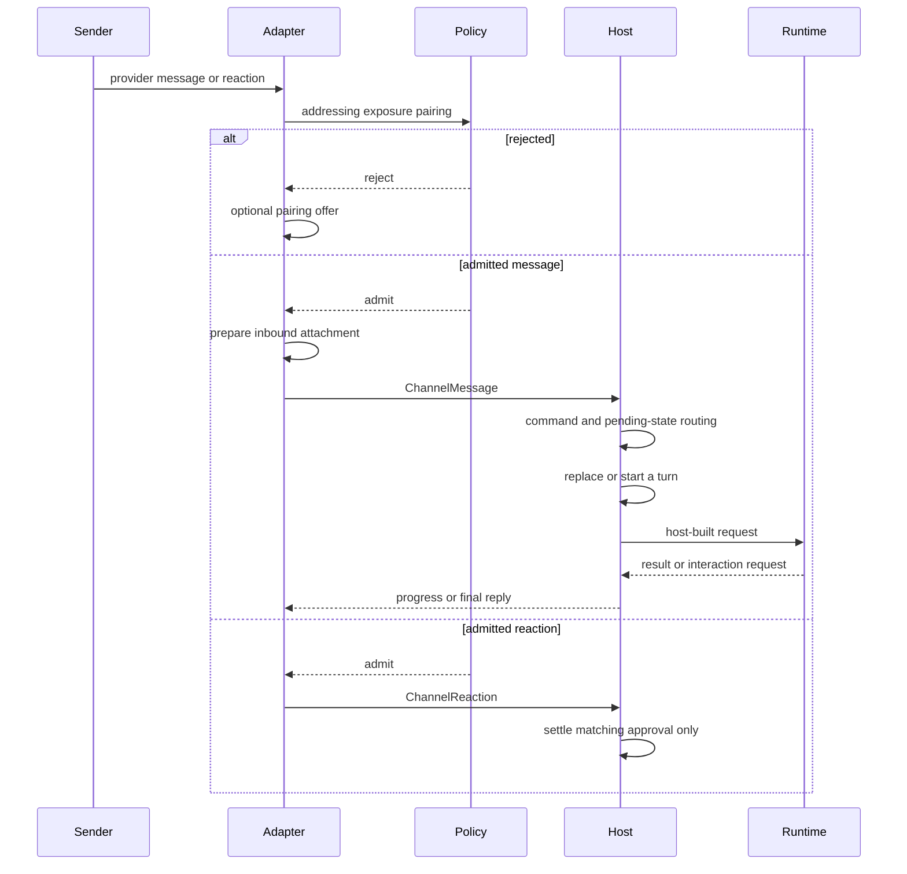

Talon channel adapters are the policy boundary between provider events and an agent turn. An adapter normalizes a provider event into `ChannelMessage` or `ChannelReaction`, applies provider-specific addressing, exposure, and pairing policy, prepares admitted attachments, and dispatches only admitted events to the callback installed by `TalonHost`. The host—not the adapter—owns commands, conversation identity, pending interaction state, model and effort selection, runtime invocation, cancellation, delivery, and turn-state cleanup.

> **Security boundary:** admission controls who may invoke a configured personal agent; it is not tenant isolation or execution containment. `open` lets arbitrary external senders invoke an agent with the host's configured credentials and local access. Pairing grants invocation, not operator authority. Attachment preparation and voice transcription happen after admission and never authorize a sender.

See [profiles and models](/openwiki/concepts/profiles-models.md), [Talon scheduling](/openwiki/concepts/talon-scheduling.md), [the Talon integration](/openwiki/integrations/talon.md), and [security operations](/openwiki/operations/security.md).

## Contract and component lifecycle

`ChannelAdapter` is the transport-neutral contract for lifecycle, handler registration, text and media delivery, editing, typing, and status. `ChannelMessage` and `ChannelReaction` carry stable channel-specific conversation and sender identities plus adapter metadata. Reactions are optional: only a `ReactionChannelAdapter` receives the host reaction callback.

`TalonHost.start()` ensures the home and starts the runtime, binds callbacks before starting each channel, then starts the scheduler after the channels are live. It records a channel *before* calling `start()`, so an adapter that raises after opening a subprocess or polling task is included in reverse-order startup unwind. A failed start stops the scheduler if it started, all attempted channels, and the runtime. Normal shutdown stops the background loop, cancels work, then stops channels, scheduler, and runtime; a failed stop is logged without preventing later cleanup.

*Adapters admit and prepare a provider event before dispatch; the host controls the authority-bearing request and the turn lifecycle.*

## Adapter admission and pairing

`ChannelExposure` defaults to `self`: `from_self` or a configured operator ID is admitted. In `allowlist`, configured conversation IDs or text glob patterns are admitted. `open` admits every message, but requires an explicit risk acknowledgement and logs that arbitrary senders can invoke the agent with host access. Discord, Slack, and Telegram apply exposure or pairing before preparing inbound media; Slack and Telegram also gate reactions independently, while Telegram derives `from_self` from the bot identity.

Discord adds a guild-addressing gate: a human message must mention the bot or its integration role unless `DEEPAGENTS_TALON_DISCORD_MENTION_OPTIONAL_CHATS` permits that channel. After a top-level guild message is admitted, Discord opens a public thread for the turn, falling back to the parent channel if thread creation fails. An application interaction is normalized to a `ChannelMessage`, checked for admission before it is deferred, and uses a task-local interaction sink so concurrent output cannot be captured by the wrong interaction.

Pairing is a separate, revocable admission route. It grants normal sender invocation but never operator authority: environment-configured operators and allowlisted IDs remain authoritative, `/pair` is handled outside the model, and only an explicitly configured operator may administer it. Pairing records are provider-scoped; codes expire after one hour and are consumed on approval. Store mutations are locked and atomically replaced, while unreadable or invalid persisted state fails closed. Revocation removes future paired access, cancels the sender's tracked conversations, and pauses that sender's provider-scoped cron jobs.

## Commands, context, and pending interactions

The shared command registry supplies host-visible definitions, help text, and Discord's visible application-command set. Hidden commands remain typeable but are excluded from help and platform registration. The host dispatches recognized commands before ordinary turns and before treating text as an approval, authorization callback, or `ask_user` reply. `/model` and `/effort` changes require operator authority; the host, rather than channel metadata, captures their selected values for later `AgentRequest` instances.

For a non-`/help` message, `receive_message` derives a provider-qualified conversation root from the trusted channel identity and the adapter conversation ID, serializes work by that root, and derives the agent conversation ID including any persisted reset suffix. It keeps the original channel ID as the reply destination. Adapter metadata is request context, not authority to select a conversation, model, or operator privilege; host and route values overwrite authority-bearing fields.

An admitted reaction is not automatically an approval. The host resolves it only against the pending approval for the matching provider-qualified conversation, prompt, sender, and accepted decision emoji. `ask_user` is separately request-scoped and serialized, unavailable to subagents or when no handler exists, and distinguishes unanswered questions from tool approval. For an identified attended sender, the host persists a `QuestionSession` and accepts replies only from that sender; failed delivery ends it without answers, and a transcribed voice reply is checked against the still-current session. Cron and background-delivery work are unattended: question, approval, and authorization handlers are withheld and operator authority for tool approval is false.

## Attachment boundary and model input

Adapters normalize successfully downloaded attachment paths and MIME metadata. If preparation fails, they retain a deliverable message but set `has_media` false and record `media_error`; the host turns that condition into a generic "Attachment was unavailable" notice without exposing error details. This keeps a download failure from suppressing the sender's text.

Inbound attachment metadata is data, not instructions. Document attachments become a JSON-escaped path notice telling the model that both attachment and path are untrusted; document bytes are not inlined into the prompt. Runtime sandbox staging revalidates a document path against configured inbound roots after symlink resolution, opens it without following symlinks, requires a bounded regular file, and enforces the configured byte cap before uploading it. Images may become base64 model-content blocks only when their MIME is image-like and their local size is at most 5 MiB; inaccessible or oversized images are omitted. Video and other binary media are represented as path notices rather than injected bytes.

Outbound attachment paths are a distinct trusted-root boundary. `validate_media` resolves paths under the configured outbound root (or workspace/cwd default), rejects URL, home-expansion, parent-traversal, symlink-escape, missing, and non-regular paths, verifies that the extension-derived supported image/video type matches the requested type, and applies the configured `DEEPAGENTS_TALON_MAX_MEDIA_BYTES` cap (1 GiB by default). Adapters call this before their provider upload.

## Turn replacement, delivery, and cleanup

A new ordinary input replaces an active turn for its conversation: the host increments the generation, cancels the task, and attempts runtime recovery within the same 30-second budget. A cancellation or recovery timeout blocks further work for that agent conversation; a recovery exception permits the replacement but marks it `interruption_recovery: failed`. Stale or cancelled undelivered turns requeue their consumed background-subagent results.

Settlement reacquires the conversation lock and compares both generation and current agent conversation ID. A stale result is dropped; a current result is sent to the origin conversation with transient failures retried using exponential backoff. Markdown image references in result text remain ordinary text—they are not implicitly converted into outbound uploads. Ordinary channel turns transcribe eligible downloaded voice, audio, or video before optional runtime media preparation and model-content construction. A successful transcript appends to a caption or supplies the body and sets `voice_transcribed`; missing, empty, or failed transcription retains the admitted message. Background-delivery turns skip this preprocessing.

Each created turn is tracked in both the current-task map and a per-conversation task set. Completion removes the task from that set; once the conversation lock has no holders or waiters, the host drops idle task, generation, and sender state unless active work, background routing, a block, approval, question, or authorization state still needs it. Thus completed ordinary conversations do not accumulate in-memory turn bookkeeping, while interactive or background state remains reachable until it settles.

## Change and test guidance

- Add or change a command in `CHAT_COMMANDS`, not in a provider-specific list. Preserve visibility and argument metadata so typed help and Discord registration cannot drift.
- Preserve adapter-before-media ordering and host ownership of conversation keys, selection, and authority flags. Do not trust attachment paths from a new adapter merely because they are metadata.
- Preserve command and pending-state precedence. A reply intended for approval, authorization, or `ask_user` must not launch an ordinary turn.
- Keep generation checks, background-result requeueing, cancellation blocking, and idle-state cleanup when changing task management or delivery.
- `libs/talon/tests/test_host.py` covers startup unwind, shutdown cleanup, channel-keyed routing, media model input, cancellation, delivery, and reclamation of finished conversation state. `libs/talon/tests/test_media.py` covers untrusted document notices, image conversion limits, unsafe-path rejection, and symlink escapes. `libs/talon/tests/channels/test_base.py` covers outbound root, type, and byte-cap validation.
