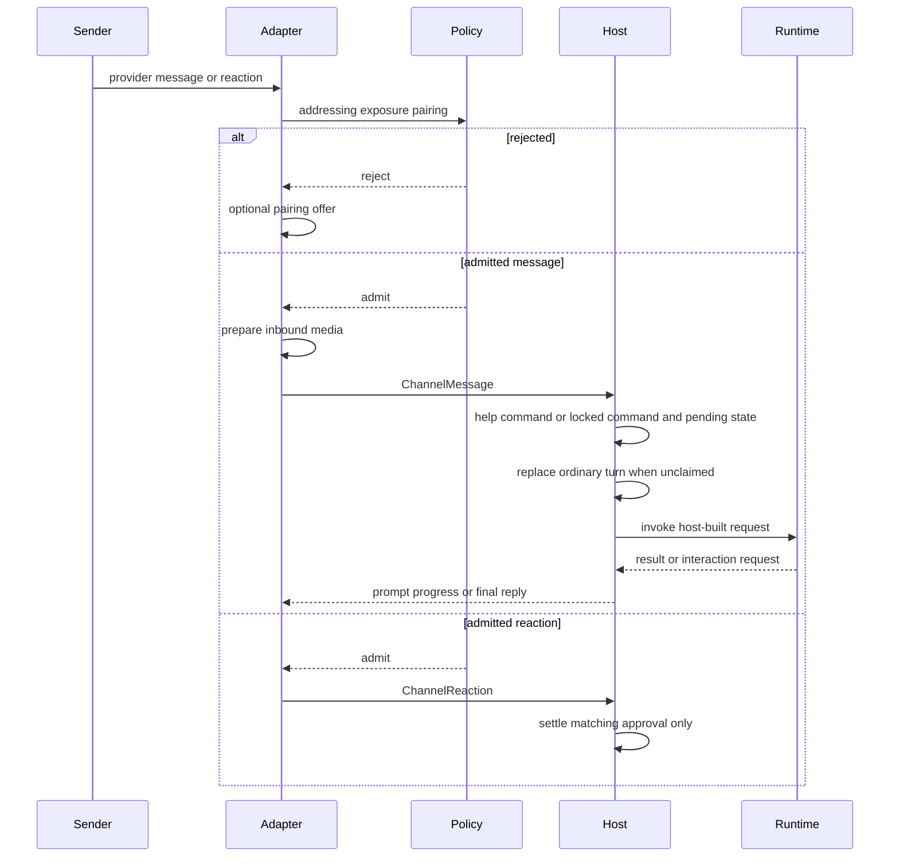

Talon channel adapters are the policy boundary between provider events and an agent turn. An adapter normalizes a provider event into `ChannelMessage` or `ChannelReaction`, applies provider-specific addressing, exposure, and pairing policy, and dispatches only admitted events to the callback installed by `TalonHost`. The host—not the adapter—owns command dispatch, conversation identity, pending interaction state, model and effort selection, runtime invocation, cancellation, and delivery.

> **Security boundary:** admission controls who may invoke a configured personal agent; it is not tenant isolation or execution containment. `open` lets arbitrary external senders invoke an agent with the host's configured credentials and local access. Pairing grants invocation, not operator authority. Media preparation and voice transcription happen after admission and never authorize a sender.

See [profiles and models](/openwiki/concepts/profiles-models.md), [Talon scheduling](/openwiki/concepts/talon-scheduling.md), [the Talon integration](/openwiki/integrations/talon.md), and [security operations](/openwiki/operations/security.md).

## Contract and host lifecycle

`ChannelAdapter` is the transport-neutral lifecycle and delivery contract: `start`, `stop`, host message-handler registration, text/media send and edit, typing, and status. `ChannelMessage` and `ChannelReaction` carry stable, channel-specific conversation and sender identifiers plus adapter metadata. `ReactionChannelAdapter` is optional; only adapters implementing it receive the host's reaction callback.

`TalonHost.start()` ensures the home, starts the runtime, binds callbacks before starting each channel, and starts the scheduler only after channels are live. A channel is recorded before its `start()` call, so even a channel that fails partway through startup is stopped during unwind. On any startup failure, the scheduler if started, all attempted channels in reverse order, and the runtime are stopped. During normal shutdown the host first stops its background loop and cancels in-flight work, then stops channels in reverse order, the scheduler, and the runtime; a failure to stop one component is logged without preventing cleanup of the others.

*Admission and attachment preparation occur before host routing. The host alone builds the runtime request and controls its authority-bearing fields.*

## Adapter admission

`ChannelExposure` defaults to `self`: a message must be marked `from_self` or have a configured operator ID. In `allowlist`, configured conversation IDs or text glob patterns are admitted. `open` admits every message, but configuration requires an explicit risk acknowledgement and logs the arbitrary-sender risk. Provider adapters perform these checks before preparing inbound media; Slack and Telegram also independently gate reactions, and Telegram derives `from_self` from the bot identity.

Discord adds an addressing gate for guild traffic: a human message must mention the bot or integration role unless `DEEPAGENTS_TALON_DISCORD_MENTION_OPTIONAL_CHATS` permits that channel. Exposure still applies. Once a top-level guild message is admitted, Discord opens a public thread for the turn and falls back to the parent channel if thread creation fails. Discord converts an application interaction to an equivalent `ChannelMessage`, verifies admission before deferring it, and uses a task-local interaction sink so a concurrent reply cannot be captured by the wrong interaction.

Pairing is a separate, revocable admission route. It grants a normal sender access but never operator authority: configured operators and allowlisted IDs remain authoritative, `/pair` is handled outside the model, and only an explicitly configured operator may administer it. Pairing records are provider-scoped, codes expire after one hour and are consumed on approval, and corrupt or unreadable persisted state fails closed for paired senders. Revocation removes future paired access and makes a running host cancel the sender's tracked conversations and pause provider-scoped cron jobs.

## One command registry, host-owned controls

`deepagents_talon.commands` is deliberately independent of host and adapters and is the single registry for command names, summaries, visibility, and optional free-text arguments. It currently defines `/help`, `/new`, `/stop`, `/mcp-reload`, `/reset-all-history`, `/context-doctor`, `/pair`, `/model`, and `/effort`. `/reset-all-history` and `/pair` are hidden: they remain typeable and host-dispatched, but are omitted from `/help` and platform registration. This avoids advertising an irreversible history deletion or a pairing administration command that cannot be expressed as a bare platform command.

The host parses a typed command before creating ordinary work. `/help` returns immediately; other recognized commands execute while holding the conversation lock, ahead of an approval, authorization callback, question reply, or replacement turn. `/new` and `/stop` cancel relevant work, `/mcp-reload` and `/context-doctor` use optional runtime capabilities, and `/pair` is an operator-only control path. Commands therefore do not reach the model as ordinary prompts.

Discord builds its visible application-command tree from that same registry and registers only visible entries. Application commands carry the registry's optional argument definition, then are normalized and passed through the same admission and host dispatch path as typed commands. A failed command sync is logged but does not stop the channel.

`/model` can show the current model, list the available catalog, or switch all chats to a credentialed runtime-supported `provider:model`; only an operator can change it. The host validates and persists a successful global selection and snapshots it in each new turn, so a switch made while a turn is already starting applies to a later turn. `/effort` similarly displays or changes supported reasoning effort for the selected model; changes are operator-only, stored per model, and captured when a turn begins. The adapter cannot choose either value: `AgentRequest.model` and `AgentRequest.effort` are host-set fields.

## Routing, context, and interactive state

For every non-`/help` message, `TalonHost.receive_message` derives a provider-qualified conversation root from the trusted adapter/provider identity and the adapter's channel conversation ID. It serializes work by that root and derives the agent conversation ID, including any persisted reset suffix. This prevents equal raw IDs on different providers from sharing a runtime thread. The host retains the channel conversation ID separately as the reply destination.

Adapter metadata is context, not the source of conversation or selection authority. The host derives the conversation ID, captures the selected model and effort, and calculates `tool_approval_operator` independently. It adds routing values such as history scope and origin conversation ID when appropriate; the final invocation forces tool-approval authority false for cron and background delivery. Adapter authors must not treat inbound metadata as a way to select a thread, model, or operator privilege.

A reaction being admitted by an adapter is not an approval. The host resolves it only against a pending approval for the provider-qualified conversation and accepts only an allowed decision emoji on the approval prompt from the sender who started the run. Text approvals are bound to that sender as well. Mismatches are ignored and audited rather than resolving a pending action.

The `ask_user` tool is distinct from tool approval. Runtime invocation scopes a request's `question_handler` and serializes question batches. The tool is unavailable to subagents or without a handler; cancelled or unanswered questions instruct the model not to assume an answer. For an attended channel turn with an identified sender, the host persists a `QuestionSession`, prompts one question at a time, and accepts replies only from that sender. Failed prompt delivery ends the session without answers; voice replies are rechecked against the current session after transcription. Cron and background-delivery work are unattended, so they receive no question, approval, or authorization handler.

## Replacement and delivery

Each conversation root is serialized. A new ordinary input replaces an active turn: the host increments its generation, cancels the task, and attempts runtime recovery within the same 30-second budget. If cancellation or recovery times out, the agent conversation is blocked rather than allowing potentially inconsistent concurrent turns; a recovery exception allows the replacement but marks it with `interruption_recovery: failed`.

Result settlement re-enters the conversation lock and compares the turn generation and current agent conversation ID. A stale or cancelled undelivered result is dropped, and its consumed background-subagent result IDs are requeued. Progress sends use equivalent current-turn checks. Current final text and extracted Markdown media references are sent to the originating adapter conversation; retryable send failures use exponential backoff.

For ordinary channel turns, the host transcribes eligible downloaded voice, audio, or video before optional runtime inbound-media preparation and model-content construction. It appends a successful transcript to an existing caption or supplies the message body, marks `voice_transcribed`, and otherwise keeps the original admitted message. Background-delivery turns skip transcription. Adapters normalize successful local media paths and MIME metadata; failed preparation keeps a deliverable message with `has_media` false and `media_error`. Outbound media validation confines resolved paths to a trusted root and requires a regular file, matching type, and size cap.

## Change and test guidance

- Add or change a command in `CHAT_COMMANDS`, not in a provider-specific list. Preserve its visibility and argument metadata so help, typed dispatch, and Discord registration cannot drift.
- Keep host ownership of conversation keys, request model/effort, and authority flags. Treat adapter IDs and metadata as untrusted transport input.
- Preserve the command and pending-state precedence ordering. A reply intended for approval, authorization, or `ask_user` must not accidentally launch an ordinary turn.
- Keep generation checks and the blocked-on-cancellation-timeout invariant when changing cancellation or delivery.
- `libs/talon/tests/test_host.py` exercises startup unwind, shutdown cleanup, routing, cancellation/recovery, generation suppression, approvals, and metadata boundaries. `libs/talon/tests/unit_tests/test_model_selection.py` verifies operator-gated selection, persistence, turn capture, available-model validation, and selected-model runtime behavior. Provider tests cover admission and application-command registration; question and effort unit suites cover their respective interactive and per-turn settings behavior.
