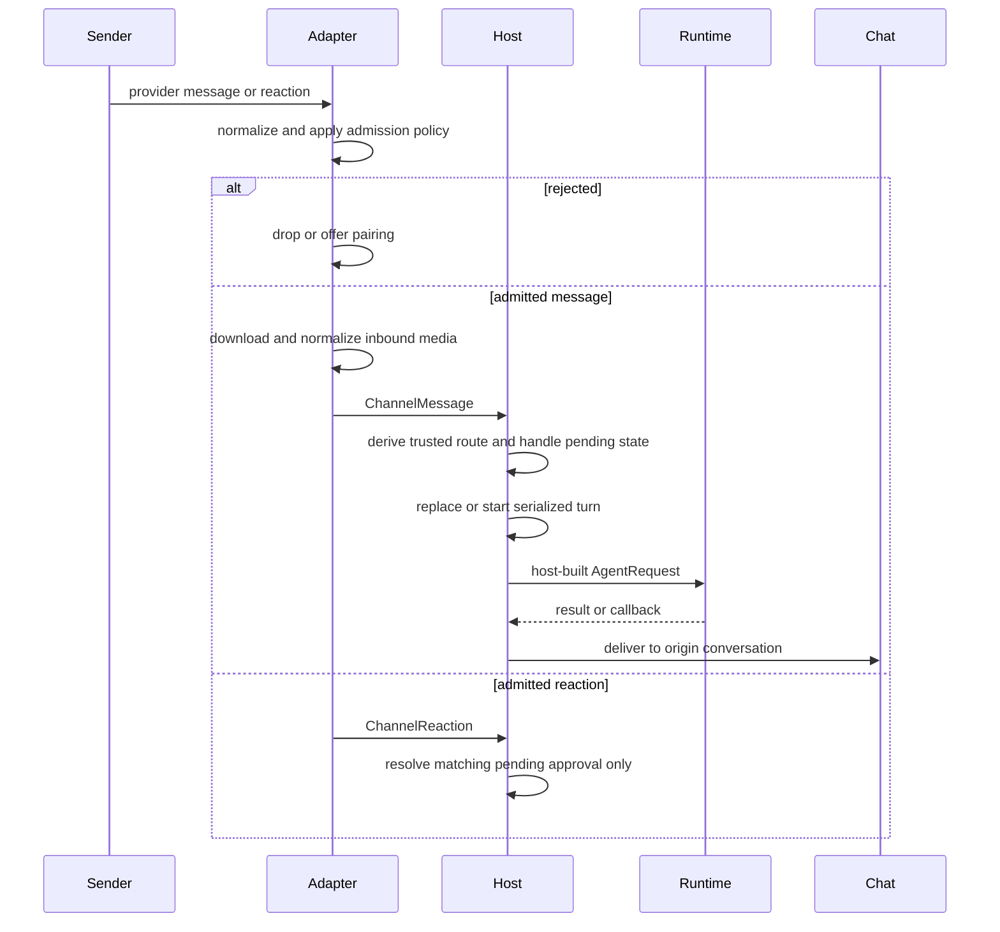

Talon channel admission is the boundary between a provider event and a host-managed agent turn. An adapter turns an eligible provider message or reaction into transport-neutral data and dispatches it to `TalonHost`; the host decides what that event can do. In particular, the adapter does **not** get to select the agent conversation, model, effort, operator authority, or delivery lifecycle.

> **Scope:** channel admission controls who may invoke a configured agent. It is not tenant isolation or execution containment. In particular, `open` exposure permits arbitrary senders to invoke an agent that has the host's configured credentials and local access.

See [Talon integration](/openwiki/integrations/talon.md), [runtime behavior](/openwiki/architecture/runtime-behavior.md), [security operations](/openwiki/operations/security.md), and [testing guide](/openwiki/testing/testing-guide.md).

## Contract and ownership

`ChannelAdapter` supplies lifecycle, inbound-handler registration, text/media delivery and editing, typing, and status. Its common inbound values are immutable `ChannelMessage` and `ChannelReaction`, carrying a provider-local conversation ID, sender identity, optional message ID, and metadata. Reactions are optional: the host only registers a reaction callback with adapters that implement `ReactionChannelAdapter`.

`AgentRequest` is a host-to-runtime contract. Along with text and host-selected `conversation_id`, `model`, and `effort`, it can carry request-scoped callbacks for progress, approval, authorization, questions, breakout work, and sending a file. The `FileSendHandler` accepts file bytes, a display name, and an optional caption; it is not an adapter-supplied capability.

*Adapters admit and normalize provider events; the host owns authority-bearing request fields and delivery.*

## Adapter admission and normalized input

Shared `ChannelExposure` defaults to `self`, which admits messages marked `from_self` or sent by configured operator IDs. `allowlist` admits configured conversation IDs or message-text glob patterns. `open` admits every message, but configuration requires the explicit `allow-arbitrary-senders` acknowledgement and logs the arbitrary-sender risk.

Discord, Slack, and Telegram apply exposure or pairing before they download inbound attachments; WhatsApp first parses bridge-provided normalized paths, applies exposure, then enforces its inbound size cap before dispatch. This ordering avoids fetching provider media for rejected Discord, Slack, and Telegram events. Discord also ignores its own gateway echoes before exposure checks, requires guild messages to address the bot unless a configured mention-optional channel allows a human message, and creates a public thread only after the message is admitted. Reactions are independently admitted and are merely candidates for a host-side pending approval, not approvals by themselves.

A successful downloaded attachment is normalized into `media_paths`, `media_path`, aligned MIME metadata, and—for voice—`voice_path`. Discord and Slack keep successfully downloaded attachments even when others fail and record `media_error`; Telegram retains a deliverable message with `has_media` false and `media_error` when its download fails. The host later turns an unavailable attachment into a generic notice, rather than exposing the provider/download failure to the model.

## Host-built request and turn replacement

On receipt, the host obtains the provider identity from the adapter and combines it with the adapter's provider-local conversation ID to form a conversation root. It serializes work under that root, derives the current agent conversation ID (including a reset suffix when applicable), and preserves the original channel ID as the reply target. Commands and pending approval, authorization, and question handling take precedence over a normal turn.

Before invoking the runtime, the host builds metadata from normalized message context and host route context, with host route fields applied last. It separately supplies the host-derived conversation ID, selected model, effort, delivery callbacks, and operator flag. Consequently, adapter metadata is contextual input, not a way to restate authority-bearing request fields.

A newer ordinary input replaces a running turn for the same agent conversation. The host increments its generation, cancels the task, and allows cancellation plus runtime interruption recovery a shared 30-second budget. A timeout blocks further work for that conversation; a recovery exception permits the replacement but marks it degraded. Delivery and progress callbacks check generation and current conversation identity so a superseded turn cannot post into the chat.

## Inbound attachments are not outbound uploads

Inbound paths originate with an adapter or WhatsApp bridge and must be treated as untrusted. For document input, Talon adds a JSON-escaped path notice that explicitly tells the model that the attachment and its path are data rather than instructions; it does not inline document bytes in the prompt. When a remote runtime needs documents, its staging step revalidates containment under an inbound media root after resolution, opens without following symlinks, requires a bounded regular file, and enforces the configured size cap before uploading bytes to the sandbox. Eligible images can become base64 model-content blocks only when image MIME handling succeeds and the local file is no larger than 5 MiB.

Outbound provider media is a separate boundary: adapters validate a `ChannelMedia` path against their configured outbound root, require a regular contained file, require its recognized type to match the requested category, and enforce `DEEPAGENTS_TALON_MAX_MEDIA_BYTES` (1 GiB by default). Do not weaken this because inbound media was already downloaded: inbound-root acceptance does not authorize an outbound upload.

## Per-turn `send_file`

The `send_file` tool reads through the active agent backend, so it works for either local workspaces or remote sandboxes. It is unavailable to subagents and to requests with no chat-bound handler; it reads at most the configured tool limit and returns a generic failure message rather than provider transport detail.

For an attended channel turn, the host binds a file handler to the exact origin channel and conversation and refuses delivery after that turn no longer reaches its chat. The handler stages supplied bytes in a fresh private directory below the outbound staging root, sanitizes the recipient-facing file name, writes using exclusive no-follow creation with mode `0600`, selects a channel media category from the staged name, retries the adapter upload, and removes the staging directory whether upload succeeds or fails. This is intentionally different from an adapter's path-based outbound upload validation: the host has already materialized bounded bytes in its own private staging location before calling `send_media`.

## Change and test guidance

- Preserve admission-before-download ordering for adapters that fetch provider media. A new adapter should normalize only local paths and MIME metadata, never provider URLs as model input.
- Treat `ChannelMessage.metadata` as untrusted context. Keep provider qualification, conversation IDs, selected model/effort, callback binding, and delivery decisions in `TalonHost`.
- Preserve generation checks on progress, final results, and file delivery when changing turn cancellation or routing.
- Keep inbound document staging and outbound uploads separate: each needs its own root containment, regular-file, and byte-limit checks.
- Focused coverage includes `libs/talon/tests/unit_tests/test_discord_attachments.py` for admission before attachment dispatch and partial failures, `libs/talon/tests/channels/test_telegram.py` and `libs/talon/tests/channels/test_whatsapp.py` for provider normalization and limits, `libs/talon/tests/channels/test_base.py` for exposure and outbound validation, and `libs/talon/tests/unit_tests/test_file_sending.py` for scoped delivery, filename handling, private staging, cleanup, and runtime binding.
