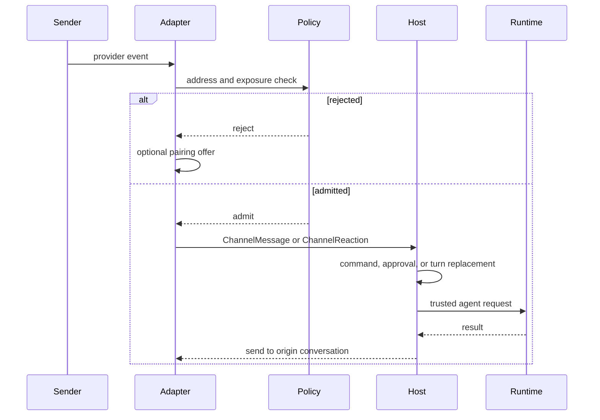
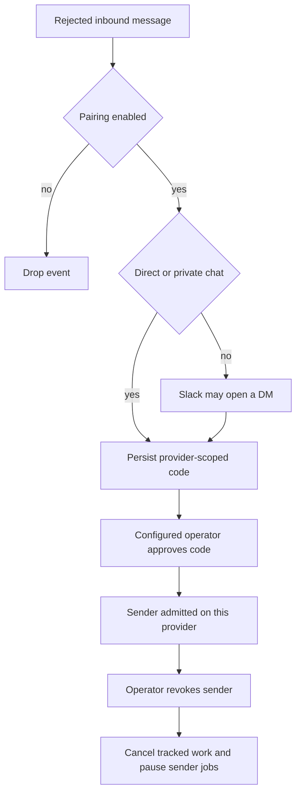

Talon channel adapters are the policy boundary between provider events and an agent turn. They normalize provider-local identifiers into `ChannelMessage` or `ChannelReaction`, apply their provider's exposure and pairing rules, and dispatch only admitted events to the callback installed by `TalonHost`. The host then owns commands, the trusted agent conversation key, authorization/approval binding, turn replacement, and delivery.

> **Security boundary:** admission controls who may invoke a configured personal agent; it is not tenant isolation or execution containment. In particular, `open` means arbitrary external senders can invoke an agent with the host's configured credentials and local access. Pairing grants invocation access, not operator authority.

See [permissions and HITL](/openwiki/concepts/permissions-hitl.md), [Talon scheduling](/openwiki/concepts/talon-scheduling.md), [the Talon integration](/openwiki/integrations/talon.md), and [security operations](/openwiki/operations/security.md).

## Adapter contract and lifecycle

`ChannelAdapter` provides a transport-neutral lifecycle and delivery surface: `start`, `stop`, host message-handler registration, text/media send and edit, typing, and status. `ChannelMessage` and `ChannelReaction` retain channel-specific conversation, sender, and message identifiers plus metadata. Reactions are optional through `ReactionChannelAdapter`; an adapter with no registered host handler logs and drops the event rather than guessing a destination.

The host starts the runtime, binds each channel's callbacks before starting that channel, and starts the scheduler last. Startup failure unwinds started components in reverse order. Shutdown cancels host work first, then stops channels, the scheduler, and the runtime.

*Provider adapters decide whether an event enters Talon; the host owns the resulting work and state.*

## Exposure, addressing, and identity

`ChannelExposure` defaults to `self` and is read from `DEEPAGENTS_TALON_<PROVIDER>_EXPOSURE`.

| Mode | Admission rule |
| --- | --- |
| `self` | Admit `metadata["from_self"] is true` or a configured `*_OPERATOR_ID`. Discord, Slack, and Telegram require an operator ID in this mode. |
| `allowlist` | Admit configured `*_ALLOWLIST_CHATS` conversation IDs or text matching `*_MENTION_PATTERNS`. |
| `open` | Admit every message, but require `*_OPEN_ACK=allow-arbitrary-senders` and emit a risk warning. |

`*_ALLOWLIST_USERS` additionally admits named users in direct/private chats in allowlist mode. Discord admits threads whose parent is an allowlisted channel; Slack recognizes the parent portion of its thread conversation ID. These static identities do not become operators merely because they are admitted.

Discord has a separate **addressing** gate before exposure: it ignores Gateway messages authored by the bot, and a guild message must mention the bot or integration role. `DEEPAGENTS_TALON_DISCORD_MENTION_OPTIONAL_CHATS` may make mentions optional for named guild channels or `*`, but only for human messages; it does not weaken exposure. An admitted top-level guild message opens a public thread and routes the turn there; thread-creation failure falls back to the parent channel. Existing thread messages retain their thread conversation and may gain bounded thread context.

Slack and Telegram do not use Discord's mention/thread-opening gate. Their adapters build messages from their native events, apply exposure or pairing, and only then collect thread context or download attachments. Telegram derives `from_self` by comparing the incoming sender with the bot identity. In all three providers, reaction events must independently pass adapter admission before they reach the host.

## Pairing: revocable sender access

Pairing is opt-in through `DEEPAGENTS_TALON_<PROVIDER>_PAIRING`; it is available for Discord, Slack, and Telegram, is invalid with `open` exposure, and is provider-scoped in `pairing.json`. A rejected direct/private sender can receive a one-hour code; approval consumes the code and admits that sender in any chat visible to that adapter. `*_PAIRING_REPLY=disabled` records the request but withholds the automatic code reply. Discord only offers from a DM, Slack can open a DM for a rejected non-DM sender, and Telegram offers after ordinary admission fails.

*Pairing stores a provider-scoped admission record, while revocation affects both future admission and host-tracked work.*

Environment-configured operators and allowlisted IDs remain authoritative: they neither receive codes nor can pairing revoke them. `/pair` never reaches the model. It requires a sender explicitly present in the configured operator IDs—not merely `from_self`—and is DM-only except that an operator may approve a code outside a DM. On revocation, the host cancels tracked conversations for that sender and pauses their provider-scoped cron jobs; a revoked in-flight scheduled run fails without delivery.

The store locks every read-modify-write mutation and atomically replaces the JSON file. Admission reads cache a file identity including inode, so a CLI atomic replacement is visible; unreadable or invalid store state fails closed for paired users while static environment identities keep their configured access. The stopped-host `deepagents-talon pairing` CLI can list, approve, revoke, and pause matching jobs, but it only changes persistence and cannot cancel work held by a running host.

## Host-owned conversations, commands, and cancellation

Apart from `/help`, `TalonHost.receive_message` combines a trusted provider key and adapter-provided conversation ID into a conversation root, uses that root for locking and persisted reset state, and derives the active agent conversation ID from it. Adapter metadata becomes request context, but cannot choose the host conversation or model. The host first handles its commands, pending tool-approval replies, and authorization callbacks; only ordinary messages replace or start an agent turn.

The shared command registry is the source for typed command parsing, `/help`, and visible Discord application commands. Hidden commands remain accepted when typed but are excluded from help and registration. Discord application interactions are converted into the same `ChannelMessage` form, must pass admission before deferral, and use a task-local response sink so an interaction receives only its own output. Slack command handling similarly checks admission before revealing whether a command exists.

Each conversation root is serialized. A new ordinary input replaces an active turn: the host increments its generation, cancels the task, and attempts runtime recovery within the same 30-second budget. On timeout it blocks further work for that agent conversation rather than running potentially inconsistent turns concurrently. A completed turn delivers only if its generation is still current; stale or cancelled undelivered results requeue their consumed background-subagent results.

Approval is not implied by reaction admission. The host only acts on a pending provider-qualified request that matches conversation, prompt message ID, initiating sender, and decision emoji; text approval replies are likewise sender-bound. This prevents an admitted participant from deciding another sender's pending action.

## Media and outbound delivery

Adapters prepare inbound media only after admission. Shared metadata uses `has_media`, `media_paths`, `media_path`, aligned `media_mime_types`, and `voice_path` for voice files; a failed or oversized download preserves delivery of the message while setting `has_media` false and `media_error`. Discord downloads the first non-document attachment (and carries document references); Slack can download multiple files; Telegram downloads the identified media file. The host may then make prepared media available to a media-capable runtime.

For outbound media, the shared validator resolves paths beneath the trusted root selected from `DEEPAGENTS_TALON_OUTBOUND_MEDIA_DIR`, then `DEEPAGENTS_TALON_WORKSPACE`, then the current directory. It requires a regular file, a compatible inferred media type, and the configured maximum byte size. This protects the attachment transport boundary; it does not authorize a sender or sandbox the runtime.

The host sends result text and extracted Markdown media references to the originating adapter conversation. `send_with_retry` converts send exceptions into failed results and retries retryable failures twice with exponential backoff. Progress and final delivery both check that the turn remains active/current, preventing replaced work from sending into a newer conversation state.

## Operational guidance and focused tests

1. Prefer `self` or explicit allowlists. Treat `open` as arbitrary invocation, not a sandbox.
2. Configure an operator ID before using `self` exposure on Discord, Slack, or Telegram.
3. Keep Discord mentions required unless a deliberately chosen channel is listed in `DEEPAGENTS_TALON_DISCORD_MENTION_OPTIONAL_CHATS`; this is an addressing setting, not access control.
4. Enable pairing only for people who should be able to invoke the agent wherever the provider can see them. Use host `/pair revoke` to stop live work as well as future admission.
5. Set an intentional outbound-media root and byte cap separately from inbound-media storage.

`libs/talon/tests/channels/test_base.py` exercises exposure, media validation, dispatch, and retry behavior. Provider suites in `test_discord.py`, `test_slack.py`, and `test_telegram.py` cover admission, pairing offers, reactions, commands, thread/context routing, and media failure paths. `test_host.py` covers command precedence, conversation identity, generation-based suppression, cancellation/recovery, approvals, and delivery; pairing behavior is covered by the pairing test suites.
