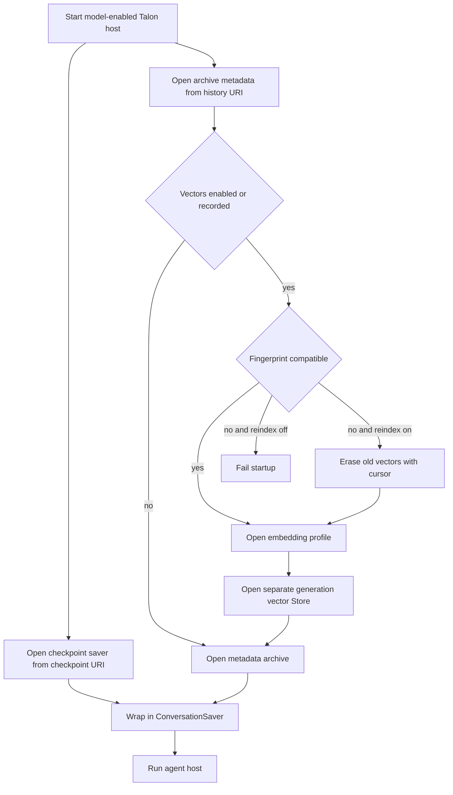
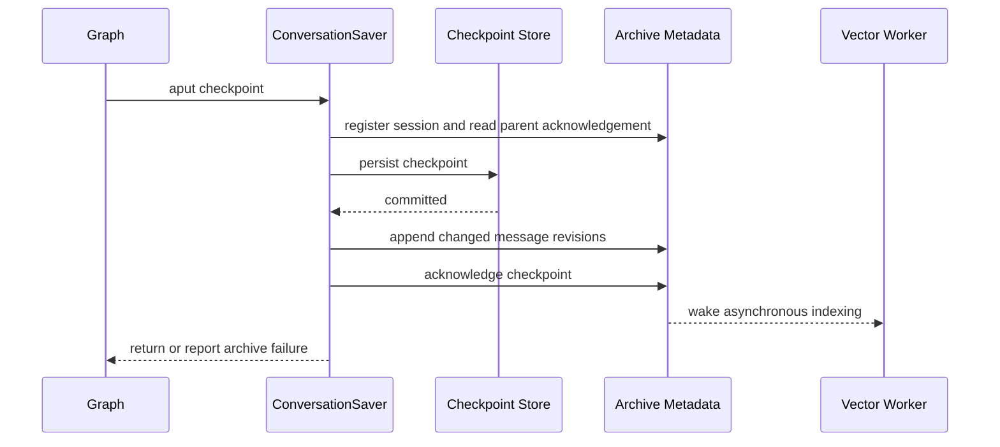

Talon has three separate persistence roles:

- **Checkpoint storage** is the LangGraph saver for graph state, pending writes, and thread deletion.
- **Archive metadata storage** is a separate LangGraph `BaseStore` for transcript chunks, session ownership, ordering, deletion state, and indexing work.
- **Vector storage** is an optional, separate `BaseStore` for embeddings. It must never be the metadata Store.

A model-enabled host opens the URI-selected checkpointer and archive independently, then wraps them in `ConversationSaver`. The echo runtime does not take that model-host storage path. Thus changing a checkpoint URI does not migrate or implicitly alter archived history. [^host] [^backends]

> **Ownership boundary:** scopes and session IDs used by the archive come from trusted host/runtime state, not model tool arguments. The archive namespaces metadata by assistant ID and isolates retrieval by channel and chat, but this is not a general multi-tenant security boundary. Operate one active writer per archive namespace: the local lock and redo journal recover partial work but are not distributed locking. [^ownership] [^journal]

## Startup topology

`DEEPAGENTS_TALON_CHECKPOINT_URI` and `DEEPAGENTS_TALON_HISTORY_URI` select storage independently. Built-in SQLite/file, PostgreSQL, and MongoDB schemes are available; a non-built-in scheme needs exactly one matching installed entry point. Backend initialization turns driver failures into configuration errors rather than exposing a URI that may contain credentials. [^backends]

The history opener creates metadata under `("talon", assistant_id)`, validates/replays archive records, and optionally opens a distinct vector Store. The metadata Store needs read-after-write consistency and no automatic TTL. [^history-open] [^journal]

This is the startup relationship: checkpoint, metadata, and vector storage have independent lifecycles.

## Checkpoint projection and acknowledgement

`ConversationSaver` delegates reads, listings, versioning, and pending writes to its wrapped checkpointer. During `aput`, it considers a checkpoint archiveable only when it is top-level and its metadata contains trusted `talon_history_channel` and `talon_history_chat` strings. Nested graph namespaces and unscoped work remain checkpointed but do not become transcripts. An archive registration permanently associates a session with its accepted scope; an attempted scope reassignment fails before checkpoint mutation. [^ownership] [^projection]

For an archiveable checkpoint, Talon first registers the session and checks whether the parent checkpoint was acknowledged. It derives changed messages from the snapshot and pending writes, writes the checkpoint, appends transcript revisions, and only then records acknowledgement of the new checkpoint. There is no transaction across the checkpoint and archive stores: an archive failure after the checkpoint commit is reported, and repeating that checkpoint—or a later checkpoint—repairs the idempotent projection. Cancellation is delayed until both writes finish, preventing reset from interleaving with a half-finished projection. [^projection] [^projection-tests]

This is the durability order. Vector indexing is not part of checkpoint durability.

Transcript records retain chunked Human, AI, and tool-message text; AI tool-call arguments are included. Revisions are deduplicated by session, message identity, revision, and chunk part, so edits are preserved without duplicate checkpoint snapshots. System messages and the archive tools' own results are excluded. Only user-originated human messages and host-confirmed delivered AI replies are indexable. [^content]

### Delivered replies

An AI message first enters the transcript as non-indexable unless its source is already marked delivered. After successful channel delivery, `DeepAgentRuntime.record_delivered_reply` calls `archive.record_delivery` with the trusted destination scope and final text. The archive finds the matching archived AI revision, or creates a delivered fallback, then promotes it into the durable indexing queue. This distinction prevents an undelivered generated reply from becoming semantic history. [^delivery]

## Trusted scope and Slack compatibility

Archive reads use the exact requested channel/chat scope and verify a live session owner before returning a chunk. Agent-facing `list_conversations`, `read_conversation`, and `search_conversations` receive their scope through a host-provided callback, so a model cannot submit a different scope. [^tools] [^ownership]

There is one narrowly scoped compatibility exception for **legacy Slack** registrations. A session stored as `slack` chat `C...:thread` or `G...:thread` may subsequently be appended to, or have delivery recorded from, its parent `C...` or `G...` scope. Its stored scope is not rewritten: history still appears through the legacy threaded scope, and the parent scope sees only sessions actually registered there. The exception does not apply to DMs, malformed thread IDs, another Slack parent, another provider, a reverse parent-to-thread move, or a session already deleting. [^slack]

## Bounded retrieval and continuation

All archive tools accept pages of 1–20 entries. `read_conversation` uses numeric cursors that must belong to the selected session; filters can select roles and timezone-aware archive-time windows. `list_conversations` and direct transcript traversal scan at most 500 ordering records for a page that would otherwise claim completion. A scan limit becomes a tool error, with a resumable cursor for filtered reads when available, rather than a false "no more history." [^tools] [^scan]

Keyword `search_conversations` is different: it returns a `SearchPage` with `has_more`, `next_after`, `pagination_status`, and `scan_status`. When its 500-record budget ends, it reports `limit_reached` and issues an opaque continuation token. Tokens are in-memory, bound to the exact channel/chat/query and retrieval mode, and may expire after restart, reset, or cache eviction; an expired token returns no results with `pagination_status: "expired"`, so callers must start a fresh search. Literal matching is normalized and requires all query words. [^search-continuation]

With vector search enabled, Talon ranks fused lexical and semantic candidates. Search responses also state whether semantic retrieval completed, timed out, failed, or was unavailable, and whether indexing is pending or visibility is unknown. An empty response therefore does not prove that no retained history exists. [^vector-worker]

## Vector indexing and generations

The optional vector worker consumes durable index requests in batches. It writes vectors before acknowledging their metadata rows; failures log and retry with backoff without blocking checkpoint or transcript writes. Semantic search has a two-second deadline and falls back to keyword candidates on timeout or error. Shutdown is bounded: a wedged batch may be abandoned after cancellation, leaving unacknowledged work to retry at the next archive start. [^vector-worker] [^vector-shutdown]

Embedding fingerprints define vector generations. An incompatible existing fingerprint or an interrupted reindex blocks startup unless `DEEPAGENTS_TALON_HISTORY_REINDEX=1` is set. With explicit reindexing, Talon marks the operation, opens the old generation in deletion-only mode, durably erases vectors in batches using `reindex_cursor`, resets indexing progress, records the new generation, and rebuilds from retained transcript content. The cursor makes interrupted erasure restartable. [^reindex]

Talon supports local, Voyage, OpenAI-compatible, and Atlas embedding adapters. Client-side requests are concurrency- and input-bounded, validate returned vectors, and split/pool oversized documents; oversized queries degrade to keyword search. Atlas uses server-side embeddings and requires a MongoDB history backend. [^embeddings]

## Erasure and recovery

History reset first requires chat work to be stopped. `ConversationSaver` erases hook transcripts when configured, deletes the checkpoint thread, then asks the archive to remove the session. The archive marks deletion before vector work; vector entries are removed and acknowledged before transcript chunks, deduplication records, and session ownership disappear. A failure leaves state retryable. If metadata says vectors have been used but the vector Store cannot be opened, metadata-only deletion is refused rather than leaving embeddings behind. [^erasure]

Metadata writes use a bounded redo journal: write intended mutations to `journal`, replay idempotent batch writes, then clear the journal only on success. Each serialized archive access replays an interrupted journal first. This provides restart recovery for a single writer, not a cross-process lock or a multi-store transaction. [^journal]

## Operations and focused tests

1. **Use independent URI configuration deliberately.** Separate assistant databases where checkpoint thread identifiers could collide; archive metadata is assistant-namespaced but is not a multi-tenant authorization system. [^backends] [^history-open]
2. **Treat storage URIs and embedding credentials as secrets.** Initialization errors are intentionally generic. Preserve the old vector backend/configuration until retained sessions can be erased or reindexed. [^backends] [^erasure]
3. **Treat embedding changes as a migration.** Model, endpoint, dimension, prompt, or input-budget changes can change the profile fingerprint. Test against a copy, then use `DEEPAGENTS_TALON_HISTORY_REINDEX=1` only for the planned rebuild. [^reindex]
4. **Test the invariants, not only a backend.** Archive tests cover trusted scope isolation, long-transcript chunks, scan budgets and continuations, legacy Slack handling, interrupted journal recovery, and vector-before-text deletion. Saver tests cover projection failure/retry, cancellation ordering, and scope reassignment rejection. [^archive-tests] [^projection-tests]

## Related pages

- [State persistence](/openwiki/concepts/state-persistence.md)
- [Talon scheduling](/openwiki/concepts/talon-scheduling.md)
- [Talon integration](/openwiki/integrations/talon.md)
- [Security operations](/openwiki/operations/security.md)
- [Testing guide](/openwiki/testing/testing-guide.md)

[^host]: `libs/talon/deepagents_talon/__main__.py` lines 296–331 and 359–390
[^backends]: `libs/talon/deepagents_talon/checkpoint_backends.py` lines 25–55 and 108–115; `libs/talon/deepagents_talon/history_backends.py` lines 38–117
[^history-open]: `libs/talon/deepagents_talon/history_backends.py` lines 44–91; `libs/talon/deepagents_talon/store_archive.py` lines 104–149
[^ownership]: `libs/talon/deepagents_talon/archive_saver.py` lines 193–212 and 316–323; `libs/talon/deepagents_talon/store_archive.py` lines 216–247 and 380–394
[^journal]: `libs/talon/deepagents_talon/store_records.py` lines 56–116
[^projection]: `libs/talon/deepagents_talon/archive_saver.py` lines 153–229
[^projection-tests]: `libs/talon/tests/unit_tests/test_archive_saver.py` lines 87–225 and 289–321
[^content]: `libs/talon/deepagents_talon/store_archive.py` lines 76–101 and 273–321
[^delivery]: `libs/talon/deepagents_talon/runtime.py` lines 864–880; `libs/talon/deepagents_talon/store_archive.py` lines 323–360
[^slack]: `libs/talon/deepagents_talon/store_archive.py` lines 60–67 and 216–223; `libs/talon/tests/unit_tests/test_store_archive.py` lines 22–114
[^tools]: `libs/talon/deepagents_talon/archive.py` lines 202–318
[^scan]: `libs/talon/deepagents_talon/store_archive.py` lines 396–530 and 604–665
[^search-continuation]: `libs/talon/deepagents_talon/store_archive.py` lines 532–602; `libs/talon/tests/unit_tests/test_store_archive.py` lines 604–679
[^vector-worker]: `libs/talon/deepagents_talon/history_vectors.py` lines 204–282 and 284–375
[^vector-shutdown]: `libs/talon/deepagents_talon/history_vectors.py` lines 105–162
[^reindex]: `libs/talon/deepagents_talon/config.py` lines 213–253; `libs/talon/deepagents_talon/history_vector_backends.py` lines 35–123
[^embeddings]: `libs/talon/deepagents_talon/history_adapters.py` lines 43–64, 87–154, and 157–289; `libs/talon/deepagents_talon/history_backends.py` lines 44–52
[^erasure]: `libs/talon/deepagents_talon/archive_saver.py` lines 249–313; `libs/talon/deepagents_talon/store_archive.py` lines 683–773; `libs/talon/deepagents_talon/history_vectors.py` lines 272–282
[^archive-tests]: `libs/talon/tests/unit_tests/test_archive.py` lines 44–79 and 350–469; `libs/talon/tests/unit_tests/test_store_archive.py` lines 22–238 and 413–533
