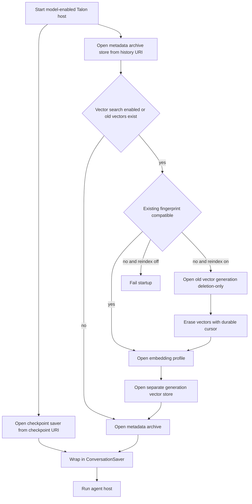
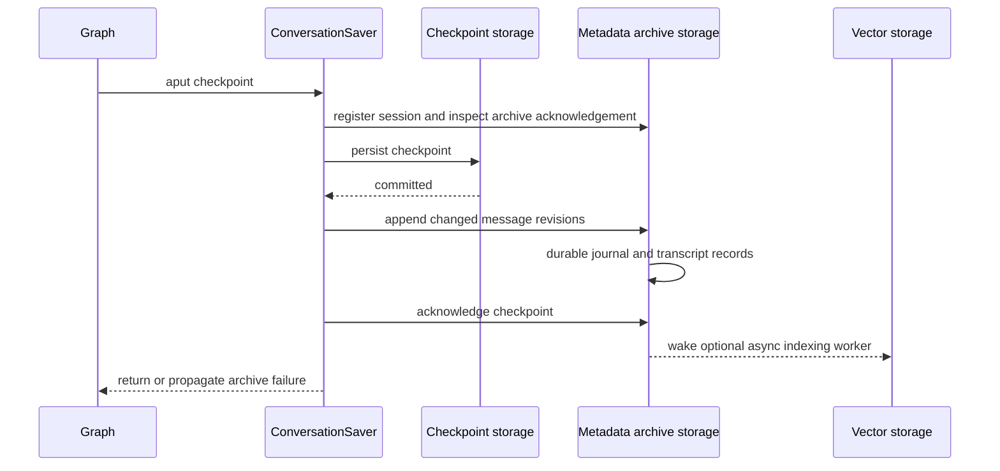

Talon has **three distinct persistence roles**:

- **Checkpoint storage** is the LangGraph saver for graph state, pending writes, and thread deletion.
- **Metadata archive storage** is a separate LangGraph `BaseStore` holding durable transcripts, session ownership, ordering links, deletion state, and the indexing queue.
- **Vector storage** is an optional, separate `BaseStore` containing embeddings only. It is never the metadata store.

The normal model-enabled host opens a checkpointer and a history archive independently, then supplies `ConversationSaver(checkpointer, archive=archive)` to the runtime. The echo runtime does not open this composition, so it has no archive tools. This separation means changing a checkpoint URI neither migrates nor implicitly changes history storage. [^host-composition] [^checkpoint-selection] [^history-selection]

> **Scope and safety boundary:** archive entries are registered against host-supplied channel and chat identifiers, not model-provided tool arguments. The archive is scoped to the current chat (with a Slack thread compatibility rule), and archives are namespaced by assistant ID. This is isolation for Talon's retrieval behavior, **not** a multi-tenant guarantee. Talon and its plugins require one active writer per archive namespace; their local locks and redo journal are not distributed locking. [^scope] [^single-writer]

## Storage topology and startup

By default, checkpoints use `checkpoints.sqlite` under the assistant home; the default history metadata store is a distinct connection to that same SQLite database. Set `DEEPAGENTS_TALON_CHECKPOINT_URI` and `DEEPAGENTS_TALON_HISTORY_URI` independently. Built-in URI schemes are `sqlite`/`file`, `postgres`/`postgresql`, and `mongodb`/`mongodb+srv`; remote URIs require a host and database name. SQLite URIs must name a file and have no host. [^checkpoint-selection] [^history-selection]

History metadata is wrapped in `StoreConversationArchive` under the namespace `("talon", assistant_id)`. Its underlying portable records namespace is hashed, avoids TTL, and requires read-after-write consistency. The store opening path verifies the archive record format, recovers any interrupted metadata journal, and verifies archive write access before startup finishes. [^history-selection] [^records]

Third parties may add trusted, installed entry points:

- `deepagents_talon.checkpoint_backends`: `scheme -> factory(uri)` yielding an async `BaseCheckpointSaver`.
- `deepagents_talon.history_backends`: `scheme -> factory(uri)` yielding an async metadata `BaseStore`.
- `deepagents_talon.history_vector_backends`: `scheme -> factory(uri, *, index, generation)` yielding a **separate** vector `BaseStore`; `index=None` is deletion-only mode.

Built-in schemes win. Unknown schemes or any scheme with anything other than exactly one applicable plugin fail startup. Factories own their connection lifecycle and must tolerate cancellation; plugins are an operator-installed extension boundary, not untrusted in-process code. [^checkpoint-selection] [^history-selection] [^vector-backends]

This shows initialization and reindex decisions. Checkpoint storage, metadata archive storage, and optional vector storage are different resources.

## Checkpoint-to-archive projection

`ConversationSaver` delegates checkpoint reads, listings, versioning, and pending writes to its wrapped saver. On `aput`, it serializes the operation with an in-process lock, derives a history scope only for a top-level checkpoint with trusted `talon_history_channel` and `talon_history_chat` metadata, and first registers session ownership in the archive. Nested graph namespaces and unscoped work—including scheduled runs—remain checkpointed but are not transcript-archived. [^projection] [^scope]

It identifies changed message revisions from the checkpoint and its pending writes, persists the checkpoint first, then appends the committed messages and acknowledges the checkpoint in archive metadata. This deliberately has **no cross-store transaction**: if checkpoint persistence fails, no transcript is appended; if archive persistence fails after the checkpoint succeeds, the error propagates and retrying the same checkpoint repairs the idempotent archive projection. Cancellation is held until both writes complete, so a reset cannot delete between a checkpoint commit and its archive append. [^projection] [^projection-tests]

This is the ordered checkpoint projection. Vector indexing is asynchronous and does not participate in checkpoint durability.

The archive retains Human, AI, and tool message text in 4,000-character chunks; AI tool-call arguments are included in the text representation. It deduplicates by session, message identity, revision, and chunk part, preserving revisions rather than overwriting them. Only user-originated human messages and AI messages confirmed as delivered to a channel are indexable; archive-tool calls themselves are excluded. A final reply is promoted for semantic indexing only when the host records successful delivery. [^archive-content]

## Retrieval, indexing, and generations

The agent receives `list_conversations`, `read_conversation`, and `search_conversations`. Tool scope is obtained from the current invocation rather than accepted from the model. Listing, reading, and keyword search are bounded to 1–20 results; complete pages scan at most 500 ordering records and raise rather than falsely claim completion. Keyword search uses normalized literal-word matching. Search continuation tokens are opaque, in-memory, and can expire after reset or cache eviction. [^retrieval] [^archive-search]

With `DEEPAGENTS_TALON_HISTORY_VECTOR_SEARCH=1`, search fuses keyword candidates with semantic candidates. The vector worker consumes durable index requests in batches, writes vectors, then acknowledges only successful work; failures log and retry with backoff without blocking checkpoint/archive writes. Searches have a two-second semantic deadline and fall back to keyword matches on timeout or error. Search responses expose semantic status, pending/unknown indexing coverage, and pagination/scan status, so an empty result does not necessarily prove history is absent. [^vector-worker]

Each embedding profile has a fingerprint. The fingerprint selects a separate generation: SQLite uses `history-vectors-<fingerprint>.sqlite`, PostgreSQL configures a generation, and MongoDB uses a suffixed collection. Metadata and vectors are always separate store instances. If vectors exist but the embedding fingerprint differs or a previous rebuild is unfinished, startup fails unless `DEEPAGENTS_TALON_HISTORY_REINDEX=1` is explicitly set. With that flag, Talon marks reindexing, opens the old generation without an embedding client, removes vectors in durable batches, resets indexing progress, records the new fingerprint/generation, and reindexes retained transcript content. Interrupted erasure resumes from `reindex_cursor`; remove the flag after a successful compatible startup. [^vector-backends] [^reindex]

Client-side adapters are `local`, `voyage`, and `openai-compatible`; Atlas is server-side and requires a MongoDB history backend. Remote adapters require configured model, dimensions, and input budget and transmit archive text and queries to the provider. Client inputs are bounded using a conservative UTF-8 byte budget; oversized documents are split and length-weighted pooled, while oversized queries fall back to keyword search. [^embeddings] [^history-selection]

## Erasure ordering and recovery

`/reset-all-history` and `delete_conversations` eventually call `ConversationSaver` deletion. The host must stop chat workers first. `clear_history` finds sessions owned by the trusted scope; selected deletion rejects an empty list, the current session, and any running session. A batch may partially delete and should be retried with the same IDs. [^erasure]

For each session, Talon deletes hook transcripts if configured, then deletes the checkpoint thread, then calls archive deletion. The archive first marks the session deleting; where vectors exist, the vector worker deletes all session vectors and acknowledges that work **before** transcript chunks, deduplication records, and session ownership are erased. If a checkpointer deletion fails, the archive registration remains, making reset retryable after restart. If vector storage was previously used but is not opened, metadata deletion refuses rather than leaving vectors behind. Thus disabling semantic search does not make old vectors undeletable: startup still opens vector storage in deletion-only mode when the metadata root records vectors. [^erasure] [^archive-deletion]

Archive metadata changes are made through a bounded redo journal: it records the intended mutation, replays idempotent writes, and clears the journal only on success. Every serialized archive access first recovers that journal. This protects a single active writer from partial store batches, but does not coordinate multiple processes; run only one Talon writer per assistant/archive namespace and do not attempt storage migration by pointing concurrent hosts at it. [^records] [^single-writer]

Vector shutdown is intentionally bounded: it waits for active work, then cancels and may abandon a wedged store operation so host shutdown can proceed. Unacknowledged work remains durable and is retried at the next archive open, although a misbehaving store may log errors after its connection closes. [^vector-shutdown]

## Operations and safe changes

1. **Choose stores deliberately.** Use separate databases for separate assistants when checkpoint threads are remote: remote checkpoint thread IDs are not automatically namespaced. History metadata itself is assistant-namespaced, but this is not a multi-tenant security boundary. [^checkpoint-selection] [^history-selection]
2. **Treat URIs and credentials as secrets.** URI initialization failures are deliberately reduced to generic configuration errors because database URIs can contain credentials. Place the assistant home on protected storage; Talon creates it with mode `0700`. [^checkpoint-selection] [^history-selection] [^config-home]
3. **Plan embedding changes as migrations.** Changing model, endpoint, dimensions, prompt, or input budget changes the fingerprint. Test the replacement against a copy, then use `DEEPAGENTS_TALON_HISTORY_REINDEX=1`; rebuilding can call remote embedding APIs and incur charges. Do not enable the flag casually or leave it as a standing configuration. [^reindex] [^embeddings]
4. **Preserve erasure capability.** Do not delete an old vector generation before all sessions have been erased or reindexed. If deletion reports that vector storage must be opened, restore the correct vector backend/configuration and retry. [^archive-deletion]
5. **Test real backend behavior.** The shared archive contract tests idempotent append, chat isolation, semantic retrieval, vector-before-text erasure, and deletion after vector search is disabled. Saver tests cover failed checkpoint writes, archive retry after reopening, cancellation versus reset, scope reassignment rejection, and restartable deletion. [^contract-tests] [^projection-tests]

## Related pages

- [Talon integration](/openwiki/integrations/talon.md)
- [Talon scheduling](/openwiki/concepts/talon-scheduling.md)
- [Security operations](/openwiki/operations/security.md)
- [Testing guide](/openwiki/testing/testing-guide.md)
- [Source map](/openwiki/architecture/source-map.md)

[^host-composition]: `libs/talon/deepagents_talon/__main__.py` lines 309–331
[^checkpoint-selection]: `libs/talon/deepagents_talon/checkpoint_backends.py` lines 25–115
[^history-selection]: `libs/talon/deepagents_talon/history_backends.py` lines 37–117
[^vector-backends]: `libs/talon/deepagents_talon/history_vector_backends.py` lines 126–190
[^scope]: `libs/talon/deepagents_talon/archive_saver.py` lines 193–212 and 316–323
[^single-writer]: `libs/talon/deepagents_talon/store_archive.py` lines 97–112; `libs/talon/deepagents_talon/store_records.py` lines 56–77
[^records]: `libs/talon/deepagents_talon/store_records.py` lines 56–116
[^projection]: `libs/talon/deepagents_talon/archive_saver.py` lines 153–229
[^projection-tests]: `libs/talon/tests/unit_tests/test_archive_saver.py` lines 100–225 and 289–321
[^archive-content]: `libs/talon/deepagents_talon/store_archive.py` lines 69–94 and 242–353
[^retrieval]: `libs/talon/deepagents_talon/archive.py` lines 130–210
[^archive-search]: `libs/talon/deepagents_talon/store_archive.py` lines 389–491 and 493–563
[^vector-worker]: `libs/talon/deepagents_talon/history_vectors.py` lines 100–116, 204–282, and 284–375
[^reindex]: `libs/talon/deepagents_talon/history_vector_backends.py` lines 35–123
[^embeddings]: `libs/talon/deepagents_talon/history_adapters.py` lines 43–64 and 157–289
[^erasure]: `libs/talon/deepagents_talon/archive_saver.py` lines 249–313
[^archive-deletion]: `libs/talon/deepagents_talon/store_archive.py` lines 639–729; `libs/talon/deepagents_talon/history_vectors.py` lines 272–282
[^vector-shutdown]: `libs/talon/deepagents_talon/history_vectors.py` lines 105–162
[^config-home]: `libs/talon/deepagents_talon/config.py` lines 113–136
[^contract-tests]: `libs/talon/tests/store_archive_contract.py` lines 52–127
