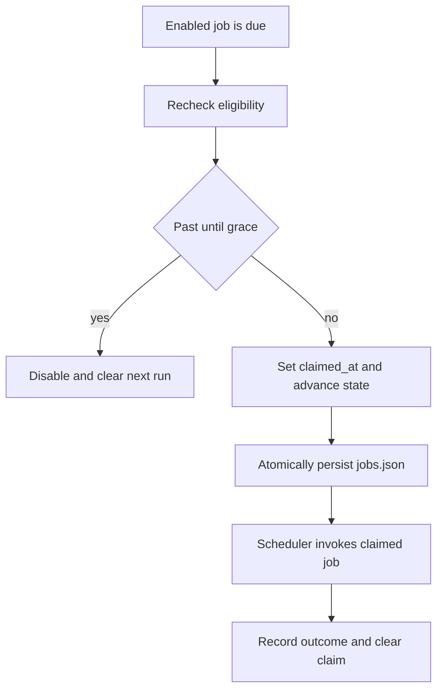
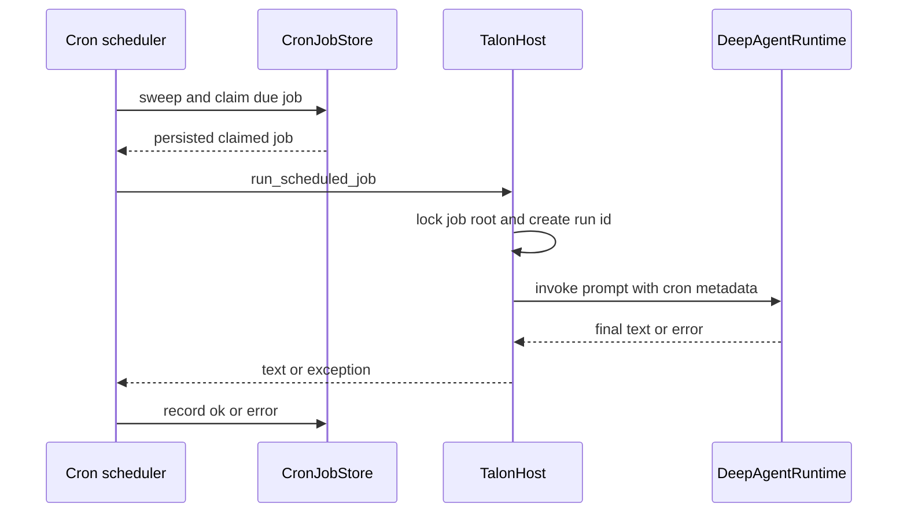
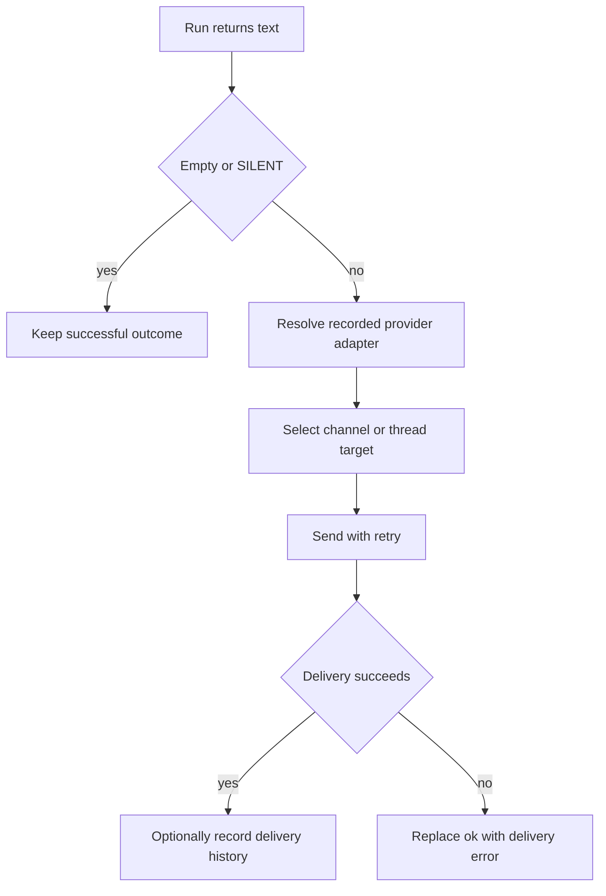

# Talon Scheduling and Background Work

> **Experimental and unattended.** Talon is experimental. A cron invocation has no person available to approve a protected tool action or complete interactive authorization: the host supplies neither handler and the runtime automatically rejects approval interrupts for `trigger: "cron"`. A scheduled prompt is persistent, unattended access to the installed assistant, not a sandbox. Do not schedule work that needs interactive approval.

Talon separates durable scheduling from execution. `CronJobStore` owns `jobs.json`; `PersistentCronScheduler` claims due occurrences; and `TalonHost` invokes the agent and routes its result. Standard model-host startup opens the configured checkpoint and history services, wraps them in `ConversationSaver`, and attaches the scheduler only when at least one channel is configured.

## Job ownership, scope, and pinned skills

A record persists a self-contained prompt, assistant ID, parsed schedule, repeat and enabled state, timestamps, outcome/error, optional `until`, claim timestamp, delivery choice, pinned skills, and `CronOrigin`. The origin holds the channel conversation, provider, creating message and sender IDs, and optional parent history chat. It is host-supplied metadata: it sets both the management boundary and the later delivery address. A job created during a run keeps the original creator sender ID.

The agent manages its local jobs with `create_job`, `list_jobs`, `edit_job`, and `remove_job`. These tools obtain the current origin from runtime context rather than accepting a model-selected destination. `enabled=False` pauses a job, an empty edit `until` clears the bound, and create/edit responses include a few `upcoming` occurrences.

Management scope is **provider plus channel-level origin scope**, not raw message or thread ID. Slack `C`/`G` threads share their parent channel; Discord threads use `history_chat` when present; other conversations and providers remain isolated. Stored `message_id` does not participate in that comparison. `deliver_to` defaults to `channel` and may be `thread`; it affects target selection, not management authority.

A job may pin up to eight skill names. Names must be lowercase letters/digits/hyphens, are de-duplicated while preserving order, and are persisted; editing with an empty list unpins all skills. Creation does **not** require that named skills are installed, because installations can change before a fire. On a scheduled invocation the host copies the persisted names into `pinned_skills`; the runtime accepts that metadata only when `trigger` is `cron` and supplies it to the skill middleware. Thus an ordinary channel request cannot force skills through metadata, and a missing pinned skill is skipped at run time.

## Schedule language and civil time

Schedule text is capped at 200 characters.

| Form | Meaning |
| --- | --- |
| `in <N>m` or `in <N>h` | One-shot relative interval of at least one minute. |
| `every <N>m` or `every <N>h` | Recurring relative interval. |
| `at YYYY-MM-DD HH:MM <IANA-zone>` | One-shot wall-clock time. |
| `daily at HH:MM <IANA-zone>` | Recurring local wall-clock time. |
| `cron <minute> <hour> <day-of-month> <month> <day-of-week> <IANA-zone>` | Recurring five-field cron in an explicit zone. |
| `cron @hourly`, `@daily`, `@weekly`, `@monthly`, or `@yearly` plus a zone | Agent-documented macros. |

Zones must be `UTC` or an IANA region such as `America/New_York`; bare offsets and legacy POSIX aliases are rejected so future daylight-saving rules remain available. The parser additionally accepts `@annually` and `@midnight`. Fields support ranges, steps, lists, month/weekday aliases (Sunday is `0` or `7`), and limited `L`, `W`, and `#` calendar extensions. When neither textual day field starts with `*`, day-of-month and day-of-week are ORed as in Vixie cron; otherwise they are ANDed. Parsed expressions and resolved zones each use bounded 128-entry caches because this input comes from an agent.

Wall-clock schedules, `until`, and cron candidates are resolved in their stated zone. A nonexistent spring-forward time advances to the first valid minute; an ambiguous fall-back time selects the earlier occurrence. Multiple skipped cron candidates that snap to the same instant coalesce into one fire. A past `at` is rejected. Interval jobs retain phase from their prior due time and skip ahead after downtime rather than replaying all missed intervals.

`until` is a local `YYYY-MM-DD HH:MM <IANA-zone>` limit only for recurring jobs. It is inclusive and permits five minutes of late-claim grace; an occurrence found later than that is disabled and dropped rather than delivered after the requested window. Create and edit reject a bound before the first possible run.

## Durable store and persisted claim

`jobs.json` is a versioned JSON envelope with structured schedule fields and whole-second UTC timestamps. An unreadable, malformed, invalid-record, or wrong-version store is logged and treated as empty. That keeps the ticker alive, but a later write can replace bad data, so operators should protect and back up the cron directory.

Writes use a temporary file in the cron directory, flush and `fsync` it, set mode `0600`, atomically replace `jobs.json`, and `fsync` the directory; the directory is `0700`. Parsed records are cached by `(mtime_ns, size, inode)`, with identity captured using `fstat` on the opened file so atomic replacement cannot associate old bytes with a newer pathname identity.

All live `CronJobStore` instances for a resolved path share a reentrant lock **only in the current process**. It serializes complete reads and mutations, including claims, but not another process, external writers, execution, or delivery. Run one owner process per cron file and do not mutate the store offline while the host is live.



*Persisted claim flow: advancement is durable before agent invocation, so a crash after the claim does not make that occurrence runnable again.*

Each default 60-second tick sweeps first, then processes due jobs sequentially. `advance_next_run` rechecks eligibility and persists `claimed_at` and advanced state before host invocation. One-shots and exhausted recurrences are disabled before their final attempt, and repeat count is consumed at claim time. This is at-most-once claiming: process failure after a durable claim can lose that occurrence rather than rerunning it.

Later sweeps delete completed or expired records only when they have neither an error nor an unresolved `claimed_at`. Failed final runs and interrupted claims remain inspectable. `prune_completed(retain_for=...)` removes disabled, no-next-run records older than its non-negative retention window.

## Scheduled invocation and recovery



*Scheduled execution flow. The claim is committed before the host starts, while result status is committed after the run returns.*

The host serializes overlapping executions of the same job with a lock on its stable cron root, then gives each fire a unique run conversation ID beneath that root. The unique ID starts with `<job-id>:talon-cron`; scheduled runs therefore begin with fresh checkpointed conversation history rather than continuing prior scheduled prompts. A run is limited to 30 minutes. On timeout, and when a revoked run is cancelled, the host calls interruption recovery to repair checkpoint state whose assistant tool calls could otherwise lack results and poison later work.

A cron execution carries durable origin metadata for tool scope and can read the resolved origin history when the matching channel and a history-enabled runtime are available. Archive scope is disabled: the scheduled prompt and execution do not create an attended turn or transcript archive entry. A successful final reply may separately be recorded in conversation delivery history.

The standard model host opens a checkpointer from `DEEPAGENTS_TALON_CHECKPOINT_URI` or the local checkpoint path and gives it, together with the history archive, to `ConversationSaver`. Built-in checkpoint URI schemes are SQLite/file, PostgreSQL, and MongoDB; a custom scheme requires exactly one `deepagents_talon.checkpoint_backends` entry point. Initialization errors are sanitized configuration errors rather than URI credential disclosures. Cron recovery and durable graph state therefore depend on a correctly configured persistent checkpointer; the bare runtime fallback is in-memory and does not survive restart.

An invocation exception records `error`. A successful run is recorded as `ok` before output handling; empty output and output with `[SILENT]` at either trimmed end are withheld. A non-silent delivery failure changes the outcome to `error`. Unexpected failures escaping a whole tick are logged; the ticker waits its ordinary interval and continues.

## Delivery path



*Delivery applies only to non-silent text and uses the job's recorded origin rather than a destination chosen by model output.*

The host resolves the stored provider adapter and selects parent channel or thread from `deliver_to`, then sends with retry. A callback failure is a scheduler delivery error. In standard wiring, however, no configured adapter for the recorded origin is logged and dropped rather than raised; the run has already been marked successful. Removing or renaming a provider while it has outstanding jobs can therefore lose messages without changing that result status.

## Background subagents: attended chat versus cron

`BackgroundSubagents` changes delegation semantics by request trigger. In attended chat, `task` and `start_async_task` create in-memory, conversation-owned workers. The main conversation can continue and completed results are injected into a later main-agent turn. Workers and results are not durable. The subsystem caps its job table at 128 and detached running workers at four; detached workers have a one-hour timeout. Results are limited to 64,000 characters, and a result whose host turn repeatedly fails delivery is dropped after three attempts.

A scheduled turn cannot await a future user turn. The runtime marks `trigger: "cron"` as scheduled, replaces ordinary background instructions, hides `list_subagents` and `cancel_subagent`, and runs `task` or `start_async_task` inline to completion rather than adding a background job. Inline calls queue behind a separate four-slot limit, have a 10-minute work timeout, prohibit nested delegation, clamp returned text to 64,000 characters, and return safe failure text rather than escaping and causing a graph retry. Cron fan-out can add latency while it holds the per-job root lock, but does not consume attended-chat background-worker capacity or leave a result for a nonexistent later turn.

On shutdown, the runtime cancels background workers before closing graph resources. If workers outlive the cancellation wait, it deliberately leaves graph/checkpoint resources open and raises rather than letting a live worker write through a closed checkpointer.

## Revocation and operations

Live pairing revocation through the running host cancels the sender's active conversation work, pauses enabled jobs whose stored provider and creator sender ID match, and cancels their in-flight scheduled runs. A cancelled revoked cron run becomes an error and is not delivered.

The offline command is:

```text
deepagents-talon pairing pause-jobs <channel> <sender_id>
```

Run it only while Talon is stopped. It disables matching enabled jobs but cannot coordinate with the live process; the running host is the cron store's normal writer. Offline pairing revocation likewise cannot cancel work already executing. Use host-side revocation when immediate pause and cancellation matter.

## Change and test guidance

Preserve strict parsing and record validation, trusted origin injection, channel-level scope, pinned-skill validation, persist-before-run claiming, and the single-process store ownership assumption. Do not add an interactive approval or authorization path to cron. Keep execution status, result delivery, history access, archive writes, channel admission, background delegation, and retention as distinct boundaries.

Focused coverage includes `libs/talon/tests/cron/test_jobs.py` for persistence, scope, grammar, civil time, caching, and pinned-skill persistence; `libs/talon/tests/cron/test_until.py` for bounds and retention; `libs/talon/tests/cron/test_scheduler.py` for ordering and failures; `libs/talon/tests/unit_tests/test_cron_pinned_skills.py` for scheduled-only skill injection; and `libs/talon/tests/unit_tests/test_scheduled_history.py` for fresh scheduled state, origin-history access, archive behavior, and concurrent channel turns. See [state persistence](./state-persistence.md), [subagents and skills](./subagents-skills.md), [Talon channel admission](./talon-channel-admission.md), [Talon integration](../integrations/talon.md), [security operations](../operations/security.md), and the [testing guide](../testing/testing-guide.md).
