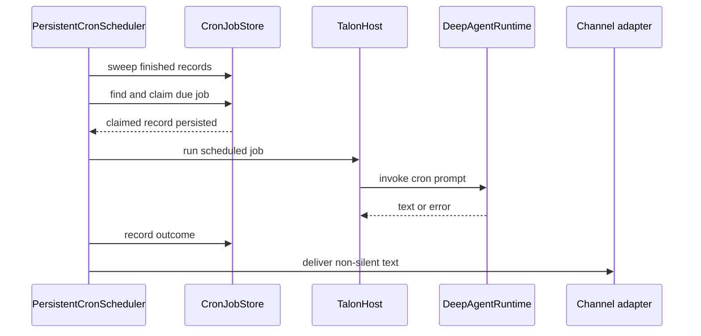
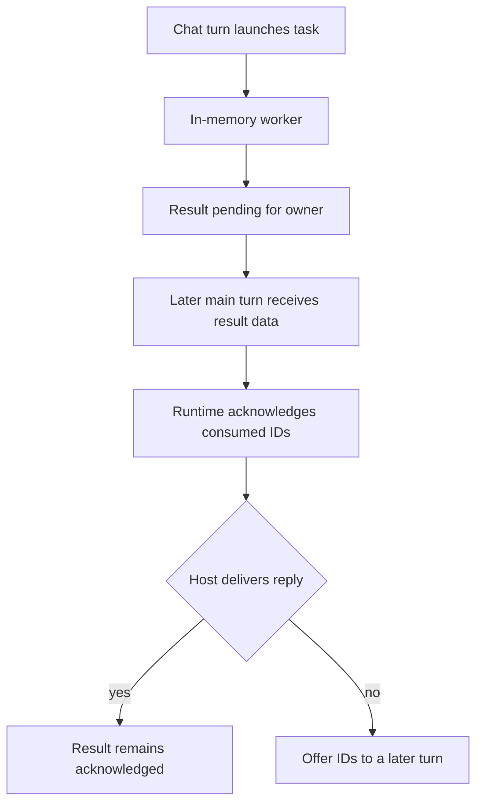

# Talon Scheduling and Background Work

Talon separates persistent scheduling from an interactive conversation. `CronJobStore` owns assistant-scoped `jobs.json`; `PersistentCronScheduler` claims due records and invokes callbacks; and `TalonHost` executes a scheduled prompt and delivers its report. The CLI installs the scheduler only when at least one channel is configured, wiring the host as the runner and delivery boundary.

> **Unattended execution.** Talon is experimental. A cron fire is delegated access to the installed assistant, not a user-attended session, sandbox, or a mechanism for waiting on an approval or login.

## Persistent jobs and lifecycle

A job persists its prompt, parsed schedule, repeat and end limits, enabled and next-run state, most recent outcome, origin, delivery preference, claim state, and optional pinned skills. Agent tools create, list, edit, and remove jobs using the current trusted origin. They accept relative one-shot and recurring schedules, explicit-timezone wall-clock schedules, and standard five-field cron forms; timezone-aware forms retain local-time behavior across daylight-saving changes.

The origin is host-derived metadata rather than a model-chosen destination. It scopes job management and identifies the provider/conversation to which a result may be sent. `deliver_to` controls only whether a threaded channel result is addressed to the thread or its top-level channel; it does not broaden which jobs the caller can manage.

*The scheduler persists the claim before it executes the occurrence, then attempts delivery only after it has text.*

Each tick first discards eligible finished records, obtains due jobs, and processes them sequentially. Before invoking the host, `advance_next_run` rechecks that the record remains enabled and due, advances or completes its schedule, and persists the claimed record. This gives an occurrence at-most-once behavior: a process failure after that write does not automatically make it due again. A late occurrence outside the short `until` grace window is finished instead of delivered after the requested window. Failed and unresolved claimed records are retained for inspection, while `prune_completed` is the explicit retention cleanup path.

The scheduler records invocation exceptions as errors. It records a returned result as `ok` before output handling, suppresses blank output and text with `[SILENT]` at either trimmed end, and overwrites the outcome with an error if delivery raises. An unexpected tick failure is logged and retried after the normal tick interval, rather than terminating the ticker.

## Scheduled execution, authority, and delivery

For each fire, the host locks a stable root derived from the job ID but creates a unique run conversation ID. Fires of one job are serialized, while each starts with fresh checkpointed history rather than continuing an earlier scheduled prompt. A run is bounded to 30 minutes. On timeout, or cancellation caused by revoking the paired sender that created a DM job, the host attempts checkpoint interruption recovery before reporting failure.

The invocation carries `trigger: "cron"`, the durable origin, and any pinned skills. When persistent history is available and the origin adapter remains available, it can also receive the origin chat's read-only history scope. The runtime disables archive scope for cron turns, so the execution itself does not create an attended transcript entry; a successfully delivered final reply can still be recorded in delivery history.

Cron receives neither host approval nor authorization handlers. The runtime also auto-rejects tool-approval interrupts for `trigger: "cron"`; protected interactive actions therefore cannot be completed by waiting for a person. This posture extends to cron delegation.

For non-silent output, the host resolves the recorded provider adapter, chooses the thread or channel target from `deliver_to`, and uses `send_with_retry`. If sending succeeds, it may record delivery history. The standard CLI delivery adapter logs and drops a result when no adapter still serves the stored origin, so removing a provider can leave a successfully executed job without a report.

## Skills and schedule configuration

A job can pin at most eight lowercase skill names. Validation removes duplicates without changing their order and intentionally does not require a skill to be installed when the job is created, because skill availability can change before a fire. The host forwards them as `pinned_skills`, and the runtime consumes that metadata only for cron requests; ordinary channel metadata cannot inject pinned skills into a turn.

Cron is not a multi-process scheduler. Store instances sharing a resolved `jobs.json` path share a reentrant lock only within the current process, covering complete reads and mutations but never execution or delivery. Operate one owner process per jobs file.

## Detached chat subagents and result handoff

`BackgroundSubagents` gives ordinary attended turns a different model. `task` and `start_async_task` create in-memory workers owned by the conversation and return a task ID immediately. The conversation can continue while the worker runs; completed results are injected as data into a later main-agent turn. Jobs and results are process-local and disappear on restart.

The table holds at most 128 jobs. Detached workers share a configurable cross-conversation limit (four by default); excess launches are refused. A worker has a one-hour timeout and its stored text is limited to 64,000 characters. It inherits useful scoped context but explicitly clears the authorization handler, preventing an approval from surviving the originating turn.

*Acknowledgement means the main agent completed a turn that consumed the result, not that the user received its reply.*

If a main turn fails while consuming pending results, the runtime increments their delivery count and drops a result after three failed attempts. If the model completed but the host discards or cancels the reply before delivery, the host requeues only the IDs consumed by that reply. This avoids silently losing work while not resurrecting unrelated, cancelled, or pruned work. Cancelling a conversation's background workers also discards its pending results.

## Cron delegation is inline

A scheduled turn has no future user turn to receive detached work. Its `task` and `start_async_task` calls therefore run to completion within the current tool call; no background job or later delivery is created. The runtime replaces detached-work guidance, hides `list_subagents` and `cancel_subagent`, and prohibits nested delegation.

Inline cron work uses a separate four-slot semaphore, so fan-out queues rather than consuming the detached-chat capacity or being refused. One operation has a 10-minute default timeout and returned text is clamped to 64,000 characters. Timeout and failure become safe tool error messages rather than escaping the graph and causing a whole-turn retry that could relaunch sibling delegations.

## Remote async subagents

Remote definitions are loaded from `[async_subagents]` tables in `~/.deepagents/config.toml` by default. Each requires a nonempty name, `description`, and `graph_id`; `url` and string-to-string `headers` are optional. Loading is fail-closed: an invalid definition rejects the complete configuration rather than silently operating with fewer targets. When invoked, a remote subagent streams a LangGraph run with `on_disconnect="cancel"`; an interrupt becomes a safe approval-needed result and a stream error becomes a safe failure.

## Shutdown and operating guidance

Host shutdown cancels the background dispatch loop and in-flight work, then stops channels, the scheduler, and the runtime; component stop failures are logged and do not prevent later components from stopping. The runtime cancels background workers before closing its graph or checkpoint resources. If a worker outlives the cancellation wait, it raises and intentionally leaves those resources open rather than allowing a live worker to write through a closed checkpointer.

When changing this area, preserve the durable claim-before-run transition, trusted origin propagation, cron approval rejection, and the distinction between detached chat work and inline scheduled work.

## Focused tests

`libs/talon/tests/cron/test_scheduler.py` covers tick ordering, claims, outcomes, suppressed output, and delivery failures; `test_until.py` covers expiry behavior. `libs/talon/tests/unit_tests/test_scheduled_history.py` covers fresh scheduled conversations and read-only origin history. `test_background.py` covers capacity, ownership, cancellation, acknowledgement/requeue, delivery failure limits, inline cron delegation, and shutdown. `libs/talon/tests/test_async_subagents.py` covers loading and fail-closed validation of remote definitions.

See also [state persistence](./state-persistence.md), [subagents and skills](./subagents-skills.md), [Talon channel admission](./talon-channel-admission.md), [Talon integration](../integrations/talon.md), and [security operations](../operations/security.md).
