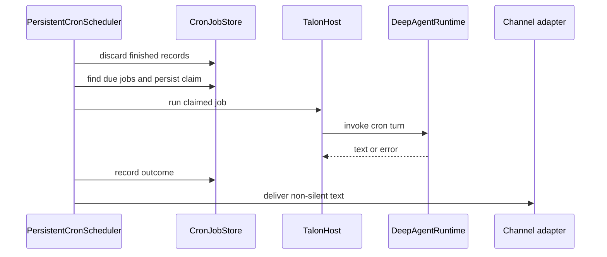
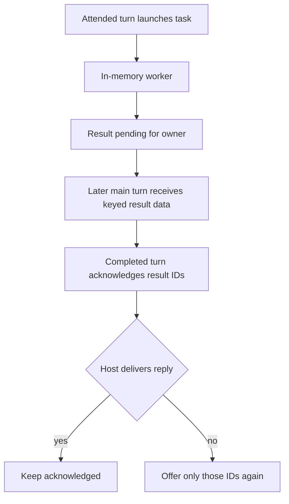

# Talon Scheduling and Background Work

Talon has two deliberately different asynchronous models. `CronJobStore` persists assistant-scoped scheduled prompts in `jobs.json`; `PersistentCronScheduler` claims due records and calls the host to run and deliver them. `BackgroundSubagents`, in contrast, retains process-local worker handles for an attended conversation and injects completed work into a later main-agent turn. The CLI installs a persistent scheduler only when channels are configured, wiring it to `TalonHost.run_scheduled_job` and the cron delivery callback.

> **Security boundary:** Talon is experimental. A cron fire is unattended delegated access to the installed assistant, not an attended conversation, an approval queue, or a sandbox. Protected actions that interrupt for approval are rejected. A normal channel turn may use its supplied approval handler; its detached workers cannot carry that handler beyond the turn.

## Persistent scheduled jobs

A persisted job carries its prompt, parsed schedule, recurrence/end limits, enabled and next-run state, last outcome/error, trusted origin, delivery selection, claim timestamp, and optional pinned skills. Cron tools create, list, edit, and remove jobs **only in the current origin scope**. They support relative one-shot and recurring times, timezone-aware wall-clock times, and five-field cron expressions. Wall-clock and cron schedules retain local-time semantics across daylight-saving changes.

The origin is host-derived metadata, not a destination chosen by the model. It scopes job management and identifies the provider/conversation eligible for delivery. `deliver_to` only selects a threaded result target—thread or top-level channel—and does not expand who can view or modify jobs.

*Scheduled lifecycle: claim/advance is durable before execution; delivery follows a successful non-silent run.*

Each tick sweeps finished records, then handles due jobs sequentially. `advance_next_run` rechecks that a job is enabled and due, advances or finishes its schedule, and persists the claim before host invocation. Consequently, an occurrence is effectively at-most-once: if the process fails after the claim write, that occurrence is not made due again. A job past `until` beyond its small tick-latency grace is finished rather than run after its requested window. Finished successful jobs can disappear during the sweep; failed or unresolved claimed jobs are retained for inspection and `prune_completed` is the retention cleanup path.

The scheduler marks exceptions from execution as errors. For returned text it first records `ok`, suppresses blank output and output with `[SILENT]` at either trimmed end, then changes the outcome to an error if delivery raises. A failed tick is logged and retried at the normal tick interval instead of killing the ticker.

## Cron invocation, authority, and delivery

For every fire, the host locks a stable root based on the job ID, but creates a unique run conversation ID. Thus fires of the same job serialize while each begins with fresh checkpointed history, rather than continuing a previous scheduled prompt. The host bounds a run to 30 minutes; on timeout, or when revocation of the paired DM sender cancels the run, it attempts checkpoint interruption recovery before reporting failure.

The host supplies `trigger: "cron"`, the durable origin metadata, and any pinned skills. If persistent history and the origin adapter are available, the run receives the origin chat's history scope read-only. The runtime does not archive the cron turn into that chat's history, although a final reply successfully delivered by the host may be recorded as delivery history.

Cron receives no host approval or authorization handler. The runtime auto-rejects approval interrupts for `trigger: "cron"`, so cron cannot wait for a person to authorize a protected action. Its model is also told that delegation completes within the current turn; this avoids a scheduled answer ending while work is still pending.

For non-silent text, the CLI delivery callback resolves the stored origin's channel adapter; if none remains, it logs and drops the result rather than retrying through another provider. Otherwise `TalonHost` uses `send_with_retry` against the selected channel/thread target. A send failure reaches the scheduler and changes that run's recorded outcome to an error.

## Skills, hooks, and graph assembly

A job can pin at most eight lowercase skill names. Validation deduplicates without changing order and does not require a skill to be installed at creation time. The host forwards the names as `pinned_skills`; the runtime admits this metadata only on cron requests and includes it in the model payload. Channel metadata cannot force pinned skills into an ordinary turn.

At the start of every runtime invocation, Talon reloads a trusted assistant-home hook configuration if `hooks.json` exists; workspace hooks are explicitly excluded. The resulting per-turn snapshot records committed messages and resolves hook interrupts before remaining tool-approval interrupts. It validates hook snapshot, thread, and prompt identities, so a hook request cannot be resumed in a different turn. Fresh local subagents receive an isolated child hook identity, prompt, and transcript while retaining the parent snapshot; their hook decisions still do not bypass Talon's approval policy.

## Detached work for attended chat

In an attended turn, `task` and `start_async_task` create in-memory conversation-owned workers and immediately return a task ID. The conversation can continue while work runs. When a worker has a result, the runtime inserts it as a keyed user-data message on a later main-agent turn; results and workers vanish on process restart.

The job table stores at most 128 entries. Running workers share a configurable, cross-conversation limit (four by default), so excess launches are refused. A detached worker is limited to one hour and 64,000 result characters. It gets necessary copied context, but clears the authorization handler and disables operator status; no approval prompt can outlive the originating turn. Ownership checks restrict inspection and cancellation to the owning conversation, and cancelling that conversation discards its pending results.

*Acknowledgement means that the main agent consumed the result, not that the user received the reply.*

If the main turn fails while processing offered results, the runtime counts the failed delivery attempt and drops a result after three failures. Once a main turn completes, it acknowledges the consumed IDs and returns them with `AgentResult`; if the host later discards, supersedes, or is cancelled before sending that reply, it requeues only those IDs. This prevents silently losing delivered work without resurrecting cancelled, pruned, or unrelated results.

### Scheduled delegation is inline

A scheduled turn has no later user turn to receive detached work. Therefore `task` and `start_async_task` run inline to completion: no background job or later handoff is created. The runtime changes delegation guidance, hides `list_subagents` and `cancel_subagent`, and blocks nested delegation.

Inline scheduled work uses a separate four-slot semaphore, so fan-out queues instead of consuming attended-worker capacity or returning a capacity refusal. Each call has a 10-minute default timeout and output is clamped to 64,000 characters. Timeout and failure become safe tool errors rather than escaping the graph and causing a retry that might relaunch sibling calls.

Remote async targets are read fail-closed from `[async_subagents]` in `~/.deepagents/config.toml` by default: each definition needs a name, description, and graph ID; optional URL and string headers are validated. A remote invocation streams with `on_disconnect="cancel"`; stream errors and approval interrupts become safe result text.

## Shutdown and operations

Cron-store locks serialize whole reads and mutations among store instances in the **same process** only. They do not coordinate processes, execution, or delivery. Run one owner process for a `jobs.json` file.

Host shutdown cancels its background dispatch loop and in-flight agent work, stops channels, then the scheduler, then the runtime. It logs a component stop failure and continues stopping later components. Runtime shutdown first cancels background workers; if one remains after the cancellation wait, it raises and deliberately leaves graph/checkpoint resources open so a live worker cannot write through a closed checkpointer.

When changing this area, preserve the durable claim-before-run transition, trusted origin propagation, cron approval rejection, hook identity isolation, and the distinction between inline scheduled delegation and detached attended work.

## Focused tests

`libs/talon/tests/cron/test_scheduler.py` covers claims, outcomes, silent output, delivery failure, ticker recovery, and sequential progress after a bounded stalled job. `libs/talon/tests/unit_tests/test_scheduled_history.py` covers fresh scheduled conversation IDs and read-only origin history. `libs/talon/tests/unit_tests/test_background.py` covers capacity, ownership, cancellation, acknowledgement/requeue, failed deliveries, remote cancellation, inline cron delegation, and shutdown. `libs/talon/tests/unit_tests/test_hooks.py` covers trusted hook loading, approval interaction, per-turn isolation, and child-subagent hook contexts. `libs/talon/tests/test_runtime.py` covers runtime graph wiring, tool refresh/reload, and local/remote subagent assembly.

See also [state persistence](./state-persistence.md), [subagents and skills](./subagents-skills.md), [Talon channel admission](./talon-channel-admission.md), [Talon integration](../integrations/talon.md), and [security operations](../operations/security.md).
