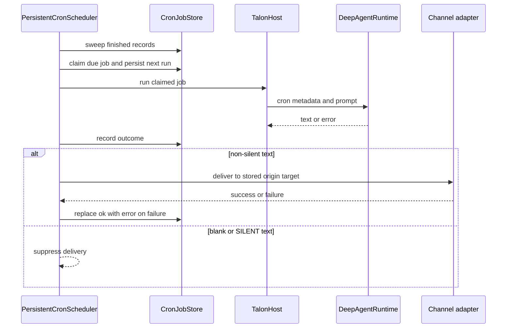
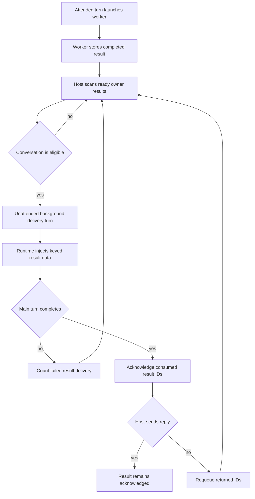

# Talon Scheduling and Background Work

Talon has two deliberately different deferred-work mechanisms. `PersistentCronScheduler` persists assistant-scoped jobs in `jobs.json`, claims due fires, invokes the host, and delivers returned text. `BackgroundSubagents` keeps workers in process for an attended chat conversation and injects their completed results into a later main-agent turn; neither workers nor results survive a restart. The CLI installs the persistent scheduler only when at least one channel is configured, wiring it to `TalonHost.run_scheduled_job` and a delivery callback.

> **Unattended authority boundary:** Talon is experimental. Cron fires and background-result delivery turns have no approval or authorization handler. The runtime automatically rejects approval interrupts for `trigger: "cron"`; detached workers also clear the authorization handler inherited from their launching turn, so an authorization prompt cannot outlive the party able to answer it.

## Persistent cron lifecycle

A persisted job contains the prompt, schedule and recurrence/end state, next run, last status/error, trusted origin, delivery choice, claim timestamp, and optional pinned skills. Cron tools create, list, edit, and remove only jobs in the current origin scope. They accept relative one-shot or recurring schedules, timezone-aware wall-clock schedules, and five-field cron schedules. Wall-clock and cron forms retain their local-time meaning across daylight-saving changes. `deliver_to` selects only a channel-versus-thread result target; it does not widen management scope or alter the originating conversation.

*Scheduled lifecycle: durable state advances before execution, and a delivery failure becomes a failed run.*

Each tick first sweeps finished records and then processes due jobs sequentially. `advance_next_run` rechecks eligibility and writes the advanced or completed state before invoking the host. This claim-before-run design is effectively at-most-once per occurrence: a process failure after the claim is durable does not make that occurrence due again. A job past `until` beyond a small tick-latency grace is finished instead of being delivered after its requested window. An unexpected tick failure is logged and retried at the normal interval.

An invocation exception is recorded as an error. After returned text, the scheduler records `ok`, suppresses empty text and text whose trimmed start or end is `[SILENT]`, and changes the outcome to error if delivery raises. The host resolves the recorded origin channel and uses `send_with_retry` for the selected target; a missing origin adapter does not cause a result to be rerouted elsewhere.

### Host execution, history, and skills

For each fire, the host locks a stable per-job cron root but creates a unique run conversation ID. Fires of a single job serialize, yet each starts with fresh checkpointed history rather than continuing a prior scheduled prompt. A run is bounded to 30 minutes. On timeout, or when revocation of the paired sender stops a scheduled DM run, the host attempts checkpoint interruption recovery before reporting the failure.

The host supplies `trigger: "cron"`, origin metadata, and pinned skills. If persistent history and the origin adapter are available, a cron turn can read the origin chat history scope but does not archive its own execution transcript there. A final reply enters history only after host-confirmed delivery.

A job may pin at most eight validated lowercase skill names. Validation de-duplicates while preserving first-seen order and does not require a skill to be installed yet. The host forwards these names as `pinned_skills`; the runtime accepts that metadata only for a cron request and injects it into graph/model assembly. Channel metadata cannot force skill pinning.

Hooks are per turn: Talon loads only trusted assistant-home `hooks.json`, not workspace hooks, and validates hook snapshot, thread, and prompt identity before resuming an interrupt. Fresh local subagents get isolated hook identities and transcripts while retaining the parent turn's hook snapshot.

## Attended-chat background subagents

In an attended turn, `task` and `start_async_task` create in-memory workers owned by the conversation and immediately return a task ID. The table holds at most 128 entries. Running workers share a configurable cross-conversation limit (four by default, via `DEEPAGENTS_TALON_MAX_BACKGROUND_TASKS`), have a one-hour timeout, and clamp results to 64,000 characters. At capacity, an attended launch is refused rather than queued.

Workers retain necessary copied context but receive neither authorization handler nor approval operator. Failure, timeout, remote stream failure, or an approval interrupt becomes safe result text rather than a leak of arguments or credentials. Remote definitions load fail-closed from `[async_subagents]` in `~/.deepagents/config.toml`: every definition needs its table name, `description`, and `graph_id`; optional URL and string headers are validated. Remote streams use `on_disconnect="cancel"`.

Only the owning conversation can list, inspect, message, or cancel its workers. `inspect_subagent` can return that worker's final result, bounded lifecycle/model/tool metadata, and message receipt IDs/statuses; its activity stream omits reasoning, arguments, tool output, and message text. Guidance is limited to Talon-built local `task` workers: a nonblank message up to 2,000 characters enters a 20-message inbox and is injected at the next worker model boundary. It does not interrupt an active model or tool call.

*Background-result delivery: acknowledgement records main-turn consumption, while requeue repairs an acknowledged result whose reply never reached the conversation.*

While running, the host polls about once per second. It skips an owner whose conversation/history scope is locked, whose agent turn is active, whose conversation is blocked or superseded, or which has no ready result. It claims a capped exponential-backoff slot before starting an unattended `background_delivery` follow-up.

The runtime tracks results exposed to a main turn and acknowledges them only after that turn completes. A failed (non-cancelled) turn increments the selected result's delivery count; after three failed processing attempts, the result is dropped. `AgentResult` returns acknowledged IDs to the host. If a newer turn supersedes the reply, or cancellation occurs before delivery, the host requeues only those IDs. Cancelled or already-pruned work is not resurrected.

## Scheduled delegation is inline

A cron turn has no later user turn into which detached work could be delivered. For `trigger: "cron"`, `task` and `start_async_task` run inline and return their result in the same turn; they create no background job. Scheduled guidance explains this difference, inspection, messaging, listing, and cancellation tools are hidden, and nested delegation is refused.

Inline scheduled calls use a separate four-slot semaphore and queue rather than consuming the attended-worker limit or returning a capacity refusal. The default timeout is 10 minutes and can be changed with `DEEPAGENTS_TALON_INLINE_SUBAGENT_TIMEOUT`; answer text is capped at 64,000 characters. Timeout or failure becomes a safe tool error, preventing a retryable escaping error from relaunching sibling delegation calls.

## Operations and safe changes

`CronJobStore` locks serialize complete reads and mutations only among store instances in the current process. They do not coordinate other processes, execution, or delivery, so a `jobs.json` file needs one owner process.

During host shutdown, Talon stops the background delivery loop, cancels in-flight work, stops channels and the scheduler, and finally stops the runtime. A component-stop failure is logged without preventing later shutdown steps. Runtime shutdown cancels background workers before closing graph/checkpoint resources. If workers outlive the cancellation wait, it raises and deliberately leaves those resources open rather than allowing live workers to write through a closed checkpointer.

When changing this area, preserve the durable claim-before-run transition, trusted origin propagation, cron approval rejection, worker ownership/privacy, and the distinction between detached attended work and inline scheduled delegation.

## Focused tests

`libs/talon/tests/cron/test_scheduler.py` covers claiming, outcomes, silent output, delivery failure, ticker recovery, and sequential execution. `libs/talon/tests/test_host.py` covers scheduled timeout recovery, serialization, background delivery, and scheduled delivery. `libs/talon/tests/unit_tests/test_scheduled_history.py` verifies fresh scheduled IDs and read-only origin history. `libs/talon/tests/unit_tests/test_background.py` exercises capacity, ownership, cancellation, acknowledgement/requeue, failure limits, remote cancellation, inline cron delegation, and shutdown. `libs/talon/tests/unit_tests/test_subagent_control.py` covers cooperative messages, privacy, and bounded retention.

See also [runtime behavior](../architecture/runtime-behavior.md), [subagents and skills](./subagents-skills.md), [Talon channel admission](./talon-channel-admission.md), [Talon integration](../integrations/talon.md), and [testing guide](../testing/testing-guide.md).
